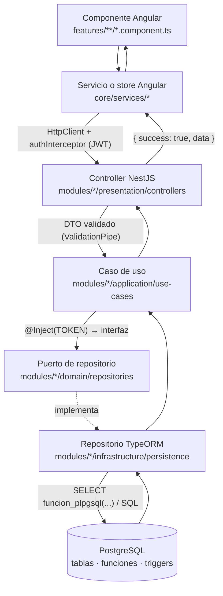

# Comercial Jhoel — Guía de estudio del código fuente

Manual técnico para **aprender, mantener, depurar y ampliar** el sistema. Sirve para abrir cualquier archivo y saber cuál es su propósito, qué clases y métodos contiene, de qué depende, quién lo usa y cómo viaja una operación desde la pantalla hasta PostgreSQL y de regreso.

> **Cómo se construyó.** Esta guía tiene dos partes:
>
> 1. **Referencia generada.** Un análisis estático con el compilador de TypeScript recorrió los 2,325 archivos `.ts`, las 379 plantillas y los scripts SQL. Se sumó el esquema real de PostgreSQL, consultado en solo lectura en la base de desarrollo. De ahí salen el inventario, las clases, los métodos con firma y líneas, los imports, los consumidores, los endpoints, las tablas y las funciones SQL. No hay datos inventados: si el código no tiene un comentario, la ficha lo indica.
> 2. **Capítulos explicativos escritos a mano.** Arquitectura, flujos, seguridad, glosario y ruta de aprendizaje, verificados contra el código, con rutas y líneas reales.
>
> El código del proyecto **no se modificó**. Las limitaciones del análisis automático están en [13_FINDINGS.md §6](docs/codebase-study/13_FINDINGS.md#6-limitaciones-del-análisis-automático).

## Cifras del código analizado

| Elemento | Cantidad |
|---|---|
| Archivos TypeScript (backend + frontend, incluidas las pruebas) | 2,325 |
| Plantillas HTML | 379 |
| Clases / métodos / funciones / interfaces | 2,143 / 5,099 / 604 / 1,496 |
| Endpoints HTTP | 440 (427 de 429 llamadas del frontend emparejadas con su endpoint) |
| Tablas / funciones SQL / migraciones | 110 / 202 / 112 |
| Módulos backend / áreas frontend documentadas | 54 / 73 documentos |

## Mapa de la documentación

| # | Documento | Qué contiene |
|---|---|---|
| 00 | [Inventario de archivos](docs/codebase-study/00_FILE_INVENTORY.md) | Resumen por módulo con enlaces al inventario detallado (ruta, tipo, capa, responsabilidad, dependencias, consumidores, importancia) |
| 01 | [Visión general](docs/codebase-study/01_PROJECT_OVERVIEW.md) | Tecnologías y versiones, carpetas, puntos de entrada, variables de entorno (solo nombres), Docker, comandos |
| 02 | [Arquitectura](docs/codebase-study/02_ARCHITECTURE.md) | Capas, inyección de dependencias, dónde está la lógica, transacciones, validación, errores, frontend y un recorrido real entre capas |
| 03 | [Referencia del backend](docs/codebase-study/03_BACKEND_REFERENCE.md) | Un documento por módulo: endpoints con su cadena controlador → caso de uso → repositorio → SQL, inventario y ficha de **cada** clase, método y función |
| 04 | [Referencia del frontend](docs/codebase-study/04_FRONTEND_REFERENCE.md) | Un documento por área: componentes (selector, plantilla, hijos, eventos), servicios, stores, modelos y cada método |
| 05 | [Base de datos](docs/codebase-study/05_DATABASE_REFERENCE.md) | Tablas por dominio con diagramas ER, columnas, llaves, índices, restricciones, triggers, funciones PL/pgSQL y migraciones |
| 06 | [Flujos de negocio](docs/codebase-study/06_BUSINESS_FLOWS.md) | Login, venta, compra, Transaccionar, apertura y saldos, Cuadre de Agentes, cortes, arqueo y Bodega, CxC, recargas; con diagramas de secuencia |
| 07 | [Seguridad y autenticación](docs/codebase-study/07_SECURITY_AND_AUTH.md) | JWT, guards, roles, permisos nombrados, validación, CORS, auditoría, datos sensibles |
| 08 | [Dependencias entre archivos](docs/codebase-study/08_FILE_DEPENDENCIES.md) | Grafo entre módulos, pantallas → servicios, dependencias circulares, archivos sin consumidores |
| 09 | [Glosario](docs/codebase-study/09_GLOSSARY.md) | Términos técnicos, de base de datos y del negocio |
| 10 | [RUTA_DE_APRENDIZAJE](docs/codebase-study/10_LEARNING_PATH.md) | Cinco niveles con los archivos a estudiar en orden |
| 11 | [Ejemplos prácticos](docs/codebase-study/11_PRACTICAL_EXAMPLES.md) | Cómo seguir a mano en VS Code una pantalla, una petición, una validación, una consulta, un guardado y la actualización de la interfaz |
| 12 | [Catálogo de endpoints](docs/codebase-study/12_API_ENDPOINTS.md) | Las 440 rutas con su controlador, guards y el método Angular que las llama |
| 13 | [Hallazgos](docs/codebase-study/13_FINDINGS.md) | Código sin uso, ciclos, duplicaciones, inconsistencias y límites del análisis |
| — | Índice de símbolos: [backend](docs/codebase-study/index/backend.md) · [frontend](docs/codebase-study/index/frontend.md) | Toda clase, componente, caso de uso, interfaz, tipo, enum, función y método, con enlace al código y a su ficha |
| — | [Diagramas de flujo del sistema](docs/flowcharts/README.md) | Arquitectura, mapas por módulo, flujos de decisiones de cada operación, secuencias, procesos financieros y base de datos |
| — | Diagramas Mermaid: [architecture](docs/codebase-study/diagrams/architecture.mmd) · [module_dependencies](docs/codebase-study/diagrams/module_dependencies.mmd) · [database_relationships](docs/codebase-study/diagrams/database_relationships.mmd) · [business_flows](docs/codebase-study/diagrams/business_flows.mmd) | Fuentes `.mmd` reutilizables |

## La arquitectura en un minuto



- **Backend:** NestJS con Clean Architecture **por módulo** (dominio, aplicación, infraestructura, presentación). Cada módulo usa a los demás a través de sus puertos.
- **Dinero y stock:** solo los escriben **funciones PL/pgSQL** atómicas (por ejemplo `apply_bank_account_movement`, `apply_cash_movement`, `adjust_sale_item`), con bloqueos, idempotencia y anulación por movimiento inverso.
- **Validación en tres niveles:** DTO, caso de uso y SQL. El frontend solo muestra vistas previas.
- **Frontend:** Angular 19 con componentes *standalone*, signals, `OnPush`, servicios HTTP por recurso, stores singleton e interceptores.

## Cómo usar esta guía

1. **Primera vez:** sigue la [RUTA_DE_APRENDIZAJE](docs/codebase-study/10_LEARNING_PATH.md) nivel por nivel.
2. **Para entender un archivo:** búscalo en el [índice de símbolos](docs/codebase-study/index/backend.md) o abre el documento de su módulo (secciones 03/04). Su ficha dice responsabilidad, dependencias, consumidores y el detalle de cada método.
3. **Para seguir una operación:** busca la ruta en el [catálogo de endpoints](docs/codebase-study/12_API_ENDPOINTS.md) y luego su fila en la tabla "Endpoints HTTP y recorrido por capas" del módulo.
4. **Para la base de datos:** [05_DATABASE_REFERENCE.md](docs/codebase-study/05_DATABASE_REFERENCE.md). Cada función SQL lista qué tablas escribe y desde qué método TypeScript se llama.
5. **Documentación de los autores:** `comercial-jhoel-api/CLAUDE.md` y `comercial-jhoel-app/CLAUDE.md` explican el *porqué* de muchas decisiones; esta guía se centra en el *cómo*.

## Regenerar la referencia

La parte generada refleja el código al momento del análisis; las rutas y los números de línea son de esta versión. Cuando el código cambie, regenérala con:

```bash
DB_USER=<usuario> DB_NAME=<base> docs/codebase-study/tools/run.sh
```

El script analiza el código, lee el esquema en solo lectura, reescribe solo los documentos generados y valida enlaces, rutas, símbolos y diagramas. Los capítulos escritos a mano no se tocan. Detalles en [docs/codebase-study/tools/README.md](docs/codebase-study/tools/README.md).
