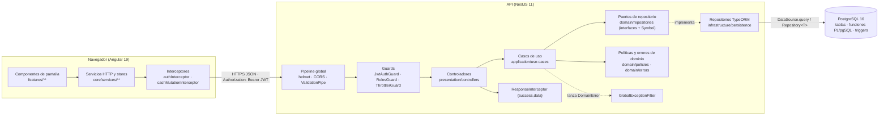
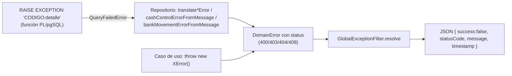

# 02 · Arquitectura

Volver a la [guía principal](../../CODEBASE_STUDY_GUIDE.md). Diagrama fuente: [diagrams/architecture.mmd](diagrams/architecture.mmd).

## 1. Vista de conjunto

Dos ideas resumen el diseño:

1. **Backend con Clean Architecture por módulo.** Cada contexto de negocio (`sales`, `banks`, `cash-control`…) es un módulo Nest con cuatro capas propias. Los módulos no se meten en la infraestructura de otros: se comunican por los *tokens* de sus puertos.
2. **La base de datos es la autoridad en lo financiero.** Toda escritura con dinero o stock la hace **una función PL/pgSQL** (`confirm_sale`, `register_bank_deposit_operation`, `apply_cash_movement`, `close_agent_day`…). El repositorio la llama con un solo `SELECT funcion(...)`. Así la operación es atómica, usa bloqueos, revalida las reglas y es la única que escribe saldos.

## 2. Capas del backend

| Capa | Carpeta | Responsabilidad | Puede depender de | Ejemplo real |
|---|---|---|---|---|
| **Dominio** | `modules/<m>/domain/` | Entidades (constructor privado + `static create()`), interfaces de repositorio con su token `Symbol`, errores (`extends DomainError` con `status`), políticas puras. Sin Nest ni TypeORM. | Solo TypeScript y `shared/domain` | `banks/domain/repositories/agent-reconciliation.repository.ts` (`AGENT_RECONCILIATION_REPOSITORY`, `CloseAgentDayData`) |
| **Aplicación** | `modules/<m>/application/` | Un caso de uso por acción (`@Injectable` con `execute(input)`): valida reglas, revisa permisos, orquesta repositorios y devuelve objetos planos (`to*Output`). | Dominio propio y **puertos** de otros módulos | `banks/application/use-cases/close-agent-day.use-case.ts` (`CloseAgentDayUseCase.execute`, L112–159) |
| **Infraestructura** | `modules/<m>/infrastructure/` | Implementa los puertos: entidades `*.orm-entity.ts`, `*.mapper.ts`, repositorios `TypeOrm*Repository` (SQL crudo y llamadas a funciones), traducción de errores SQL. | Dominio, TypeORM, `pg` | `banks/infrastructure/persistence/typeorm-agent-reconciliation.repository.ts` (`closeDayWithReconciliation`, L31–72) |
| **Presentación** | `modules/<m>/presentation/` | Controladores delgados (rutas, guards, `@CurrentUser`) y DTO de entrada con `class-validator`. | Aplicación | `banks/presentation/controllers/agent-reconciliations.controller.ts` |

Código transversal: `src/shared/` contiene:

- `shared/domain/domain-error.ts`: clase abstracta `DomainError` con `status`.
- `shared/filters/global-exception.filter.ts`.
- `shared/interceptors/response.interceptor.ts`.
- `shared/decorators/current-user.decorator.ts` y `shared/decorators/roles.decorator.ts`.
- Los puertos `PasswordHasher` y `TransactionManager`, con sus implementaciones `BcryptPasswordHasher` y `TypeOrmTransactionManager`.

## 3. Inyección de dependencias

Patrón usado en todos los módulos:

1. El **puerto** se declara en dominio como `export const X_REPOSITORY = Symbol('X_REPOSITORY')` junto a `export interface XRepository { … }`.
2. El **módulo** registra la implementación: `{ provide: X_REPOSITORY, useClass: TypeOrmXRepository }` y la exporta si otro módulo la necesita.
3. El **caso de uso** la recibe con `@Inject(X_REPOSITORY) private readonly repository: XRepository`. Para importarla usa `import type`, así que solo depende de la interfaz.
4. Los casos de uso que usan otro caso de uso lo inyectan por su clase. Ejemplo: `CloseAgentDayUseCase` recibe `GetCuadreAgentesSummaryUseCase` y `ValidateBankBalancesForDateUseCase`.

En el frontend se usa `inject(Servicio)` como propiedad, por ejemplo `private readonly cashCustodyService = inject(CashCustodyService)`, y los servicios son `@Injectable({ providedIn: 'root' })`.

## 4. Dónde está la lógica de negocio

Hay tres niveles, y **cada regla crítica se valida al menos dos veces**:

| Nivel | Qué valida | Ejemplo |
|---|---|---|
| DTO (`presentation/dtos`) | Forma y tipos: `@IsInt`, `@Min(0)`, `@IsIn(lista)`, `@IsUUID`. `forbidNonWhitelisted` rechaza campos no declarados. | `CreateAgentReconciliationRequestDto` solo acepta `totalCash`, `date`, `cashDetails`, `cashBreakdownSource`, `sourceCashCountId`. |
| Caso de uso (`application`) | Permisos por rol, estado del día, consistencia de datos y mensajes claros antes de ir a la base. | `assertCuadreCashBreakdown` (close-agent-day.use-case.ts) suma el desglose en centavos y lo compara con `totalCash`. |
| Función SQL (migraciones) | **La garantía real**: bloqueos, saldos leídos bajo lock, idempotencia y reglas repetidas dentro de la transacción. | `close_agent_day_with_cash_breakdown` vuelve a validar denominaciones y totales, y calcula por su cuenta `modified_after_load`. |

El frontend **no decide nada financiero**. Sus cálculos (totales en vivo, vistas previas) son solo de interfaz y el backend recalcula todo. Por ejemplo, en `CloseAgentDayUseCase` el `result` se recalcula con el resumen del servidor y no se acepta del cliente.

## 5. Acceso a datos

Se usan dos estilos, a veces en el mismo repositorio:

- **TypeORM con entidades** (`Repository<OrmEntity>`, `findOne`, `save`) para catálogos y CRUD simples, por ejemplo en `categories` y `products`.
- **SQL crudo** con `DataSource.query(sql, params)` para lecturas complejas y para llamar a funciones PL/pgSQL. Por ejemplo, `TypeOrmCashCustodyRepository.findLatestValidCount` (L448–480) ejecuta `SELECT … FROM cash_latest_count_candidate($1::date)`.

Los parámetros siempre van como `$1, $2…` y nunca se concatenan al SQL. Las columnas `numeric` (dinero) se convierten con `DecimalColumnTransformer` o con helpers `num()` en los repositorios, porque `pg` las devuelve como texto.

## 6. Manejo de errores

- `DomainError` (`shared/domain/domain-error.ts`) es abstracta y obliga a declarar `status`. `GlobalExceptionFilter.resolve` (`shared/filters/global-exception.filter.ts`) la revisa primero.
- Los errores `FINANCIAL_REVIEW_*` que lanza el trigger de revisión de días se traducen en el filtro global, sin importar qué repositorio ejecutó la consulta.
- Las respuestas exitosas se envuelven como `{ success: true, data }` (`ResponseInterceptor.intercept`, L28–35). El frontend las desenvuelve con `.pipe(map((r) => r.data))` en cada servicio.

## 7. Base de datos y transacciones

- **Una función = una transacción.** Las funciones PL/pgSQL corren dentro de la transacción de la llamada; un `RAISE EXCEPTION` deshace todo lo que hicieron. No hay `BEGIN`/`COMMIT` en TypeScript para estas operaciones.
- **Transacciones entre módulos**: el puerto `TransactionManager` (`shared/application/ports/transaction-manager.port.ts`) y su implementación `TypeOrmTransactionManager.runInTransaction`, que usa `dataSource.transaction(manager => work(manager))`. Lo usa `RegisterBankDepositOperationUseCase` para registrar el depósito y, en la misma transacción, el cargo de CxC o de Activos.
- **Concurrencia**:
  - `SELECT … FOR UPDATE` en las filas (productos, bancos, día).
  - Bloqueos consultivos `pg_advisory_xact_lock(hashtext('cash_control_main'))` y `'warehouse_cash_main'` para los Kardex de caja y Bodega.
  - Orden fijo de bloqueo (banco → caja → Bodega) para evitar interbloqueos.
- **Idempotencia**: columnas `idempotency_key` / `client_request_id` con `UNIQUE`. Si el usuario repite una solicitud (doble clic), recibe el mismo registro.
- **Inmutabilidad**: los Kardex, arqueos y fotos no se editan ni se borran. Una anulación crea el movimiento inverso, y triggers *guard* bloquean `UPDATE`/`DELETE`.
- **Esquema solo por migraciones** (`synchronize: false`): 112 migraciones en `src/database/migrations/`. Detalle en [05_DATABASE_REFERENCE.md](05_DATABASE_REFERENCE.md).

## 8. Arquitectura del frontend

| Pieza | Dónde | Cómo funciona |
|---|---|---|
| Componentes | `features/**`, `shared/ui/**`, `layout/**` | *Standalone* (declaran sus `imports`), en su mayoría `ChangeDetectionStrategy.OnPush`, con estado en `signal()`/`computed()`. |
| Servicios HTTP | `core/services/*.service.ts` | Un servicio por recurso del backend; construyen la URL desde `environment.apiUrl` y devuelven `Observable<T>` ya desenvuelto. |
| Stores de estado | `core/services/*.store.ts`, `*-state.service.ts` | Singletons `providedIn: 'root'` con signals que sobreviven a la navegación (`SalesDraftStore`, `BankDepositDraftStore`, `CuadreAgentesStateService`). |
| Interceptores | `core/interceptors/` | `authInterceptor` agrega `Authorization: Bearer` y, ante un 401, cierra la sesión. `cashMutationInterceptor` avisa a `CashControlSyncService` tras cada escritura de dinero exitosa, para refrescar pantallas y otras pestañas por `BroadcastChannel`. |
| Guards | `core/guards/` | `authGuard` (sesión), `adminGuard` (rol SUPER_ADMIN/ADMIN), `guestGuard` (solo sin sesión). Son de UX: la seguridad real está en el backend. |
| Rutas | `app.routes.ts` | Carga diferida (`loadComponent: () => import(...)`) y `/dashboard` con sus hijos. |
| Modelos | `core/models/*.model.ts` (barrel `index.ts`) | Interfaces de las respuestas del API y funciones puras de cálculo de UI. |

## 9. Ejemplo real de recorrido entre capas: "Cargar último arqueo de Caja"

| # | Capa | Archivo y método | Qué hace |
|---|---|---|---|
| 1 | Plantilla | `features/dashboard/bank-agents/components/cuadre-cash-source/cuadre-cash-source.component.html` | El botón emite `loadLatest`. |
| 2 | Componente | `cuadre-agentes-page.component.ts` → `CuadreAgentesPageComponent.loadLatestCount` (L271–324) | Si hay cantidades tecleadas a mano, pide confirmación con `ConfirmDialogService.confirm`. Luego llama al servicio con la fecha de operación (`draft.operationDate()`). |
| 3 | Servicio | `core/services/cash-custody.service.ts` → `CashCustodyService.getLatestCount` (L57–63) | `GET {apiUrl}/cash-control/counts/latest?businessDate=…` y `map(r => r.data)`. |
| 4 | Interceptor | `core/interceptors/auth.interceptor.ts` → `authInterceptor` | Agrega el JWT. |
| 5 | Guard | `JwtAuthGuard` → `JwtStrategy.validate` (L28–41) | Verifica el token, vuelve a leer el usuario y su rol actual, y rechaza si está inactivo. |
| 6 | Controlador | `cash-control/presentation/controllers/cash-custody.controller.ts` → `CashCustodyController.latestCount` (L133–142) | `LatestCashCountQueryDto` validado; pasa `role` desde `@CurrentUser()`. |
| 7 | Caso de uso | `cash-control/application/use-cases/cash-custody.use-cases.ts` → `GetLatestCashCountUseCase.execute` (L375–392) | `assertCashCustodyPermission(role, 'cash_custody.view')`, valida la fecha, llama al puerto y completa las 12 denominaciones con `completeBreakdown`. |
| 8 | Puerto | `cash-control/domain/repositories/cash-custody.repository.ts` → `findLatestValidCount` | Contrato e interfaz `LatestCashCountCandidate`. |
| 9 | Repositorio | `cash-control/infrastructure/persistence/typeorm-cash-custody.repository.ts` → `TypeOrmCashCustodyRepository.findLatestValidCount` (L448–480) | Resuelve el día de referencia con `cash_current_bank_day()` y llama a `cash_latest_count_candidate($1)`. |
| 10 | SQL | Migración `1760007700000-CuadreBreakdownFromLatestCut.ts` → `cash_latest_count_candidate` | Devuelve **una** fila: el arqueo vigente del corte 2 finalizado (`cash_cut_counts` + `cash_cut_count_details`). |
| 11 | Respuesta | `ResponseInterceptor` | `{ success: true, data: { count, breakdown, referenceBusinessDate, isFromReferenceDay } }`. |
| 12 | Estado | `CuadreAgentesStateService.loadFromCount` (L45–48) | Copia las cantidades y guarda el origen. Las signals `cashCounts`/`origin` hacen que la tabla, el total y el aviso se vuelvan a pintar. |
