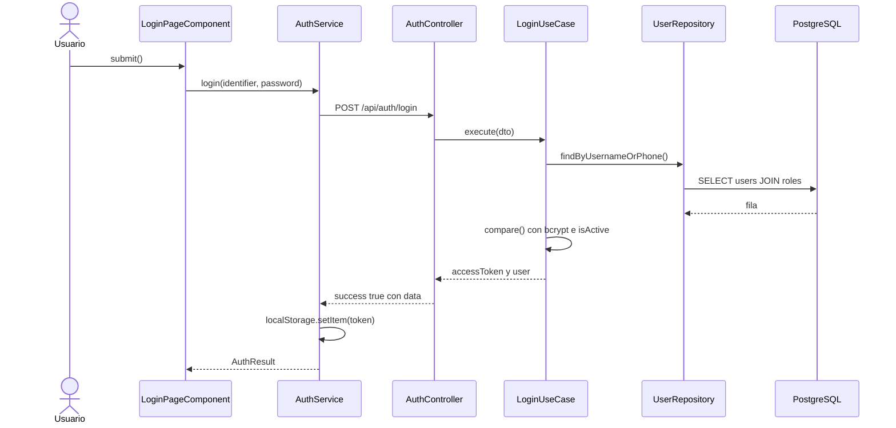
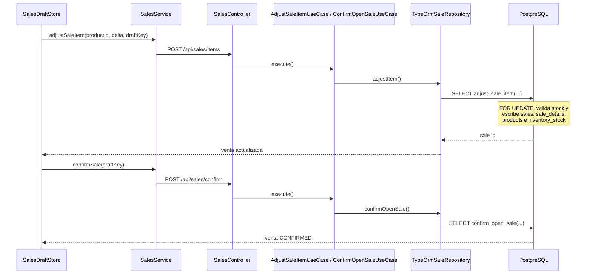
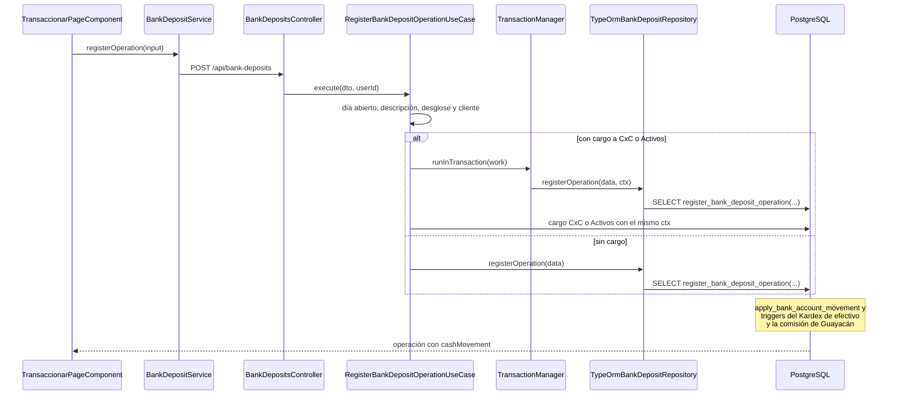
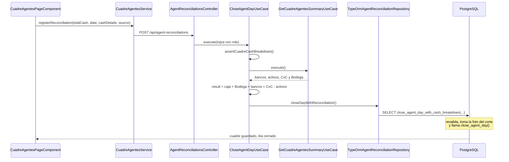

# 06 · Flujos de negocio

Volver a la [guía principal](../../CODEBASE_STUDY_GUIDE.md). Cada flujo se reconstruyó con la cadena real **componente → servicio → endpoint → controlador → caso de uso → repositorio → función SQL** extraída del código (ver las tablas "Endpoints HTTP y recorrido por capas" de cada módulo en [03_BACKEND_REFERENCE.md](03_BACKEND_REFERENCE.md)). Las rutas de archivo son relativas a `comercial-jhoel-app/src/app/` (frontend) o `comercial-jhoel-api/src/modules/` (backend). Los números de línea son los del código analizado. Archivo Mermaid combinado: [diagrams/business_flows.mmd](diagrams/business_flows.mmd).

Respuesta estándar de todo endpoint: `{ success: true, data }` (`ResponseInterceptor`) o `{ success: false, statusCode, message, timestamp }` (`GlobalExceptionFilter`).

---

## 1. Inicio de sesión

1. **Acción:** el usuario escribe su usuario o teléfono y su contraseña.
2. **Componente:** `features/auth/login/login-page.component.ts` → `LoginPageComponent.submit` (L31–52).
3. **Servicio:** `core/services/auth.service.ts` → `AuthService.login` (L61–74): `POST /api/auth/login`.
4. **Backend:** `auth/presentation/controllers/auth.controller.ts` → `AuthController.login` (L27–33). Lo protege `ThrottlerGuard` con `@Throttle({ default: { limit: 5, ttl: 60_000 } })`.
5. **Caso de uso:** `auth/application/use-cases/login.use-case.ts` → `LoginUseCase.execute` (L33–71):
   - `userRepository.findByUsernameOrPhone(identifier.trim())`; si no existe → `InvalidCredentialsError`.
   - `passwordHasher.compare(password, user.passwordHash)` (`BcryptPasswordHasher`); si falla → `InvalidCredentialsError`.
   - Si `!user.isActive` → `InvalidCredentialsError`. Es **el mismo error en los tres casos**, para no revelar qué usuarios existen.
   - `tokenService.sign({ sub, username, role })` (`NestJwtTokenService`) → `{ accessToken, user }`.
6. **Tablas:** `users`, `roles` (rol con carga eager).
7. **Frontend:** guarda el token en `localStorage` (`cj_auth_token`) y la sesión, y navega al dashboard.
8. **Siguientes peticiones:** `authInterceptor` agrega `Authorization: Bearer`. `JwtStrategy.validate` vuelve a leer el usuario **en cada petición** y usa el rol de la base, no el del token.

---

## 2. Venta (recibo con reserva de stock en tiempo real)

1. **Acción:** el cajero agrega productos al recibo y luego pulsa "Guardar venta".
2. **Store:** `core/services/sales-draft.store.ts` → `SalesDraftStore.onProductSelected` (L169–171) llama al método privado `adjustItem`, que llama `SalesService.adjustSaleItem(productId, quantityDelta, draftKey)` (`core/services/sales.service.ts` L59–63) → `POST /api/sales/items`.
3. **Backend:** `SalesController.adjustItem` (`sales/presentation/controllers/sales.controller.ts` L136–142) → `AdjustSaleItemUseCase.execute` (L32–46) → `TypeOrmSaleRepository.adjustItem` (L139–164) → **`adjust_sale_item(user, product, delta, presentation, location, draft_key)`**.
4. **Reglas en SQL:** bloquea el producto y la línea (`FOR UPDATE`); al reservar (`delta > 0`) exige producto activo y stock suficiente (`INSUFFICIENT_STOCK`, `PRODUCT_INACTIVE`, `INVALID_QUANTITY`); al liberar no exige nada; escribe `sales` (borrador `OPEN` por `draft_key`), `sale_details`, `products.stock` e `inventory_stock`.
5. **Confirmar:** `SalesDraftStore.confirmSale` (L259–283) → `POST /api/sales/confirm` → `ConfirmOpenSaleUseCase.execute` (L18–29) → `TypeOrmSaleRepository.confirmOpenSale` (L182–216) → **`confirm_open_sale(user, draft_key)`**, que escribe `sales` (estado `CONFIRMED`) e `inventory_movements`. El stock ya se había reservado, así que confirmar no lo vuelve a descontar.
6. **Interfaz:** el store quita la pestaña (`removeDraftLocally`), muestra la notificación y ofrece el PDF (`exportSalePdf`).

---

## 3. Compra a proveedor

1. **Componente:** `features/dashboard/purchases/purchases-page.component.ts` → `PurchasesPageComponent.confirmSave` (L184–230).
2. **Servicio:** `PurchasesService.createPurchase` (L25–27) → `POST /api/purchases`.
3. **Backend:** `PurchasesController.create` → `CreatePurchaseUseCase.execute` (`purchases/application/use-cases/create-purchase.use-case.ts` L45–126). Une productos repetidos, ordena por `productId` para evitar interbloqueos y rechaza fechas futuras → `TypeOrmPurchaseRepository.confirmPurchase` (L42–89) → **`confirm_purchase(supplier, user, date, items, payment_type, …)`**.
4. **SQL:** valida proveedor y productos activos, cantidades y precios (`PURCHASE_EMPTY`, `INVALID_QUANTITY`, `INVALID_PRICE`, `PRODUCT_INACTIVE`, `PAYMENT_DUE_DATE_REQUIRED`…). Escribe `purchases`, `purchase_details`, `products` (stock y precios), `inventory_stock`, `inventory_movements` y `product_presentations`.
5. **Importes:** total de línea = `cost_price × cantidad`. El precio público se guarda para actualizar el producto, pero no entra en el total.

---

## 4. Transaccionar (depósito, retiro u otra transacción bancaria)

1. **Componente:** `features/dashboard/transaccionar/transaccionar-page.component.ts` → `TransaccionarPageComponent.confirmSave` (L611–678), con el borrador en `BankDepositDraftStore`.
2. **Servicio:** `BankDepositService.registerOperation` (L25–29) → `POST /api/bank-deposits`.
3. **Controlador:** `BankDepositsController.create` (`bank-deposits/presentation/controllers/bank-deposits.controller.ts` L70–93).
4. **Caso de uso:** `RegisterBankDepositOperationUseCase.execute` (`bank-deposits/application/use-cases/register-bank-deposit-operation.use-case.ts` L152–277):
   - El día de Agentes Bancarios debe estar abierto y no cerrado (`DayOpeningRepository.findByDate` → `BankDepositDayNotOpenedError` / `BankDepositDayAlreadyClosedError`).
   - Descripción / beneficiario obligatoria, de hasta 250 caracteres (`InvalidBankDepositDescriptionError`).
   - Coherencia del desglose de efectivo (`CashBreakdownRequiredError` / `CashBreakdownNotExpectedError`).
   - Si se indica, el cliente debe existir y estar activo. Es incompatible enviar la operación a CxC y a Activos a la vez; "Activos" solo aplica a ciertos tipos.
   - Sin cargo asociado, llama directamente a `bankDepositRepository.registerOperation`. Con cargo, abre `transactionManager.runInTransaction(...)`: registra la operación y luego `RegisterAccountReceivableChargeUseCase` o `RegisterAssetChargeUseCase` **en la misma transacción**.
5. **Repositorio:** `TypeOrmBankDepositRepository.registerOperation` (L48–96) → **`register_bank_deposit_operation(...)`**:
   - Valida que el efectivo sume el monto (`CASH_TOTAL_MISMATCH`) y que las transacciones también.
   - Escribe `bank_deposit_operations`, `bank_deposit_cash_details` y `bank_deposit_transactions`.
   - Aplica el saldo bancario con **`apply_bank_account_movement`** (bloquea la cuenta, valida límites y saldo, escribe `bank_account_movements` y `banks.final_balance`).
6. **Triggers en la misma transacción** (tabla `bank_deposit_operations`):
   - `trg_cash_bank_deposit_insert` → `cash_on_bank_deposit_insert()` escribe en el Kardex de efectivo según `transaction_types.cash_effect`.
   - `trg_guayacan_commission_insert` → `guayacan_commission_on_operation_insert()` registra la comisión y el efectivo de la Caja Guayacán. Solo aplica al banco agente Guayacán; `comercial-jhoel-api/CLAUDE.md` documenta las reglas.
   - Al anular (`is_voided`), `trg_cash_bank_deposit_void` y `trg_guayacan_commission_void` revierten.
7. **Interfaz:** `cashMutationInterceptor` avisa a `CashControlSyncService.notifyChanged` (L41–44) para que Control de Efectivo y la tira de saldos se refresquen.

---

## 5. Agentes Bancarios: apertura del día y saldos

1. **Apertura:** `BankAgentsPageComponent.confirmEntryModal` (L176–191) → `CuadreAgentesService.openDay` → `POST /api/banks/day-status/open` → `BanksController.openDay` → `OpenDayUseCase.execute` (`banks/application/use-cases/open-day.use-case.ts` L34–53) → `DayOpeningRepository.open` y `DayAuditLogRepository.record`.
   - Tablas: `day_openings`, `day_audit_logs`.
   - Trigger `trg_cash_bank_day_on_opening` (`day_openings`) → `cash_bank_day_on_opening()`: crea el ancla inmutable `cash_bank_day_openings`, desde donde se reinician los acumulados diarios de efectivo.
2. **Guardar saldos:** `BankAgentsPageComponent.confirmSaveChanges` (L326–364) → `BankBalanceService.saveBalances` → `POST /api/banks/balances` → `SaveBankBalancesUseCase.execute` (L46–90) → **`save_bank_balance(bank, date, final_balance, user)`** por cuenta (tabla `bank_balances`). Para "hoy" envía `NULL` y la función toma el saldo vivo bajo bloqueo.

---

## 6. Cuadre de Agentes (cierre del día)

1. **Componente:** `features/dashboard/bank-agents/cuadre-agentes-page.component.ts`.
   - `fetchSummary` → `GET /api/banks/cuadre-agentes-summary` → `GetCuadreAgentesSummaryUseCase` (bancos, activos, CxC y Bodega vía `warehouse_cash_balance()`).
   - Conteo de efectivo: manual o "Cargar último arqueo de Caja" (ver [02_ARCHITECTURE.md §9](02_ARCHITECTURE.md#9-ejemplo-real-de-recorrido-entre-capas-cargar-último-arqueo-de-caja)).
   - `confirmSaveCuadre` (L429–454) → `CuadreAgentesService.registerReconciliation(buildReconciliationInput())`.
2. **Backend:** `POST /api/agent-reconciliations` → `AgentReconciliationsController.create` → `CloseAgentDayUseCase.execute` (`banks/application/use-cases/close-agent-day.use-case.ts` L112–159):
   - Valida el desglose (`assertCuadreCashBreakdown`): denominaciones válidas, cantidades enteras ≥ 0, sin repetir, suma exacta en centavos igual a `totalCash`, y rol si el origen es un corte.
   - Verifica que el día esté abierto, no cerrado, y que haya saldos de todas las cuentas (`ValidateBankBalancesForDateUseCase`).
   - **Recalcula** el resultado: `result = totalCash + totalWarehouseCash + totalBanks + totalAccountsReceivable − totalAssets`, con los totales del servidor.
3. **Repositorio:** `TypeOrmAgentReconciliationRepository.closeDayWithReconciliation` (L31–72):
   - Con desglose → **`close_agent_day_with_cash_breakdown(...)`**: revalida, toma la foto del corte de origen y llama a `close_agent_day`.
   - Sin desglose → **`close_agent_day(...)`**.
   - Tablas: `agent_reconciliations`, `day_openings.closed_at`, `day_audit_logs`, `agent_reconciliation_cash_breakdowns` y `agent_reconciliation_cash_details`.
4. **Interfaz:** `state.reset()`, `dayStatusService.refresh()` (la pantalla pasa a "Día Cerrado") y `fetchSummary()`.

---

## 7. Control de Efectivo: cortes y movimientos

- **Kardex:** la tabla `cash_movements` es la única fuente del efectivo físico. Su único escritor es **`apply_cash_movement`** (bloqueo `cash_control_main`, saldo leído bajo el bloqueo, `idempotency_key` UNIQUE). `cash_balance()` devuelve el saldo actual.
- **Movimiento manual:** `CashMovementFormModalComponent.save` → `CashControlService.registerMovement` → `POST /api/cash-control/movements` (roles SUPER_ADMIN, ADMIN, SUPERVISOR_DE_TURNO) → `RegisterCashMovementUseCase` → `register_manual_cash_movement` (`cash_movements`, `cash_movement_details`).
- **Finalizar corte:** `CashCutFinishModalComponent.save` (L136–175) → `CashControlService.finishCut` → `POST /api/cash-control/cuts/:id/finish` → `FinishCashCutUseCase.execute` (`cash-cut-commands.use-cases.ts` L204–235) → **`finish_cash_cut_period(period, user, details, banks, …)`**:
  - Usa el bloqueo `cash_control_main`.
  - Exige la verificación de todas las cuentas activas (`CASH_CUT_BANKS_INCOMPLETE`).
  - Escribe `cash_cut_counts` (contado vs. sistema), `cash_cut_count_details`, `cash_cut_bank_reconciliations`, `cash_cut_events` y `cash_cut_periods`.
  - Calcula la diferencia como contado − sistema.

---

## 8. Arqueo de Caja y Entrega a Bodega

- **Arqueo:** `CashCountModalComponent.save` (L114–152) → `CashCustodyService.registerCount` → `POST /api/cash-control/counts` → `RegisterCashCountUseCase.execute` (L258–292) → **`register_cash_count`**:
  - Usa los bloqueos `cash_control_main` y `warehouse_cash_main`.
  - Escribe `cash_counts` y `cash_count_details`.
  - Es solo una foto: no mueve saldos.
- **Entrega a Bodega:** `WarehouseTransferModalComponent.save` (L107–149) → `CashCustodyService.registerTransfer` → `POST /api/cash-control/warehouse/transfers` → `RegisterWarehouseTransferUseCase.execute` (L76–110) → **`register_cash_warehouse_transfer`**. En una sola transacción ejecuta `apply_cash_movement` (salida de caja `ENTREGA_BODEGA`) y `apply_warehouse_cash_movement` (entrada a Bodega), y escribe `cash_warehouse_transfers` y los detalles. El total bajo custodia (caja + Bodega) no cambia.

---

## 9. Cancelación de Cuentas por Cobrar

- `SettlementModalComponent.confirm` (L244–284) → `AccountReceivablePaymentService.settle` → `POST /api/account-receivable-payments` (ADMIN/SUPER_ADMIN) → `SettleAccountsReceivableUseCase.execute` (`account-receivable-settlement.use-cases.ts` L228–267) → **`settle_accounts_receivable(client, items, method, bank, …)`**.
- La función toma el bloqueo `cash_control_main` y registra un ABONO consolidado con `register_account_receivable_movement`:
  - **Efectivo:** el ABONO dispara el trigger `cash_on_portfolio_row`, que registra la entrada al Kardex.
  - **Depósito:** `apply_bank_account_movement`.
- Escribe `account_receivable_payment_operations` y `account_receivable_payment_details`.
- Errores `AR_SETTLEMENT_*`, por ejemplo `AR_SETTLEMENT_AMOUNT_EXCEEDS_PENDING`.

---

## 10. Recargas: compra de saldo

- `RegisterPurchaseFormComponent.submit` (L68–110) → `RechargesService.registerPurchase` → `POST /api/recharges/purchases` → `RegisterRechargePurchaseUseCase.execute` (L46–64) → **`register_recharge_purchase(type, date, purchase_amount, credited_amount, user)`**.
- Llama a `ensure_recharge_daily_balance` y escribe `recharge_purchases` y `recharge_daily_balances`.
- Errores: `DAY_ALREADY_CLOSED`, `RECHARGE_DAY_CLOSED`, `INVALID_AMOUNT`, `RECHARGE_TYPE_INACTIVE`.

---

## Cómo se actualizan los saldos (resumen verificado)

| Saldo | Única forma de escribirlo | Lectura |
|---|---|---|
| Cuenta bancaria (`banks.final_balance`) | `apply_bank_account_movement` (ledger `bank_account_movements`) | Repositorios de `banks` |
| Efectivo en caja | `apply_cash_movement` (Kardex `cash_movements`) | `cash_balance()` |
| Efectivo en Bodega | `apply_warehouse_cash_movement` (`warehouse_cash_movements`) | `warehouse_cash_balance()` |
| Caja Guayacán | `apply_guayacan_cash_movement` (`guayacan_cash_movements`) | `guayacan_cash_balance()` |
| Stock | `adjust_sale_item`, `confirm_purchase`, `register_inventory_transfer`, `cancel_open_sale` | `products.stock`, `inventory_stock` |

Las anulaciones nunca borran: generan el movimiento inverso y marcan el original como `ANULADO`. Las reglas exactas de cada función están en la tabla de funciones de [05_DATABASE_REFERENCE.md](05_DATABASE_REFERENCE.md).
