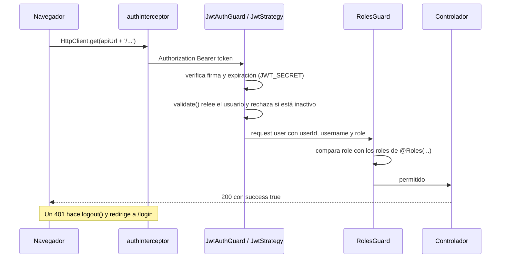

# 07 · Autenticación, seguridad y permisos

Volver a la [guía principal](../../CODEBASE_STUDY_GUIDE.md). Las rutas son relativas a `comercial-jhoel-api/src/` y a `comercial-jhoel-app/src/app/`.

## 1. Mapa de archivos responsables

| Pieza | Archivo | Papel |
|---|---|---|
| Login | `modules/auth/presentation/controllers/auth.controller.ts` (`AuthController.login`) | `POST /api/auth/login`, limitado a 5 intentos por minuto (`ThrottlerGuard` + `@Throttle`) |
| Caso de uso de login | `modules/auth/application/use-cases/login.use-case.ts` (`LoginUseCase.execute`) | Busca por usuario o teléfono, compara con bcrypt, rechaza cuentas inactivas y firma el JWT |
| Cambio de contraseña | `modules/auth/application/use-cases/change-password.use-case.ts` | Ruta protegida del mismo controlador |
| Puerto de tokens | `modules/auth/application/ports/token-service.port.ts` | `AuthTokenPayload { sub, username, role }` |
| Implementación JWT | `modules/auth/infrastructure/services/jwt-token.service.ts` | Firma con `@nestjs/jwt`; la expiración viene de `jwt.expiresIn` (`auth.module.ts`, `signOptions`) |
| Hash de contraseñas | `shared/infrastructure/services/bcrypt-password-hasher.service.ts` (`BcryptPasswordHasher`) | Puerto `PasswordHasher` en `shared/application/ports/` |
| Validación del token | `modules/auth/infrastructure/strategies/jwt.strategy.ts` (`JwtStrategy.validate`) | Toma el token de `Authorization: Bearer` y **vuelve a leer el usuario en cada petición**; rechaza con 401 si no existe o está inactivo, y usa el rol de la base, no el del token |
| Guard de sesión | `modules/auth/infrastructure/guards/jwt-auth.guard.ts` (`JwtAuthGuard`) | Se aplica con `@UseGuards(JwtAuthGuard)` |
| Guard de roles | `modules/auth/infrastructure/guards/roles.guard.ts` (`RolesGuard.canActivate`) | Lee `ROLES_KEY` del método o la clase y responde 403 si el rol no está en la lista |
| Decorador de roles | `shared/decorators/roles.decorator.ts` (`Roles(...)`) | Acepta `RoleName` y `SHIFT_SUPERVISOR_ROLE` (`'SUPERVISOR_DE_TURNO'`, definido en `modules/roles/domain/entities/role.entity.ts`) |
| Usuario actual | `shared/decorators/current-user.decorator.ts` (`CurrentUser`, `RequestUser { userId, username, role }`) | Se inyecta en los controladores |
| Frontend: sesión | `core/services/auth.service.ts` (`AuthService`) | Guarda el token en `localStorage['cj_auth_token']`; `isAuthenticated`, `isAdmin` (signals `computed`), `logout` |
| Frontend: token en peticiones | `core/interceptors/auth.interceptor.ts` (`authInterceptor`) | Agrega el Bearer solo a URLs que empiezan con `environment.apiUrl`; ante un 401 hace `logout()` y redirige a `/login` |
| Frontend: rutas | `core/guards/auth.guard.ts`, `admin.guard.ts`, `guest.guard.ts` | Solo de UX: redirigen; el backend vuelve a verificar todo |

## 2. Secuencia de autenticación

## 3. Roles y permisos

- **Roles base** (sembrados por migración): `SUPER_ADMIN`, `ADMIN`, `USER`. Además existe el rol personalizado `SUPERVISOR_DE_TURNO`. No hay diferencia funcional entre `ADMIN` y `SUPER_ADMIN` salvo donde un mapa de permisos lo indica explícitamente.
- **Tres maneras de aplicar permisos**:
  1. **Por ruta:** `@UseGuards(JwtAuthGuard, RolesGuard)` + `@Roles('ADMIN', 'SUPER_ADMIN')`. Unos 56 controladores usan `RolesGuard`. La columna "Guards / roles" de [12_API_ENDPOINTS.md](12_API_ENDPOINTS.md) dice cuál aplica a cada ruta.
  2. **Por permiso nombrado dentro del caso de uso**, cuando la regla depende del dato:
     - `CASH_CUSTODY_PERMISSION_ROLES` + `assertCashCustodyPermission` (`modules/cash-control/domain/policies/cash-control.policy.ts`): `cash_custody.view`, `operate` y `authorize`.
     - `FINANCIAL_DAY_PERMISSIONS` (`modules/financial-day-review/domain/financial-day-permissions.ts`).
     - Reglas como "re-editar un día cerrado solo admin" en Recargas, o la propiedad de ventas y compras: un `USER` solo ve las suyas (`ListSalesUseCase`, `GetSaleByIdUseCase`).
  3. **En SQL**, como última barrera: `cash_custody_assert_role(user, permiso)` y `financial_review_assert_role` lanzan `CASH_CUSTODY_FORBIDDEN` o el error equivalente aunque el TypeScript hubiera fallado.
- **Control de acceso a módulos en el frontend:** `adminGuard` en rutas hijas de `/dashboard` (por ejemplo `administrar-facturas-compras`, `usuarios`) y los menús del sidebar (`features/dashboard/sidebar`). Esto solo oculta opciones; la protección real es la del backend.

## 4. Validación de entradas

- `ValidationPipe` global (`main.ts`): `whitelist: true` elimina propiedades sin decorador y `forbidNonWhitelisted: true` **rechaza** la petición si trae propiedades no declaradas. Por eso un cliente no puede enviar `result`, `totalBanks` o un `userId` ajeno. `transform: true` convierte los tipos.
- Los DTO usan `class-validator`: `@IsUUID`, `@IsIn(lista)`, `@IsInt`, `@Min`, `@Max`, `@MaxLength`, `@IsDateString`, `@ValidateNested` + `@Type`.
- El usuario que registra una operación **siempre** sale del JWT (`@CurrentUser('userId')`), nunca del cuerpo de la petición.

## 5. Cabeceras, CORS y límites

- `helmet()` aplica las cabeceras de seguridad estándar.
- CORS: lista de `CORS_ORIGINS`, con comodines `*` convertidos a expresión regular en `compileCorsOrigins` (`main.ts`). Cabeceras permitidas: `Content-Type`, `Authorization`, `X-Visitor-Id`.
- Rate limit: `ThrottlerModule` registrado globalmente, pero **aplicado solo donde se usa `ThrottlerGuard`** (login). El almacenamiento es en memoria y se reinicia con cada despliegue.

## 6. Sesiones

No hay sesiones en el servidor: el JWT es *stateless* y expira según `JWT_EXPIRES_IN` (segundos). Desactivar un usuario o cambiar su rol tiene efecto inmediato porque `JwtStrategy.validate` consulta la base en cada petición.

## 7. Auditoría identificada en el código

| Registro | Tabla(s) | Escrito por |
|---|---|---|
| Ciclo del día de Agentes Bancarios | `day_audit_logs` | `close_agent_day`, `OpenDayUseCase` (`DayAuditLogRepository.record`) y la reapertura o cancelación de días |
| Cortes de efectivo | `cash_cut_events`, `cash_cut_schedule_changes` | Funciones de cortes (`finish_cash_cut_period`, etc.) |
| Revisión de días históricos | `financial_day_review_sessions`, versiones de fotos, ajustes y efectos | Funciones de `financial-day-review` (tablas inmutables) |
| Kardex y ledgers | `cash_movements`, `warehouse_cash_movements`, `bank_account_movements`, `guayacan_cash_movements` | Escritores únicos; las anulaciones son movimientos inversos |
| Suscriptores de noticias | tabla de la entidad `news-subscriber-audit-log.orm-entity.ts` | `news-subscriptions` |

Además, casi todas las tablas guardan `created_by`/`updated_by` y `created_at`.

## 8. Información sensible

- Las contraseñas solo se guardan como hash (bcrypt); ningún DTO de respuesta las incluye.
- Los mensajes de login son genéricos (`InvalidCredentialsError`: "Credenciales inválidas.").
- Los secretos (`JWT_SECRET`, `DATABASE_PASSWORD`, `VAPID_PRIVATE_KEY`, `SEED_ADMIN_PASSWORD`) solo existen como variables de entorno. Esta documentación no copia ningún valor.
- El token del frontend vive en `localStorage`. Es accesible desde JavaScript de la misma página; el proyecto lo asume así, es una decisión de diseño y no se cambió.
