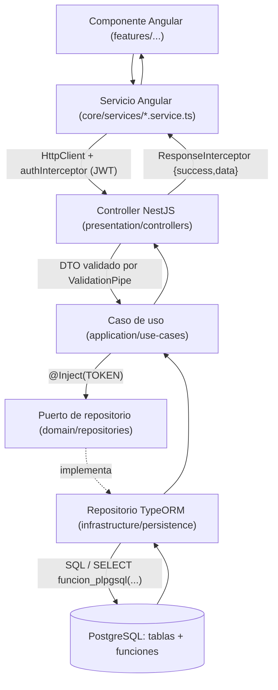

# Relaciones entre archivos y dependencias

Grafo calculado de los `import` reales (estáticos y `import()` dinámicos de las rutas) y del uso de selectores `<app-…>` en plantillas. Para ver las dependencias y consumidores de un archivo concreto, abrir su ficha en la referencia ([backend](03_BACKEND_REFERENCE.md), [frontend](04_FRONTEND_REFERENCE.md)).

## Cómo leer un flujo entre capas

Patrón real del proyecto (ver [02_ARCHITECTURE.md](02_ARCHITECTURE.md) y los flujos de [06_BUSINESS_FLOWS.md](06_BUSINESS_FLOWS.md)):

## Dependencias entre módulos del backend

Cantidad de imports de archivos de un módulo hacia otro (excluye `shared`, migraciones y pruebas). Archivo fuente: [diagrams/module_dependencies.mmd](diagrams/module_dependencies.mmd).

```mermaid
graph LR
  api_account_types["account-types"] -->|2| api_auth["auth"]
  api_account_types["account-types"] -->|1| api_users["users"]
  api_accounts_receivable["accounts-receivable"] -->|4| api_auth["auth"]
  api_accounts_receivable["accounts-receivable"] -->|1| api_banks["banks"]
  api_accounts_receivable["accounts-receivable"] -->|8| api_clients["clients"]
  api_accounts_receivable["accounts-receivable"] -->|1| api_users["users"]
  api_alert_settings["alert-settings"] -->|2| api_auth["auth"]
  api_alert_settings["alert-settings"] -->|1| api_users["users"]
  api_alerts["alerts"] -->|4| api_alert_settings["alert-settings"]
  api_alerts["alerts"] -->|1| api_auth["auth"]
  api_alerts["alerts"] -->|3| api_catalog["catalog"]
  api_alerts["alerts"] -->|5| api_inventory["inventory"]
  api_alerts["alerts"] -->|6| api_purchases["purchases"]
  api_alerts["alerts"] -->|3| api_recharge_cash_box["recharge-cash-box"]
  api_alerts["alerts"] -->|9| api_recharges["recharges"]
  api_assets["assets"] -->|2| api_auth["auth"]
  api_assets["assets"] -->|8| api_clients["clients"]
  api_assets["assets"] -->|1| api_users["users"]
  api_auth["auth"] -->|1| api_roles["roles"]
  api_auth["auth"] -->|5| api_users["users"]
  api_bank_deposits["bank-deposits"] -->|3| api_accounts_receivable["accounts-receivable"]
  api_bank_deposits["bank-deposits"] -->|3| api_assets["assets"]
  api_bank_deposits["bank-deposits"] -->|2| api_auth["auth"]
  api_bank_deposits["bank-deposits"] -->|8| api_banks["banks"]
  api_bank_deposits["bank-deposits"] -->|3| api_cash_control["cash-control"]
  api_bank_deposits["bank-deposits"] -->|4| api_clients["clients"]
  api_bank_deposits["bank-deposits"] -->|2| api_transaction_banks["transaction-banks"]
  api_bank_deposits["bank-deposits"] -->|6| api_transaction_types["transaction-types"]
  api_bank_deposits["bank-deposits"] -->|1| api_users["users"]
  api_banks["banks"] -->|4| api_account_types["account-types"]
  api_banks["banks"] -->|3| api_accounts_receivable["accounts-receivable"]
  api_banks["banks"] -->|3| api_assets["assets"]
  api_banks["banks"] -->|7| api_auth["auth"]
  api_banks["banks"] -->|3| api_cash_control["cash-control"]
  api_banks["banks"] -->|5| api_users["users"]
  api_businesses["businesses"] -->|2| api_auth["auth"]
  api_cash_control["cash-control"] -->|3| api_auth["auth"]
  api_cash_control["cash-control"] -->|6| api_banks["banks"]
  api_catalog_banks["catalog-banks"] -->|2| api_auth["auth"]
  api_catalog_banks["catalog-banks"] -->|1| api_users["users"]
  api_catalog["catalog"] -->|4| api_auth["auth"]
  api_catalog["catalog"] -->|8| api_company_settings["company-settings"]
  api_catalog["catalog"] -->|5| api_likes["likes"]
  api_catalog["catalog"] -->|2| api_users["users"]
  api_categories["categories"] -->|2| api_auth["auth"]
  api_clients["clients"] -->|2| api_auth["auth"]
  api_clients["clients"] -->|1| api_users["users"]
  api_company_settings["company-settings"] -->|2| api_auth["auth"]
  api_company_settings["company-settings"] -->|1| api_users["users"]
  api_dashboard["dashboard"] -->|2| api_auth["auth"]
  api_dashboard["dashboard"] -->|2| api_bank_deposits["bank-deposits"]
  api_dashboard["dashboard"] -->|2| api_purchases["purchases"]
  api_dashboard["dashboard"] -->|2| api_recharges["recharges"]
  api_dashboard["dashboard"] -->|2| api_sales["sales"]
  api_financial_day_review["financial-day-review"] -->|2| api_auth["auth"]
  api_guayacan_cash_box["guayacan-cash-box"] -->|2| api_auth["auth"]
  api_ice_creams["ice-creams"] -->|4| api_auth["auth"]
  api_ice_creams["ice-creams"] -->|1| api_suppliers["suppliers"]
  api_ice_creams["ice-creams"] -->|3| api_users["users"]
  api_inventory["inventory"] -->|2| api_auth["auth"]
  api_inventory["inventory"] -->|8| api_presentation_types["presentation-types"]
  api_inventory["inventory"] -->|11| api_products["products"]
  api_inventory["inventory"] -->|1| api_users["users"]
  api_keyboard_shortcuts["keyboard-shortcuts"] -->|2| api_auth["auth"]
  api_keyboard_shortcuts["keyboard-shortcuts"] -->|1| api_users["users"]
  api_landing_backgrounds["landing-backgrounds"] -->|2| api_auth["auth"]
  api_landing_backgrounds["landing-backgrounds"] -->|1| api_users["users"]
  api_news_subscriptions["news-subscriptions"] -->|2| api_auth["auth"]
  api_news_subscriptions["news-subscriptions"] -->|9| api_news_types["news-types"]
  api_news_subscriptions["news-subscriptions"] -->|1| api_users["users"]
  api_news_types["news-types"] -->|2| api_auth["auth"]
  api_news_types["news-types"] -->|1| api_users["users"]
  api_news["news"] -->|2| api_auth["auth"]
  api_news["news"] -->|6| api_likes["likes"]
  api_news["news"] -->|2| api_news_subscriptions["news-subscriptions"]
  api_news["news"] -->|6| api_news_types["news-types"]
  api_news["news"] -->|1| api_users["users"]
  api_phones["phones"] -->|3| api_auth["auth"]
  api_phones["phones"] -->|4| api_clients["clients"]
  api_phones["phones"] -->|1| api_users["users"]
  api_presentation_types["presentation-types"] -->|2| api_auth["auth"]
  api_presentation_types["presentation-types"] -->|1| api_users["users"]
  api_product_catalog["product-catalog"] -->|4| api_auth["auth"]
  api_product_catalog["product-catalog"] -->|5| api_likes["likes"]
  api_product_catalog["product-catalog"] -->|3| api_products["products"]
  api_product_catalog["product-catalog"] -->|2| api_users["users"]
  api_products["products"] -->|2| api_auth["auth"]
  api_products["products"] -->|6| api_businesses["businesses"]
  api_products["products"] -->|6| api_categories["categories"]
  api_products["products"] -->|12| api_inventory["inventory"]
  api_products["products"] -->|3| api_presentation_types["presentation-types"]
  api_products["products"] -->|1| api_reports["reports"]
  api_products["products"] -->|5| api_units_of_measure["units-of-measure"]
  api_purchases["purchases"] -->|2| api_auth["auth"]
  api_purchases["purchases"] -->|2| api_company_settings["company-settings"]
  api_purchases["purchases"] -->|6| api_inventory["inventory"]
  api_purchases["purchases"] -->|3| api_products["products"]
  api_purchases["purchases"] -->|4| api_suppliers["suppliers"]
  api_purchases["purchases"] -->|1| api_users["users"]
  api_quotations["quotations"] -->|2| api_auth["auth"]
  api_quotations["quotations"] -->|5| api_clients["clients"]
  api_quotations["quotations"] -->|2| api_company_settings["company-settings"]
  api_quotations["quotations"] -->|1| api_users["users"]
  api_recharge_cash_box["recharge-cash-box"] -->|2| api_auth["auth"]
  api_recharge_cash_box["recharge-cash-box"] -->|2| api_recharges["recharges"]
  api_recharge_cash_box["recharge-cash-box"] -->|1| api_users["users"]
  api_recharges["recharges"] -->|6| api_auth["auth"]
  api_recharges["recharges"] -->|7| api_users["users"]
  api_reports["reports"] -->|4| api_accounts_receivable["accounts-receivable"]
  api_reports["reports"] -->|4| api_assets["assets"]
  api_reports["reports"] -->|18| api_auth["auth"]
  api_reports["reports"] -->|6| api_bank_deposits["bank-deposits"]
  api_reports["reports"] -->|13| api_banks["banks"]
  api_reports["reports"] -->|3| api_businesses["businesses"]
  api_reports["reports"] -->|3| api_categories["categories"]
  api_reports["reports"] -->|2| api_clients["clients"]
  api_reports["reports"] -->|6| api_ice_creams["ice-creams"]
  api_reports["reports"] -->|3| api_products["products"]
  api_reports["reports"] -->|7| api_purchases["purchases"]
  api_reports["reports"] -->|7| api_recharges["recharges"]
  api_reports["reports"] -->|7| api_sales["sales"]
  api_reports["reports"] -->|2| api_suppliers["suppliers"]
  api_reports["reports"] -->|2| api_transaction_banks["transaction-banks"]
  api_reports["reports"] -->|2| api_transaction_types["transaction-types"]
  api_reports["reports"] -->|7| api_users["users"]
  api_roles["roles"] -->|2| api_auth["auth"]
  api_sales_cash_box["sales-cash-box"] -->|2| api_auth["auth"]
  api_sales_cash_box["sales-cash-box"] -->|1| api_businesses["businesses"]
  api_sales_cash_box["sales-cash-box"] -->|1| api_users["users"]
  api_sales_register["sales-register"] -->|1| api_auth["auth"]
  api_sales_register["sales-register"] -->|4| api_sales["sales"]
  api_sales["sales"] -->|2| api_auth["auth"]
  api_sales["sales"] -->|1| api_businesses["businesses"]
  api_sales["sales"] -->|6| api_clients["clients"]
  api_sales["sales"] -->|2| api_company_settings["company-settings"]
  api_sales["sales"] -->|1| api_inventory["inventory"]
  api_sales["sales"] -->|1| api_products["products"]
  api_sales["sales"] -->|1| api_users["users"]
  api_suppliers["suppliers"] -->|2| api_auth["auth"]
  api_tickets["tickets"] -->|2| api_auth["auth"]
  api_tickets["tickets"] -->|5| api_clients["clients"]
  api_tickets["tickets"] -->|2| api_company_settings["company-settings"]
  api_tickets["tickets"] -->|1| api_users["users"]
  api_transaction_banks["transaction-banks"] -->|2| api_auth["auth"]
  api_transaction_banks["transaction-banks"] -->|1| api_users["users"]
  api_transaction_types["transaction-types"] -->|2| api_auth["auth"]
  api_transaction_types["transaction-types"] -->|1| api_users["users"]
  api_units_of_measure["units-of-measure"] -->|2| api_auth["auth"]
  api_units_of_measure["units-of-measure"] -->|1| api_users["users"]
  api_users["users"] -->|2| api_auth["auth"]
  api_users["users"] -->|9| api_roles["roles"]
```

| Desde | Hacia | Imports |
|---|---|---|
| account-types | auth | 2 |
| account-types | users | 1 |
| accounts-receivable | auth | 4 |
| accounts-receivable | banks | 1 |
| accounts-receivable | clients | 8 |
| accounts-receivable | users | 1 |
| alert-settings | auth | 2 |
| alert-settings | users | 1 |
| alerts | alert-settings | 4 |
| alerts | auth | 1 |
| alerts | catalog | 3 |
| alerts | inventory | 5 |
| alerts | purchases | 6 |
| alerts | recharge-cash-box | 3 |
| alerts | recharges | 9 |
| assets | auth | 2 |
| assets | clients | 8 |
| assets | users | 1 |
| auth | roles | 1 |
| auth | users | 5 |
| bank-deposits | accounts-receivable | 3 |
| bank-deposits | assets | 3 |
| bank-deposits | auth | 2 |
| bank-deposits | banks | 8 |
| bank-deposits | cash-control | 3 |
| bank-deposits | clients | 4 |
| bank-deposits | transaction-banks | 2 |
| bank-deposits | transaction-types | 6 |
| bank-deposits | users | 1 |
| banks | account-types | 4 |
| banks | accounts-receivable | 3 |
| banks | assets | 3 |
| banks | auth | 7 |
| banks | cash-control | 3 |
| banks | users | 5 |
| businesses | auth | 2 |
| cash-control | auth | 3 |
| cash-control | banks | 6 |
| catalog-banks | auth | 2 |
| catalog-banks | users | 1 |
| catalog | auth | 4 |
| catalog | company-settings | 8 |
| catalog | likes | 5 |
| catalog | users | 2 |
| categories | auth | 2 |
| clients | auth | 2 |
| clients | users | 1 |
| company-settings | auth | 2 |
| company-settings | users | 1 |
| dashboard | auth | 2 |
| dashboard | bank-deposits | 2 |
| dashboard | purchases | 2 |
| dashboard | recharges | 2 |
| dashboard | sales | 2 |
| financial-day-review | auth | 2 |
| guayacan-cash-box | auth | 2 |
| ice-creams | auth | 4 |
| ice-creams | suppliers | 1 |
| ice-creams | users | 3 |
| inventory | auth | 2 |
| inventory | presentation-types | 8 |
| inventory | products | 11 |
| inventory | users | 1 |
| keyboard-shortcuts | auth | 2 |
| keyboard-shortcuts | users | 1 |
| landing-backgrounds | auth | 2 |
| landing-backgrounds | users | 1 |
| news-subscriptions | auth | 2 |
| news-subscriptions | news-types | 9 |
| news-subscriptions | users | 1 |
| news-types | auth | 2 |
| news-types | users | 1 |
| news | auth | 2 |
| news | likes | 6 |
| news | news-subscriptions | 2 |
| news | news-types | 6 |
| news | users | 1 |
| phones | auth | 3 |
| phones | clients | 4 |
| phones | users | 1 |
| presentation-types | auth | 2 |
| presentation-types | users | 1 |
| product-catalog | auth | 4 |
| product-catalog | likes | 5 |
| product-catalog | products | 3 |
| product-catalog | users | 2 |
| products | auth | 2 |
| products | businesses | 6 |
| products | categories | 6 |
| products | inventory | 12 |
| products | presentation-types | 3 |
| products | reports | 1 |
| products | units-of-measure | 5 |
| purchases | auth | 2 |
| purchases | company-settings | 2 |
| purchases | inventory | 6 |
| purchases | products | 3 |
| purchases | suppliers | 4 |
| purchases | users | 1 |
| quotations | auth | 2 |
| quotations | clients | 5 |
| quotations | company-settings | 2 |
| quotations | users | 1 |
| recharge-cash-box | auth | 2 |
| recharge-cash-box | recharges | 2 |
| recharge-cash-box | users | 1 |
| recharges | auth | 6 |
| recharges | users | 7 |
| reports | accounts-receivable | 4 |
| reports | assets | 4 |
| reports | auth | 18 |
| reports | bank-deposits | 6 |
| reports | banks | 13 |
| reports | businesses | 3 |
| reports | categories | 3 |
| reports | clients | 2 |
| reports | ice-creams | 6 |
| reports | products | 3 |
| reports | purchases | 7 |
| reports | recharges | 7 |
| reports | sales | 7 |
| reports | suppliers | 2 |
| reports | transaction-banks | 2 |
| reports | transaction-types | 2 |
| reports | users | 7 |
| roles | auth | 2 |
| sales-cash-box | auth | 2 |
| sales-cash-box | businesses | 1 |
| sales-cash-box | users | 1 |
| sales-register | auth | 1 |
| sales-register | sales | 4 |
| sales | auth | 2 |
| sales | businesses | 1 |
| sales | clients | 6 |
| sales | company-settings | 2 |
| sales | inventory | 1 |
| sales | products | 1 |
| sales | users | 1 |
| suppliers | auth | 2 |
| tickets | auth | 2 |
| tickets | clients | 5 |
| tickets | company-settings | 2 |
| tickets | users | 1 |
| transaction-banks | auth | 2 |
| transaction-banks | users | 1 |
| transaction-types | auth | 2 |
| transaction-types | users | 1 |
| units-of-measure | auth | 2 |
| units-of-measure | users | 1 |
| users | auth | 2 |
| users | roles | 9 |

## Pantallas del dashboard → servicios del core que usan

| Área | Servicios |
|---|---|
| dashboard | `auth.service`, `purchase-draft.store`, `sales-draft.store` |
| dashboard-account-types | `account-type.service`, `auth.service`, `confirm-dialog.service`, `notification.service` |
| dashboard-accounts-receivable | `account-receivable-payment.service`, `account-receivable.service`, `auth.service`, `cash-control.service`, `client.service`, `confirm-dialog.service`, `notification.service` |
| dashboard-alert-settings | `alert-settings.service`, `notification.service`, `recharges.service` |
| dashboard-assets | `asset.service`, `auth.service`, `client.service`, `confirm-dialog.service`, `notification.service` |
| dashboard-bank-agents | `auth.service`, `bank-balance-draft.store`, `bank-balance.service`, `bank.service`, `cash-custody.service`, `confirm-dialog.service`, `cuadre-agentes-state.service`, `cuadre-agentes.service`, `day-status.service`, `notification.service` |
| dashboard-bank-transfers | `auth.service`, `bank-transfer.service`, `bank.service`, `notification.service` |
| dashboard-banks | `account-type.service`, `auth.service`, `bank.service`, `notification.service` |
| dashboard-businesses | `auth.service`, `business.service`, `confirm-dialog.service`, `notification.service` |
| dashboard-cash-control | `auth.service`, `bank-deposit-draft.store`, `cash-control-sync.service`, `cash-control.service`, `cash-custody.service`, `confirm-dialog.service`, `notification.service` |
| dashboard-catalog-banks | `catalog-bank.service`, `confirm-dialog.service`, `notification.service` |
| dashboard-catalog-phones | `catalog-phone.service`, `confirm-dialog.service`, `notification.service` |
| dashboard-catalog-product-requests | `catalog-product-request.service`, `notification.service` |
| dashboard-catalog-products | `catalog-product.service`, `confirm-dialog.service`, `inventory.service`, `notification.service` |
| dashboard-catalog-requests | `catalog-request.service`, `notification.service` |
| dashboard-categories | `auth.service`, `category.service`, `confirm-dialog.service`, `notification.service` |
| dashboard-change-password-modal | `auth.service` |
| dashboard-clients | `auth.service`, `client.service`, `confirm-dialog.service`, `notification.service` |
| dashboard-closed-days | `closed-days.service`, `day-status.service`, `notification.service` |
| dashboard-company-settings | `company-settings.service`, `confirm-dialog.service`, `notification.service` |
| dashboard-financial-day-review | `auth.service`, `financial-day-review.service`, `notification.service` |
| dashboard-graphs | `bank-deposit.service`, `purchases.service`, `recharges.service`, `sales.service` |
| dashboard-guayacan-cash-box | `auth.service`, `bank-deposit-draft.store`, `confirm-dialog.service`, `guayacan-cash-box.service`, `guayacan-cash-sync.service`, `notification.service` |
| dashboard-guayacan-cash-counts | `guayacan-cash-box.service`, `notification.service` |
| dashboard-home | `auth.service`, `bank-deposit.service`, `dashboard-metrics.service`, `dashboard-summary.service`, `recharges.service` |
| dashboard-ice-creams | `auth.service`, `confirm-dialog.service`, `ice-cream-purchase-draft.store`, `ice-cream-purchases.service`, `ice-cream-sale-draft.store`, `ice-cream-sales.service`, `ice-cream.service`, `notification.service`, `supplier.service` |
| dashboard-inventory | `auth.service`, `business.service`, `category.service`, `confirm-dialog.service`, `inventory-locations.service`, `inventory.service`, `notification.service`, `presentation-type.service`, `purchases.service`, `unit-of-measure.service` |
| dashboard-keyboard-shortcuts | `confirm-dialog.service`, `keyboard-shortcut.service`, `keyboard-shortcuts.service`, `notification.service` |
| dashboard-landing-backgrounds | `confirm-dialog.service`, `landing-background.service`, `notification.service` |
| dashboard-news | `confirm-dialog.service`, `news-type.service`, `news.service`, `notification.service` |
| dashboard-news-subscribers | `confirm-dialog.service`, `news-subscriber.service`, `notification.service` |
| dashboard-news-types | `confirm-dialog.service`, `news-type.service`, `notification.service` |
| dashboard-phones | `auth.service`, `notification.service`, `phones.service` |
| dashboard-presentation-units | `auth.service`, `confirm-dialog.service`, `notification.service`, `presentation-type.service`, `unit-of-measure.service` |
| dashboard-purchases | `inventory-locations.service`, `inventory.service`, `notification.service`, `pdf-prompt-modal.service`, `purchase-draft.store`, `purchases.service`, `supplier.service` |
| dashboard-purchases-admin | `notification.service`, `purchases.service`, `supplier.service` |
| dashboard-quotations | `auth.service`, `confirm-dialog.service`, `inventory.service`, `notification.service`, `quotations.service` |
| dashboard-recharge-cash-box | `auth.service`, `confirm-dialog.service`, `notification.service`, `recharge-cash-box.service` |
| dashboard-recharge-days | `notification.service`, `recharge-day-status.service`, `recharge-days.service` |
| dashboard-recharges | `auth.service`, `confirm-dialog.service`, `notification.service`, `recharge-day-status.service`, `recharge-sims.service`, `recharges.service` |
| dashboard-recharges-sim-sales-admin | `notification.service`, `recharge-sims.service` |
| dashboard-reports | `assets-receivables-report-state.service`, `bank-deposit.service`, `bank-transfer.service`, `bank.service`, `business.service`, `category.service`, `client.service`, `guayacan-cash-sync.service`, `ice-cream-report-state.service`, `ice-cream.service`, `inventory.service`, `notification.service`, `recharges.service`, `reports.service`, `supplier.service`, `transaction-bank.service`, `transaction-type.service`, `user.service` |
| dashboard-roles | `confirm-dialog.service`, `notification.service`, `role.service` |
| dashboard-sales | `inventory.service`, `sales-draft.store` |
| dashboard-sales-admin | `client.service`, `notification.service`, `sales.service` |
| dashboard-sales-register | `auth.service`, `business.service`, `confirm-dialog.service`, `notification.service`, `sales-cash-box.service`, `sales-register.service` |
| dashboard-sidebar | `auth.service`, `bank-balance-draft.store`, `day-status.service`, `ice-cream-purchase-draft.store`, `ice-cream-sale-draft.store`, `notification.service`, `purchase-draft.store`, `sales-draft.store` |
| dashboard-suppliers | `auth.service`, `confirm-dialog.service`, `notification.service`, `supplier.service` |
| dashboard-tickets | `auth.service`, `confirm-dialog.service`, `inventory.service`, `notification.service`, `tickets.service` |
| dashboard-topbar | `alerts.service`, `auth.service`, `notification.service`, `purchases.service`, `theme.service` |
| dashboard-transaccionar | `auth.service`, `bank-deposit-draft.store`, `bank-deposit.service`, `bank.service`, `cash-control-sync.service`, `cash-control.service`, `confirm-dialog.service`, `guayacan-cash-sync.service`, `notification.service`, `transaction-bank.service`, `transaction-type.service` |
| dashboard-transaction-banks | `auth.service`, `confirm-dialog.service`, `notification.service`, `transaction-bank.service` |
| dashboard-transaction-days | `closed-days.service`, `day-status.service`, `notification.service`, `reports.service` |
| dashboard-transaction-types | `auth.service`, `confirm-dialog.service`, `notification.service`, `transaction-type.service` |
| dashboard-users | `auth.service`, `confirm-dialog.service`, `notification.service`, `role.service`, `user.service` |

## Dependencias circulares (9 grupos)

Grupos de archivos que se importan mutuamente (directa o indirectamente). En TypeScript suelen ser inofensivos si son solo tipos, pero conviene conocerlos:

1. `comercial-jhoel-api/src/modules/inventory/inventory.module.ts` ↔ `comercial-jhoel-api/src/modules/products/products.module.ts`
2. `comercial-jhoel-api/src/modules/sales/infrastructure/persistence/sale-detail.orm-entity.ts` ↔ `comercial-jhoel-api/src/modules/sales/infrastructure/persistence/sale.orm-entity.ts`
3. `comercial-jhoel-api/src/modules/purchases/infrastructure/persistence/purchase-detail.orm-entity.ts` ↔ `comercial-jhoel-api/src/modules/purchases/infrastructure/persistence/purchase.orm-entity.ts`
4. `comercial-jhoel-api/src/modules/ice-creams/infrastructure/persistence/ice-cream-purchase-detail.orm-entity.ts` ↔ `comercial-jhoel-api/src/modules/ice-creams/infrastructure/persistence/ice-cream-purchase.orm-entity.ts`
5. `comercial-jhoel-api/src/modules/ice-creams/infrastructure/persistence/ice-cream-sale-detail.orm-entity.ts` ↔ `comercial-jhoel-api/src/modules/ice-creams/infrastructure/persistence/ice-cream-sale.orm-entity.ts`
6. `comercial-jhoel-api/src/modules/bank-deposits/infrastructure/persistence/bank-deposit-transaction.orm-entity.ts` ↔ `comercial-jhoel-api/src/modules/bank-deposits/infrastructure/persistence/bank-deposit-cash-detail.orm-entity.ts` ↔ `comercial-jhoel-api/src/modules/bank-deposits/infrastructure/persistence/bank-deposit-operation.orm-entity.ts`
7. `comercial-jhoel-api/src/modules/catalog/infrastructure/persistence/catalog-phone-image.orm-entity.ts` ↔ `comercial-jhoel-api/src/modules/catalog/infrastructure/persistence/catalog-phone.orm-entity.ts`
8. `comercial-jhoel-api/src/modules/tickets/infrastructure/persistence/ticket-detail.orm-entity.ts` ↔ `comercial-jhoel-api/src/modules/tickets/infrastructure/persistence/ticket.orm-entity.ts`
9. `comercial-jhoel-api/src/modules/quotations/infrastructure/persistence/quotation-detail.orm-entity.ts` ↔ `comercial-jhoel-api/src/modules/quotations/infrastructure/persistence/quotation.orm-entity.ts`

## Archivos sin consumidores detectados (3)

No los importa ningún archivo de producción (solo, a lo sumo, su propia prueba) ni se usan como selector en una plantilla. Se excluyen pruebas, migraciones, seeds, módulos Nest y puntos de entrada. Pueden ser código sin uso, o usarse de una forma que el análisis estático no ve (por ejemplo, un nombre de clase registrado por cadena). **Verificar antes de concluir.**

- `comercial-jhoel-api/src/modules/transaction-banks/domain/errors/transaction-bank-inactive.error.ts` (Errores de dominio)
- `comercial-jhoel-api/src/modules/transaction-types/domain/errors/transaction-type-inactive.error.ts` (Errores de dominio)
- `comercial-jhoel-app/src/app/features/dashboard/bank-agents/components/pending-balances-modal/pending-balances-modal.component.ts` (Componente Angular)

