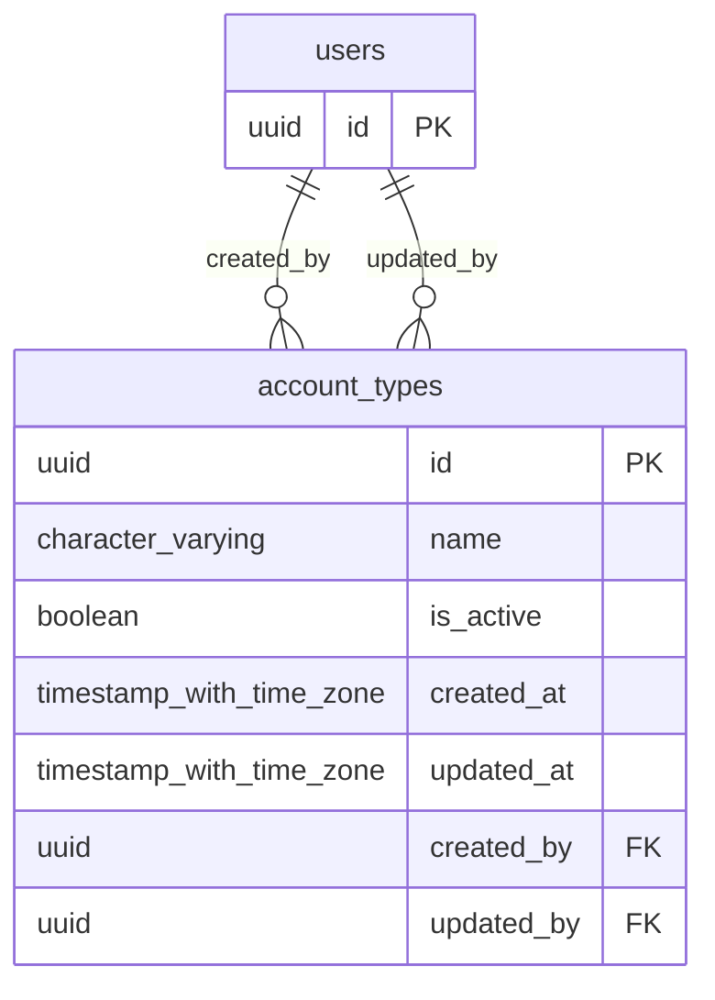

# Base de datos — dominio `account-types`

Volver a [05_DATABASE_REFERENCE.md](../05_DATABASE_REFERENCE.md). Diagrama ER: llaves primarias (PK) y foráneas (FK) reales; las tablas de otros dominios referenciadas aparecen solo con su `id`. Se muestran hasta 14 columnas por tabla en el diagrama; la lista completa está en cada ficha.

## `account_types`

- **Entidad TypeORM:** [AccountTypeOrmEntity](../reference/backend/account-types.md#f-comercial-jhoel-api-src-modules-account-types-infrastructure-persistence-account-type-orm-entity-ts)
- **Creada en:** migración no identificada por el análisis (creada con TypeORM `Table` o `createTable`)
- **Archivos TypeScript que la usan:** [account-type.orm-entity.ts](../reference/backend/account-types.md#f-comercial-jhoel-api-src-modules-account-types-infrastructure-persistence-account-type-orm-entity-ts), [typeorm-bank-movement.repository.ts](../reference/backend/banks.md#f-comercial-jhoel-api-src-modules-banks-infrastructure-persistence-typeorm-bank-movement-repository-ts), [typeorm-financial-day-review.repository.ts](../reference/backend/financial-day-review.md#f-comercial-jhoel-api-src-modules-financial-day-review-infrastructure-persistence-typeorm-financial-day-review-repository-ts)

| Columna | Tipo | Nulo | Default |
|---|---|---|---|
| `id` | uuid | NOT NULL | gen_random_uuid() |
| `name` | character varying(80) | NOT NULL |  |
| `is_active` | boolean | NOT NULL | true |
| `created_at` | timestamp with time zone | NOT NULL | now() |
| `updated_at` | timestamp with time zone | NOT NULL | now() |
| `created_by` | uuid | NOT NULL |  |
| `updated_by` | uuid | sí |  |

| Restricción | Tipo | Definición |
|---|---|---|
| `FK_account_types_created_by` | FK | FOREIGN KEY (created_by) REFERENCES users(id) ON DELETE RESTRICT |
| `FK_account_types_updated_by` | FK | FOREIGN KEY (updated_by) REFERENCES users(id) ON DELETE RESTRICT |
| `PK_1944ce0e8e4a9f29fa1d4fbe4ce` | PK | PRIMARY KEY (id) |

**Índices:**

- `PK_1944ce0e8e4a9f29fa1d4fbe4ce`: CREATE UNIQUE INDEX "PK_1944ce0e8e4a9f29fa1d4fbe4ce" ON public.account_types USING btree (id)
- `UQ_account_types_name_active`: CREATE UNIQUE INDEX "UQ_account_types_name_active" ON public.account_types USING btree (name) WHERE (is_active = true)

