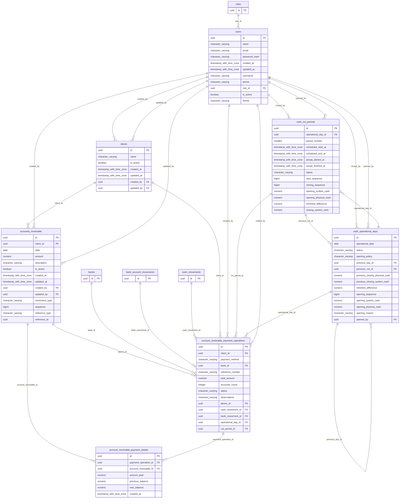

# Base de datos — dominio `accounts-receivable`

Volver a [05_DATABASE_REFERENCE.md](../05_DATABASE_REFERENCE.md). Diagrama ER: llaves primarias (PK) y foráneas (FK) reales; las tablas de otros dominios referenciadas aparecen solo con su `id`. Se muestran hasta 14 columnas por tabla en el diagrama; la lista completa está en cada ficha.

## `account_receivable_payment_details`

- **Entidad TypeORM:** ninguna (se accede con SQL crudo o solo desde funciones PL/pgSQL)
- **Creada en:** `1760007000000-AccountsReceivableSettlements.ts`
- **Archivos TypeScript que la usan:** [typeorm-account-receivable-settlement.repository.ts](../reference/backend/accounts-receivable.md#f-comercial-jhoel-api-src-modules-accounts-receivable-infrastructure-persistence-typeorm-account-receivable-settlement-repository-ts)
- **Funciones SQL que la escriben:** `settle_accounts_receivable`

| Columna | Tipo | Nulo | Default |
|---|---|---|---|
| `id` | uuid | NOT NULL | gen_random_uuid() |
| `payment_operation_id` | uuid | NOT NULL |  |
| `account_receivable_id` | uuid | NOT NULL |  |
| `amount_paid` | numeric(14,2) | NOT NULL |  |
| `previous_balance` | numeric(14,2) | NOT NULL |  |
| `new_balance` | numeric(14,2) | NOT NULL |  |
| `created_at` | timestamp with time zone | NOT NULL | now() |

| Restricción | Tipo | Definición |
|---|---|---|
| `CHK_ar_payment_details_amount` | CHECK | CHECK ((amount_paid &gt; (0)::numeric)) |
| `CHK_ar_payment_details_balance` | CHECK | CHECK (((previous_balance &gt;= amount_paid) AND (new_balance = (previous_balance - amount_paid)))) |
| `account_receivable_payment_details_account_receivable_id_fkey` | FK | FOREIGN KEY (account_receivable_id) REFERENCES accounts_receivable(id) ON DELETE RESTRICT |
| `account_receivable_payment_details_payment_operation_id_fkey` | FK | FOREIGN KEY (payment_operation_id) REFERENCES account_receivable_payment_operations(id) ON DELETE RESTRICT |
| `account_receivable_payment_details_pkey` | PK | PRIMARY KEY (id) |
| `UQ_ar_payment_details_account` | UNIQUE | UNIQUE (payment_operation_id, account_receivable_id) |

**Índices:**

- `IDX_ar_payment_details_account`: CREATE INDEX "IDX_ar_payment_details_account" ON public.account_receivable_payment_details USING btree (account_receivable_id)
- `UQ_ar_payment_details_account`: CREATE UNIQUE INDEX "UQ_ar_payment_details_account" ON public.account_receivable_payment_details USING btree (payment_operation_id, account_receivable_id)
- `account_receivable_payment_details_pkey`: CREATE UNIQUE INDEX account_receivable_payment_details_pkey ON public.account_receivable_payment_details USING btree (id)

## `account_receivable_payment_operations`

- **Entidad TypeORM:** ninguna (se accede con SQL crudo o solo desde funciones PL/pgSQL)
- **Creada en:** `1760007000000-AccountsReceivableSettlements.ts`
- **Archivos TypeScript que la usan:** [typeorm-account-receivable-settlement.repository.ts](../reference/backend/accounts-receivable.md#f-comercial-jhoel-api-src-modules-accounts-receivable-infrastructure-persistence-typeorm-account-receivable-settlement-repository-ts)
- **Funciones SQL que la escriben:** `settle_accounts_receivable`, `void_account_receivable_payment`

| Columna | Tipo | Nulo | Default |
|---|---|---|---|
| `id` | uuid | NOT NULL | gen_random_uuid() |
| `client_id` | uuid | NOT NULL |  |
| `payment_method` | character varying(20) | NOT NULL |  |
| `bank_id` | uuid | sí |  |
| `reference_number` | character varying(100) | sí |  |
| `total_amount` | numeric(14,2) | NOT NULL |  |
| `accounts_count` | integer | NOT NULL |  |
| `status` | character varying(10) | NOT NULL | 'APLICADO'::character varying |
| `observations` | character varying(500) | sí |  |
| `abono_id` | uuid | sí |  |
| `cash_movement_id` | uuid | sí |  |
| `bank_movement_id` | uuid | sí |  |
| `operational_day_id` | uuid | sí |  |
| `cut_period_id` | uuid | sí |  |
| `idempotency_key` | character varying(150) | NOT NULL |  |
| `created_by` | uuid | NOT NULL |  |
| `created_at` | timestamp with time zone | NOT NULL | now() |
| `voided_at` | timestamp with time zone | sí |  |
| `voided_by` | uuid | sí |  |
| `void_reason` | character varying(255) | sí |  |

| Restricción | Tipo | Definición |
|---|---|---|
| `CHK_ar_payment_operations_bank` | CHECK | CHECK ((((payment_method)::text = 'DEPOSITO_BANCARIO'::text) = (bank_id IS NOT NULL))) |
| `CHK_ar_payment_operations_count` | CHECK | CHECK ((accounts_count &gt; 0)) |
| `CHK_ar_payment_operations_method` | CHECK | CHECK (((payment_method)::text = ANY ((ARRAY['EFECTIVO'::character varying, 'DEPOSITO_BANCARIO'::character varying])::text[]))) |
| `CHK_ar_payment_operations_status` | CHECK | CHECK (((status)::text = ANY ((ARRAY['APLICADO'::character varying, 'ANULADO'::character varying])::text[]))) |
| `CHK_ar_payment_operations_total` | CHECK | CHECK ((total_amount &gt; (0)::numeric)) |
| `CHK_ar_payment_operations_void` | CHECK | CHECK (((((status)::text = 'APLICADO'::text) AND (voided_at IS NULL) AND (voided_by IS NULL)) OR (((status)::text = 'ANULADO'::text) AND (voided_at IS NOT NULL) AND (voided_by IS NOT NULL)))) |
| `account_receivable_payment_operations_abono_id_fkey` | FK | FOREIGN KEY (abono_id) REFERENCES accounts_receivable(id) ON DELETE RESTRICT |
| `account_receivable_payment_operations_bank_id_fkey` | FK | FOREIGN KEY (bank_id) REFERENCES banks(id) ON DELETE RESTRICT |
| `account_receivable_payment_operations_bank_movement_id_fkey` | FK | FOREIGN KEY (bank_movement_id) REFERENCES bank_account_movements(id) ON DELETE RESTRICT |
| `account_receivable_payment_operations_cash_movement_id_fkey` | FK | FOREIGN KEY (cash_movement_id) REFERENCES cash_movements(id) ON DELETE RESTRICT |
| `account_receivable_payment_operations_client_id_fkey` | FK | FOREIGN KEY (client_id) REFERENCES clients(id) ON DELETE RESTRICT |
| `account_receivable_payment_operations_created_by_fkey` | FK | FOREIGN KEY (created_by) REFERENCES users(id) ON DELETE RESTRICT |
| `account_receivable_payment_operations_cut_period_id_fkey` | FK | FOREIGN KEY (cut_period_id) REFERENCES cash_cut_periods(id) ON DELETE RESTRICT |
| `account_receivable_payment_operations_operational_day_id_fkey` | FK | FOREIGN KEY (operational_day_id) REFERENCES cash_operational_days(id) ON DELETE RESTRICT |
| `account_receivable_payment_operations_voided_by_fkey` | FK | FOREIGN KEY (voided_by) REFERENCES users(id) ON DELETE RESTRICT |
| `account_receivable_payment_operations_pkey` | PK | PRIMARY KEY (id) |
| `UQ_ar_payment_operations_idempotency` | UNIQUE | UNIQUE (idempotency_key) |

**Índices:**

- `IDX_ar_payment_operations_bank`: CREATE INDEX "IDX_ar_payment_operations_bank" ON public.account_receivable_payment_operations USING btree (bank_id) WHERE (bank_id IS NOT NULL)
- `IDX_ar_payment_operations_client`: CREATE INDEX "IDX_ar_payment_operations_client" ON public.account_receivable_payment_operations USING btree (client_id, created_at DESC)
- `IDX_ar_payment_operations_created`: CREATE INDEX "IDX_ar_payment_operations_created" ON public.account_receivable_payment_operations USING btree (created_at DESC)
- `UQ_ar_payment_operations_idempotency`: CREATE UNIQUE INDEX "UQ_ar_payment_operations_idempotency" ON public.account_receivable_payment_operations USING btree (idempotency_key)
- `account_receivable_payment_operations_pkey`: CREATE UNIQUE INDEX account_receivable_payment_operations_pkey ON public.account_receivable_payment_operations USING btree (id)

## `accounts_receivable`

- **Entidad TypeORM:** [AccountReceivableOrmEntity](../reference/backend/accounts-receivable.md#f-comercial-jhoel-api-src-modules-accounts-receivable-infrastructure-persistence-account-receivable-orm-entity-ts)
- **Creada en:** migración no identificada por el análisis (creada con TypeORM `Table` o `createTable`)
- **Archivos TypeScript que la usan:** [account-receivable.orm-entity.ts](../reference/backend/accounts-receivable.md#f-comercial-jhoel-api-src-modules-accounts-receivable-infrastructure-persistence-account-receivable-orm-entity-ts), [typeorm-account-receivable-settlement.repository.ts](../reference/backend/accounts-receivable.md#f-comercial-jhoel-api-src-modules-accounts-receivable-infrastructure-persistence-typeorm-account-receivable-settlement-repository-ts), [typeorm-account-receivable.repository.ts](../reference/backend/accounts-receivable.md#f-comercial-jhoel-api-src-modules-accounts-receivable-infrastructure-persistence-typeorm-account-receivable-repository-ts), [typeorm-financial-day-review.repository.ts](../reference/backend/financial-day-review.md#f-comercial-jhoel-api-src-modules-financial-day-review-infrastructure-persistence-typeorm-financial-day-review-repository-ts), [financial-day-review.e2e-spec.ts](../reference/backend/e2e.md#f-comercial-jhoel-api-test-financial-day-review-e2e-spec-ts)
- **Funciones SQL que la escriben:** `register_account_receivable_movement`, `void_account_receivable_payment`

| Columna | Tipo | Nulo | Default |
|---|---|---|---|
| `id` | uuid | NOT NULL | gen_random_uuid() |
| `client_id` | uuid | NOT NULL |  |
| `date` | date | NOT NULL |  |
| `amount` | numeric(12,2) | NOT NULL |  |
| `description` | character varying(500) | sí |  |
| `is_active` | boolean | NOT NULL | true |
| `created_at` | timestamp with time zone | NOT NULL | now() |
| `updated_at` | timestamp with time zone | NOT NULL | now() |
| `created_by` | uuid | NOT NULL |  |
| `updated_by` | uuid | sí |  |
| `movement_type` | character varying(20) | NOT NULL | 'CARGO'::character varying |
| `sequence` | bigint | NOT NULL | nextval('accounts_receivable_sequence_seq'::regclass) |
| `reference_type` | character varying(50) | sí |  |
| `reference_id` | uuid | sí |  |

| Restricción | Tipo | Definición |
|---|---|---|
| `CHK_accounts_receivable_amount_positive` | CHECK | CHECK ((amount &gt; (0)::numeric)) |
| `CHK_accounts_receivable_movement_type` | CHECK | CHECK (((movement_type)::text = ANY ((ARRAY['CARGO'::character varying, 'ABONO'::character varying])::text[]))) |
| `CHK_accounts_receivable_reference_pair` | CHECK | CHECK ((((reference_type IS NULL) AND (reference_id IS NULL)) OR ((reference_type IS NOT NULL) AND (reference_id IS NOT NULL)))) |
| `FK_accounts_receivable_client` | FK | FOREIGN KEY (client_id) REFERENCES clients(id) ON DELETE RESTRICT |
| `FK_accounts_receivable_created_by` | FK | FOREIGN KEY (created_by) REFERENCES users(id) ON DELETE RESTRICT |
| `FK_accounts_receivable_updated_by` | FK | FOREIGN KEY (updated_by) REFERENCES users(id) ON DELETE RESTRICT |
| `PK_7a4fd7cf394ef2c2abfed284d9e` | PK | PRIMARY KEY (id) |

**Índices:**

- `IDX_accounts_receivable_client_id`: CREATE INDEX "IDX_accounts_receivable_client_id" ON public.accounts_receivable USING btree (client_id)
- `IDX_accounts_receivable_date`: CREATE INDEX "IDX_accounts_receivable_date" ON public.accounts_receivable USING btree (date)
- `IDX_accounts_receivable_is_active`: CREATE INDEX "IDX_accounts_receivable_is_active" ON public.accounts_receivable USING btree (is_active)
- `PK_7a4fd7cf394ef2c2abfed284d9e`: CREATE UNIQUE INDEX "PK_7a4fd7cf394ef2c2abfed284d9e" ON public.accounts_receivable USING btree (id)

**Triggers:**

- `trg_ar_payment_guard`: CREATE TRIGGER trg_ar_payment_guard BEFORE UPDATE ON public.accounts_receivable FOR EACH ROW EXECUTE FUNCTION ar_payment_guard()
- `trg_cash_accounts_receivable_insert`: CREATE TRIGGER trg_cash_accounts_receivable_insert AFTER INSERT ON public.accounts_receivable FOR EACH ROW EXECUTE FUNCTION cash_on_portfolio_row()
- `trg_cash_accounts_receivable_update`: CREATE TRIGGER trg_cash_accounts_receivable_update AFTER UPDATE OF amount, movement_type, is_active ON public.accounts_receivable FOR EACH ROW WHEN (((old.amount IS DISTINCT FROM new.amount) OR ((old.movement_type)::text IS DISTINCT FROM (new.movement_type)::text) OR (old.is_active IS DISTINCT FROM new.is_active))) EXECUTE FUNCTION cash_on_portfolio_row()
- `trg_financial_review_guard`: CREATE TRIGGER trg_financial_review_guard BEFORE INSERT OR DELETE OR UPDATE ON public.accounts_receivable FOR EACH ROW EXECUTE FUNCTION financial_review_day_guard('date')

## `cash_cut_periods`

- **Entidad TypeORM:** ninguna (se accede con SQL crudo o solo desde funciones PL/pgSQL)
- **Creada en:** `1760006800000-CreateCashControlKardexAndCuts.ts`
- **Archivos TypeScript que la usan:** [typeorm-account-receivable-settlement.repository.ts](../reference/backend/accounts-receivable.md#f-comercial-jhoel-api-src-modules-accounts-receivable-infrastructure-persistence-typeorm-account-receivable-settlement-repository-ts), [typeorm-cash-control.repository.ts](../reference/backend/cash-control.md#f-comercial-jhoel-api-src-modules-cash-control-infrastructure-persistence-typeorm-cash-control-repository-ts), [typeorm-financial-day-review.repository.ts](../reference/backend/financial-day-review.md#f-comercial-jhoel-api-src-modules-financial-day-review-infrastructure-persistence-typeorm-financial-day-review-repository-ts), [cuadre-cash-breakdown.e2e-spec.ts](../reference/backend/e2e.md#f-comercial-jhoel-api-test-cuadre-cash-breakdown-e2e-spec-ts)
- **Funciones SQL que la escriben:** `correct_financial_day_snapshot`, `finish_cash_cut_period`, `open_cash_operational_day`, `reopen_cash_cut_period`, `start_cash_cut_period`, `update_cash_cut_schedule`

| Columna | Tipo | Nulo | Default |
|---|---|---|---|
| `id` | uuid | NOT NULL | gen_random_uuid() |
| `operational_day_id` | uuid | NOT NULL |  |
| `period_number` | smallint | NOT NULL |  |
| `scheduled_start_at` | timestamp with time zone | NOT NULL |  |
| `scheduled_end_at` | timestamp with time zone | NOT NULL |  |
| `actual_started_at` | timestamp with time zone | sí |  |
| `actual_finished_at` | timestamp with time zone | sí |  |
| `status` | character varying(15) | NOT NULL | 'PROGRAMADO'::character varying |
| `start_sequence` | bigint | sí |  |
| `closing_sequence` | bigint | sí |  |
| `opening_system_cash` | numeric(14,2) | sí |  |
| `opening_physical_cash` | numeric(14,2) | sí |  |
| `inherited_difference` | numeric(14,2) | sí |  |
| `closing_system_cash` | numeric(14,2) | sí |  |
| `closing_physical_cash` | numeric(14,2) | sí |  |
| `cash_difference` | numeric(14,2) | sí |  |
| `total_in` | numeric(14,2) | sí |  |
| `total_out` | numeric(14,2) | sí |  |
| `movement_count` | integer | sí |  |
| `opening_bank_balances` | jsonb | sí |  |
| `opened_by` | uuid | sí |  |
| `closed_by` | uuid | sí |  |
| `observations` | character varying(500) | sí |  |
| `reopened_count` | integer | NOT NULL | 0 |
| `created_at` | timestamp with time zone | NOT NULL | now() |

| Restricción | Tipo | Definición |
|---|---|---|
| `CHK_cash_cut_periods_number` | CHECK | CHECK ((period_number = ANY (ARRAY[1, 2]))) |
| `CHK_cash_cut_periods_schedule` | CHECK | CHECK ((scheduled_end_at &gt; scheduled_start_at)) |
| `CHK_cash_cut_periods_state` | CHECK | CHECK (((((status)::text = 'PROGRAMADO'::text) AND (actual_started_at IS NULL) AND (actual_finished_at IS NULL)) OR (((status)::text = 'ABIERTO'::text) AND (actual_started_at IS NOT NULL) AND (actual_finished_at IS NULL) AND (start_sequence IS NOT NULL) AND (opened_by IS NOT NULL)) OR (((status)::text = 'FINALIZADO'::text) AND (actual_started_at IS NOT NULL) AND (actual_finished_at IS NOT NULL) AND (closing_sequence IS NOT NULL) AND (closing_physical_cash IS NOT NULL) AND (closing_system_cash IS NOT NULL) AND (closed_by IS NOT NULL)))) |
| `CHK_cash_cut_periods_status` | CHECK | CHECK (((status)::text = ANY ((ARRAY['PROGRAMADO'::character varying, 'ABIERTO'::character varying, 'FINALIZADO'::character varying])::text[]))) |
| `cash_cut_periods_closed_by_fkey` | FK | FOREIGN KEY (closed_by) REFERENCES users(id) ON DELETE RESTRICT |
| `cash_cut_periods_opened_by_fkey` | FK | FOREIGN KEY (opened_by) REFERENCES users(id) ON DELETE RESTRICT |
| `cash_cut_periods_operational_day_id_fkey` | FK | FOREIGN KEY (operational_day_id) REFERENCES cash_operational_days(id) ON DELETE RESTRICT |
| `cash_cut_periods_pkey` | PK | PRIMARY KEY (id) |
| `UQ_cash_cut_periods_day_number` | UNIQUE | UNIQUE (operational_day_id, period_number) |

**Índices:**

- `UQ_cash_cut_periods_day_number`: CREATE UNIQUE INDEX "UQ_cash_cut_periods_day_number" ON public.cash_cut_periods USING btree (operational_day_id, period_number)
- `UQ_cash_cut_periods_single_open`: CREATE UNIQUE INDEX "UQ_cash_cut_periods_single_open" ON public.cash_cut_periods USING btree ((true)) WHERE ((status)::text = 'ABIERTO'::text)
- `cash_cut_periods_pkey`: CREATE UNIQUE INDEX cash_cut_periods_pkey ON public.cash_cut_periods USING btree (id)

**Triggers:**

- `trg_financial_review_guard`: CREATE TRIGGER trg_financial_review_guard BEFORE INSERT OR DELETE OR UPDATE ON public.cash_cut_periods FOR EACH ROW EXECUTE FUNCTION financial_review_day_guard('day')

## `cash_operational_days`

- **Entidad TypeORM:** ninguna (se accede con SQL crudo o solo desde funciones PL/pgSQL)
- **Creada en:** `1760006800000-CreateCashControlKardexAndCuts.ts`
- **Archivos TypeScript que la usan:** [typeorm-account-receivable-settlement.repository.ts](../reference/backend/accounts-receivable.md#f-comercial-jhoel-api-src-modules-accounts-receivable-infrastructure-persistence-typeorm-account-receivable-settlement-repository-ts), [typeorm-cash-control.repository.ts](../reference/backend/cash-control.md#f-comercial-jhoel-api-src-modules-cash-control-infrastructure-persistence-typeorm-cash-control-repository-ts), [typeorm-financial-day-review.repository.ts](../reference/backend/financial-day-review.md#f-comercial-jhoel-api-src-modules-financial-day-review-infrastructure-persistence-typeorm-financial-day-review-repository-ts), [financial-day-review.e2e-spec.ts](../reference/backend/e2e.md#f-comercial-jhoel-api-test-financial-day-review-e2e-spec-ts)
- **Funciones SQL que la escriben:** `close_cash_operational_day`, `correct_financial_day_snapshot`, `open_cash_operational_day`

| Columna | Tipo | Nulo | Default |
|---|---|---|---|
| `id` | uuid | NOT NULL | gen_random_uuid() |
| `operational_date` | date | NOT NULL |  |
| `status` | character varying(15) | NOT NULL | 'ABIERTO'::character varying |
| `opening_policy` | character varying(40) | NOT NULL |  |
| `previous_day_id` | uuid | sí |  |
| `previous_cut_id` | uuid | sí |  |
| `previous_closing_physical_cash` | numeric(14,2) | sí |  |
| `previous_closing_system_cash` | numeric(14,2) | sí |  |
| `inherited_difference` | numeric(14,2) | NOT NULL | 0 |
| `opening_sequence` | bigint | NOT NULL | 0 |
| `opening_system_cash` | numeric(14,2) | NOT NULL |  |
| `opening_physical_cash` | numeric(14,2) | NOT NULL |  |
| `opening_reason` | character varying(255) | sí |  |
| `opened_by` | uuid | NOT NULL |  |
| `opened_at` | timestamp with time zone | NOT NULL | now() |
| `closing_sequence` | bigint | sí |  |
| `closing_system_cash` | numeric(14,2) | sí |  |
| `closing_physical_cash` | numeric(14,2) | sí |  |
| `closing_difference` | numeric(14,2) | sí |  |
| `total_in` | numeric(14,2) | sí |  |
| `total_out` | numeric(14,2) | sí |  |
| `movement_count` | integer | sí |  |
| `closing_observations` | character varying(500) | sí |  |
| `closed_by` | uuid | sí |  |
| `closed_at` | timestamp with time zone | sí |  |

| Restricción | Tipo | Definición |
|---|---|---|
| `CHK_cash_operational_days_closed` | CHECK | CHECK (((((status)::text = 'ABIERTO'::text) AND (closed_at IS NULL) AND (closed_by IS NULL)) OR (((status)::text = 'CERRADO'::text) AND (closed_at IS NOT NULL) AND (closed_by IS NOT NULL) AND (closing_physical_cash IS NOT NULL) AND (closing_system_cash IS NOT NULL)))) |
| `CHK_cash_operational_days_policy` | CHECK | CHECK (((opening_policy)::text = ANY ((ARRAY['INHERITED_FROM_CLOSE'::character varying, 'INHERITED_FROM_LAST_CUT'::character varying, 'AUTHORIZED_MANUAL'::character varying, 'SYSTEM_UNVERIFIED'::character varying])::text[]))) |
| `CHK_cash_operational_days_status` | CHECK | CHECK (((status)::text = ANY ((ARRAY['ABIERTO'::character varying, 'CERRADO'::character varying])::text[]))) |
| `FK_cash_operational_days_previous_cut` | FK | FOREIGN KEY (previous_cut_id) REFERENCES cash_cut_periods(id) ON DELETE RESTRICT |
| `cash_operational_days_closed_by_fkey` | FK | FOREIGN KEY (closed_by) REFERENCES users(id) ON DELETE RESTRICT |
| `cash_operational_days_opened_by_fkey` | FK | FOREIGN KEY (opened_by) REFERENCES users(id) ON DELETE RESTRICT |
| `cash_operational_days_previous_day_id_fkey` | FK | FOREIGN KEY (previous_day_id) REFERENCES cash_operational_days(id) ON DELETE RESTRICT |
| `cash_operational_days_pkey` | PK | PRIMARY KEY (id) |
| `UQ_cash_operational_days_date` | UNIQUE | UNIQUE (operational_date) |

**Índices:**

- `UQ_cash_operational_days_date`: CREATE UNIQUE INDEX "UQ_cash_operational_days_date" ON public.cash_operational_days USING btree (operational_date)
- `cash_operational_days_pkey`: CREATE UNIQUE INDEX cash_operational_days_pkey ON public.cash_operational_days USING btree (id)

**Triggers:**

- `trg_financial_review_guard`: CREATE TRIGGER trg_financial_review_guard BEFORE INSERT OR DELETE OR UPDATE ON public.cash_operational_days FOR EACH ROW EXECUTE FUNCTION financial_review_day_guard('operational_date')

## `clients`

- **Entidad TypeORM:** [ClientOrmEntity](../reference/backend/clients.md#f-comercial-jhoel-api-src-modules-clients-infrastructure-persistence-client-orm-entity-ts)
- **Creada en:** migración no identificada por el análisis (creada con TypeORM `Table` o `createTable`)
- **Archivos TypeScript que la usan:** [typeorm-account-receivable-settlement.repository.ts](../reference/backend/accounts-receivable.md#f-comercial-jhoel-api-src-modules-accounts-receivable-infrastructure-persistence-typeorm-account-receivable-settlement-repository-ts), [typeorm-account-receivable.repository.ts](../reference/backend/accounts-receivable.md#f-comercial-jhoel-api-src-modules-accounts-receivable-infrastructure-persistence-typeorm-account-receivable-repository-ts), [typeorm-asset.repository.ts](../reference/backend/assets.md#f-comercial-jhoel-api-src-modules-assets-infrastructure-persistence-typeorm-asset-repository-ts), [client.orm-entity.ts](../reference/backend/clients.md#f-comercial-jhoel-api-src-modules-clients-infrastructure-persistence-client-orm-entity-ts), [typeorm-financial-day-review.repository.ts](../reference/backend/financial-day-review.md#f-comercial-jhoel-api-src-modules-financial-day-review-infrastructure-persistence-typeorm-financial-day-review-repository-ts), [typeorm-phone-sale.repository.ts](../reference/backend/phones.md#f-comercial-jhoel-api-src-modules-phones-infrastructure-persistence-typeorm-phone-sale-repository-ts), [typeorm-recharge-sim-sale-registration.repository.ts](../reference/backend/recharges.md#f-comercial-jhoel-api-src-modules-recharges-infrastructure-persistence-typeorm-recharge-sim-sale-registration-repository-ts), [ar-settlements.e2e-spec.ts](../reference/backend/e2e.md#f-comercial-jhoel-api-test-ar-settlements-e2e-spec-ts)

| Columna | Tipo | Nulo | Default |
|---|---|---|---|
| `id` | uuid | NOT NULL | gen_random_uuid() |
| `name` | character varying(150) | NOT NULL |  |
| `is_active` | boolean | NOT NULL | true |
| `created_at` | timestamp with time zone | NOT NULL | now() |
| `updated_at` | timestamp with time zone | NOT NULL | now() |
| `created_by` | uuid | NOT NULL |  |
| `updated_by` | uuid | sí |  |

| Restricción | Tipo | Definición |
|---|---|---|
| `FK_clients_created_by` | FK | FOREIGN KEY (created_by) REFERENCES users(id) ON DELETE RESTRICT |
| `FK_clients_updated_by` | FK | FOREIGN KEY (updated_by) REFERENCES users(id) ON DELETE RESTRICT |
| `PK_f1ab7cf3a5714dbc6bb4e1c28a4` | PK | PRIMARY KEY (id) |

**Índices:**

- `PK_f1ab7cf3a5714dbc6bb4e1c28a4`: CREATE UNIQUE INDEX "PK_f1ab7cf3a5714dbc6bb4e1c28a4" ON public.clients USING btree (id)
- `UQ_clients_name_active`: CREATE UNIQUE INDEX "UQ_clients_name_active" ON public.clients USING btree (lower((name)::text)) WHERE (is_active = true)

## `users`

- **Entidad TypeORM:** [UserOrmEntity](../reference/backend/users.md#f-comercial-jhoel-api-src-modules-users-infrastructure-persistence-user-orm-entity-ts)
- **Creada en:** migración no identificada por el análisis (creada con TypeORM `Table` o `createTable`)
- **Archivos TypeScript que la usan:** [typeorm-account-receivable-settlement.repository.ts](../reference/backend/accounts-receivable.md#f-comercial-jhoel-api-src-modules-accounts-receivable-infrastructure-persistence-typeorm-account-receivable-settlement-repository-ts), [typeorm-account-receivable.repository.ts](../reference/backend/accounts-receivable.md#f-comercial-jhoel-api-src-modules-accounts-receivable-infrastructure-persistence-typeorm-account-receivable-repository-ts), [typeorm-asset.repository.ts](../reference/backend/assets.md#f-comercial-jhoel-api-src-modules-assets-infrastructure-persistence-typeorm-asset-repository-ts), [typeorm-bank-movement.repository.ts](../reference/backend/banks.md#f-comercial-jhoel-api-src-modules-banks-infrastructure-persistence-typeorm-bank-movement-repository-ts), [typeorm-cash-control.repository.ts](../reference/backend/cash-control.md#f-comercial-jhoel-api-src-modules-cash-control-infrastructure-persistence-typeorm-cash-control-repository-ts), [typeorm-cash-custody.repository.ts](../reference/backend/cash-control.md#f-comercial-jhoel-api-src-modules-cash-control-infrastructure-persistence-typeorm-cash-custody-repository-ts), [typeorm-financial-day-review.repository.ts](../reference/backend/financial-day-review.md#f-comercial-jhoel-api-src-modules-financial-day-review-infrastructure-persistence-typeorm-financial-day-review-repository-ts), [typeorm-guayacan-cash-box.repository.ts](../reference/backend/guayacan-cash-box.md#f-comercial-jhoel-api-src-modules-guayacan-cash-box-infrastructure-persistence-typeorm-guayacan-cash-box-repository-ts), [typeorm-phone-sale.repository.ts](../reference/backend/phones.md#f-comercial-jhoel-api-src-modules-phones-infrastructure-persistence-typeorm-phone-sale-repository-ts), [typeorm-recharge-cash-box.repository.ts](../reference/backend/recharge-cash-box.md#f-comercial-jhoel-api-src-modules-recharge-cash-box-infrastructure-persistence-typeorm-recharge-cash-box-repository-ts), [typeorm-recharge-sim-sale-registration.repository.ts](../reference/backend/recharges.md#f-comercial-jhoel-api-src-modules-recharges-infrastructure-persistence-typeorm-recharge-sim-sale-registration-repository-ts), [typeorm-recharge-sim-sale.repository.ts](../reference/backend/recharges.md#f-comercial-jhoel-api-src-modules-recharges-infrastructure-persistence-typeorm-recharge-sim-sale-repository-ts), [typeorm-role.repository.ts](../reference/backend/roles.md#f-comercial-jhoel-api-src-modules-roles-infrastructure-persistence-typeorm-role-repository-ts), [user.orm-entity.ts](../reference/backend/users.md#f-comercial-jhoel-api-src-modules-users-infrastructure-persistence-user-orm-entity-ts) y 7 más

| Columna | Tipo | Nulo | Default |
|---|---|---|---|
| `id` | uuid | NOT NULL | gen_random_uuid() |
| `name` | character varying(150) | sí |  |
| `email` | character varying(150) | sí |  |
| `password_hash` | character varying | NOT NULL |  |
| `created_at` | timestamp with time zone | NOT NULL | now() |
| `updated_at` | timestamp with time zone | NOT NULL | now() |
| `username` | character varying(30) | sí |  |
| `phone` | character varying(20) | sí |  |
| `role_id` | uuid | NOT NULL |  |
| `is_active` | boolean | NOT NULL | true |
| `theme` | character varying(10) | NOT NULL | 'LIGHT'::character varying |

| Restricción | Tipo | Definición |
|---|---|---|
| `CHK_users_theme` | CHECK | CHECK (((theme)::text = ANY ((ARRAY['LIGHT'::character varying, 'DARK'::character varying])::text[]))) |
| `FK_users_role` | FK | FOREIGN KEY (role_id) REFERENCES roles(id) ON DELETE RESTRICT |
| `PK_a3ffb1c0c8416b9fc6f907b7433` | PK | PRIMARY KEY (id) |
| `UQ_97672ac88f789774dd47f7c8be3` | UNIQUE | UNIQUE (email) |
| `UQ_users_phone` | UNIQUE | UNIQUE (phone) |
| `UQ_users_username` | UNIQUE | UNIQUE (username) |

**Índices:**

- `PK_a3ffb1c0c8416b9fc6f907b7433`: CREATE UNIQUE INDEX "PK_a3ffb1c0c8416b9fc6f907b7433" ON public.users USING btree (id)
- `UQ_97672ac88f789774dd47f7c8be3`: CREATE UNIQUE INDEX "UQ_97672ac88f789774dd47f7c8be3" ON public.users USING btree (email)
- `UQ_users_phone`: CREATE UNIQUE INDEX "UQ_users_phone" ON public.users USING btree (phone)
- `UQ_users_username`: CREATE UNIQUE INDEX "UQ_users_username" ON public.users USING btree (username)

