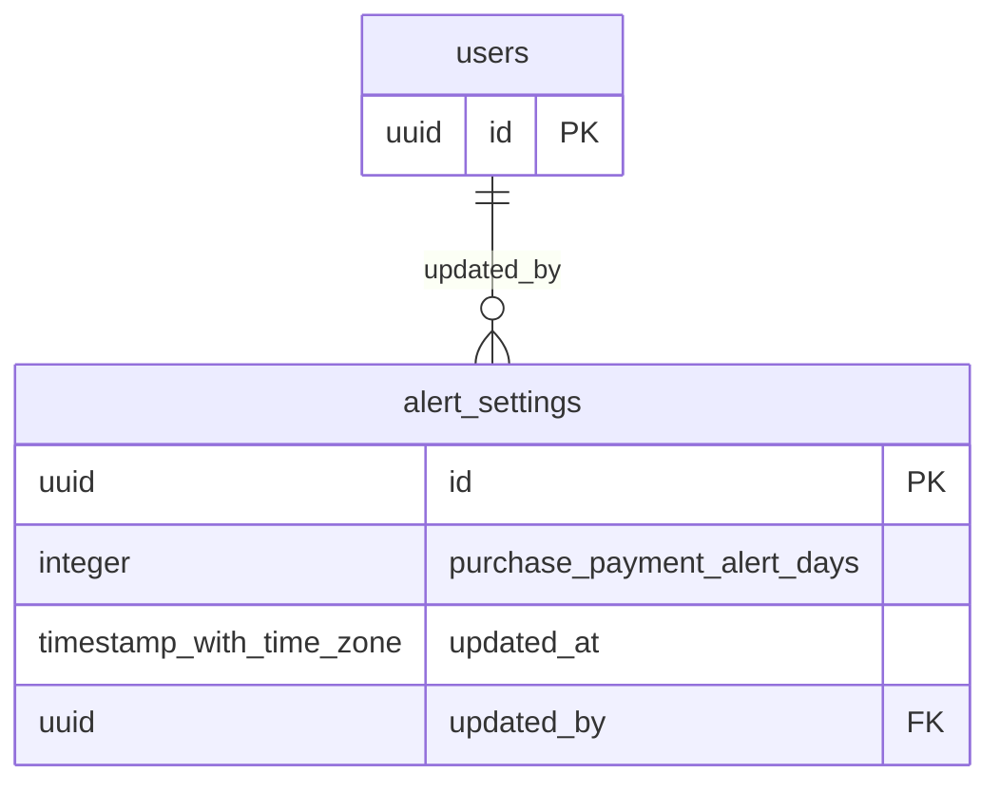

# Base de datos — dominio `alert-settings`

Volver a [05_DATABASE_REFERENCE.md](../05_DATABASE_REFERENCE.md). Diagrama ER: llaves primarias (PK) y foráneas (FK) reales; las tablas de otros dominios referenciadas aparecen solo con su `id`. Se muestran hasta 14 columnas por tabla en el diagrama; la lista completa está en cada ficha.

## `alert_settings`

- **Entidad TypeORM:** [AlertSettingsOrmEntity](../reference/backend/alert-settings.md#f-comercial-jhoel-api-src-modules-alert-settings-infrastructure-persistence-alert-settings-orm-entity-ts)
- **Creada en:** migración no identificada por el análisis (creada con TypeORM `Table` o `createTable`)
- **Archivos TypeScript que la usan:** [alert-settings.orm-entity.ts](../reference/backend/alert-settings.md#f-comercial-jhoel-api-src-modules-alert-settings-infrastructure-persistence-alert-settings-orm-entity-ts)

| Columna | Tipo | Nulo | Default |
|---|---|---|---|
| `id` | uuid | NOT NULL | gen_random_uuid() |
| `purchase_payment_alert_days` | integer | NOT NULL | 3 |
| `updated_at` | timestamp with time zone | NOT NULL | now() |
| `updated_by` | uuid | sí |  |

| Restricción | Tipo | Definición |
|---|---|---|
| `CHK_alert_settings_days_non_negative` | CHECK | CHECK ((purchase_payment_alert_days &gt;= 0)) |
| `FK_alert_settings_updated_by` | FK | FOREIGN KEY (updated_by) REFERENCES users(id) ON DELETE RESTRICT |
| `PK_9f318561ba481069150ca1fff62` | PK | PRIMARY KEY (id) |

**Índices:**

- `PK_9f318561ba481069150ca1fff62`: CREATE UNIQUE INDEX "PK_9f318561ba481069150ca1fff62" ON public.alert_settings USING btree (id)

