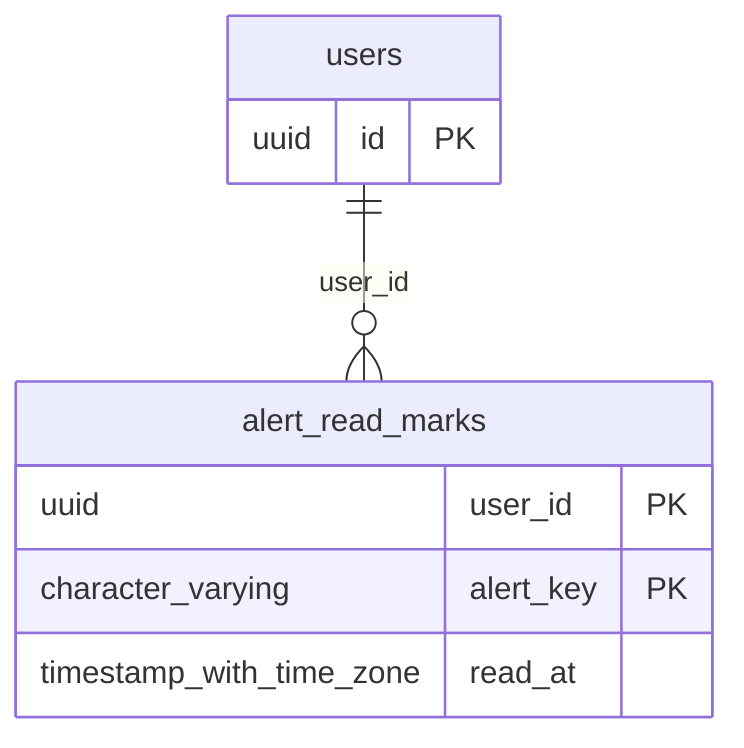

# Base de datos — dominio `alerts`

Volver a [05_DATABASE_REFERENCE.md](../05_DATABASE_REFERENCE.md). Diagrama ER: llaves primarias (PK) y foráneas (FK) reales; las tablas de otros dominios referenciadas aparecen solo con su `id`. Se muestran hasta 14 columnas por tabla en el diagrama; la lista completa está en cada ficha.

## `alert_read_marks`

- **Entidad TypeORM:** [AlertReadMarkOrmEntity](../reference/backend/alerts.md#f-comercial-jhoel-api-src-modules-alerts-infrastructure-persistence-alert-read-mark-orm-entity-ts)
- **Creada en:** migración no identificada por el análisis (creada con TypeORM `Table` o `createTable`)
- **Archivos TypeScript que la usan:** [alert-read-mark.orm-entity.ts](../reference/backend/alerts.md#f-comercial-jhoel-api-src-modules-alerts-infrastructure-persistence-alert-read-mark-orm-entity-ts)

| Columna | Tipo | Nulo | Default |
|---|---|---|---|
| `user_id` | uuid | NOT NULL |  |
| `alert_key` | character varying(255) | NOT NULL |  |
| `read_at` | timestamp with time zone | NOT NULL | now() |

| Restricción | Tipo | Definición |
|---|---|---|
| `FK_alert_read_marks_user` | FK | FOREIGN KEY (user_id) REFERENCES users(id) ON DELETE CASCADE |
| `PK_b38adc8de1cb436f38ca6495034` | PK | PRIMARY KEY (user_id, alert_key) |

**Índices:**

- `PK_b38adc8de1cb436f38ca6495034`: CREATE UNIQUE INDEX "PK_b38adc8de1cb436f38ca6495034" ON public.alert_read_marks USING btree (user_id, alert_key)

