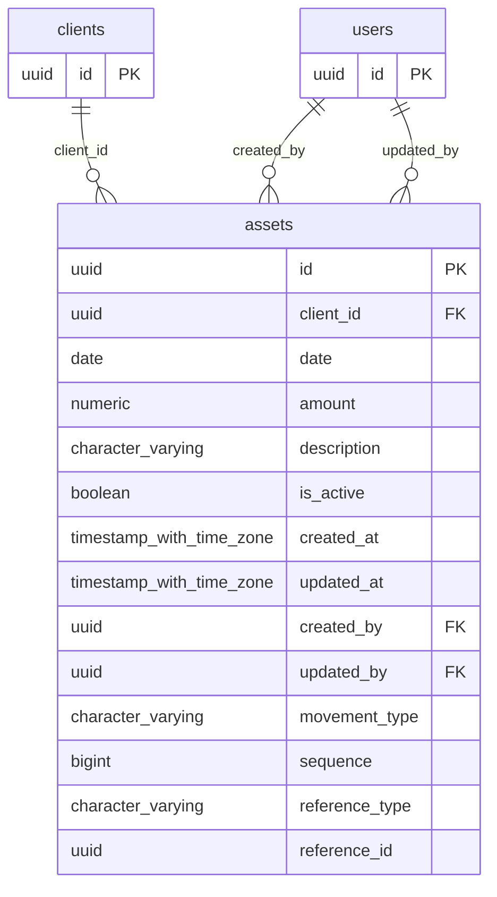

# Base de datos — dominio `assets`

Volver a [05_DATABASE_REFERENCE.md](../05_DATABASE_REFERENCE.md). Diagrama ER: llaves primarias (PK) y foráneas (FK) reales; las tablas de otros dominios referenciadas aparecen solo con su `id`. Se muestran hasta 14 columnas por tabla en el diagrama; la lista completa está en cada ficha.

## `assets`

- **Entidad TypeORM:** [AssetOrmEntity](../reference/backend/assets.md#f-comercial-jhoel-api-src-modules-assets-infrastructure-persistence-asset-orm-entity-ts)
- **Creada en:** migración no identificada por el análisis (creada con TypeORM `Table` o `createTable`)
- **Archivos TypeScript que la usan:** [asset.orm-entity.ts](../reference/backend/assets.md#f-comercial-jhoel-api-src-modules-assets-infrastructure-persistence-asset-orm-entity-ts), [typeorm-asset.repository.ts](../reference/backend/assets.md#f-comercial-jhoel-api-src-modules-assets-infrastructure-persistence-typeorm-asset-repository-ts), [typeorm-financial-day-review.repository.ts](../reference/backend/financial-day-review.md#f-comercial-jhoel-api-src-modules-financial-day-review-infrastructure-persistence-typeorm-financial-day-review-repository-ts), [financial-day-review.e2e-spec.ts](../reference/backend/e2e.md#f-comercial-jhoel-api-test-financial-day-review-e2e-spec-ts)
- **Funciones SQL que la escriben:** `register_asset_movement`

| Columna | Tipo | Nulo | Default |
|---|---|---|---|
| `id` | uuid | NOT NULL | gen_random_uuid() |
| `client_id` | uuid | NOT NULL |  |
| `date` | date | NOT NULL |  |
| `amount` | numeric(12,2) | NOT NULL |  |
| `description` | character varying(500) | sí |  |
| `is_active` | boolean | NOT NULL | true |
| `created_at` | timestamp with time zone | NOT NULL | now() |
| `updated_at` | timestamp with time zone | NOT NULL | now() |
| `created_by` | uuid | NOT NULL |  |
| `updated_by` | uuid | sí |  |
| `movement_type` | character varying(20) | NOT NULL | 'CARGO'::character varying |
| `sequence` | bigint | NOT NULL | nextval('assets_sequence_seq'::regclass) |
| `reference_type` | character varying(50) | sí |  |
| `reference_id` | uuid | sí |  |

| Restricción | Tipo | Definición |
|---|---|---|
| `CHK_assets_amount_positive` | CHECK | CHECK ((amount &gt; (0)::numeric)) |
| `CHK_assets_movement_type` | CHECK | CHECK (((movement_type)::text = ANY ((ARRAY['CARGO'::character varying, 'ABONO'::character varying])::text[]))) |
| `CHK_assets_reference_pair` | CHECK | CHECK ((((reference_type IS NULL) AND (reference_id IS NULL)) OR ((reference_type IS NOT NULL) AND (reference_id IS NOT NULL)))) |
| `FK_assets_client` | FK | FOREIGN KEY (client_id) REFERENCES clients(id) ON DELETE RESTRICT |
| `FK_assets_created_by` | FK | FOREIGN KEY (created_by) REFERENCES users(id) ON DELETE RESTRICT |
| `FK_assets_updated_by` | FK | FOREIGN KEY (updated_by) REFERENCES users(id) ON DELETE RESTRICT |
| `PK_da96729a8b113377cfb6a62439c` | PK | PRIMARY KEY (id) |

**Índices:**

- `IDX_assets_client_id`: CREATE INDEX "IDX_assets_client_id" ON public.assets USING btree (client_id)
- `IDX_assets_date`: CREATE INDEX "IDX_assets_date" ON public.assets USING btree (date)
- `IDX_assets_is_active`: CREATE INDEX "IDX_assets_is_active" ON public.assets USING btree (is_active)
- `PK_da96729a8b113377cfb6a62439c`: CREATE UNIQUE INDEX "PK_da96729a8b113377cfb6a62439c" ON public.assets USING btree (id)

**Triggers:**

- `trg_cash_assets_insert`: CREATE TRIGGER trg_cash_assets_insert AFTER INSERT ON public.assets FOR EACH ROW EXECUTE FUNCTION cash_on_portfolio_row()
- `trg_cash_assets_update`: CREATE TRIGGER trg_cash_assets_update AFTER UPDATE OF amount, movement_type, is_active ON public.assets FOR EACH ROW WHEN (((old.amount IS DISTINCT FROM new.amount) OR ((old.movement_type)::text IS DISTINCT FROM (new.movement_type)::text) OR (old.is_active IS DISTINCT FROM new.is_active))) EXECUTE FUNCTION cash_on_portfolio_row()
- `trg_financial_review_guard`: CREATE TRIGGER trg_financial_review_guard BEFORE INSERT OR DELETE OR UPDATE ON public.assets FOR EACH ROW EXECUTE FUNCTION financial_review_day_guard('date')

