# Base de datos — dominio `bank-deposits`

Volver a [05_DATABASE_REFERENCE.md](../05_DATABASE_REFERENCE.md). Diagrama ER: llaves primarias (PK) y foráneas (FK) reales; las tablas de otros dominios referenciadas aparecen solo con su `id`. Se muestran hasta 14 columnas por tabla en el diagrama; la lista completa está en cada ficha.

```mermaid
erDiagram
  bank_deposit_cash_details {
    uuid id PK
    uuid operation_id FK
    numeric denomination
    integer quantity
    numeric subtotal
  }
  bank_deposit_operations {
    uuid id PK
    uuid transaction_bank_id FK
    numeric total_amount
    integer transaction_count
    numeric total_cash
    numeric total_distributed
    date operation_date
    uuid user_id FK
    timestamp_with_time_zone created_at
    timestamp_with_time_zone updated_at
    character_varying client_name
    uuid transaction_type_id FK
    boolean is_voided
    timestamp_with_time_zone voided_at
  }
  bank_deposit_transactions {
    uuid id PK
    uuid operation_id FK
    integer sequence
    numeric amount
  }
  transaction_banks {
    uuid id PK
    character_varying name
    boolean is_active
    timestamp_with_time_zone created_at
    timestamp_with_time_zone updated_at
    uuid created_by FK
    uuid updated_by FK
    bytea image_data
    character_varying image_mime_type
    integer image_size_bytes
    character_varying cash_box_code
    numeric commission_per_transaction
  }
  transaction_types {
    uuid id PK
    character_varying name
    character_varying icon
    boolean is_active
    timestamp_with_time_zone created_at
    timestamp_with_time_zone updated_at
    uuid created_by FK
    uuid updated_by FK
    character_varying balance_effect
    character_varying cash_effect
  }
  banks {
    uuid id PK
  }
  clients {
    uuid id PK
  }
  users {
    uuid id PK
  }
  bank_deposit_operations ||--o{ bank_deposit_cash_details : "operation_id"
  banks ||--o{ bank_deposit_operations : "bank_account_id"
  clients ||--o{ bank_deposit_operations : "client_id"
  transaction_banks ||--o{ bank_deposit_operations : "transaction_bank_id"
  users ||--o{ bank_deposit_operations : "user_id"
  users ||--o{ bank_deposit_operations : "voided_by"
  transaction_types ||--o{ bank_deposit_operations : "transaction_type_id"
  bank_deposit_operations ||--o{ bank_deposit_transactions : "operation_id"
  users ||--o{ transaction_banks : "created_by"
  users ||--o{ transaction_banks : "updated_by"
  users ||--o{ transaction_types : "created_by"
  users ||--o{ transaction_types : "updated_by"
```

## `bank_deposit_cash_details`

- **Entidad TypeORM:** [BankDepositCashDetailOrmEntity](../reference/backend/bank-deposits.md#f-comercial-jhoel-api-src-modules-bank-deposits-infrastructure-persistence-bank-deposit-cash-detail-orm-entity-ts)
- **Creada en:** migración no identificada por el análisis (creada con TypeORM `Table` o `createTable`)
- **Archivos TypeScript que la usan:** [bank-deposit-cash-detail.orm-entity.ts](../reference/backend/bank-deposits.md#f-comercial-jhoel-api-src-modules-bank-deposits-infrastructure-persistence-bank-deposit-cash-detail-orm-entity-ts), [typeorm-guayacan-cash-box.repository.ts](../reference/backend/guayacan-cash-box.md#f-comercial-jhoel-api-src-modules-guayacan-cash-box-infrastructure-persistence-typeorm-guayacan-cash-box-repository-ts)
- **Funciones SQL que la escriben:** `register_bank_deposit_operation`

| Columna | Tipo | Nulo | Default |
|---|---|---|---|
| `id` | uuid | NOT NULL | gen_random_uuid() |
| `operation_id` | uuid | NOT NULL |  |
| `denomination` | numeric(10,2) | NOT NULL |  |
| `quantity` | integer | NOT NULL |  |
| `subtotal` | numeric(14,2) | NOT NULL |  |

| Restricción | Tipo | Definición |
|---|---|---|
| `chk_bank_deposit_cash_details_quantity_non_negative` | CHECK | CHECK ((quantity &gt;= 0)) |
| `FK_bank_deposit_cash_details_operation` | FK | FOREIGN KEY (operation_id) REFERENCES bank_deposit_operations(id) ON DELETE CASCADE |
| `PK_36104f5d828492ce8ce6c88b778` | PK | PRIMARY KEY (id) |

**Índices:**

- `IDX_bank_deposit_cash_details_operation_id`: CREATE INDEX "IDX_bank_deposit_cash_details_operation_id" ON public.bank_deposit_cash_details USING btree (operation_id)
- `PK_36104f5d828492ce8ce6c88b778`: CREATE UNIQUE INDEX "PK_36104f5d828492ce8ce6c88b778" ON public.bank_deposit_cash_details USING btree (id)

## `bank_deposit_operations`

- **Entidad TypeORM:** [BankDepositOperationOrmEntity](../reference/backend/bank-deposits.md#f-comercial-jhoel-api-src-modules-bank-deposits-infrastructure-persistence-bank-deposit-operation-orm-entity-ts)
- **Creada en:** migración no identificada por el análisis (creada con TypeORM `Table` o `createTable`)
- **Archivos TypeScript que la usan:** [bank-deposit-operation.orm-entity.ts](../reference/backend/bank-deposits.md#f-comercial-jhoel-api-src-modules-bank-deposits-infrastructure-persistence-bank-deposit-operation-orm-entity-ts), [typeorm-financial-day-review.repository.ts](../reference/backend/financial-day-review.md#f-comercial-jhoel-api-src-modules-financial-day-review-infrastructure-persistence-typeorm-financial-day-review-repository-ts), [typeorm-guayacan-cash-box.repository.ts](../reference/backend/guayacan-cash-box.md#f-comercial-jhoel-api-src-modules-guayacan-cash-box-infrastructure-persistence-typeorm-guayacan-cash-box-repository-ts), [bank-deposit-description.e2e-spec.ts](../reference/backend/e2e.md#f-comercial-jhoel-api-test-bank-deposit-description-e2e-spec-ts), [financial-day-review.e2e-spec.ts](../reference/backend/e2e.md#f-comercial-jhoel-api-test-financial-day-review-e2e-spec-ts)
- **Funciones SQL que la escriben:** `register_bank_deposit_operation`, `void_bank_deposit_operation`

| Columna | Tipo | Nulo | Default |
|---|---|---|---|
| `id` | uuid | NOT NULL | gen_random_uuid() |
| `transaction_bank_id` | uuid | sí |  |
| `total_amount` | numeric(14,2) | NOT NULL |  |
| `transaction_count` | integer | NOT NULL |  |
| `total_cash` | numeric(14,2) | NOT NULL | 0 |
| `total_distributed` | numeric(14,2) | NOT NULL | 0 |
| `operation_date` | date | NOT NULL |  |
| `user_id` | uuid | NOT NULL |  |
| `created_at` | timestamp with time zone | NOT NULL | now() |
| `updated_at` | timestamp with time zone | NOT NULL | now() |
| `client_name` | character varying(150) | sí |  |
| `transaction_type_id` | uuid | NOT NULL |  |
| `is_voided` | boolean | NOT NULL | false |
| `voided_at` | timestamp with time zone | sí |  |
| `voided_by` | uuid | sí |  |
| `void_reason` | text | sí |  |
| `change_given` | numeric(14,2) | NOT NULL | 0 |
| `client_id` | uuid | sí |  |
| `bank_account_id` | uuid | sí |  |
| `cash_breakdown_enabled` | boolean | NOT NULL | true |
| `description` | character varying(250) | sí |  |

| Restricción | Tipo | Definición |
|---|---|---|
| `CHK_bank_deposit_operations_bank_reference` | CHECK | CHECK (((transaction_bank_id IS NOT NULL) OR (bank_account_id IS NOT NULL))) |
| `CHK_bank_deposit_operations_change_given_non_negative` | CHECK | CHECK ((change_given &gt;= (0)::numeric)) |
| `CHK_bank_deposit_operations_description` | CHECK | CHECK (((description IS NULL) OR (((char_length((description)::text) &gt;= 1) AND (char_length((description)::text) &lt;= 250)) AND ((description)::text = btrim((description)::text))))) |
| `CHK_bank_deposit_operations_void_consistency` | CHECK | CHECK ((((is_voided = false) AND (voided_at IS NULL) AND (voided_by IS NULL) AND (void_reason IS NULL)) OR ((is_voided = true) AND (voided_at IS NOT NULL) AND (voided_by IS NOT NULL) AND (void_reason IS NOT NULL)))) |
| `chk_bank_deposit_operations_total_amount_positive` | CHECK | CHECK ((total_amount &gt; (0)::numeric)) |
| `chk_bank_deposit_operations_transaction_count_positive` | CHECK | CHECK ((transaction_count &gt; 0)) |
| `FK_bank_deposit_operations_bank_account` | FK | FOREIGN KEY (bank_account_id) REFERENCES banks(id) ON DELETE RESTRICT |
| `FK_bank_deposit_operations_client` | FK | FOREIGN KEY (client_id) REFERENCES clients(id) ON DELETE RESTRICT |
| `FK_bank_deposit_operations_transaction_bank` | FK | FOREIGN KEY (transaction_bank_id) REFERENCES transaction_banks(id) ON DELETE RESTRICT |
| `FK_bank_deposit_operations_user` | FK | FOREIGN KEY (user_id) REFERENCES users(id) ON DELETE RESTRICT |
| `FK_bank_deposit_operations_voided_by` | FK | FOREIGN KEY (voided_by) REFERENCES users(id) ON DELETE RESTRICT |
| `fk_bank_deposit_operations_transaction_type` | FK | FOREIGN KEY (transaction_type_id) REFERENCES transaction_types(id) ON DELETE RESTRICT |
| `PK_1092965d75cfa2b727ab41b370e` | PK | PRIMARY KEY (id) |

**Índices:**

- `IDX_bank_deposit_operations_bank_account_id`: CREATE INDEX "IDX_bank_deposit_operations_bank_account_id" ON public.bank_deposit_operations USING btree (bank_account_id)
- `IDX_bank_deposit_operations_client_id`: CREATE INDEX "IDX_bank_deposit_operations_client_id" ON public.bank_deposit_operations USING btree (client_id)
- `IDX_bank_deposit_operations_created_at_id`: CREATE INDEX "IDX_bank_deposit_operations_created_at_id" ON public.bank_deposit_operations USING btree (created_at DESC, id DESC)
- `IDX_bank_deposit_operations_description_trgm`: CREATE INDEX "IDX_bank_deposit_operations_description_trgm" ON public.bank_deposit_operations USING gin (search_normalize((description)::text) gin_trgm_ops) WHERE (description IS NOT NULL)
- `IDX_bank_deposit_operations_is_voided`: CREATE INDEX "IDX_bank_deposit_operations_is_voided" ON public.bank_deposit_operations USING btree (is_voided)
- `IDX_bank_deposit_operations_operation_date`: CREATE INDEX "IDX_bank_deposit_operations_operation_date" ON public.bank_deposit_operations USING btree (operation_date)
- `IDX_bank_deposit_operations_transaction_bank_id`: CREATE INDEX "IDX_bank_deposit_operations_transaction_bank_id" ON public.bank_deposit_operations USING btree (transaction_bank_id)
- `IDX_bank_deposit_operations_transaction_type_id`: CREATE INDEX "IDX_bank_deposit_operations_transaction_type_id" ON public.bank_deposit_operations USING btree (transaction_type_id)
- `IDX_bank_deposit_operations_user_id`: CREATE INDEX "IDX_bank_deposit_operations_user_id" ON public.bank_deposit_operations USING btree (user_id)
- `PK_1092965d75cfa2b727ab41b370e`: CREATE UNIQUE INDEX "PK_1092965d75cfa2b727ab41b370e" ON public.bank_deposit_operations USING btree (id)

**Triggers:**

- `trg_cash_bank_deposit_insert`: CREATE TRIGGER trg_cash_bank_deposit_insert AFTER INSERT ON public.bank_deposit_operations FOR EACH ROW EXECUTE FUNCTION cash_on_bank_deposit_insert()
- `trg_cash_bank_deposit_void`: CREATE TRIGGER trg_cash_bank_deposit_void AFTER UPDATE OF is_voided ON public.bank_deposit_operations FOR EACH ROW WHEN (((old.is_voided = false) AND (new.is_voided = true))) EXECUTE FUNCTION cash_on_bank_deposit_void()
- `trg_financial_review_guard`: CREATE TRIGGER trg_financial_review_guard BEFORE INSERT OR DELETE OR UPDATE ON public.bank_deposit_operations FOR EACH ROW EXECUTE FUNCTION financial_review_day_guard('operation_date')
- `trg_guayacan_commission_insert`: CREATE TRIGGER trg_guayacan_commission_insert AFTER INSERT ON public.bank_deposit_operations FOR EACH ROW EXECUTE FUNCTION guayacan_commission_on_operation_insert()
- `trg_guayacan_commission_void`: CREATE TRIGGER trg_guayacan_commission_void AFTER UPDATE OF is_voided ON public.bank_deposit_operations FOR EACH ROW WHEN (((old.is_voided = false) AND (new.is_voided = true))) EXECUTE FUNCTION guayacan_commission_on_operation_void()

## `bank_deposit_transactions`

- **Entidad TypeORM:** [BankDepositTransactionOrmEntity](../reference/backend/bank-deposits.md#f-comercial-jhoel-api-src-modules-bank-deposits-infrastructure-persistence-bank-deposit-transaction-orm-entity-ts)
- **Creada en:** migración no identificada por el análisis (creada con TypeORM `Table` o `createTable`)
- **Archivos TypeScript que la usan:** [bank-deposit-transaction.orm-entity.ts](../reference/backend/bank-deposits.md#f-comercial-jhoel-api-src-modules-bank-deposits-infrastructure-persistence-bank-deposit-transaction-orm-entity-ts)
- **Funciones SQL que la escriben:** `register_bank_deposit_operation`

| Columna | Tipo | Nulo | Default |
|---|---|---|---|
| `id` | uuid | NOT NULL | gen_random_uuid() |
| `operation_id` | uuid | NOT NULL |  |
| `sequence` | integer | NOT NULL |  |
| `amount` | numeric(14,2) | NOT NULL |  |

| Restricción | Tipo | Definición |
|---|---|---|
| `chk_bank_deposit_transactions_amount_positive` | CHECK | CHECK ((amount &gt; (0)::numeric)) |
| `FK_bank_deposit_transactions_operation` | FK | FOREIGN KEY (operation_id) REFERENCES bank_deposit_operations(id) ON DELETE CASCADE |
| `PK_839d69733d8459e822111269fd1` | PK | PRIMARY KEY (id) |

**Índices:**

- `IDX_bank_deposit_transactions_operation_id`: CREATE INDEX "IDX_bank_deposit_transactions_operation_id" ON public.bank_deposit_transactions USING btree (operation_id)
- `PK_839d69733d8459e822111269fd1`: CREATE UNIQUE INDEX "PK_839d69733d8459e822111269fd1" ON public.bank_deposit_transactions USING btree (id)

## `transaction_banks`

- **Entidad TypeORM:** [TransactionBankOrmEntity](../reference/backend/transaction-banks.md#f-comercial-jhoel-api-src-modules-transaction-banks-infrastructure-persistence-transaction-bank-orm-entity-ts)
- **Creada en:** migración no identificada por el análisis (creada con TypeORM `Table` o `createTable`)
- **Archivos TypeScript que la usan:** [typeorm-bank-deposit.repository.ts](../reference/backend/bank-deposits.md#f-comercial-jhoel-api-src-modules-bank-deposits-infrastructure-persistence-typeorm-bank-deposit-repository-ts), [typeorm-financial-day-review.repository.ts](../reference/backend/financial-day-review.md#f-comercial-jhoel-api-src-modules-financial-day-review-infrastructure-persistence-typeorm-financial-day-review-repository-ts), [typeorm-guayacan-cash-box.repository.ts](../reference/backend/guayacan-cash-box.md#f-comercial-jhoel-api-src-modules-guayacan-cash-box-infrastructure-persistence-typeorm-guayacan-cash-box-repository-ts), [transaction-bank.orm-entity.ts](../reference/backend/transaction-banks.md#f-comercial-jhoel-api-src-modules-transaction-banks-infrastructure-persistence-transaction-bank-orm-entity-ts), [bank-deposit-description.e2e-spec.ts](../reference/backend/e2e.md#f-comercial-jhoel-api-test-bank-deposit-description-e2e-spec-ts), [cash-control.e2e-spec.ts](../reference/backend/e2e.md#f-comercial-jhoel-api-test-cash-control-e2e-spec-ts)

| Columna | Tipo | Nulo | Default |
|---|---|---|---|
| `id` | uuid | NOT NULL | gen_random_uuid() |
| `name` | character varying(150) | NOT NULL |  |
| `is_active` | boolean | NOT NULL | true |
| `created_at` | timestamp with time zone | NOT NULL | now() |
| `updated_at` | timestamp with time zone | NOT NULL | now() |
| `created_by` | uuid | NOT NULL |  |
| `updated_by` | uuid | sí |  |
| `image_data` | bytea | sí |  |
| `image_mime_type` | character varying(50) | sí |  |
| `image_size_bytes` | integer | sí |  |
| `cash_box_code` | character varying(30) | sí |  |
| `commission_per_transaction` | numeric(10,2) | sí |  |

| Restricción | Tipo | Definición |
|---|---|---|
| `CHK_transaction_banks_cash_box_code` | CHECK | CHECK (((cash_box_code IS NULL) OR ((cash_box_code)::text = 'GUAYACAN'::text))) |
| `CHK_transaction_banks_commission` | CHECK | CHECK (((commission_per_transaction IS NULL) OR ((commission_per_transaction &gt; (0)::numeric) AND (cash_box_code IS NOT NULL)))) |
| `FK_transaction_banks_created_by` | FK | FOREIGN KEY (created_by) REFERENCES users(id) ON DELETE RESTRICT |
| `FK_transaction_banks_updated_by` | FK | FOREIGN KEY (updated_by) REFERENCES users(id) ON DELETE RESTRICT |
| `PK_fed3802617c201aa4e7dec2129c` | PK | PRIMARY KEY (id) |

**Índices:**

- `PK_fed3802617c201aa4e7dec2129c`: CREATE UNIQUE INDEX "PK_fed3802617c201aa4e7dec2129c" ON public.transaction_banks USING btree (id)
- `UQ_transaction_banks_cash_box_code`: CREATE UNIQUE INDEX "UQ_transaction_banks_cash_box_code" ON public.transaction_banks USING btree (cash_box_code) WHERE (cash_box_code IS NOT NULL)
- `UQ_transaction_banks_name_active`: CREATE UNIQUE INDEX "UQ_transaction_banks_name_active" ON public.transaction_banks USING btree (name) WHERE (is_active = true)

## `transaction_types`

- **Entidad TypeORM:** [TransactionTypeOrmEntity](../reference/backend/transaction-types.md#f-comercial-jhoel-api-src-modules-transaction-types-infrastructure-persistence-transaction-type-orm-entity-ts)
- **Creada en:** migración no identificada por el análisis (creada con TypeORM `Table` o `createTable`)
- **Archivos TypeScript que la usan:** [typeorm-bank-deposit.repository.ts](../reference/backend/bank-deposits.md#f-comercial-jhoel-api-src-modules-bank-deposits-infrastructure-persistence-typeorm-bank-deposit-repository-ts), [typeorm-financial-day-review.repository.ts](../reference/backend/financial-day-review.md#f-comercial-jhoel-api-src-modules-financial-day-review-infrastructure-persistence-typeorm-financial-day-review-repository-ts), [typeorm-guayacan-cash-box.repository.ts](../reference/backend/guayacan-cash-box.md#f-comercial-jhoel-api-src-modules-guayacan-cash-box-infrastructure-persistence-typeorm-guayacan-cash-box-repository-ts), [transaction-type.orm-entity.ts](../reference/backend/transaction-types.md#f-comercial-jhoel-api-src-modules-transaction-types-infrastructure-persistence-transaction-type-orm-entity-ts), [bank-deposit-description.e2e-spec.ts](../reference/backend/e2e.md#f-comercial-jhoel-api-test-bank-deposit-description-e2e-spec-ts), [cash-control.e2e-spec.ts](../reference/backend/e2e.md#f-comercial-jhoel-api-test-cash-control-e2e-spec-ts)

| Columna | Tipo | Nulo | Default |
|---|---|---|---|
| `id` | uuid | NOT NULL | gen_random_uuid() |
| `name` | character varying(150) | NOT NULL |  |
| `icon` | character varying(50) | NOT NULL |  |
| `is_active` | boolean | NOT NULL | true |
| `created_at` | timestamp with time zone | NOT NULL | now() |
| `updated_at` | timestamp with time zone | NOT NULL | now() |
| `created_by` | uuid | NOT NULL |  |
| `updated_by` | uuid | sí |  |
| `balance_effect` | character varying(30) | sí |  |
| `cash_effect` | character varying(10) | NOT NULL | 'NONE'::character varying |

| Restricción | Tipo | Definición |
|---|---|---|
| `CHK_transaction_types_balance_effect` | CHECK | CHECK (((balance_effect IS NULL) OR ((balance_effect)::text = ANY ((ARRAY['DEPOSITO'::character varying, 'RETIRO'::character varying, 'DESEMBOLSO_GENESIS'::character varying, 'PAGO_GENESIS'::character varying, 'REINTEGRO'::character varying])::text[])))) |
| `CHK_transaction_types_cash_effect` | CHECK | CHECK (((cash_effect)::text = ANY ((ARRAY['IN'::character varying, 'OUT'::character varying, 'NONE'::character varying])::text[]))) |
| `FK_transaction_types_created_by` | FK | FOREIGN KEY (created_by) REFERENCES users(id) ON DELETE RESTRICT |
| `FK_transaction_types_updated_by` | FK | FOREIGN KEY (updated_by) REFERENCES users(id) ON DELETE RESTRICT |
| `PK_2a49fe7879bf8a02812639cea61` | PK | PRIMARY KEY (id) |

**Índices:**

- `PK_2a49fe7879bf8a02812639cea61`: CREATE UNIQUE INDEX "PK_2a49fe7879bf8a02812639cea61" ON public.transaction_types USING btree (id)
- `UQ_transaction_types_name_active`: CREATE UNIQUE INDEX "UQ_transaction_types_name_active" ON public.transaction_types USING btree (name) WHERE (is_active = true)

