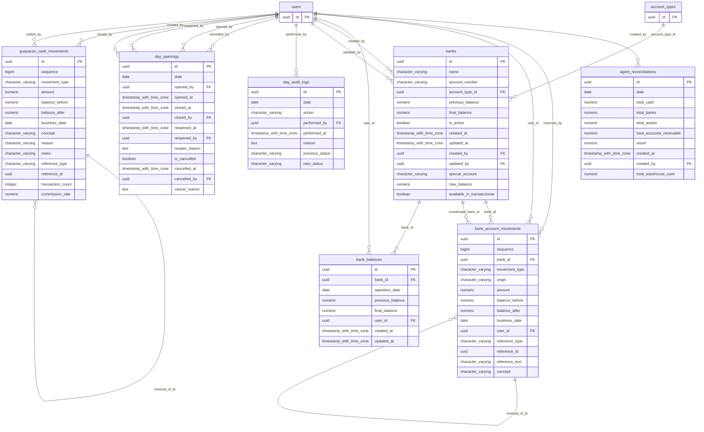

# Base de datos — dominio `banks`

Volver a [05_DATABASE_REFERENCE.md](../05_DATABASE_REFERENCE.md). Diagrama ER: llaves primarias (PK) y foráneas (FK) reales; las tablas de otros dominios referenciadas aparecen solo con su `id`. Se muestran hasta 14 columnas por tabla en el diagrama; la lista completa está en cada ficha.

## `agent_reconciliations`

- **Entidad TypeORM:** [AgentReconciliationOrmEntity](../reference/backend/banks.md#f-comercial-jhoel-api-src-modules-banks-infrastructure-persistence-agent-reconciliation-orm-entity-ts)
- **Creada en:** migración no identificada por el análisis (creada con TypeORM `Table` o `createTable`)
- **Archivos TypeScript que la usan:** [agent-reconciliation.orm-entity.ts](../reference/backend/banks.md#f-comercial-jhoel-api-src-modules-banks-infrastructure-persistence-agent-reconciliation-orm-entity-ts), [typeorm-day-opening.repository.ts](../reference/backend/banks.md#f-comercial-jhoel-api-src-modules-banks-infrastructure-persistence-typeorm-day-opening-repository-ts), [typeorm-financial-day-review.repository.ts](../reference/backend/financial-day-review.md#f-comercial-jhoel-api-src-modules-financial-day-review-infrastructure-persistence-typeorm-financial-day-review-repository-ts), [financial-day-review.e2e-spec.ts](../reference/backend/e2e.md#f-comercial-jhoel-api-test-financial-day-review-e2e-spec-ts)
- **Funciones SQL que la escriben:** `close_agent_day`, `correct_financial_day_snapshot`

| Columna | Tipo | Nulo | Default |
|---|---|---|---|
| `id` | uuid | NOT NULL | gen_random_uuid() |
| `date` | date | NOT NULL |  |
| `total_cash` | numeric(14,2) | NOT NULL |  |
| `total_banks` | numeric(14,2) | NOT NULL |  |
| `total_assets` | numeric(14,2) | NOT NULL |  |
| `total_accounts_receivable` | numeric(14,2) | NOT NULL |  |
| `result` | numeric(14,2) | NOT NULL |  |
| `created_at` | timestamp with time zone | NOT NULL | now() |
| `created_by` | uuid | NOT NULL |  |
| `total_warehouse_cash` | numeric(14,2) | NOT NULL | 0 |

| Restricción | Tipo | Definición |
|---|---|---|
| `FK_agent_reconciliations_created_by` | FK | FOREIGN KEY (created_by) REFERENCES users(id) ON DELETE RESTRICT |
| `PK_caaac68cff19e5598d0d34c56b4` | PK | PRIMARY KEY (id) |

**Índices:**

- `IDX_agent_reconciliations_date`: CREATE INDEX "IDX_agent_reconciliations_date" ON public.agent_reconciliations USING btree (date)
- `PK_caaac68cff19e5598d0d34c56b4`: CREATE UNIQUE INDEX "PK_caaac68cff19e5598d0d34c56b4" ON public.agent_reconciliations USING btree (id)

**Triggers:**

- `trg_financial_review_guard`: CREATE TRIGGER trg_financial_review_guard BEFORE INSERT OR DELETE OR UPDATE ON public.agent_reconciliations FOR EACH ROW EXECUTE FUNCTION financial_review_day_guard('date')

## `bank_account_movements`

- **Entidad TypeORM:** ninguna (se accede con SQL crudo o solo desde funciones PL/pgSQL)
- **Creada en:** `1760005100000-CreateBankAccountMovements.ts`
- **Archivos TypeScript que la usan:** [typeorm-account-receivable-settlement.repository.ts](../reference/backend/accounts-receivable.md#f-comercial-jhoel-api-src-modules-accounts-receivable-infrastructure-persistence-typeorm-account-receivable-settlement-repository-ts), [typeorm-bank-movement.repository.ts](../reference/backend/banks.md#f-comercial-jhoel-api-src-modules-banks-infrastructure-persistence-typeorm-bank-movement-repository-ts), [typeorm-bank.repository.ts](../reference/backend/banks.md#f-comercial-jhoel-api-src-modules-banks-infrastructure-persistence-typeorm-bank-repository-ts), [typeorm-financial-day-review.repository.ts](../reference/backend/financial-day-review.md#f-comercial-jhoel-api-src-modules-financial-day-review-infrastructure-persistence-typeorm-financial-day-review-repository-ts), [cuadre-cash-breakdown.e2e-spec.ts](../reference/backend/e2e.md#f-comercial-jhoel-api-test-cuadre-cash-breakdown-e2e-spec-ts), [financial-day-review.e2e-spec.ts](../reference/backend/e2e.md#f-comercial-jhoel-api-test-financial-day-review-e2e-spec-ts)
- **Funciones SQL que la escriben:** `apply_bank_account_movement`, `reverse_bank_account_movements`

| Columna | Tipo | Nulo | Default |
|---|---|---|---|
| `id` | uuid | NOT NULL | gen_random_uuid() |
| `sequence` | bigint | NOT NULL | nextval('bank_account_movements_sequence_seq'::regclass) |
| `bank_id` | uuid | NOT NULL |  |
| `movement_type` | character varying(30) | NOT NULL |  |
| `origin` | character varying(30) | NOT NULL |  |
| `amount` | numeric(14,2) | NOT NULL |  |
| `balance_before` | numeric(14,2) | NOT NULL |  |
| `balance_after` | numeric(14,2) | NOT NULL |  |
| `business_date` | date | NOT NULL |  |
| `user_id` | uuid | NOT NULL |  |
| `reference_type` | character varying(40) | sí |  |
| `reference_id` | uuid | sí |  |
| `reference_text` | character varying(100) | sí |  |
| `concept` | character varying(255) | sí |  |
| `observation` | text | sí |  |
| `counterpart_bank_id` | uuid | sí |  |
| `status` | character varying(20) | NOT NULL | 'APLICADO'::character varying |
| `reversal_of_id` | uuid | sí |  |
| `reversed_at` | timestamp with time zone | sí |  |
| `reversed_by` | uuid | sí |  |
| `created_at` | timestamp with time zone | NOT NULL | now() |

| Restricción | Tipo | Definición |
|---|---|---|
| `CHK_bank_account_movements_amount` | CHECK | CHECK (((amount &lt;&gt; (0)::numeric) OR ((movement_type)::text = 'SALDO_INICIAL'::text))) |
| `CHK_bank_account_movements_consistency` | CHECK | CHECK ((balance_after = (balance_before + amount))) |
| `CHK_bank_account_movements_origin` | CHECK | CHECK (((origin)::text = ANY ((ARRAY['TRANSACCIONAR'::character varying, 'TRANSFERENCIA'::character varying, 'AJUSTE_MANUAL'::character varying, 'SALDO_INICIAL'::character varying, 'ANULACION'::character varying, 'ACREDITACION_SALDO'::character varying, 'CONTROL_EFECTIVO'::character varying, 'CUENTAS_POR_COBRAR'::character varying])::text[]))) |
| `CHK_bank_account_movements_reference_pair` | CHECK | CHECK ((((reference_type IS NULL) AND (reference_id IS NULL)) OR ((reference_type IS NOT NULL) AND (reference_id IS NOT NULL)))) |
| `CHK_bank_account_movements_reversal_state` | CHECK | CHECK (((((status)::text = 'APLICADO'::text) AND (reversed_at IS NULL) AND (reversed_by IS NULL)) OR (((status)::text = 'ANULADO'::text) AND (reversed_at IS NOT NULL) AND (reversed_by IS NOT NULL)))) |
| `CHK_bank_account_movements_status` | CHECK | CHECK (((status)::text = ANY ((ARRAY['APLICADO'::character varying, 'ANULADO'::character varying])::text[]))) |
| `CHK_bank_account_movements_type` | CHECK | CHECK (((movement_type)::text = ANY ((ARRAY['DEPOSITO'::character varying, 'RETIRO'::character varying, 'DESEMBOLSO_GENESIS'::character varying, 'PAGO_GENESIS'::character varying, 'REINTEGRO'::character varying, 'TRANSFERENCIA_SALIDA'::character varying, 'TRANSFERENCIA_ENTRADA'::character varying, 'RETIRO_EFECTIVO'::character varying, 'AJUSTE_MANUAL'::character varying, 'SALDO_INICIAL'::character varying, 'ANULACION'::character varying, 'ACREDITACION_SALDO'::character varying, 'DEPOSITO_CAJA'::character varying, 'COBRO_CXC'::character varying])::text[]))) |
| `FK_bank_account_movements_bank` | FK | FOREIGN KEY (bank_id) REFERENCES banks(id) ON DELETE RESTRICT |
| `FK_bank_account_movements_counterpart` | FK | FOREIGN KEY (counterpart_bank_id) REFERENCES banks(id) ON DELETE RESTRICT |
| `FK_bank_account_movements_reversal_of` | FK | FOREIGN KEY (reversal_of_id) REFERENCES bank_account_movements(id) ON DELETE RESTRICT |
| `FK_bank_account_movements_reversed_by` | FK | FOREIGN KEY (reversed_by) REFERENCES users(id) ON DELETE RESTRICT |
| `FK_bank_account_movements_user` | FK | FOREIGN KEY (user_id) REFERENCES users(id) ON DELETE RESTRICT |
| `bank_account_movements_pkey` | PK | PRIMARY KEY (id) |

**Índices:**

- `IDX_bank_account_movements_bank_sequence`: CREATE INDEX "IDX_bank_account_movements_bank_sequence" ON public.bank_account_movements USING btree (bank_id, sequence)
- `IDX_bank_account_movements_business_date`: CREATE INDEX "IDX_bank_account_movements_business_date" ON public.bank_account_movements USING btree (business_date)
- `IDX_bank_account_movements_reference`: CREATE INDEX "IDX_bank_account_movements_reference" ON public.bank_account_movements USING btree (reference_type, reference_id)
- `IDX_bank_account_movements_user_id`: CREATE INDEX "IDX_bank_account_movements_user_id" ON public.bank_account_movements USING btree (user_id)
- `bank_account_movements_pkey`: CREATE UNIQUE INDEX bank_account_movements_pkey ON public.bank_account_movements USING btree (id)

**Triggers:**

- `trg_cash_bank_movement_insert`: CREATE TRIGGER trg_cash_bank_movement_insert AFTER INSERT ON public.bank_account_movements FOR EACH ROW WHEN (((new.movement_type)::text = 'RETIRO_EFECTIVO'::text)) EXECUTE FUNCTION cash_on_bank_movement_insert()
- `trg_cash_bank_movement_void`: CREATE TRIGGER trg_cash_bank_movement_void AFTER UPDATE OF status ON public.bank_account_movements FOR EACH ROW WHEN ((((old.status)::text = 'APLICADO'::text) AND ((new.status)::text = 'ANULADO'::text) AND ((new.movement_type)::text = 'RETIRO_EFECTIVO'::text))) EXECUTE FUNCTION cash_on_bank_movement_void()
- `trg_financial_review_guard`: CREATE TRIGGER trg_financial_review_guard BEFORE INSERT OR DELETE OR UPDATE ON public.bank_account_movements FOR EACH ROW EXECUTE FUNCTION financial_review_day_guard('business_date')
- `trg_guard_guayacan_bank_account_movement`: CREATE TRIGGER trg_guard_guayacan_bank_account_movement BEFORE INSERT ON public.bank_account_movements FOR EACH ROW EXECUTE FUNCTION guard_guayacan_bank_account_movement()

## `bank_balances`

- **Entidad TypeORM:** [BankBalanceOrmEntity](../reference/backend/banks.md#f-comercial-jhoel-api-src-modules-banks-infrastructure-persistence-bank-balance-orm-entity-ts)
- **Creada en:** migración no identificada por el análisis (creada con TypeORM `Table` o `createTable`)
- **Archivos TypeScript que la usan:** [bank-balance.orm-entity.ts](../reference/backend/banks.md#f-comercial-jhoel-api-src-modules-banks-infrastructure-persistence-bank-balance-orm-entity-ts), [typeorm-financial-day-review.repository.ts](../reference/backend/financial-day-review.md#f-comercial-jhoel-api-src-modules-financial-day-review-infrastructure-persistence-typeorm-financial-day-review-repository-ts), [cuadre-cash-breakdown.e2e-spec.ts](../reference/backend/e2e.md#f-comercial-jhoel-api-test-cuadre-cash-breakdown-e2e-spec-ts), [financial-day-review.e2e-spec.ts](../reference/backend/e2e.md#f-comercial-jhoel-api-test-financial-day-review-e2e-spec-ts)
- **Funciones SQL que la escriben:** `correct_financial_day_snapshot`, `save_bank_balance`

| Columna | Tipo | Nulo | Default |
|---|---|---|---|
| `id` | uuid | NOT NULL | gen_random_uuid() |
| `bank_id` | uuid | NOT NULL |  |
| `operation_date` | date | NOT NULL |  |
| `previous_balance` | numeric(12,2) | NOT NULL |  |
| `final_balance` | numeric(12,2) | NOT NULL |  |
| `user_id` | uuid | NOT NULL |  |
| `created_at` | timestamp with time zone | NOT NULL | now() |
| `updated_at` | timestamp with time zone | NOT NULL | now() |

| Restricción | Tipo | Definición |
|---|---|---|
| `FK_bank_balances_bank` | FK | FOREIGN KEY (bank_id) REFERENCES banks(id) ON DELETE RESTRICT |
| `FK_bank_balances_user` | FK | FOREIGN KEY (user_id) REFERENCES users(id) ON DELETE RESTRICT |
| `PK_3673debe12fa1c6631aba77a10b` | PK | PRIMARY KEY (id) |
| `UQ_bank_balances_bank_id_operation_date` | UNIQUE | UNIQUE (bank_id, operation_date) |

**Índices:**

- `PK_3673debe12fa1c6631aba77a10b`: CREATE UNIQUE INDEX "PK_3673debe12fa1c6631aba77a10b" ON public.bank_balances USING btree (id)
- `UQ_bank_balances_bank_id_operation_date`: CREATE UNIQUE INDEX "UQ_bank_balances_bank_id_operation_date" ON public.bank_balances USING btree (bank_id, operation_date)

**Triggers:**

- `trg_financial_review_guard`: CREATE TRIGGER trg_financial_review_guard BEFORE INSERT OR DELETE OR UPDATE ON public.bank_balances FOR EACH ROW EXECUTE FUNCTION financial_review_day_guard('operation_date')

## `banks`

- **Entidad TypeORM:** [BankOrmEntity](../reference/backend/banks.md#f-comercial-jhoel-api-src-modules-banks-infrastructure-persistence-bank-orm-entity-ts)
- **Creada en:** migración no identificada por el análisis (creada con TypeORM `Table` o `createTable`)
- **Archivos TypeScript que la usan:** [typeorm-account-receivable-settlement.repository.ts](../reference/backend/accounts-receivable.md#f-comercial-jhoel-api-src-modules-accounts-receivable-infrastructure-persistence-typeorm-account-receivable-settlement-repository-ts), [typeorm-bank-deposit.repository.ts](../reference/backend/bank-deposits.md#f-comercial-jhoel-api-src-modules-bank-deposits-infrastructure-persistence-typeorm-bank-deposit-repository-ts), [bank.orm-entity.ts](../reference/backend/banks.md#f-comercial-jhoel-api-src-modules-banks-infrastructure-persistence-bank-orm-entity-ts), [typeorm-bank-movement.repository.ts](../reference/backend/banks.md#f-comercial-jhoel-api-src-modules-banks-infrastructure-persistence-typeorm-bank-movement-repository-ts), [typeorm-cash-custody.repository.ts](../reference/backend/cash-control.md#f-comercial-jhoel-api-src-modules-cash-control-infrastructure-persistence-typeorm-cash-custody-repository-ts), [typeorm-financial-day-review.repository.ts](../reference/backend/financial-day-review.md#f-comercial-jhoel-api-src-modules-financial-day-review-infrastructure-persistence-typeorm-financial-day-review-repository-ts), [ar-settlements.e2e-spec.ts](../reference/backend/e2e.md#f-comercial-jhoel-api-test-ar-settlements-e2e-spec-ts), [bank-deposit-description.e2e-spec.ts](../reference/backend/e2e.md#f-comercial-jhoel-api-test-bank-deposit-description-e2e-spec-ts), [cash-control.e2e-spec.ts](../reference/backend/e2e.md#f-comercial-jhoel-api-test-cash-control-e2e-spec-ts), [cash-custody.e2e-spec.ts](../reference/backend/e2e.md#f-comercial-jhoel-api-test-cash-custody-e2e-spec-ts), [cuadre-cash-breakdown.e2e-spec.ts](../reference/backend/e2e.md#f-comercial-jhoel-api-test-cuadre-cash-breakdown-e2e-spec-ts), [financial-day-review.e2e-spec.ts](../reference/backend/e2e.md#f-comercial-jhoel-api-test-financial-day-review-e2e-spec-ts)
- **Funciones SQL que la escriben:** `apply_bank_account_movement`

| Columna | Tipo | Nulo | Default |
|---|---|---|---|
| `id` | uuid | NOT NULL | gen_random_uuid() |
| `name` | character varying(150) | NOT NULL |  |
| `account_number` | character varying(34) | NOT NULL |  |
| `account_type_id` | uuid | NOT NULL |  |
| `previous_balance` | numeric(12,2) | NOT NULL | 0 |
| `final_balance` | numeric(12,2) | NOT NULL | 0 |
| `is_active` | boolean | NOT NULL | true |
| `created_at` | timestamp with time zone | NOT NULL | now() |
| `updated_at` | timestamp with time zone | NOT NULL | now() |
| `created_by` | uuid | NOT NULL |  |
| `updated_by` | uuid | sí |  |
| `special_account` | character varying(30) | sí |  |
| `max_balance` | numeric(14,2) | sí |  |
| `available_in_transaccionar` | boolean | NOT NULL | true |

| Restricción | Tipo | Definición |
|---|---|---|
| `CHK_banks_max_balance_non_negative` | CHECK | CHECK (((max_balance IS NULL) OR (max_balance &gt;= (0)::numeric))) |
| `CHK_banks_special_account` | CHECK | CHECK (((special_account IS NULL) OR ((special_account)::text = ANY ((ARRAY['GENESIS'::character varying, 'BI_CLUB'::character varying, 'DISTRICOL'::character varying, 'BANCO_INDUSTRIAL'::character varying, 'BANCO_AGROMERCANTIL'::character varying, 'GUAYACAN'::character varying])::text[])))) |
| `chk_banks_previous_balance_non_negative` | CHECK | CHECK ((previous_balance &gt;= (0)::numeric)) |
| `FK_banks_account_type` | FK | FOREIGN KEY (account_type_id) REFERENCES account_types(id) ON DELETE RESTRICT |
| `FK_banks_created_by` | FK | FOREIGN KEY (created_by) REFERENCES users(id) ON DELETE RESTRICT |
| `FK_banks_updated_by` | FK | FOREIGN KEY (updated_by) REFERENCES users(id) ON DELETE RESTRICT |
| `PK_3975b5f684ec241e3901db62d77` | PK | PRIMARY KEY (id) |

**Índices:**

- `IDX_banks_account_type_id`: CREATE INDEX "IDX_banks_account_type_id" ON public.banks USING btree (account_type_id)
- `PK_3975b5f684ec241e3901db62d77`: CREATE UNIQUE INDEX "PK_3975b5f684ec241e3901db62d77" ON public.banks USING btree (id)
- `UQ_banks_name_account_number_active`: CREATE UNIQUE INDEX "UQ_banks_name_account_number_active" ON public.banks USING btree (name, account_number) WHERE (is_active = true)
- `UQ_banks_special_account_single_active`: CREATE UNIQUE INDEX "UQ_banks_special_account_single_active" ON public.banks USING btree (special_account) WHERE ((is_active = true) AND ((special_account)::text = ANY ((ARRAY['GENESIS'::character varying, 'BI_CLUB'::character varying, 'DISTRICOL'::character varying, 'GUAYACAN'::character varying])::text[])))

## `day_audit_logs`

- **Entidad TypeORM:** [DayAuditLogOrmEntity](../reference/backend/banks.md#f-comercial-jhoel-api-src-modules-banks-infrastructure-persistence-day-audit-log-orm-entity-ts)
- **Creada en:** migración no identificada por el análisis (creada con TypeORM `Table` o `createTable`)
- **Archivos TypeScript que la usan:** [day-audit-log.orm-entity.ts](../reference/backend/banks.md#f-comercial-jhoel-api-src-modules-banks-infrastructure-persistence-day-audit-log-orm-entity-ts)
- **Funciones SQL que la escriben:** `cancel_agent_day`, `close_agent_day`, `reopen_agent_day`

| Columna | Tipo | Nulo | Default |
|---|---|---|---|
| `id` | uuid | NOT NULL | gen_random_uuid() |
| `date` | date | NOT NULL |  |
| `action` | character varying(30) | NOT NULL |  |
| `performed_by` | uuid | NOT NULL |  |
| `performed_at` | timestamp with time zone | NOT NULL | now() |
| `reason` | text | sí |  |
| `previous_status` | character varying(30) | sí |  |
| `new_status` | character varying(30) | sí |  |

| Restricción | Tipo | Definición |
|---|---|---|
| `FK_day_audit_logs_performed_by` | FK | FOREIGN KEY (performed_by) REFERENCES users(id) ON DELETE RESTRICT |
| `PK_b39c961fe546cc013b8559db98f` | PK | PRIMARY KEY (id) |

**Índices:**

- `IDX_day_audit_logs_date`: CREATE INDEX "IDX_day_audit_logs_date" ON public.day_audit_logs USING btree (date)
- `PK_b39c961fe546cc013b8559db98f`: CREATE UNIQUE INDEX "PK_b39c961fe546cc013b8559db98f" ON public.day_audit_logs USING btree (id)

## `day_openings`

- **Entidad TypeORM:** [DayOpeningOrmEntity](../reference/backend/banks.md#f-comercial-jhoel-api-src-modules-banks-infrastructure-persistence-day-opening-orm-entity-ts)
- **Creada en:** migración no identificada por el análisis (creada con TypeORM `Table` o `createTable`)
- **Archivos TypeScript que la usan:** [day-opening.orm-entity.ts](../reference/backend/banks.md#f-comercial-jhoel-api-src-modules-banks-infrastructure-persistence-day-opening-orm-entity-ts), [typeorm-cash-control.repository.ts](../reference/backend/cash-control.md#f-comercial-jhoel-api-src-modules-cash-control-infrastructure-persistence-typeorm-cash-control-repository-ts), [typeorm-financial-day-review.repository.ts](../reference/backend/financial-day-review.md#f-comercial-jhoel-api-src-modules-financial-day-review-infrastructure-persistence-typeorm-financial-day-review-repository-ts), [typeorm-agent-reconciliations-report.repository.ts](../reference/backend/reports.md#f-comercial-jhoel-api-src-modules-reports-infrastructure-persistence-typeorm-agent-reconciliations-report-repository-ts), [bank-deposit-description.e2e-spec.ts](../reference/backend/e2e.md#f-comercial-jhoel-api-test-bank-deposit-description-e2e-spec-ts), [cash-control.e2e-spec.ts](../reference/backend/e2e.md#f-comercial-jhoel-api-test-cash-control-e2e-spec-ts), [financial-day-review.e2e-spec.ts](../reference/backend/e2e.md#f-comercial-jhoel-api-test-financial-day-review-e2e-spec-ts)
- **Funciones SQL que la escriben:** `cancel_agent_day`, `close_agent_day`, `reopen_agent_day`

| Columna | Tipo | Nulo | Default |
|---|---|---|---|
| `id` | uuid | NOT NULL | gen_random_uuid() |
| `date` | date | NOT NULL |  |
| `opened_by` | uuid | NOT NULL |  |
| `opened_at` | timestamp with time zone | NOT NULL | now() |
| `closed_at` | timestamp with time zone | sí |  |
| `closed_by` | uuid | sí |  |
| `reopened_at` | timestamp with time zone | sí |  |
| `reopened_by` | uuid | sí |  |
| `reopen_reason` | text | sí |  |
| `is_cancelled` | boolean | NOT NULL | false |
| `cancelled_at` | timestamp with time zone | sí |  |
| `cancelled_by` | uuid | sí |  |
| `cancel_reason` | text | sí |  |

| Restricción | Tipo | Definición |
|---|---|---|
| `FK_day_openings_cancelled_by` | FK | FOREIGN KEY (cancelled_by) REFERENCES users(id) ON DELETE RESTRICT |
| `FK_day_openings_opened_by` | FK | FOREIGN KEY (opened_by) REFERENCES users(id) ON DELETE RESTRICT |
| `FK_day_openings_reopened_by` | FK | FOREIGN KEY (reopened_by) REFERENCES users(id) ON DELETE RESTRICT |
| `fk_day_openings_closed_by` | FK | FOREIGN KEY (closed_by) REFERENCES users(id) ON DELETE RESTRICT |
| `PK_a5c382d500aba5c8185de9bdc55` | PK | PRIMARY KEY (id) |
| `UQ_524ddd40990890742c944856fa6` | UNIQUE | UNIQUE (date) |

**Índices:**

- `PK_a5c382d500aba5c8185de9bdc55`: CREATE UNIQUE INDEX "PK_a5c382d500aba5c8185de9bdc55" ON public.day_openings USING btree (id)
- `UQ_524ddd40990890742c944856fa6`: CREATE UNIQUE INDEX "UQ_524ddd40990890742c944856fa6" ON public.day_openings USING btree (date)

**Triggers:**

- `trg_cash_bank_day_on_opening`: CREATE TRIGGER trg_cash_bank_day_on_opening AFTER INSERT ON public.day_openings FOR EACH ROW EXECUTE FUNCTION cash_bank_day_on_opening()
- `trg_financial_review_guard`: CREATE TRIGGER trg_financial_review_guard BEFORE INSERT OR DELETE OR UPDATE ON public.day_openings FOR EACH ROW EXECUTE FUNCTION financial_review_day_guard('date')

## `guayacan_cash_movements`

- **Entidad TypeORM:** ninguna (se accede con SQL crudo o solo desde funciones PL/pgSQL)
- **Creada en:** `1760006300000-CreateGuayacanCashBox.ts`
- **Archivos TypeScript que la usan:** [typeorm-bank-movement.repository.ts](../reference/backend/banks.md#f-comercial-jhoel-api-src-modules-banks-infrastructure-persistence-typeorm-bank-movement-repository-ts), [typeorm-guayacan-cash-box.repository.ts](../reference/backend/guayacan-cash-box.md#f-comercial-jhoel-api-src-modules-guayacan-cash-box-infrastructure-persistence-typeorm-guayacan-cash-box-repository-ts)
- **Funciones SQL que la escriben:** `apply_guayacan_cash_movement`, `guayacan_commission_on_operation_void`, `void_guayacan_cash_movement`

| Columna | Tipo | Nulo | Default |
|---|---|---|---|
| `id` | uuid | NOT NULL | gen_random_uuid() |
| `sequence` | bigint | NOT NULL | nextval('guayacan_cash_movements_sequence_seq'::regclass) |
| `movement_type` | character varying(30) | NOT NULL |  |
| `amount` | numeric(14,2) | NOT NULL |  |
| `balance_before` | numeric(14,2) | NOT NULL |  |
| `balance_after` | numeric(14,2) | NOT NULL |  |
| `business_date` | date | NOT NULL |  |
| `concept` | character varying(150) | NOT NULL |  |
| `reason` | character varying(255) | sí |  |
| `notes` | character varying(500) | sí |  |
| `reference_type` | character varying(30) | sí |  |
| `reference_id` | uuid | sí |  |
| `transaction_count` | integer | sí |  |
| `commission_rate` | numeric(10,2) | sí |  |
| `reversal_of_id` | uuid | sí |  |
| `client_request_id` | uuid | sí |  |
| `status` | character varying(15) | NOT NULL | 'VIGENTE'::character varying |
| `voided_at` | timestamp with time zone | sí |  |
| `voided_by` | uuid | sí |  |
| `void_reason` | character varying(255) | sí |  |
| `created_by` | uuid | NOT NULL |  |
| `created_at` | timestamp with time zone | NOT NULL | now() |

| Restricción | Tipo | Definición |
|---|---|---|
| `CHK_guayacan_cash_movements_amount` | CHECK | CHECK ((amount &lt;&gt; (0)::numeric)) |
| `CHK_guayacan_cash_movements_balance` | CHECK | CHECK ((balance_after = (balance_before + amount))) |
| `CHK_guayacan_cash_movements_sign` | CHECK | CHECK (((((movement_type)::text = ANY ((ARRAY['INGRESO'::character varying, 'COMISION_TRANSACCION'::character varying, 'TRANSACCION_DEPOSITO'::character varying])::text[])) AND (amount &gt; (0)::numeric)) OR (((movement_type)::text = ANY ((ARRAY['EGRESO'::character varying, 'REVERSO_COMISION'::character varying, 'TRANSACCION_RETIRO'::character varying, 'TRANSACCION_REINTEGRO'::character varying])::text[])) AND (amount &lt; (0)::numeric)) OR ((movement_type)::text = ANY ((ARRAY['AJUSTE'::character varying, 'ANULACION'::character varying])::text[])))) |
| `CHK_guayacan_cash_movements_status` | CHECK | CHECK (((status)::text = ANY ((ARRAY['VIGENTE'::character varying, 'ANULADO'::character varying])::text[]))) |
| `CHK_guayacan_cash_movements_type` | CHECK | CHECK (((movement_type)::text = ANY ((ARRAY['INGRESO'::character varying, 'EGRESO'::character varying, 'AJUSTE'::character varying, 'TRANSACCION_DEPOSITO'::character varying, 'TRANSACCION_RETIRO'::character varying, 'TRANSACCION_REINTEGRO'::character varying, 'ANULACION'::character varying, 'COMISION_TRANSACCION'::character varying, 'REVERSO_COMISION'::character varying])::text[]))) |
| `CHK_guayacan_cash_movements_void` | CHECK | CHECK (((((status)::text = 'VIGENTE'::text) AND (voided_at IS NULL) AND (voided_by IS NULL) AND (void_reason IS NULL)) OR (((status)::text = 'ANULADO'::text) AND (voided_at IS NOT NULL) AND (voided_by IS NOT NULL) AND (void_reason IS NOT NULL)))) |
| `guayacan_cash_movements_created_by_fkey` | FK | FOREIGN KEY (created_by) REFERENCES users(id) ON DELETE RESTRICT |
| `guayacan_cash_movements_reversal_of_id_fkey` | FK | FOREIGN KEY (reversal_of_id) REFERENCES guayacan_cash_movements(id) ON DELETE RESTRICT |
| `guayacan_cash_movements_voided_by_fkey` | FK | FOREIGN KEY (voided_by) REFERENCES users(id) ON DELETE RESTRICT |
| `guayacan_cash_movements_pkey` | PK | PRIMARY KEY (id) |
| `guayacan_cash_movements_sequence_key` | UNIQUE | UNIQUE (sequence) |

**Índices:**

- `IDX_guayacan_cash_movements_business_date`: CREATE INDEX "IDX_guayacan_cash_movements_business_date" ON public.guayacan_cash_movements USING btree (business_date)
- `UQ_guayacan_cash_movements_client_request`: CREATE UNIQUE INDEX "UQ_guayacan_cash_movements_client_request" ON public.guayacan_cash_movements USING btree (client_request_id) WHERE (client_request_id IS NOT NULL)
- `UQ_guayacan_cash_movements_commission`: CREATE UNIQUE INDEX "UQ_guayacan_cash_movements_commission" ON public.guayacan_cash_movements USING btree (reference_type, reference_id) WHERE ((movement_type)::text = 'COMISION_TRANSACCION'::text)
- `UQ_guayacan_cash_movements_reintegro`: CREATE UNIQUE INDEX "UQ_guayacan_cash_movements_reintegro" ON public.guayacan_cash_movements USING btree (reference_type, reference_id) WHERE ((movement_type)::text = 'TRANSACCION_REINTEGRO'::text)
- `UQ_guayacan_cash_movements_reversal`: CREATE UNIQUE INDEX "UQ_guayacan_cash_movements_reversal" ON public.guayacan_cash_movements USING btree (reversal_of_id) WHERE (reversal_of_id IS NOT NULL)
- `UQ_guayacan_cash_movements_transaction`: CREATE UNIQUE INDEX "UQ_guayacan_cash_movements_transaction" ON public.guayacan_cash_movements USING btree (reference_type, reference_id) WHERE ((movement_type)::text = ANY ((ARRAY['TRANSACCION_DEPOSITO'::character varying, 'TRANSACCION_RETIRO'::character varying])::text[]))
- `guayacan_cash_movements_pkey`: CREATE UNIQUE INDEX guayacan_cash_movements_pkey ON public.guayacan_cash_movements USING btree (id)
- `guayacan_cash_movements_sequence_key`: CREATE UNIQUE INDEX guayacan_cash_movements_sequence_key ON public.guayacan_cash_movements USING btree (sequence)

