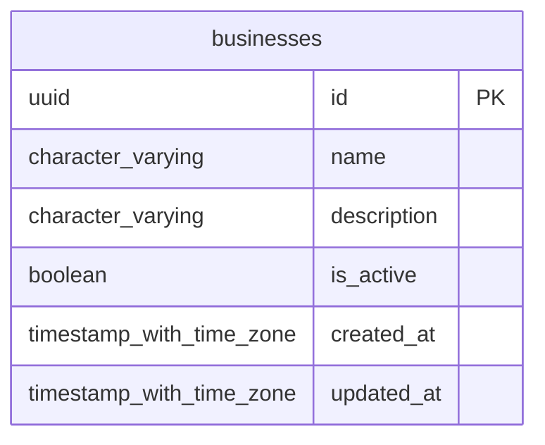

# Base de datos — dominio `businesses`

Volver a [05_DATABASE_REFERENCE.md](../05_DATABASE_REFERENCE.md). Diagrama ER: llaves primarias (PK) y foráneas (FK) reales; las tablas de otros dominios referenciadas aparecen solo con su `id`. Se muestran hasta 14 columnas por tabla en el diagrama; la lista completa está en cada ficha.

## `businesses`

- **Entidad TypeORM:** [BusinessOrmEntity](../reference/backend/businesses.md#f-comercial-jhoel-api-src-modules-businesses-infrastructure-persistence-business-orm-entity-ts)
- **Creada en:** migración no identificada por el análisis (creada con TypeORM `Table` o `createTable`)
- **Archivos TypeScript que la usan:** [business.orm-entity.ts](../reference/backend/businesses.md#f-comercial-jhoel-api-src-modules-businesses-infrastructure-persistence-business-orm-entity-ts), [typeorm-sales-cash-box.repository.ts](../reference/backend/sales-cash-box.md#f-comercial-jhoel-api-src-modules-sales-cash-box-infrastructure-persistence-typeorm-sales-cash-box-repository-ts)

| Columna | Tipo | Nulo | Default |
|---|---|---|---|
| `id` | uuid | NOT NULL | gen_random_uuid() |
| `name` | character varying(80) | NOT NULL |  |
| `description` | character varying(255) | sí |  |
| `is_active` | boolean | NOT NULL | true |
| `created_at` | timestamp with time zone | NOT NULL | now() |
| `updated_at` | timestamp with time zone | NOT NULL | now() |

| Restricción | Tipo | Definición |
|---|---|---|
| `PK_bc1bf63498dd2368ce3dc8686e8` | PK | PRIMARY KEY (id) |
| `UQ_businesses_name` | UNIQUE | UNIQUE (name) |

**Índices:**

- `PK_bc1bf63498dd2368ce3dc8686e8`: CREATE UNIQUE INDEX "PK_bc1bf63498dd2368ce3dc8686e8" ON public.businesses USING btree (id)
- `UQ_businesses_name`: CREATE UNIQUE INDEX "UQ_businesses_name" ON public.businesses USING btree (name)

