# Base de datos — dominio `cash-control`

Volver a [05_DATABASE_REFERENCE.md](../05_DATABASE_REFERENCE.md). Diagrama ER: llaves primarias (PK) y foráneas (FK) reales; las tablas de otros dominios referenciadas aparecen solo con su `id`. Se muestran hasta 14 columnas por tabla en el diagrama; la lista completa está en cada ficha.

```mermaid
erDiagram
  cash_count_details {
    uuid id PK
    uuid count_id FK
    numeric denomination
    integer quantity
    numeric subtotal
  }
  cash_counts {
    uuid id PK
    bigint number
    date business_date
    uuid day_opening_id FK
    timestamp_with_time_zone counted_at
    bigint last_cash_sequence
    numeric system_cash
    numeric total_counted
    numeric difference
    character_varying result
    numeric warehouse_balance
    numeric warehouse_counted
    numeric warehouse_difference
    numeric custody_theoretical
  }
  cash_cut_bank_reconciliations {
    uuid id PK
    uuid cut_period_id FK
    uuid count_id FK
    uuid bank_id FK
    character_varying bank_name
    numeric system_balance
    numeric verified_balance
    numeric difference
    character_varying observations
    uuid created_by FK
    timestamp_with_time_zone created_at
  }
  cash_cut_count_details {
    uuid id PK
    uuid count_id FK
    numeric denomination
    integer quantity
    numeric subtotal
  }
  cash_cut_counts {
    uuid id PK
    uuid cut_period_id FK
    numeric total_counted
    numeric system_cash
    numeric difference
    character_varying observations
    boolean is_current
    uuid created_by FK
    timestamp_with_time_zone created_at
  }
  cash_cut_events {
    uuid id PK
    uuid cut_period_id FK
    character_varying action
    character_varying reason
    jsonb snapshot
    uuid performed_by FK
    timestamp_with_time_zone performed_at
  }
  cash_cut_schedule_changes {
    uuid id PK
    uuid cut_period_id FK
    timestamp_with_time_zone previous_start_at
    timestamp_with_time_zone previous_end_at
    timestamp_with_time_zone new_start_at
    timestamp_with_time_zone new_end_at
    character_varying reason
    uuid changed_by FK
    timestamp_with_time_zone changed_at
  }
  cash_movement_details {
    uuid id PK
    uuid movement_id FK
    numeric denomination
    integer quantity
    numeric subtotal
  }
  cash_movements {
    uuid id PK
    bigint sequence
    date operational_date
    uuid operational_day_id FK
    uuid cut_period_id FK
    character_varying movement_type
    character_varying direction
    numeric amount
    numeric previous_balance
    numeric new_balance
    character_varying reference_type
    uuid reference_id
    character_varying description
    character_varying bank_name
  }
  cash_warehouse_transfers {
    uuid id PK
    bigint number
    character_varying reference_number
    numeric amount
    character_varying delivered_by
    character_varying received_by
    character_varying voucher_reference
    character_varying observations
    boolean has_breakdown
    date business_date
    uuid day_opening_id FK
    uuid cash_movement_id FK
    uuid warehouse_movement_id FK
    character_varying status
  }
  warehouse_cash_movement_details {
    uuid id PK
    uuid movement_id FK
    numeric denomination
    integer quantity
    numeric subtotal
  }
  warehouse_cash_movements {
    uuid id PK
    bigint sequence
    date business_date
    uuid day_opening_id FK
    character_varying movement_type
    character_varying direction
    numeric amount
    numeric previous_balance
    numeric new_balance
    character_varying reference_type
    uuid reference_id
    character_varying description
    character_varying counterpart
    character_varying reason
  }
  warehouse_cash_withdrawals {
    uuid id PK
    bigint number
    character_varying reference_number
    character_varying destination
    numeric amount
    uuid bank_id FK
    character_varying delivered_by
    character_varying received_by
    character_varying voucher_reference
    character_varying observations
    boolean has_breakdown
    date business_date
    uuid day_opening_id FK
    uuid warehouse_movement_id FK
  }
  users {
    uuid id PK
  }
  day_openings {
    uuid id PK
  }
  banks {
    uuid id PK
  }
  cash_cut_periods {
    uuid id PK
  }
  cash_operational_days {
    uuid id PK
  }
  bank_account_movements {
    uuid id PK
  }
  cash_counts ||--o{ cash_count_details : "count_id"
  cash_counts ||--o{ cash_counts : "replaced_by_id"
  users ||--o{ cash_counts : "created_by"
  day_openings ||--o{ cash_counts : "day_opening_id"
  cash_counts ||--o{ cash_counts : "replaces_id"
  banks ||--o{ cash_cut_bank_reconciliations : "bank_id"
  cash_cut_counts ||--o{ cash_cut_bank_reconciliations : "count_id"
  users ||--o{ cash_cut_bank_reconciliations : "created_by"
  cash_cut_periods ||--o{ cash_cut_bank_reconciliations : "cut_period_id"
  cash_cut_counts ||--o{ cash_cut_count_details : "count_id"
  users ||--o{ cash_cut_counts : "created_by"
  cash_cut_periods ||--o{ cash_cut_counts : "cut_period_id"
  cash_cut_periods ||--o{ cash_cut_events : "cut_period_id"
  users ||--o{ cash_cut_events : "performed_by"
  users ||--o{ cash_cut_schedule_changes : "changed_by"
  cash_cut_periods ||--o{ cash_cut_schedule_changes : "cut_period_id"
  cash_movements ||--o{ cash_movement_details : "movement_id"
  users ||--o{ cash_movements : "created_by"
  cash_cut_periods ||--o{ cash_movements : "cut_period_id"
  cash_operational_days ||--o{ cash_movements : "operational_day_id"
  cash_movements ||--o{ cash_movements : "reversal_of_id"
  users ||--o{ cash_movements : "voided_by"
  cash_movements ||--o{ cash_warehouse_transfers : "cash_movement_id"
  users ||--o{ cash_warehouse_transfers : "created_by"
  day_openings ||--o{ cash_warehouse_transfers : "day_opening_id"
  users ||--o{ cash_warehouse_transfers : "voided_by"
  warehouse_cash_movements ||--o{ cash_warehouse_transfers : "warehouse_movement_id"
  warehouse_cash_movements ||--o{ warehouse_cash_movement_details : "movement_id"
  users ||--o{ warehouse_cash_movements : "created_by"
  day_openings ||--o{ warehouse_cash_movements : "day_opening_id"
  warehouse_cash_movements ||--o{ warehouse_cash_movements : "reversal_of_id"
  users ||--o{ warehouse_cash_movements : "voided_by"
  banks ||--o{ warehouse_cash_withdrawals : "bank_id"
  bank_account_movements ||--o{ warehouse_cash_withdrawals : "bank_movement_id"
  cash_movements ||--o{ warehouse_cash_withdrawals : "cash_movement_id"
  users ||--o{ warehouse_cash_withdrawals : "created_by"
  day_openings ||--o{ warehouse_cash_withdrawals : "day_opening_id"
  users ||--o{ warehouse_cash_withdrawals : "voided_by"
  warehouse_cash_movements ||--o{ warehouse_cash_withdrawals : "warehouse_movement_id"
```

## `cash_count_details`

- **Entidad TypeORM:** ninguna (se accede con SQL crudo o solo desde funciones PL/pgSQL)
- **Creada en:** `1760007400000-CashCountsAndWarehouseCustody.ts`
- **Archivos TypeScript que la usan:** [typeorm-cash-custody.repository.ts](../reference/backend/cash-control.md#f-comercial-jhoel-api-src-modules-cash-control-infrastructure-persistence-typeorm-cash-custody-repository-ts), [cuadre-cash-breakdown.e2e-spec.ts](../reference/backend/e2e.md#f-comercial-jhoel-api-test-cuadre-cash-breakdown-e2e-spec-ts)
- **Funciones SQL que la escriben:** `register_cash_count`

| Columna | Tipo | Nulo | Default |
|---|---|---|---|
| `id` | uuid | NOT NULL | gen_random_uuid() |
| `count_id` | uuid | NOT NULL |  |
| `denomination` | numeric(10,2) | NOT NULL |  |
| `quantity` | integer | NOT NULL |  |
| `subtotal` | numeric(14,2) | NOT NULL |  |

| Restricción | Tipo | Definición |
|---|---|---|
| `CHK_cash_count_details_quantity` | CHECK | CHECK ((quantity &gt;= 0)) |
| `CHK_cash_count_details_subtotal` | CHECK | CHECK ((subtotal = (denomination * (quantity)::numeric))) |
| `cash_count_details_count_id_fkey` | FK | FOREIGN KEY (count_id) REFERENCES cash_counts(id) ON DELETE RESTRICT |
| `cash_count_details_pkey` | PK | PRIMARY KEY (id) |
| `UQ_cash_count_details` | UNIQUE | UNIQUE (count_id, denomination) |

**Índices:**

- `UQ_cash_count_details`: CREATE UNIQUE INDEX "UQ_cash_count_details" ON public.cash_count_details USING btree (count_id, denomination)
- `cash_count_details_pkey`: CREATE UNIQUE INDEX cash_count_details_pkey ON public.cash_count_details USING btree (id)

**Triggers:**

- `trg_cash_count_details_guard`: CREATE TRIGGER trg_cash_count_details_guard BEFORE DELETE OR UPDATE ON public.cash_count_details FOR EACH ROW EXECUTE FUNCTION cash_custody_status_only_guard()

## `cash_counts`

- **Entidad TypeORM:** ninguna (se accede con SQL crudo o solo desde funciones PL/pgSQL)
- **Creada en:** `1760007400000-CashCountsAndWarehouseCustody.ts`
- **Archivos TypeScript que la usan:** [typeorm-cash-custody.repository.ts](../reference/backend/cash-control.md#f-comercial-jhoel-api-src-modules-cash-control-infrastructure-persistence-typeorm-cash-custody-repository-ts), [cuadre-cash-breakdown.e2e-spec.ts](../reference/backend/e2e.md#f-comercial-jhoel-api-test-cuadre-cash-breakdown-e2e-spec-ts)
- **Funciones SQL que la escriben:** `register_cash_count`

| Columna | Tipo | Nulo | Default |
|---|---|---|---|
| `id` | uuid | NOT NULL | gen_random_uuid() |
| `number` | bigint | NOT NULL | nextval('cash_counts_number_seq'::regclass) |
| `business_date` | date | NOT NULL |  |
| `day_opening_id` | uuid | NOT NULL |  |
| `counted_at` | timestamp with time zone | NOT NULL | now() |
| `last_cash_sequence` | bigint | NOT NULL |  |
| `system_cash` | numeric(14,2) | NOT NULL |  |
| `total_counted` | numeric(14,2) | NOT NULL |  |
| `difference` | numeric(14,2) | NOT NULL |  |
| `result` | character varying(10) | NOT NULL |  |
| `warehouse_balance` | numeric(14,2) | NOT NULL |  |
| `warehouse_counted` | numeric(14,2) | sí |  |
| `warehouse_difference` | numeric(14,2) | sí |  |
| `custody_theoretical` | numeric(14,2) | NOT NULL |  |
| `observations` | character varying(500) | sí |  |
| `status` | character varying(12) | NOT NULL | 'VIGENTE'::character varying |
| `replaces_id` | uuid | sí |  |
| `replaced_by_id` | uuid | sí |  |
| `correction_reason` | character varying(255) | sí |  |
| `idempotency_key` | character varying(120) | NOT NULL |  |
| `created_by` | uuid | NOT NULL |  |
| `created_at` | timestamp with time zone | NOT NULL | now() |

| Restricción | Tipo | Definición |
|---|---|---|
| `CHK_cash_counts_correction` | CHECK | CHECK (((replaces_id IS NULL) = (correction_reason IS NULL))) |
| `CHK_cash_counts_counted` | CHECK | CHECK ((total_counted &gt;= (0)::numeric)) |
| `CHK_cash_counts_custody` | CHECK | CHECK ((custody_theoretical = (system_cash + warehouse_balance))) |
| `CHK_cash_counts_difference` | CHECK | CHECK ((difference = (total_counted - system_cash))) |
| `CHK_cash_counts_replaced` | CHECK | CHECK ((((status)::text = 'REEMPLAZADO'::text) = (replaced_by_id IS NOT NULL))) |
| `CHK_cash_counts_result` | CHECK | CHECK (((((result)::text = 'CUADRADO'::text) AND (difference = (0)::numeric)) OR (((result)::text = 'FALTANTE'::text) AND (difference &lt; (0)::numeric)) OR (((result)::text = 'SOBRANTE'::text) AND (difference &gt; (0)::numeric)))) |
| `CHK_cash_counts_status` | CHECK | CHECK (((status)::text = ANY ((ARRAY['VIGENTE'::character varying, 'REEMPLAZADO'::character varying])::text[]))) |
| `CHK_cash_counts_warehouse` | CHECK | CHECK ((((warehouse_counted IS NULL) AND (warehouse_difference IS NULL)) OR ((warehouse_counted &gt;= (0)::numeric) AND (warehouse_difference = (warehouse_counted - warehouse_balance))))) |
| `FK_cash_counts_replaced_by` | FK | FOREIGN KEY (replaced_by_id) REFERENCES cash_counts(id) DEFERRABLE INITIALLY DEFERRED |
| `cash_counts_created_by_fkey` | FK | FOREIGN KEY (created_by) REFERENCES users(id) ON DELETE RESTRICT |
| `cash_counts_day_opening_id_fkey` | FK | FOREIGN KEY (day_opening_id) REFERENCES day_openings(id) ON DELETE RESTRICT |
| `cash_counts_replaces_id_fkey` | FK | FOREIGN KEY (replaces_id) REFERENCES cash_counts(id) ON DELETE RESTRICT |
| `cash_counts_pkey` | PK | PRIMARY KEY (id) |
| `UQ_cash_counts_idempotency` | UNIQUE | UNIQUE (idempotency_key) |
| `UQ_cash_counts_number` | UNIQUE | UNIQUE (number) |

**Índices:**

- `IDX_cash_counts_date`: CREATE INDEX "IDX_cash_counts_date" ON public.cash_counts USING btree (business_date, counted_at DESC)
- `UQ_cash_counts_idempotency`: CREATE UNIQUE INDEX "UQ_cash_counts_idempotency" ON public.cash_counts USING btree (idempotency_key)
- `UQ_cash_counts_number`: CREATE UNIQUE INDEX "UQ_cash_counts_number" ON public.cash_counts USING btree (number)
- `cash_counts_pkey`: CREATE UNIQUE INDEX cash_counts_pkey ON public.cash_counts USING btree (id)

**Triggers:**

- `trg_cash_counts_guard`: CREATE TRIGGER trg_cash_counts_guard BEFORE DELETE OR UPDATE ON public.cash_counts FOR EACH ROW EXECUTE FUNCTION cash_custody_status_only_guard('status', 'replaced_by_id')

## `cash_cut_bank_reconciliations`

- **Entidad TypeORM:** ninguna (se accede con SQL crudo o solo desde funciones PL/pgSQL)
- **Creada en:** `1760006800000-CreateCashControlKardexAndCuts.ts`
- **Archivos TypeScript que la usan:** [typeorm-cash-control.repository.ts](../reference/backend/cash-control.md#f-comercial-jhoel-api-src-modules-cash-control-infrastructure-persistence-typeorm-cash-control-repository-ts), [typeorm-financial-day-review.repository.ts](../reference/backend/financial-day-review.md#f-comercial-jhoel-api-src-modules-financial-day-review-infrastructure-persistence-typeorm-financial-day-review-repository-ts)
- **Funciones SQL que la escriben:** `correct_financial_day_snapshot`, `finish_cash_cut_period`

| Columna | Tipo | Nulo | Default |
|---|---|---|---|
| `id` | uuid | NOT NULL | gen_random_uuid() |
| `cut_period_id` | uuid | NOT NULL |  |
| `count_id` | uuid | NOT NULL |  |
| `bank_id` | uuid | NOT NULL |  |
| `bank_name` | character varying(150) | NOT NULL |  |
| `system_balance` | numeric(14,2) | NOT NULL |  |
| `verified_balance` | numeric(14,2) | NOT NULL |  |
| `difference` | numeric(14,2) | NOT NULL |  |
| `observations` | character varying(500) | sí |  |
| `created_by` | uuid | NOT NULL |  |
| `created_at` | timestamp with time zone | NOT NULL | now() |

| Restricción | Tipo | Definición |
|---|---|---|
| `CHK_cash_cut_bank_reconciliations_difference` | CHECK | CHECK ((difference = (verified_balance - system_balance))) |
| `cash_cut_bank_reconciliations_bank_id_fkey` | FK | FOREIGN KEY (bank_id) REFERENCES banks(id) ON DELETE RESTRICT |
| `cash_cut_bank_reconciliations_count_id_fkey` | FK | FOREIGN KEY (count_id) REFERENCES cash_cut_counts(id) ON DELETE RESTRICT |
| `cash_cut_bank_reconciliations_created_by_fkey` | FK | FOREIGN KEY (created_by) REFERENCES users(id) ON DELETE RESTRICT |
| `cash_cut_bank_reconciliations_cut_period_id_fkey` | FK | FOREIGN KEY (cut_period_id) REFERENCES cash_cut_periods(id) ON DELETE RESTRICT |
| `cash_cut_bank_reconciliations_pkey` | PK | PRIMARY KEY (id) |
| `UQ_cash_cut_bank_reconciliations` | UNIQUE | UNIQUE (count_id, bank_id) |

**Índices:**

- `UQ_cash_cut_bank_reconciliations`: CREATE UNIQUE INDEX "UQ_cash_cut_bank_reconciliations" ON public.cash_cut_bank_reconciliations USING btree (count_id, bank_id)
- `cash_cut_bank_reconciliations_pkey`: CREATE UNIQUE INDEX cash_cut_bank_reconciliations_pkey ON public.cash_cut_bank_reconciliations USING btree (id)

**Triggers:**

- `trg_financial_review_guard`: CREATE TRIGGER trg_financial_review_guard BEFORE INSERT OR DELETE OR UPDATE ON public.cash_cut_bank_reconciliations FOR EACH ROW EXECUTE FUNCTION financial_review_day_guard('cut')

## `cash_cut_count_details`

- **Entidad TypeORM:** ninguna (se accede con SQL crudo o solo desde funciones PL/pgSQL)
- **Creada en:** `1760006800000-CreateCashControlKardexAndCuts.ts`
- **Archivos TypeScript que la usan:** [typeorm-cash-control.repository.ts](../reference/backend/cash-control.md#f-comercial-jhoel-api-src-modules-cash-control-infrastructure-persistence-typeorm-cash-control-repository-ts)
- **Funciones SQL que la escriben:** `finish_cash_cut_period`

| Columna | Tipo | Nulo | Default |
|---|---|---|---|
| `id` | uuid | NOT NULL | gen_random_uuid() |
| `count_id` | uuid | NOT NULL |  |
| `denomination` | numeric(6,2) | NOT NULL |  |
| `quantity` | integer | NOT NULL |  |
| `subtotal` | numeric(14,2) | NOT NULL |  |

| Restricción | Tipo | Definición |
|---|---|---|
| `CHK_cash_cut_count_details_subtotal` | CHECK | CHECK ((subtotal = (denomination * (quantity)::numeric))) |
| `cash_cut_count_details_quantity_check` | CHECK | CHECK ((quantity &gt;= 0)) |
| `cash_cut_count_details_count_id_fkey` | FK | FOREIGN KEY (count_id) REFERENCES cash_cut_counts(id) ON DELETE RESTRICT |
| `cash_cut_count_details_pkey` | PK | PRIMARY KEY (id) |
| `UQ_cash_cut_count_details` | UNIQUE | UNIQUE (count_id, denomination) |

**Índices:**

- `UQ_cash_cut_count_details`: CREATE UNIQUE INDEX "UQ_cash_cut_count_details" ON public.cash_cut_count_details USING btree (count_id, denomination)
- `cash_cut_count_details_pkey`: CREATE UNIQUE INDEX cash_cut_count_details_pkey ON public.cash_cut_count_details USING btree (id)

## `cash_cut_counts`

- **Entidad TypeORM:** ninguna (se accede con SQL crudo o solo desde funciones PL/pgSQL)
- **Creada en:** `1760006800000-CreateCashControlKardexAndCuts.ts`
- **Archivos TypeScript que la usan:** [typeorm-cash-control.repository.ts](../reference/backend/cash-control.md#f-comercial-jhoel-api-src-modules-cash-control-infrastructure-persistence-typeorm-cash-control-repository-ts), [typeorm-financial-day-review.repository.ts](../reference/backend/financial-day-review.md#f-comercial-jhoel-api-src-modules-financial-day-review-infrastructure-persistence-typeorm-financial-day-review-repository-ts), [cuadre-cash-breakdown.e2e-spec.ts](../reference/backend/e2e.md#f-comercial-jhoel-api-test-cuadre-cash-breakdown-e2e-spec-ts)
- **Funciones SQL que la escriben:** `correct_financial_day_snapshot`, `finish_cash_cut_period`, `reopen_cash_cut_period`

| Columna | Tipo | Nulo | Default |
|---|---|---|---|
| `id` | uuid | NOT NULL | gen_random_uuid() |
| `cut_period_id` | uuid | NOT NULL |  |
| `total_counted` | numeric(14,2) | NOT NULL |  |
| `system_cash` | numeric(14,2) | NOT NULL |  |
| `difference` | numeric(14,2) | NOT NULL |  |
| `observations` | character varying(500) | sí |  |
| `is_current` | boolean | NOT NULL | true |
| `created_by` | uuid | NOT NULL |  |
| `created_at` | timestamp with time zone | NOT NULL | now() |

| Restricción | Tipo | Definición |
|---|---|---|
| `CHK_cash_cut_counts_difference` | CHECK | CHECK ((difference = (total_counted - system_cash))) |
| `cash_cut_counts_total_counted_check` | CHECK | CHECK ((total_counted &gt;= (0)::numeric)) |
| `cash_cut_counts_created_by_fkey` | FK | FOREIGN KEY (created_by) REFERENCES users(id) ON DELETE RESTRICT |
| `cash_cut_counts_cut_period_id_fkey` | FK | FOREIGN KEY (cut_period_id) REFERENCES cash_cut_periods(id) ON DELETE RESTRICT |
| `cash_cut_counts_pkey` | PK | PRIMARY KEY (id) |

**Índices:**

- `UQ_cash_cut_counts_current`: CREATE UNIQUE INDEX "UQ_cash_cut_counts_current" ON public.cash_cut_counts USING btree (cut_period_id) WHERE is_current
- `cash_cut_counts_pkey`: CREATE UNIQUE INDEX cash_cut_counts_pkey ON public.cash_cut_counts USING btree (id)

**Triggers:**

- `trg_financial_review_guard`: CREATE TRIGGER trg_financial_review_guard BEFORE INSERT OR DELETE OR UPDATE ON public.cash_cut_counts FOR EACH ROW EXECUTE FUNCTION financial_review_day_guard('cut')

## `cash_cut_events`

- **Entidad TypeORM:** ninguna (se accede con SQL crudo o solo desde funciones PL/pgSQL)
- **Creada en:** `1760006800000-CreateCashControlKardexAndCuts.ts`
- **Archivos TypeScript que la usan:** [typeorm-cash-control.repository.ts](../reference/backend/cash-control.md#f-comercial-jhoel-api-src-modules-cash-control-infrastructure-persistence-typeorm-cash-control-repository-ts)
- **Funciones SQL que la escriben:** `finish_cash_cut_period`, `reopen_cash_cut_period`, `start_cash_cut_period`

| Columna | Tipo | Nulo | Default |
|---|---|---|---|
| `id` | uuid | NOT NULL | gen_random_uuid() |
| `cut_period_id` | uuid | NOT NULL |  |
| `action` | character varying(15) | NOT NULL |  |
| `reason` | character varying(255) | sí |  |
| `snapshot` | jsonb | sí |  |
| `performed_by` | uuid | NOT NULL |  |
| `performed_at` | timestamp with time zone | NOT NULL | now() |

| Restricción | Tipo | Definición |
|---|---|---|
| `cash_cut_events_action_check` | CHECK | CHECK (((action)::text = ANY ((ARRAY['INICIADO'::character varying, 'FINALIZADO'::character varying, 'REABIERTO'::character varying])::text[]))) |
| `cash_cut_events_cut_period_id_fkey` | FK | FOREIGN KEY (cut_period_id) REFERENCES cash_cut_periods(id) ON DELETE RESTRICT |
| `cash_cut_events_performed_by_fkey` | FK | FOREIGN KEY (performed_by) REFERENCES users(id) ON DELETE RESTRICT |
| `cash_cut_events_pkey` | PK | PRIMARY KEY (id) |

**Índices:**

- `IDX_cash_cut_events_period`: CREATE INDEX "IDX_cash_cut_events_period" ON public.cash_cut_events USING btree (cut_period_id)
- `cash_cut_events_pkey`: CREATE UNIQUE INDEX cash_cut_events_pkey ON public.cash_cut_events USING btree (id)

## `cash_cut_schedule_changes`

- **Entidad TypeORM:** ninguna (se accede con SQL crudo o solo desde funciones PL/pgSQL)
- **Creada en:** `1760006800000-CreateCashControlKardexAndCuts.ts`
- **Archivos TypeScript que la usan:** [typeorm-cash-control.repository.ts](../reference/backend/cash-control.md#f-comercial-jhoel-api-src-modules-cash-control-infrastructure-persistence-typeorm-cash-control-repository-ts)
- **Funciones SQL que la escriben:** `update_cash_cut_schedule`

| Columna | Tipo | Nulo | Default |
|---|---|---|---|
| `id` | uuid | NOT NULL | gen_random_uuid() |
| `cut_period_id` | uuid | NOT NULL |  |
| `previous_start_at` | timestamp with time zone | NOT NULL |  |
| `previous_end_at` | timestamp with time zone | NOT NULL |  |
| `new_start_at` | timestamp with time zone | NOT NULL |  |
| `new_end_at` | timestamp with time zone | NOT NULL |  |
| `reason` | character varying(255) | NOT NULL |  |
| `changed_by` | uuid | NOT NULL |  |
| `changed_at` | timestamp with time zone | NOT NULL | now() |

| Restricción | Tipo | Definición |
|---|---|---|
| `cash_cut_schedule_changes_changed_by_fkey` | FK | FOREIGN KEY (changed_by) REFERENCES users(id) ON DELETE RESTRICT |
| `cash_cut_schedule_changes_cut_period_id_fkey` | FK | FOREIGN KEY (cut_period_id) REFERENCES cash_cut_periods(id) ON DELETE RESTRICT |
| `cash_cut_schedule_changes_pkey` | PK | PRIMARY KEY (id) |

**Índices:**

- `cash_cut_schedule_changes_pkey`: CREATE UNIQUE INDEX cash_cut_schedule_changes_pkey ON public.cash_cut_schedule_changes USING btree (id)

## `cash_movement_details`

- **Entidad TypeORM:** ninguna (se accede con SQL crudo o solo desde funciones PL/pgSQL)
- **Creada en:** `1760006900000-CashBankDeposit.ts`
- **Archivos TypeScript que la usan:** [typeorm-cash-control.repository.ts](../reference/backend/cash-control.md#f-comercial-jhoel-api-src-modules-cash-control-infrastructure-persistence-typeorm-cash-control-repository-ts), [typeorm-cash-custody.repository.ts](../reference/backend/cash-control.md#f-comercial-jhoel-api-src-modules-cash-control-infrastructure-persistence-typeorm-cash-custody-repository-ts)
- **Funciones SQL que la escriben:** `register_cash_bank_deposit`, `register_cash_warehouse_transfer`

| Columna | Tipo | Nulo | Default |
|---|---|---|---|
| `id` | uuid | NOT NULL | gen_random_uuid() |
| `movement_id` | uuid | NOT NULL |  |
| `denomination` | numeric(6,2) | NOT NULL |  |
| `quantity` | integer | NOT NULL |  |
| `subtotal` | numeric(14,2) | NOT NULL |  |

| Restricción | Tipo | Definición |
|---|---|---|
| `CHK_cash_movement_details_subtotal` | CHECK | CHECK ((subtotal = (denomination * (quantity)::numeric))) |
| `cash_movement_details_quantity_check` | CHECK | CHECK ((quantity &gt; 0)) |
| `cash_movement_details_movement_id_fkey` | FK | FOREIGN KEY (movement_id) REFERENCES cash_movements(id) ON DELETE RESTRICT |
| `cash_movement_details_pkey` | PK | PRIMARY KEY (id) |
| `UQ_cash_movement_details` | UNIQUE | UNIQUE (movement_id, denomination) |

**Índices:**

- `UQ_cash_movement_details`: CREATE UNIQUE INDEX "UQ_cash_movement_details" ON public.cash_movement_details USING btree (movement_id, denomination)
- `cash_movement_details_pkey`: CREATE UNIQUE INDEX cash_movement_details_pkey ON public.cash_movement_details USING btree (id)

## `cash_movements`

- **Entidad TypeORM:** ninguna (se accede con SQL crudo o solo desde funciones PL/pgSQL)
- **Creada en:** `1760006800000-CreateCashControlKardexAndCuts.ts`
- **Archivos TypeScript que la usan:** [typeorm-account-receivable-settlement.repository.ts](../reference/backend/accounts-receivable.md#f-comercial-jhoel-api-src-modules-accounts-receivable-infrastructure-persistence-typeorm-account-receivable-settlement-repository-ts), [typeorm-cash-control.repository.ts](../reference/backend/cash-control.md#f-comercial-jhoel-api-src-modules-cash-control-infrastructure-persistence-typeorm-cash-control-repository-ts), [typeorm-cash-custody.repository.ts](../reference/backend/cash-control.md#f-comercial-jhoel-api-src-modules-cash-control-infrastructure-persistence-typeorm-cash-custody-repository-ts), [typeorm-financial-day-review.repository.ts](../reference/backend/financial-day-review.md#f-comercial-jhoel-api-src-modules-financial-day-review-infrastructure-persistence-typeorm-financial-day-review-repository-ts), [ar-settlements.e2e-spec.ts](../reference/backend/e2e.md#f-comercial-jhoel-api-test-ar-settlements-e2e-spec-ts), [cash-custody.e2e-spec.ts](../reference/backend/e2e.md#f-comercial-jhoel-api-test-cash-custody-e2e-spec-ts), [cash-daily-indicators.e2e-spec.ts](../reference/backend/e2e.md#f-comercial-jhoel-api-test-cash-daily-indicators-e2e-spec-ts), [cuadre-cash-breakdown.e2e-spec.ts](../reference/backend/e2e.md#f-comercial-jhoel-api-test-cuadre-cash-breakdown-e2e-spec-ts), [financial-day-review.e2e-spec.ts](../reference/backend/e2e.md#f-comercial-jhoel-api-test-financial-day-review-e2e-spec-ts)
- **Funciones SQL que la escriben:** `apply_cash_movement`, `reverse_cash_movement`

| Columna | Tipo | Nulo | Default |
|---|---|---|---|
| `id` | uuid | NOT NULL | gen_random_uuid() |
| `sequence` | bigint | NOT NULL | nextval('cash_movements_sequence_seq'::regclass) |
| `operational_date` | date | NOT NULL |  |
| `operational_day_id` | uuid | sí |  |
| `cut_period_id` | uuid | sí |  |
| `movement_type` | character varying(30) | NOT NULL |  |
| `direction` | character varying(4) | NOT NULL |  |
| `amount` | numeric(14,2) | NOT NULL |  |
| `previous_balance` | numeric(14,2) | NOT NULL |  |
| `new_balance` | numeric(14,2) | NOT NULL |  |
| `reference_type` | character varying(30) | sí |  |
| `reference_id` | uuid | sí |  |
| `description` | character varying(255) | NOT NULL |  |
| `bank_name` | character varying(150) | sí |  |
| `reason` | character varying(255) | sí |  |
| `reversal_of_id` | uuid | sí |  |
| `status` | character varying(10) | NOT NULL | 'VIGENTE'::character varying |
| `voided_at` | timestamp with time zone | sí |  |
| `voided_by` | uuid | sí |  |
| `void_reason` | character varying(255) | sí |  |
| `idempotency_key` | character varying(120) | NOT NULL |  |
| `created_by` | uuid | NOT NULL |  |
| `created_at` | timestamp with time zone | NOT NULL | now() |

| Restricción | Tipo | Definición |
|---|---|---|
| `CHK_cash_movements_amount` | CHECK | CHECK ((amount &gt; (0)::numeric)) |
| `CHK_cash_movements_balance` | CHECK | CHECK ((new_balance = (previous_balance + CASE direction     WHEN 'IN'::text THEN amount     WHEN 'OUT'::text THEN (- amount)     ELSE (0)::numeric END))) |
| `CHK_cash_movements_direction` | CHECK | CHECK (((direction)::text = ANY ((ARRAY['IN'::character varying, 'OUT'::character varying, 'NONE'::character varying])::text[]))) |
| `CHK_cash_movements_reference_pair` | CHECK | CHECK (((reference_type IS NULL) = (reference_id IS NULL))) |
| `CHK_cash_movements_reversal` | CHECK | CHECK ((((movement_type)::text = 'ANULACION'::text) = (reversal_of_id IS NOT NULL))) |
| `CHK_cash_movements_status` | CHECK | CHECK (((status)::text = ANY ((ARRAY['VIGENTE'::character varying, 'ANULADO'::character varying])::text[]))) |
| `CHK_cash_movements_type` | CHECK | CHECK (((movement_type)::text = ANY ((ARRAY['DEPOSITO'::character varying, 'RETIRO'::character varying, 'DESEMBOLSO_GENESIS'::character varying, 'PAGO_GENESIS'::character varying, 'REINTEGRO'::character varying, 'OTRA_TRANSACCION'::character varying, 'GASTO_POR_COBRAR'::character varying, 'ABONO_POR_COBRAR'::character varying, 'ACTIVO'::character varying, 'DEVOLUCION_ACTIVO'::character varying, 'RETIRO_BANCARIO'::character varying, 'ENTRADA_MANUAL'::character varying, 'SALIDA_MANUAL'::character varying, 'AJUSTE'::character varying, 'SALDO_INICIAL'::character varying, 'ANULACION'::character varying, 'DEPOSITO_BANCARIO'::character varying, 'ENTREGA_BODEGA'::character varying, 'DEVOLUCION_BODEGA'::character varying])::text[]))) |
| `CHK_cash_movements_void` | CHECK | CHECK (((((status)::text = 'VIGENTE'::text) AND (voided_at IS NULL) AND (voided_by IS NULL)) OR (((status)::text = 'ANULADO'::text) AND (voided_at IS NOT NULL) AND (voided_by IS NOT NULL)))) |
| `cash_movements_created_by_fkey` | FK | FOREIGN KEY (created_by) REFERENCES users(id) ON DELETE RESTRICT |
| `cash_movements_cut_period_id_fkey` | FK | FOREIGN KEY (cut_period_id) REFERENCES cash_cut_periods(id) ON DELETE RESTRICT |
| `cash_movements_operational_day_id_fkey` | FK | FOREIGN KEY (operational_day_id) REFERENCES cash_operational_days(id) ON DELETE RESTRICT |
| `cash_movements_reversal_of_id_fkey` | FK | FOREIGN KEY (reversal_of_id) REFERENCES cash_movements(id) ON DELETE RESTRICT |
| `cash_movements_voided_by_fkey` | FK | FOREIGN KEY (voided_by) REFERENCES users(id) ON DELETE RESTRICT |
| `cash_movements_pkey` | PK | PRIMARY KEY (id) |
| `UQ_cash_movements_idempotency` | UNIQUE | UNIQUE (idempotency_key) |
| `UQ_cash_movements_sequence` | UNIQUE | UNIQUE (sequence) |

**Índices:**

- `IDX_cash_movements_cut`: CREATE INDEX "IDX_cash_movements_cut" ON public.cash_movements USING btree (cut_period_id)
- `IDX_cash_movements_date`: CREATE INDEX "IDX_cash_movements_date" ON public.cash_movements USING btree (operational_date)
- `IDX_cash_movements_reference`: CREATE INDEX "IDX_cash_movements_reference" ON public.cash_movements USING btree (reference_type, reference_id)
- `IDX_cash_movements_user`: CREATE INDEX "IDX_cash_movements_user" ON public.cash_movements USING btree (created_by)
- `UQ_cash_movements_idempotency`: CREATE UNIQUE INDEX "UQ_cash_movements_idempotency" ON public.cash_movements USING btree (idempotency_key)
- `UQ_cash_movements_initial_balance`: CREATE UNIQUE INDEX "UQ_cash_movements_initial_balance" ON public.cash_movements USING btree ((true)) WHERE (((movement_type)::text = 'SALDO_INICIAL'::text) AND ((status)::text = 'VIGENTE'::text))
- `UQ_cash_movements_reversal`: CREATE UNIQUE INDEX "UQ_cash_movements_reversal" ON public.cash_movements USING btree (reversal_of_id) WHERE (reversal_of_id IS NOT NULL)
- `UQ_cash_movements_sequence`: CREATE UNIQUE INDEX "UQ_cash_movements_sequence" ON public.cash_movements USING btree (sequence)
- `cash_movements_pkey`: CREATE UNIQUE INDEX cash_movements_pkey ON public.cash_movements USING btree (id)

**Triggers:**

- `trg_financial_review_guard`: CREATE TRIGGER trg_financial_review_guard BEFORE INSERT OR DELETE OR UPDATE ON public.cash_movements FOR EACH ROW EXECUTE FUNCTION financial_review_day_guard('operational_date')

## `cash_warehouse_transfers`

- **Entidad TypeORM:** ninguna (se accede con SQL crudo o solo desde funciones PL/pgSQL)
- **Creada en:** `1760007400000-CashCountsAndWarehouseCustody.ts`
- **Archivos TypeScript que la usan:** [typeorm-cash-custody.repository.ts](../reference/backend/cash-control.md#f-comercial-jhoel-api-src-modules-cash-control-infrastructure-persistence-typeorm-cash-custody-repository-ts)
- **Funciones SQL que la escriben:** `register_cash_warehouse_transfer`, `void_cash_warehouse_transfer`

| Columna | Tipo | Nulo | Default |
|---|---|---|---|
| `id` | uuid | NOT NULL |  |
| `number` | bigint | NOT NULL | nextval('cash_warehouse_transfers_number_seq'::regclass) |
| `reference_number` | character varying(20) | NOT NULL |  |
| `amount` | numeric(14,2) | NOT NULL |  |
| `delivered_by` | character varying(150) | NOT NULL |  |
| `received_by` | character varying(150) | NOT NULL |  |
| `voucher_reference` | character varying(100) | sí |  |
| `observations` | character varying(500) | sí |  |
| `has_breakdown` | boolean | NOT NULL |  |
| `business_date` | date | NOT NULL |  |
| `day_opening_id` | uuid | NOT NULL |  |
| `cash_movement_id` | uuid | NOT NULL |  |
| `warehouse_movement_id` | uuid | NOT NULL |  |
| `status` | character varying(10) | NOT NULL | 'APLICADA'::character varying |
| `voided_at` | timestamp with time zone | sí |  |
| `voided_by` | uuid | sí |  |
| `void_reason` | character varying(255) | sí |  |
| `idempotency_key` | character varying(120) | NOT NULL |  |
| `created_by` | uuid | NOT NULL |  |
| `created_at` | timestamp with time zone | NOT NULL | now() |

| Restricción | Tipo | Definición |
|---|---|---|
| `CHK_cash_warehouse_transfers_amount` | CHECK | CHECK ((amount &gt; (0)::numeric)) |
| `CHK_cash_warehouse_transfers_people` | CHECK | CHECK (((length(btrim((delivered_by)::text)) &gt;= 3) AND (length(btrim((received_by)::text)) &gt;= 3))) |
| `CHK_cash_warehouse_transfers_status` | CHECK | CHECK (((status)::text = ANY ((ARRAY['APLICADA'::character varying, 'ANULADA'::character varying])::text[]))) |
| `CHK_cash_warehouse_transfers_void` | CHECK | CHECK (((((status)::text = 'APLICADA'::text) AND (voided_at IS NULL) AND (voided_by IS NULL) AND (void_reason IS NULL)) OR (((status)::text = 'ANULADA'::text) AND (voided_at IS NOT NULL) AND (voided_by IS NOT NULL) AND (void_reason IS NOT NULL)))) |
| `cash_warehouse_transfers_cash_movement_id_fkey` | FK | FOREIGN KEY (cash_movement_id) REFERENCES cash_movements(id) ON DELETE RESTRICT |
| `cash_warehouse_transfers_created_by_fkey` | FK | FOREIGN KEY (created_by) REFERENCES users(id) ON DELETE RESTRICT |
| `cash_warehouse_transfers_day_opening_id_fkey` | FK | FOREIGN KEY (day_opening_id) REFERENCES day_openings(id) ON DELETE RESTRICT |
| `cash_warehouse_transfers_voided_by_fkey` | FK | FOREIGN KEY (voided_by) REFERENCES users(id) ON DELETE RESTRICT |
| `cash_warehouse_transfers_warehouse_movement_id_fkey` | FK | FOREIGN KEY (warehouse_movement_id) REFERENCES warehouse_cash_movements(id) ON DELETE RESTRICT |
| `cash_warehouse_transfers_pkey` | PK | PRIMARY KEY (id) |
| `UQ_cash_warehouse_transfers_cash` | UNIQUE | UNIQUE (cash_movement_id) |
| `UQ_cash_warehouse_transfers_idempotency` | UNIQUE | UNIQUE (idempotency_key) |
| `UQ_cash_warehouse_transfers_number` | UNIQUE | UNIQUE (number) |
| `UQ_cash_warehouse_transfers_reference` | UNIQUE | UNIQUE (reference_number) |
| `UQ_cash_warehouse_transfers_warehouse` | UNIQUE | UNIQUE (warehouse_movement_id) |

**Índices:**

- `IDX_cash_warehouse_transfers_date`: CREATE INDEX "IDX_cash_warehouse_transfers_date" ON public.cash_warehouse_transfers USING btree (business_date, created_at)
- `UQ_cash_warehouse_transfers_cash`: CREATE UNIQUE INDEX "UQ_cash_warehouse_transfers_cash" ON public.cash_warehouse_transfers USING btree (cash_movement_id)
- `UQ_cash_warehouse_transfers_idempotency`: CREATE UNIQUE INDEX "UQ_cash_warehouse_transfers_idempotency" ON public.cash_warehouse_transfers USING btree (idempotency_key)
- `UQ_cash_warehouse_transfers_number`: CREATE UNIQUE INDEX "UQ_cash_warehouse_transfers_number" ON public.cash_warehouse_transfers USING btree (number)
- `UQ_cash_warehouse_transfers_reference`: CREATE UNIQUE INDEX "UQ_cash_warehouse_transfers_reference" ON public.cash_warehouse_transfers USING btree (reference_number)
- `UQ_cash_warehouse_transfers_warehouse`: CREATE UNIQUE INDEX "UQ_cash_warehouse_transfers_warehouse" ON public.cash_warehouse_transfers USING btree (warehouse_movement_id)
- `cash_warehouse_transfers_pkey`: CREATE UNIQUE INDEX cash_warehouse_transfers_pkey ON public.cash_warehouse_transfers USING btree (id)

**Triggers:**

- `trg_cash_warehouse_transfers_guard`: CREATE TRIGGER trg_cash_warehouse_transfers_guard BEFORE DELETE OR UPDATE ON public.cash_warehouse_transfers FOR EACH ROW EXECUTE FUNCTION cash_custody_status_only_guard('status', 'voided_at', 'voided_by', 'void_reason')

## `warehouse_cash_movement_details`

- **Entidad TypeORM:** ninguna (se accede con SQL crudo o solo desde funciones PL/pgSQL)
- **Creada en:** `1760007500000-WarehouseWithdrawals.ts`
- **Archivos TypeScript que la usan:** [typeorm-cash-custody.repository.ts](../reference/backend/cash-control.md#f-comercial-jhoel-api-src-modules-cash-control-infrastructure-persistence-typeorm-cash-custody-repository-ts)
- **Funciones SQL que la escriben:** `register_warehouse_withdrawal`

| Columna | Tipo | Nulo | Default |
|---|---|---|---|
| `id` | uuid | NOT NULL | gen_random_uuid() |
| `movement_id` | uuid | NOT NULL |  |
| `denomination` | numeric(10,2) | NOT NULL |  |
| `quantity` | integer | NOT NULL |  |
| `subtotal` | numeric(14,2) | NOT NULL |  |

| Restricción | Tipo | Definición |
|---|---|---|
| `CHK_warehouse_cash_movement_details_quantity` | CHECK | CHECK ((quantity &gt; 0)) |
| `CHK_warehouse_cash_movement_details_subtotal` | CHECK | CHECK ((subtotal = (denomination * (quantity)::numeric))) |
| `warehouse_cash_movement_details_movement_id_fkey` | FK | FOREIGN KEY (movement_id) REFERENCES warehouse_cash_movements(id) ON DELETE RESTRICT |
| `warehouse_cash_movement_details_pkey` | PK | PRIMARY KEY (id) |
| `UQ_warehouse_cash_movement_details` | UNIQUE | UNIQUE (movement_id, denomination) |

**Índices:**

- `UQ_warehouse_cash_movement_details`: CREATE UNIQUE INDEX "UQ_warehouse_cash_movement_details" ON public.warehouse_cash_movement_details USING btree (movement_id, denomination)
- `warehouse_cash_movement_details_pkey`: CREATE UNIQUE INDEX warehouse_cash_movement_details_pkey ON public.warehouse_cash_movement_details USING btree (id)

**Triggers:**

- `trg_warehouse_cash_movement_details_guard`: CREATE TRIGGER trg_warehouse_cash_movement_details_guard BEFORE DELETE OR UPDATE ON public.warehouse_cash_movement_details FOR EACH ROW EXECUTE FUNCTION cash_custody_status_only_guard()

## `warehouse_cash_movements`

- **Entidad TypeORM:** ninguna (se accede con SQL crudo o solo desde funciones PL/pgSQL)
- **Creada en:** `1760007400000-CashCountsAndWarehouseCustody.ts`
- **Archivos TypeScript que la usan:** [typeorm-cash-custody.repository.ts](../reference/backend/cash-control.md#f-comercial-jhoel-api-src-modules-cash-control-infrastructure-persistence-typeorm-cash-custody-repository-ts), [cuadre-cash-breakdown.e2e-spec.ts](../reference/backend/e2e.md#f-comercial-jhoel-api-test-cuadre-cash-breakdown-e2e-spec-ts)
- **Funciones SQL que la escriben:** `apply_warehouse_cash_movement`, `void_cash_warehouse_transfer`, `void_warehouse_withdrawal`

| Columna | Tipo | Nulo | Default |
|---|---|---|---|
| `id` | uuid | NOT NULL | gen_random_uuid() |
| `sequence` | bigint | NOT NULL | nextval('warehouse_cash_movements_sequence_seq'::regclass) |
| `business_date` | date | sí |  |
| `day_opening_id` | uuid | sí |  |
| `movement_type` | character varying(30) | NOT NULL |  |
| `direction` | character varying(4) | NOT NULL |  |
| `amount` | numeric(14,2) | NOT NULL |  |
| `previous_balance` | numeric(14,2) | NOT NULL |  |
| `new_balance` | numeric(14,2) | NOT NULL |  |
| `reference_type` | character varying(30) | sí |  |
| `reference_id` | uuid | sí |  |
| `description` | character varying(255) | NOT NULL |  |
| `counterpart` | character varying(150) | sí |  |
| `reason` | character varying(255) | sí |  |
| `reversal_of_id` | uuid | sí |  |
| `status` | character varying(10) | NOT NULL | 'VIGENTE'::character varying |
| `voided_at` | timestamp with time zone | sí |  |
| `voided_by` | uuid | sí |  |
| `void_reason` | character varying(255) | sí |  |
| `idempotency_key` | character varying(120) | NOT NULL |  |
| `created_by` | uuid | NOT NULL |  |
| `created_at` | timestamp with time zone | NOT NULL | now() |

| Restricción | Tipo | Definición |
|---|---|---|
| `CHK_warehouse_cash_movements_amount` | CHECK | CHECK ((amount &gt; (0)::numeric)) |
| `CHK_warehouse_cash_movements_balance` | CHECK | CHECK ((new_balance = (previous_balance + CASE direction     WHEN 'IN'::text THEN amount     ELSE (- amount) END))) |
| `CHK_warehouse_cash_movements_direction` | CHECK | CHECK (((direction)::text = ANY ((ARRAY['IN'::character varying, 'OUT'::character varying])::text[]))) |
| `CHK_warehouse_cash_movements_non_negative` | CHECK | CHECK ((new_balance &gt;= (0)::numeric)) |
| `CHK_warehouse_cash_movements_reference` | CHECK | CHECK (((reference_type IS NULL) = (reference_id IS NULL))) |
| `CHK_warehouse_cash_movements_reversal` | CHECK | CHECK ((((movement_type)::text = 'ANULACION'::text) = (reversal_of_id IS NOT NULL))) |
| `CHK_warehouse_cash_movements_status` | CHECK | CHECK (((status)::text = ANY ((ARRAY['VIGENTE'::character varying, 'ANULADO'::character varying])::text[]))) |
| `CHK_warehouse_cash_movements_type` | CHECK | CHECK (((movement_type)::text = ANY ((ARRAY['SALDO_INICIAL'::character varying, 'ENTREGA_DESDE_CAJA'::character varying, 'ANULACION'::character varying, 'DEVOLUCION_A_CAJA'::character varying, 'DEPOSITO_BANCARIO'::character varying])::text[]))) |
| `CHK_warehouse_cash_movements_void` | CHECK | CHECK (((((status)::text = 'VIGENTE'::text) AND (voided_at IS NULL) AND (voided_by IS NULL)) OR (((status)::text = 'ANULADO'::text) AND (voided_at IS NOT NULL) AND (voided_by IS NOT NULL)))) |
| `warehouse_cash_movements_created_by_fkey` | FK | FOREIGN KEY (created_by) REFERENCES users(id) ON DELETE RESTRICT |
| `warehouse_cash_movements_day_opening_id_fkey` | FK | FOREIGN KEY (day_opening_id) REFERENCES day_openings(id) ON DELETE RESTRICT |
| `warehouse_cash_movements_reversal_of_id_fkey` | FK | FOREIGN KEY (reversal_of_id) REFERENCES warehouse_cash_movements(id) ON DELETE RESTRICT |
| `warehouse_cash_movements_voided_by_fkey` | FK | FOREIGN KEY (voided_by) REFERENCES users(id) ON DELETE RESTRICT |
| `warehouse_cash_movements_pkey` | PK | PRIMARY KEY (id) |
| `UQ_warehouse_cash_movements_idempotency` | UNIQUE | UNIQUE (idempotency_key) |
| `UQ_warehouse_cash_movements_sequence` | UNIQUE | UNIQUE (sequence) |

**Índices:**

- `IDX_warehouse_cash_movements_reference`: CREATE INDEX "IDX_warehouse_cash_movements_reference" ON public.warehouse_cash_movements USING btree (reference_type, reference_id)
- `UQ_warehouse_cash_movements_idempotency`: CREATE UNIQUE INDEX "UQ_warehouse_cash_movements_idempotency" ON public.warehouse_cash_movements USING btree (idempotency_key)
- `UQ_warehouse_cash_movements_initial`: CREATE UNIQUE INDEX "UQ_warehouse_cash_movements_initial" ON public.warehouse_cash_movements USING btree ((true)) WHERE (((movement_type)::text = 'SALDO_INICIAL'::text) AND ((status)::text = 'VIGENTE'::text))
- `UQ_warehouse_cash_movements_reversal`: CREATE UNIQUE INDEX "UQ_warehouse_cash_movements_reversal" ON public.warehouse_cash_movements USING btree (reversal_of_id) WHERE (reversal_of_id IS NOT NULL)
- `UQ_warehouse_cash_movements_sequence`: CREATE UNIQUE INDEX "UQ_warehouse_cash_movements_sequence" ON public.warehouse_cash_movements USING btree (sequence)
- `warehouse_cash_movements_pkey`: CREATE UNIQUE INDEX warehouse_cash_movements_pkey ON public.warehouse_cash_movements USING btree (id)

**Triggers:**

- `trg_warehouse_cash_movements_guard`: CREATE TRIGGER trg_warehouse_cash_movements_guard BEFORE DELETE OR UPDATE ON public.warehouse_cash_movements FOR EACH ROW EXECUTE FUNCTION cash_custody_status_only_guard('status', 'voided_at', 'voided_by', 'void_reason')

## `warehouse_cash_withdrawals`

- **Entidad TypeORM:** ninguna (se accede con SQL crudo o solo desde funciones PL/pgSQL)
- **Creada en:** `1760007500000-WarehouseWithdrawals.ts`
- **Archivos TypeScript que la usan:** [typeorm-cash-custody.repository.ts](../reference/backend/cash-control.md#f-comercial-jhoel-api-src-modules-cash-control-infrastructure-persistence-typeorm-cash-custody-repository-ts)
- **Funciones SQL que la escriben:** `register_warehouse_withdrawal`, `void_warehouse_withdrawal`

| Columna | Tipo | Nulo | Default |
|---|---|---|---|
| `id` | uuid | NOT NULL |  |
| `number` | bigint | NOT NULL | nextval('warehouse_cash_withdrawals_number_seq'::regclass) |
| `reference_number` | character varying(20) | NOT NULL |  |
| `destination` | character varying(10) | NOT NULL |  |
| `amount` | numeric(14,2) | NOT NULL |  |
| `bank_id` | uuid | sí |  |
| `delivered_by` | character varying(150) | NOT NULL |  |
| `received_by` | character varying(150) | NOT NULL |  |
| `voucher_reference` | character varying(100) | sí |  |
| `observations` | character varying(500) | sí |  |
| `has_breakdown` | boolean | NOT NULL |  |
| `business_date` | date | NOT NULL |  |
| `day_opening_id` | uuid | NOT NULL |  |
| `warehouse_movement_id` | uuid | NOT NULL |  |
| `cash_movement_id` | uuid | sí |  |
| `bank_movement_id` | uuid | sí |  |
| `status` | character varying(10) | NOT NULL | 'APLICADO'::character varying |
| `voided_at` | timestamp with time zone | sí |  |
| `voided_by` | uuid | sí |  |
| `void_reason` | character varying(255) | sí |  |
| `idempotency_key` | character varying(120) | NOT NULL |  |
| `created_by` | uuid | NOT NULL |  |
| `created_at` | timestamp with time zone | NOT NULL | now() |

| Restricción | Tipo | Definición |
|---|---|---|
| `CHK_warehouse_cash_withdrawals_amount` | CHECK | CHECK ((amount &gt; (0)::numeric)) |
| `CHK_warehouse_cash_withdrawals_destination` | CHECK | CHECK (((((destination)::text = 'CAJA'::text) AND (cash_movement_id IS NOT NULL) AND (bank_id IS NULL) AND (bank_movement_id IS NULL)) OR (((destination)::text = 'BANCO'::text) AND (bank_id IS NOT NULL) AND (bank_movement_id IS NOT NULL) AND (cash_movement_id IS NULL)))) |
| `CHK_warehouse_cash_withdrawals_people` | CHECK | CHECK (((length(btrim((delivered_by)::text)) &gt;= 3) AND (length(btrim((received_by)::text)) &gt;= 3))) |
| `CHK_warehouse_cash_withdrawals_status` | CHECK | CHECK (((status)::text = ANY ((ARRAY['APLICADO'::character varying, 'ANULADO'::character varying])::text[]))) |
| `CHK_warehouse_cash_withdrawals_void` | CHECK | CHECK (((((status)::text = 'APLICADO'::text) AND (voided_at IS NULL) AND (voided_by IS NULL) AND (void_reason IS NULL)) OR (((status)::text = 'ANULADO'::text) AND (voided_at IS NOT NULL) AND (voided_by IS NOT NULL) AND (void_reason IS NOT NULL)))) |
| `warehouse_cash_withdrawals_bank_id_fkey` | FK | FOREIGN KEY (bank_id) REFERENCES banks(id) ON DELETE RESTRICT |
| `warehouse_cash_withdrawals_bank_movement_id_fkey` | FK | FOREIGN KEY (bank_movement_id) REFERENCES bank_account_movements(id) ON DELETE RESTRICT |
| `warehouse_cash_withdrawals_cash_movement_id_fkey` | FK | FOREIGN KEY (cash_movement_id) REFERENCES cash_movements(id) ON DELETE RESTRICT |
| `warehouse_cash_withdrawals_created_by_fkey` | FK | FOREIGN KEY (created_by) REFERENCES users(id) ON DELETE RESTRICT |
| `warehouse_cash_withdrawals_day_opening_id_fkey` | FK | FOREIGN KEY (day_opening_id) REFERENCES day_openings(id) ON DELETE RESTRICT |
| `warehouse_cash_withdrawals_voided_by_fkey` | FK | FOREIGN KEY (voided_by) REFERENCES users(id) ON DELETE RESTRICT |
| `warehouse_cash_withdrawals_warehouse_movement_id_fkey` | FK | FOREIGN KEY (warehouse_movement_id) REFERENCES warehouse_cash_movements(id) ON DELETE RESTRICT |
| `warehouse_cash_withdrawals_pkey` | PK | PRIMARY KEY (id) |
| `UQ_warehouse_cash_withdrawals_idempotency` | UNIQUE | UNIQUE (idempotency_key) |
| `UQ_warehouse_cash_withdrawals_number` | UNIQUE | UNIQUE (number) |
| `UQ_warehouse_cash_withdrawals_reference` | UNIQUE | UNIQUE (reference_number) |
| `UQ_warehouse_cash_withdrawals_warehouse` | UNIQUE | UNIQUE (warehouse_movement_id) |

**Índices:**

- `IDX_warehouse_cash_withdrawals_date`: CREATE INDEX "IDX_warehouse_cash_withdrawals_date" ON public.warehouse_cash_withdrawals USING btree (business_date, created_at)
- `UQ_warehouse_cash_withdrawals_idempotency`: CREATE UNIQUE INDEX "UQ_warehouse_cash_withdrawals_idempotency" ON public.warehouse_cash_withdrawals USING btree (idempotency_key)
- `UQ_warehouse_cash_withdrawals_number`: CREATE UNIQUE INDEX "UQ_warehouse_cash_withdrawals_number" ON public.warehouse_cash_withdrawals USING btree (number)
- `UQ_warehouse_cash_withdrawals_reference`: CREATE UNIQUE INDEX "UQ_warehouse_cash_withdrawals_reference" ON public.warehouse_cash_withdrawals USING btree (reference_number)
- `UQ_warehouse_cash_withdrawals_warehouse`: CREATE UNIQUE INDEX "UQ_warehouse_cash_withdrawals_warehouse" ON public.warehouse_cash_withdrawals USING btree (warehouse_movement_id)
- `warehouse_cash_withdrawals_pkey`: CREATE UNIQUE INDEX warehouse_cash_withdrawals_pkey ON public.warehouse_cash_withdrawals USING btree (id)

**Triggers:**

- `trg_warehouse_cash_withdrawals_guard`: CREATE TRIGGER trg_warehouse_cash_withdrawals_guard BEFORE DELETE OR UPDATE ON public.warehouse_cash_withdrawals FOR EACH ROW EXECUTE FUNCTION cash_custody_status_only_guard('status', 'voided_at', 'voided_by', 'void_reason')

