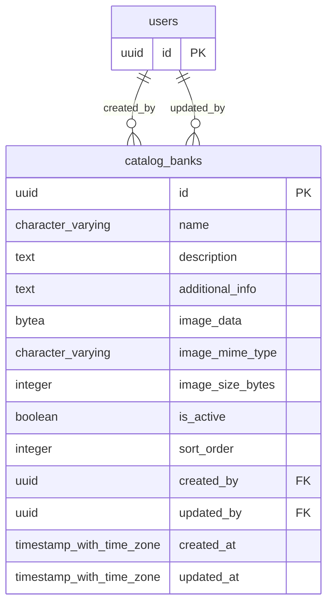

# Base de datos — dominio `catalog-banks`

Volver a [05_DATABASE_REFERENCE.md](../05_DATABASE_REFERENCE.md). Diagrama ER: llaves primarias (PK) y foráneas (FK) reales; las tablas de otros dominios referenciadas aparecen solo con su `id`. Se muestran hasta 14 columnas por tabla en el diagrama; la lista completa está en cada ficha.

## `catalog_banks`

- **Entidad TypeORM:** [CatalogBankOrmEntity](../reference/backend/catalog-banks.md#f-comercial-jhoel-api-src-modules-catalog-banks-infrastructure-persistence-catalog-bank-orm-entity-ts)
- **Creada en:** `1760004000000-CreateCatalogBanks.ts`
- **Archivos TypeScript que la usan:** [catalog-bank.orm-entity.ts](../reference/backend/catalog-banks.md#f-comercial-jhoel-api-src-modules-catalog-banks-infrastructure-persistence-catalog-bank-orm-entity-ts)

| Columna | Tipo | Nulo | Default |
|---|---|---|---|
| `id` | uuid | NOT NULL | gen_random_uuid() |
| `name` | character varying(150) | NOT NULL |  |
| `description` | text | sí |  |
| `additional_info` | text | sí |  |
| `image_data` | bytea | sí |  |
| `image_mime_type` | character varying(50) | sí |  |
| `image_size_bytes` | integer | sí |  |
| `is_active` | boolean | NOT NULL | true |
| `sort_order` | integer | NOT NULL | 0 |
| `created_by` | uuid | NOT NULL |  |
| `updated_by` | uuid | sí |  |
| `created_at` | timestamp with time zone | NOT NULL | now() |
| `updated_at` | timestamp with time zone | NOT NULL | now() |

| Restricción | Tipo | Definición |
|---|---|---|
| `catalog_banks_created_by_fkey` | FK | FOREIGN KEY (created_by) REFERENCES users(id) ON DELETE RESTRICT |
| `catalog_banks_updated_by_fkey` | FK | FOREIGN KEY (updated_by) REFERENCES users(id) ON DELETE RESTRICT |
| `catalog_banks_pkey` | PK | PRIMARY KEY (id) |

**Índices:**

- `IDX_catalog_banks_published`: CREATE INDEX "IDX_catalog_banks_published" ON public.catalog_banks USING btree (is_active, sort_order)
- `catalog_banks_pkey`: CREATE UNIQUE INDEX catalog_banks_pkey ON public.catalog_banks USING btree (id)

