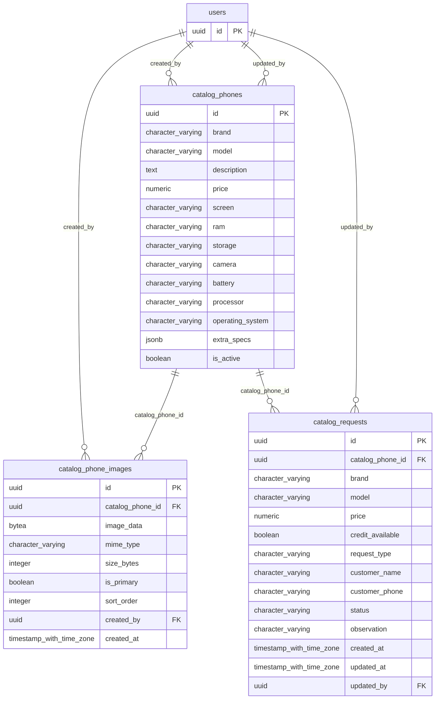

# Base de datos — dominio `catalog`

Volver a [05_DATABASE_REFERENCE.md](../05_DATABASE_REFERENCE.md). Diagrama ER: llaves primarias (PK) y foráneas (FK) reales; las tablas de otros dominios referenciadas aparecen solo con su `id`. Se muestran hasta 14 columnas por tabla en el diagrama; la lista completa está en cada ficha.

## `catalog_phone_images`

- **Entidad TypeORM:** [CatalogPhoneImageOrmEntity](../reference/backend/catalog.md#f-comercial-jhoel-api-src-modules-catalog-infrastructure-persistence-catalog-phone-image-orm-entity-ts)
- **Creada en:** `1760003100000-CreateCatalogModule.ts`
- **Archivos TypeScript que la usan:** [catalog-phone-image.orm-entity.ts](../reference/backend/catalog.md#f-comercial-jhoel-api-src-modules-catalog-infrastructure-persistence-catalog-phone-image-orm-entity-ts)

| Columna | Tipo | Nulo | Default |
|---|---|---|---|
| `id` | uuid | NOT NULL | gen_random_uuid() |
| `catalog_phone_id` | uuid | NOT NULL |  |
| `image_data` | bytea | NOT NULL |  |
| `mime_type` | character varying(50) | NOT NULL |  |
| `size_bytes` | integer | NOT NULL |  |
| `is_primary` | boolean | NOT NULL | false |
| `sort_order` | integer | NOT NULL | 0 |
| `created_by` | uuid | NOT NULL |  |
| `created_at` | timestamp with time zone | NOT NULL | now() |

| Restricción | Tipo | Definición |
|---|---|---|
| `catalog_phone_images_catalog_phone_id_fkey` | FK | FOREIGN KEY (catalog_phone_id) REFERENCES catalog_phones(id) ON DELETE CASCADE |
| `catalog_phone_images_created_by_fkey` | FK | FOREIGN KEY (created_by) REFERENCES users(id) ON DELETE RESTRICT |
| `catalog_phone_images_pkey` | PK | PRIMARY KEY (id) |

**Índices:**

- `IDX_catalog_phone_images_phone_id`: CREATE INDEX "IDX_catalog_phone_images_phone_id" ON public.catalog_phone_images USING btree (catalog_phone_id)
- `UQ_catalog_phone_images_primary`: CREATE UNIQUE INDEX "UQ_catalog_phone_images_primary" ON public.catalog_phone_images USING btree (catalog_phone_id) WHERE (is_primary = true)
- `catalog_phone_images_pkey`: CREATE UNIQUE INDEX catalog_phone_images_pkey ON public.catalog_phone_images USING btree (id)

## `catalog_phones`

- **Entidad TypeORM:** [CatalogPhoneOrmEntity](../reference/backend/catalog.md#f-comercial-jhoel-api-src-modules-catalog-infrastructure-persistence-catalog-phone-orm-entity-ts)
- **Creada en:** `1760003100000-CreateCatalogModule.ts`
- **Archivos TypeScript que la usan:** [catalog-phone.orm-entity.ts](../reference/backend/catalog.md#f-comercial-jhoel-api-src-modules-catalog-infrastructure-persistence-catalog-phone-orm-entity-ts), [typeorm-catalog-phone.repository.ts](../reference/backend/catalog.md#f-comercial-jhoel-api-src-modules-catalog-infrastructure-persistence-typeorm-catalog-phone-repository-ts)

| Columna | Tipo | Nulo | Default |
|---|---|---|---|
| `id` | uuid | NOT NULL | gen_random_uuid() |
| `brand` | character varying(80) | NOT NULL |  |
| `model` | character varying(150) | NOT NULL |  |
| `description` | text | sí |  |
| `price` | numeric(12,2) | NOT NULL |  |
| `screen` | character varying(100) | sí |  |
| `ram` | character varying(50) | sí |  |
| `storage` | character varying(50) | sí |  |
| `camera` | character varying(100) | sí |  |
| `battery` | character varying(50) | sí |  |
| `processor` | character varying(100) | sí |  |
| `operating_system` | character varying(50) | sí |  |
| `extra_specs` | jsonb | NOT NULL | '[]'::jsonb |
| `is_active` | boolean | NOT NULL | true |
| `is_published` | boolean | NOT NULL | false |
| `sort_order` | integer | NOT NULL | 0 |
| `created_by` | uuid | NOT NULL |  |
| `updated_by` | uuid | sí |  |
| `created_at` | timestamp with time zone | NOT NULL | now() |
| `updated_at` | timestamp with time zone | NOT NULL | now() |
| `likes_count` | integer | NOT NULL | 0 |

| Restricción | Tipo | Definición |
|---|---|---|
| `catalog_phones_price_check` | CHECK | CHECK ((price &gt;= (0)::numeric)) |
| `catalog_phones_created_by_fkey` | FK | FOREIGN KEY (created_by) REFERENCES users(id) ON DELETE RESTRICT |
| `catalog_phones_updated_by_fkey` | FK | FOREIGN KEY (updated_by) REFERENCES users(id) ON DELETE RESTRICT |
| `catalog_phones_pkey` | PK | PRIMARY KEY (id) |

**Índices:**

- `IDX_catalog_phones_published`: CREATE INDEX "IDX_catalog_phones_published" ON public.catalog_phones USING btree (is_published, is_active, sort_order)
- `catalog_phones_pkey`: CREATE UNIQUE INDEX catalog_phones_pkey ON public.catalog_phones USING btree (id)

## `catalog_requests`

- **Entidad TypeORM:** [CatalogRequestOrmEntity](../reference/backend/catalog.md#f-comercial-jhoel-api-src-modules-catalog-infrastructure-persistence-catalog-request-orm-entity-ts)
- **Creada en:** `1760003100000-CreateCatalogModule.ts`
- **Archivos TypeScript que la usan:** [catalog-request.orm-entity.ts](../reference/backend/catalog.md#f-comercial-jhoel-api-src-modules-catalog-infrastructure-persistence-catalog-request-orm-entity-ts)

| Columna | Tipo | Nulo | Default |
|---|---|---|---|
| `id` | uuid | NOT NULL | gen_random_uuid() |
| `catalog_phone_id` | uuid | sí |  |
| `brand` | character varying(80) | NOT NULL |  |
| `model` | character varying(150) | NOT NULL |  |
| `price` | numeric(12,2) | NOT NULL |  |
| `credit_available` | boolean | NOT NULL |  |
| `request_type` | character varying(20) | NOT NULL |  |
| `customer_name` | character varying(150) | NOT NULL |  |
| `customer_phone` | character varying(20) | NOT NULL |  |
| `status` | character varying(20) | NOT NULL | 'NUEVA'::character varying |
| `observation` | character varying(500) | sí |  |
| `created_at` | timestamp with time zone | NOT NULL | now() |
| `updated_at` | timestamp with time zone | NOT NULL | now() |
| `updated_by` | uuid | sí |  |

| Restricción | Tipo | Definición |
|---|---|---|
| `catalog_requests_request_type_check` | CHECK | CHECK (((request_type)::text = ANY ((ARRAY['INTERES_COMPRA'::character varying, 'INTERES_CREDITO'::character varying])::text[]))) |
| `catalog_requests_status_check` | CHECK | CHECK (((status)::text = ANY ((ARRAY['NUEVA'::character varying, 'CONTACTADA'::character varying, 'EN_PROCESO'::character varying, 'ATENDIDA'::character varying, 'CANCELADA'::character varying])::text[]))) |
| `catalog_requests_catalog_phone_id_fkey` | FK | FOREIGN KEY (catalog_phone_id) REFERENCES catalog_phones(id) ON DELETE RESTRICT |
| `catalog_requests_updated_by_fkey` | FK | FOREIGN KEY (updated_by) REFERENCES users(id) ON DELETE RESTRICT |
| `catalog_requests_pkey` | PK | PRIMARY KEY (id) |

**Índices:**

- `IDX_catalog_requests_created_at`: CREATE INDEX "IDX_catalog_requests_created_at" ON public.catalog_requests USING btree (created_at)
- `IDX_catalog_requests_status`: CREATE INDEX "IDX_catalog_requests_status" ON public.catalog_requests USING btree (status)
- `catalog_requests_pkey`: CREATE UNIQUE INDEX catalog_requests_pkey ON public.catalog_requests USING btree (id)

