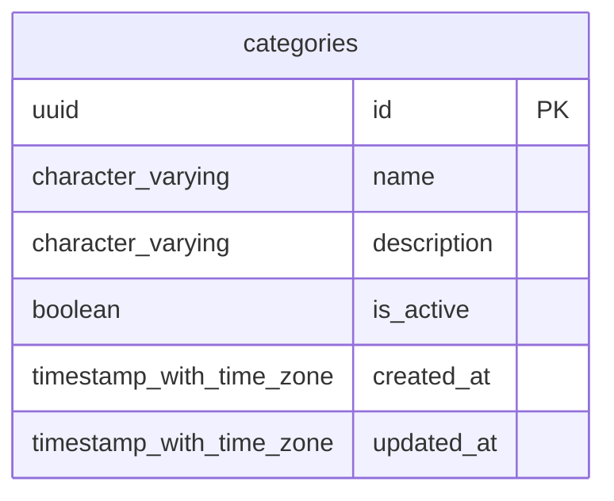

# Base de datos — dominio `categories`

Volver a [05_DATABASE_REFERENCE.md](../05_DATABASE_REFERENCE.md). Diagrama ER: llaves primarias (PK) y foráneas (FK) reales; las tablas de otros dominios referenciadas aparecen solo con su `id`. Se muestran hasta 14 columnas por tabla en el diagrama; la lista completa está en cada ficha.

## `categories`

- **Entidad TypeORM:** [CategoryOrmEntity](../reference/backend/categories.md#f-comercial-jhoel-api-src-modules-categories-infrastructure-persistence-category-orm-entity-ts)
- **Creada en:** migración no identificada por el análisis (creada con TypeORM `Table` o `createTable`)
- **Archivos TypeScript que la usan:** [category.orm-entity.ts](../reference/backend/categories.md#f-comercial-jhoel-api-src-modules-categories-infrastructure-persistence-category-orm-entity-ts)

| Columna | Tipo | Nulo | Default |
|---|---|---|---|
| `id` | uuid | NOT NULL | gen_random_uuid() |
| `name` | character varying(80) | NOT NULL |  |
| `description` | character varying(255) | sí |  |
| `is_active` | boolean | NOT NULL | true |
| `created_at` | timestamp with time zone | NOT NULL | now() |
| `updated_at` | timestamp with time zone | NOT NULL | now() |

| Restricción | Tipo | Definición |
|---|---|---|
| `PK_24dbc6126a28ff948da33e97d3b` | PK | PRIMARY KEY (id) |
| `UQ_categories_name` | UNIQUE | UNIQUE (name) |

**Índices:**

- `PK_24dbc6126a28ff948da33e97d3b`: CREATE UNIQUE INDEX "PK_24dbc6126a28ff948da33e97d3b" ON public.categories USING btree (id)
- `UQ_categories_name`: CREATE UNIQUE INDEX "UQ_categories_name" ON public.categories USING btree (name)

