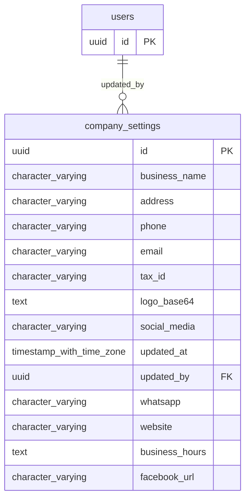

# Base de datos — dominio `company-settings`

Volver a [05_DATABASE_REFERENCE.md](../05_DATABASE_REFERENCE.md). Diagrama ER: llaves primarias (PK) y foráneas (FK) reales; las tablas de otros dominios referenciadas aparecen solo con su `id`. Se muestran hasta 14 columnas por tabla en el diagrama; la lista completa está en cada ficha.

## `company_settings`

- **Entidad TypeORM:** [CompanySettingsOrmEntity](../reference/backend/company-settings.md#f-comercial-jhoel-api-src-modules-company-settings-infrastructure-persistence-company-settings-orm-entity-ts)
- **Creada en:** migración no identificada por el análisis (creada con TypeORM `Table` o `createTable`)
- **Archivos TypeScript que la usan:** [company-settings.orm-entity.ts](../reference/backend/company-settings.md#f-comercial-jhoel-api-src-modules-company-settings-infrastructure-persistence-company-settings-orm-entity-ts)

| Columna | Tipo | Nulo | Default |
|---|---|---|---|
| `id` | uuid | NOT NULL | gen_random_uuid() |
| `business_name` | character varying(150) | NOT NULL | ''::character varying |
| `address` | character varying(255) | sí |  |
| `phone` | character varying(20) | sí |  |
| `email` | character varying(150) | sí |  |
| `tax_id` | character varying(50) | sí |  |
| `logo_base64` | text | sí |  |
| `social_media` | character varying(255) | sí |  |
| `updated_at` | timestamp with time zone | NOT NULL | now() |
| `updated_by` | uuid | sí |  |
| `whatsapp` | character varying(20) | sí |  |
| `website` | character varying(255) | sí |  |
| `business_hours` | text | sí |  |
| `facebook_url` | character varying(255) | sí |  |
| `instagram_url` | character varying(255) | sí |  |
| `tiktok_url` | character varying(255) | sí |  |
| `krediya_min_amount` | numeric(12,2) | sí |  |

| Restricción | Tipo | Definición |
|---|---|---|
| `FK_company_settings_updated_by` | FK | FOREIGN KEY (updated_by) REFERENCES users(id) ON DELETE RESTRICT |
| `PK_036b4634217db79c17305442dbe` | PK | PRIMARY KEY (id) |

**Índices:**

- `PK_036b4634217db79c17305442dbe`: CREATE UNIQUE INDEX "PK_036b4634217db79c17305442dbe" ON public.company_settings USING btree (id)

