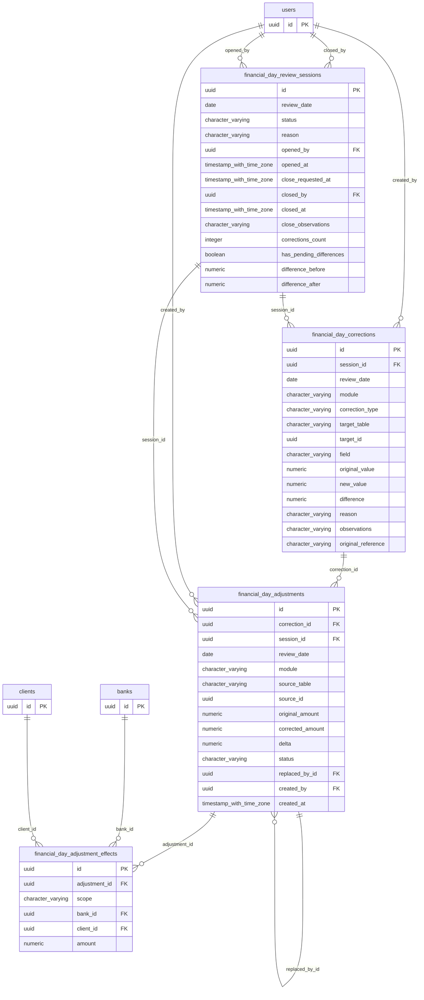

# Base de datos — dominio `financial-day-review`

Volver a [05_DATABASE_REFERENCE.md](../05_DATABASE_REFERENCE.md). Diagrama ER: llaves primarias (PK) y foráneas (FK) reales; las tablas de otros dominios referenciadas aparecen solo con su `id`. Se muestran hasta 14 columnas por tabla en el diagrama; la lista completa está en cada ficha.

## `financial_day_adjustment_effects`

- **Entidad TypeORM:** ninguna (se accede con SQL crudo o solo desde funciones PL/pgSQL)
- **Creada en:** `1760007100000-FinancialDayReview.ts`
- **Archivos TypeScript que la usan:** [typeorm-financial-day-review.repository.ts](../reference/backend/financial-day-review.md#f-comercial-jhoel-api-src-modules-financial-day-review-infrastructure-persistence-typeorm-financial-day-review-repository-ts)
- **Funciones SQL que la escriben:** `adjust_financial_day_movement`

| Columna | Tipo | Nulo | Default |
|---|---|---|---|
| `id` | uuid | NOT NULL | gen_random_uuid() |
| `adjustment_id` | uuid | NOT NULL |  |
| `scope` | character varying(10) | NOT NULL |  |
| `bank_id` | uuid | sí |  |
| `client_id` | uuid | sí |  |
| `amount` | numeric(14,2) | NOT NULL |  |

| Restricción | Tipo | Definición |
|---|---|---|
| `CHK_fdr_effects_bank` | CHECK | CHECK ((((scope)::text = 'BANK'::text) = (bank_id IS NOT NULL))) |
| `CHK_fdr_effects_client` | CHECK | CHECK ((((scope)::text = ANY ((ARRAY['AR'::character varying, 'ASSET'::character varying])::text[])) = (client_id IS NOT NULL))) |
| `CHK_fdr_effects_scope` | CHECK | CHECK (((scope)::text = ANY ((ARRAY['CASH'::character varying, 'BANK'::character varying, 'AR'::character varying, 'ASSET'::character varying])::text[]))) |
| `financial_day_adjustment_effects_adjustment_id_fkey` | FK | FOREIGN KEY (adjustment_id) REFERENCES financial_day_adjustments(id) ON DELETE RESTRICT |
| `financial_day_adjustment_effects_bank_id_fkey` | FK | FOREIGN KEY (bank_id) REFERENCES banks(id) ON DELETE RESTRICT |
| `financial_day_adjustment_effects_client_id_fkey` | FK | FOREIGN KEY (client_id) REFERENCES clients(id) ON DELETE RESTRICT |
| `financial_day_adjustment_effects_pkey` | PK | PRIMARY KEY (id) |

**Índices:**

- `IDX_fdr_effects_adjustment`: CREATE INDEX "IDX_fdr_effects_adjustment" ON public.financial_day_adjustment_effects USING btree (adjustment_id)
- `financial_day_adjustment_effects_pkey`: CREATE UNIQUE INDEX financial_day_adjustment_effects_pkey ON public.financial_day_adjustment_effects USING btree (id)

**Triggers:**

- `trg_financial_day_adjustment_effects_immutable`: CREATE TRIGGER trg_financial_day_adjustment_effects_immutable BEFORE DELETE OR UPDATE ON public.financial_day_adjustment_effects FOR EACH ROW EXECUTE FUNCTION financial_review_audit_immutable()
- `trg_financial_day_adjustment_effects_no_truncate`: CREATE TRIGGER trg_financial_day_adjustment_effects_no_truncate BEFORE TRUNCATE ON public.financial_day_adjustment_effects FOR EACH STATEMENT EXECUTE FUNCTION financial_review_audit_immutable()

## `financial_day_adjustments`

- **Entidad TypeORM:** ninguna (se accede con SQL crudo o solo desde funciones PL/pgSQL)
- **Creada en:** `1760007100000-FinancialDayReview.ts`
- **Archivos TypeScript que la usan:** [typeorm-financial-day-review.repository.ts](../reference/backend/financial-day-review.md#f-comercial-jhoel-api-src-modules-financial-day-review-infrastructure-persistence-typeorm-financial-day-review-repository-ts)
- **Funciones SQL que la escriben:** `adjust_financial_day_movement`

| Columna | Tipo | Nulo | Default |
|---|---|---|---|
| `id` | uuid | NOT NULL | gen_random_uuid() |
| `correction_id` | uuid | NOT NULL |  |
| `session_id` | uuid | NOT NULL |  |
| `review_date` | date | NOT NULL |  |
| `module` | character varying(25) | NOT NULL |  |
| `source_table` | character varying(60) | NOT NULL |  |
| `source_id` | uuid | NOT NULL |  |
| `original_amount` | numeric(14,2) | NOT NULL |  |
| `corrected_amount` | numeric(14,2) | NOT NULL |  |
| `delta` | numeric(14,2) | NOT NULL |  |
| `status` | character varying(15) | NOT NULL | 'VIGENTE'::character varying |
| `replaced_by_id` | uuid | sí |  |
| `created_by` | uuid | NOT NULL |  |
| `created_at` | timestamp with time zone | NOT NULL | now() |

| Restricción | Tipo | Definición |
|---|---|---|
| `CHK_fdr_adjustments_amount` | CHECK | CHECK ((corrected_amount &gt;= (0)::numeric)) |
| `CHK_fdr_adjustments_delta` | CHECK | CHECK ((delta = (corrected_amount - original_amount))) |
| `CHK_fdr_adjustments_replaced` | CHECK | CHECK ((((status)::text = 'REEMPLAZADO'::text) = (replaced_by_id IS NOT NULL))) |
| `CHK_fdr_adjustments_status` | CHECK | CHECK (((status)::text = ANY ((ARRAY['VIGENTE'::character varying, 'REEMPLAZADO'::character varying])::text[]))) |
| `FK_fdr_adjustments_replaced_by` | FK | FOREIGN KEY (replaced_by_id) REFERENCES financial_day_adjustments(id) DEFERRABLE INITIALLY DEFERRED |
| `financial_day_adjustments_correction_id_fkey` | FK | FOREIGN KEY (correction_id) REFERENCES financial_day_corrections(id) ON DELETE RESTRICT |
| `financial_day_adjustments_created_by_fkey` | FK | FOREIGN KEY (created_by) REFERENCES users(id) ON DELETE RESTRICT |
| `financial_day_adjustments_session_id_fkey` | FK | FOREIGN KEY (session_id) REFERENCES financial_day_review_sessions(id) ON DELETE RESTRICT |
| `financial_day_adjustments_pkey` | PK | PRIMARY KEY (id) |
| `UQ_fdr_adjustments_correction` | UNIQUE | UNIQUE (correction_id) |

**Índices:**

- `IDX_fdr_adjustments_date`: CREATE INDEX "IDX_fdr_adjustments_date" ON public.financial_day_adjustments USING btree (review_date, status)
- `UQ_fdr_adjustments_correction`: CREATE UNIQUE INDEX "UQ_fdr_adjustments_correction" ON public.financial_day_adjustments USING btree (correction_id)
- `UQ_fdr_adjustments_current`: CREATE UNIQUE INDEX "UQ_fdr_adjustments_current" ON public.financial_day_adjustments USING btree (source_table, source_id) WHERE ((status)::text = 'VIGENTE'::text)
- `financial_day_adjustments_pkey`: CREATE UNIQUE INDEX financial_day_adjustments_pkey ON public.financial_day_adjustments USING btree (id)

**Triggers:**

- `trg_financial_day_adjustments_guard`: CREATE TRIGGER trg_financial_day_adjustments_guard BEFORE DELETE OR UPDATE ON public.financial_day_adjustments FOR EACH ROW EXECUTE FUNCTION financial_review_adjustment_guard()
- `trg_financial_day_adjustments_no_truncate`: CREATE TRIGGER trg_financial_day_adjustments_no_truncate BEFORE TRUNCATE ON public.financial_day_adjustments FOR EACH STATEMENT EXECUTE FUNCTION financial_review_audit_immutable()

## `financial_day_corrections`

- **Entidad TypeORM:** ninguna (se accede con SQL crudo o solo desde funciones PL/pgSQL)
- **Creada en:** `1760007100000-FinancialDayReview.ts`
- **Archivos TypeScript que la usan:** [typeorm-financial-day-review.repository.ts](../reference/backend/financial-day-review.md#f-comercial-jhoel-api-src-modules-financial-day-review-infrastructure-persistence-typeorm-financial-day-review-repository-ts)
- **Funciones SQL que la escriben:** `adjust_financial_day_movement`, `correct_financial_day_snapshot`

| Columna | Tipo | Nulo | Default |
|---|---|---|---|
| `id` | uuid | NOT NULL | gen_random_uuid() |
| `session_id` | uuid | NOT NULL |  |
| `review_date` | date | NOT NULL |  |
| `module` | character varying(25) | NOT NULL |  |
| `correction_type` | character varying(25) | NOT NULL |  |
| `target_table` | character varying(60) | NOT NULL |  |
| `target_id` | uuid | NOT NULL |  |
| `field` | character varying(60) | NOT NULL |  |
| `original_value` | numeric(14,2) | NOT NULL |  |
| `new_value` | numeric(14,2) | NOT NULL |  |
| `difference` | numeric(14,2) | NOT NULL |  |
| `reason` | character varying(500) | NOT NULL |  |
| `observations` | character varying(500) | sí |  |
| `original_reference` | character varying(255) | sí |  |
| `client_request_id` | character varying(80) | NOT NULL |  |
| `created_by` | uuid | NOT NULL |  |
| `created_at` | timestamp with time zone | NOT NULL | now() |

| Restricción | Tipo | Definición |
|---|---|---|
| `CHK_fdr_corrections_difference` | CHECK | CHECK ((difference = (new_value - original_value))) |
| `CHK_fdr_corrections_module` | CHECK | CHECK (((module)::text = ANY ((ARRAY['BANCOS'::character varying, 'EFECTIVO'::character varying, 'CORTES'::character varying, 'CUENTAS_POR_COBRAR'::character varying, 'ACTIVOS'::character varying, 'TRANSACCIONES'::character varying, 'CUADRE'::character varying])::text[]))) |
| `CHK_fdr_corrections_reason` | CHECK | CHECK ((length(btrim((reason)::text)) &gt;= 5)) |
| `CHK_fdr_corrections_type` | CHECK | CHECK (((correction_type)::text = ANY ((ARRAY['SNAPSHOT_VERSION'::character varying, 'MOVEMENT_ADJUSTMENT'::character varying])::text[]))) |
| `financial_day_corrections_created_by_fkey` | FK | FOREIGN KEY (created_by) REFERENCES users(id) ON DELETE RESTRICT |
| `financial_day_corrections_session_id_fkey` | FK | FOREIGN KEY (session_id) REFERENCES financial_day_review_sessions(id) ON DELETE RESTRICT |
| `financial_day_corrections_pkey` | PK | PRIMARY KEY (id) |
| `UQ_fdr_corrections_request` | UNIQUE | UNIQUE (client_request_id) |

**Índices:**

- `IDX_fdr_corrections_date`: CREATE INDEX "IDX_fdr_corrections_date" ON public.financial_day_corrections USING btree (review_date, created_at)
- `IDX_fdr_corrections_session`: CREATE INDEX "IDX_fdr_corrections_session" ON public.financial_day_corrections USING btree (session_id)
- `IDX_fdr_corrections_target`: CREATE INDEX "IDX_fdr_corrections_target" ON public.financial_day_corrections USING btree (target_table, target_id)
- `UQ_fdr_corrections_request`: CREATE UNIQUE INDEX "UQ_fdr_corrections_request" ON public.financial_day_corrections USING btree (client_request_id)
- `financial_day_corrections_pkey`: CREATE UNIQUE INDEX financial_day_corrections_pkey ON public.financial_day_corrections USING btree (id)

**Triggers:**

- `trg_financial_day_corrections_immutable`: CREATE TRIGGER trg_financial_day_corrections_immutable BEFORE DELETE OR UPDATE ON public.financial_day_corrections FOR EACH ROW EXECUTE FUNCTION financial_review_audit_immutable()
- `trg_financial_day_corrections_no_truncate`: CREATE TRIGGER trg_financial_day_corrections_no_truncate BEFORE TRUNCATE ON public.financial_day_corrections FOR EACH STATEMENT EXECUTE FUNCTION financial_review_audit_immutable()

## `financial_day_review_sessions`

- **Entidad TypeORM:** ninguna (se accede con SQL crudo o solo desde funciones PL/pgSQL)
- **Creada en:** `1760007100000-FinancialDayReview.ts`
- **Archivos TypeScript que la usan:** [typeorm-financial-day-review.repository.ts](../reference/backend/financial-day-review.md#f-comercial-jhoel-api-src-modules-financial-day-review-infrastructure-persistence-typeorm-financial-day-review-repository-ts)
- **Funciones SQL que la escriben:** `adjust_financial_day_movement`, `close_financial_day_review`, `correct_financial_day_snapshot`, `open_financial_day_review`, `request_financial_day_review_close`

| Columna | Tipo | Nulo | Default |
|---|---|---|---|
| `id` | uuid | NOT NULL | gen_random_uuid() |
| `review_date` | date | NOT NULL |  |
| `status` | character varying(25) | NOT NULL | 'OPEN'::character varying |
| `reason` | character varying(500) | NOT NULL |  |
| `opened_by` | uuid | NOT NULL |  |
| `opened_at` | timestamp with time zone | NOT NULL | now() |
| `close_requested_at` | timestamp with time zone | sí |  |
| `closed_by` | uuid | sí |  |
| `closed_at` | timestamp with time zone | sí |  |
| `close_observations` | character varying(500) | sí |  |
| `corrections_count` | integer | NOT NULL | 0 |
| `has_pending_differences` | boolean | sí |  |
| `difference_before` | numeric(14,2) | sí |  |
| `difference_after` | numeric(14,2) | sí |  |
| `snapshot_before` | jsonb | sí |  |
| `snapshot_after` | jsonb | sí |  |

| Restricción | Tipo | Definición |
|---|---|---|
| `CHK_fdr_sessions_closed` | CHECK | CHECK ((((status)::text = 'CLOSED'::text) = ((closed_at IS NOT NULL) AND (closed_by IS NOT NULL)))) |
| `CHK_fdr_sessions_reason` | CHECK | CHECK ((length(btrim((reason)::text)) &gt;= 5)) |
| `CHK_fdr_sessions_status` | CHECK | CHECK (((status)::text = ANY ((ARRAY['OPEN'::character varying, 'IN_REVIEW'::character varying, 'PENDING_CONFIRMATION'::character varying, 'CLOSED'::character varying])::text[]))) |
| `financial_day_review_sessions_closed_by_fkey` | FK | FOREIGN KEY (closed_by) REFERENCES users(id) ON DELETE RESTRICT |
| `financial_day_review_sessions_opened_by_fkey` | FK | FOREIGN KEY (opened_by) REFERENCES users(id) ON DELETE RESTRICT |
| `financial_day_review_sessions_pkey` | PK | PRIMARY KEY (id) |

**Índices:**

- `IDX_fdr_sessions_date`: CREATE INDEX "IDX_fdr_sessions_date" ON public.financial_day_review_sessions USING btree (review_date, opened_at DESC)
- `UQ_fdr_sessions_active_date`: CREATE UNIQUE INDEX "UQ_fdr_sessions_active_date" ON public.financial_day_review_sessions USING btree (review_date) WHERE ((status)::text &lt;&gt; 'CLOSED'::text)
- `financial_day_review_sessions_pkey`: CREATE UNIQUE INDEX financial_day_review_sessions_pkey ON public.financial_day_review_sessions USING btree (id)

**Triggers:**

- `trg_financial_day_review_sessions_guard`: CREATE TRIGGER trg_financial_day_review_sessions_guard BEFORE DELETE OR UPDATE ON public.financial_day_review_sessions FOR EACH ROW EXECUTE FUNCTION financial_review_session_guard()
- `trg_financial_day_review_sessions_no_truncate`: CREATE TRIGGER trg_financial_day_review_sessions_no_truncate BEFORE TRUNCATE ON public.financial_day_review_sessions FOR EACH STATEMENT EXECUTE FUNCTION financial_review_audit_immutable()

