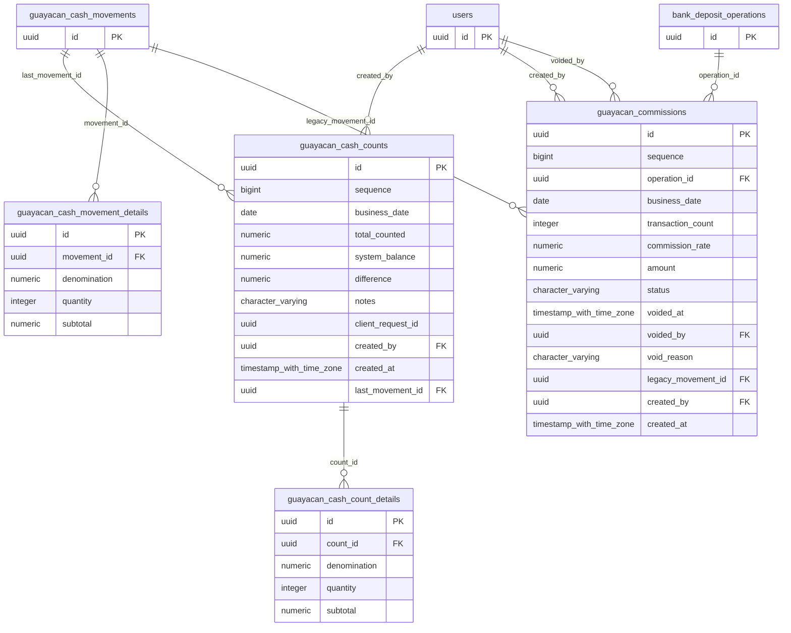

# Base de datos — dominio `guayacan-cash-box`

Volver a [05_DATABASE_REFERENCE.md](../05_DATABASE_REFERENCE.md). Diagrama ER: llaves primarias (PK) y foráneas (FK) reales; las tablas de otros dominios referenciadas aparecen solo con su `id`. Se muestran hasta 14 columnas por tabla en el diagrama; la lista completa está en cada ficha.

## `guayacan_cash_count_details`

- **Entidad TypeORM:** ninguna (se accede con SQL crudo o solo desde funciones PL/pgSQL)
- **Creada en:** `1760006300000-CreateGuayacanCashBox.ts`
- **Archivos TypeScript que la usan:** [typeorm-guayacan-cash-box.repository.ts](../reference/backend/guayacan-cash-box.md#f-comercial-jhoel-api-src-modules-guayacan-cash-box-infrastructure-persistence-typeorm-guayacan-cash-box-repository-ts)

| Columna | Tipo | Nulo | Default |
|---|---|---|---|
| `id` | uuid | NOT NULL | gen_random_uuid() |
| `count_id` | uuid | NOT NULL |  |
| `denomination` | numeric(10,2) | NOT NULL |  |
| `quantity` | integer | NOT NULL |  |
| `subtotal` | numeric(14,2) | NOT NULL |  |

| Restricción | Tipo | Definición |
|---|---|---|
| `guayacan_cash_count_details_quantity_check` | CHECK | CHECK ((quantity &gt;= 0)) |
| `guayacan_cash_count_details_count_id_fkey` | FK | FOREIGN KEY (count_id) REFERENCES guayacan_cash_counts(id) ON DELETE RESTRICT |
| `guayacan_cash_count_details_pkey` | PK | PRIMARY KEY (id) |
| `UQ_guayacan_cash_count_details` | UNIQUE | UNIQUE (count_id, denomination) |

**Índices:**

- `UQ_guayacan_cash_count_details`: CREATE UNIQUE INDEX "UQ_guayacan_cash_count_details" ON public.guayacan_cash_count_details USING btree (count_id, denomination)
- `guayacan_cash_count_details_pkey`: CREATE UNIQUE INDEX guayacan_cash_count_details_pkey ON public.guayacan_cash_count_details USING btree (id)

## `guayacan_cash_counts`

- **Entidad TypeORM:** ninguna (se accede con SQL crudo o solo desde funciones PL/pgSQL)
- **Creada en:** `1760006300000-CreateGuayacanCashBox.ts`
- **Archivos TypeScript que la usan:** [typeorm-guayacan-cash-box.repository.ts](../reference/backend/guayacan-cash-box.md#f-comercial-jhoel-api-src-modules-guayacan-cash-box-infrastructure-persistence-typeorm-guayacan-cash-box-repository-ts)

| Columna | Tipo | Nulo | Default |
|---|---|---|---|
| `id` | uuid | NOT NULL | gen_random_uuid() |
| `sequence` | bigint | NOT NULL | nextval('guayacan_cash_counts_sequence_seq'::regclass) |
| `business_date` | date | NOT NULL |  |
| `total_counted` | numeric(14,2) | NOT NULL |  |
| `system_balance` | numeric(14,2) | NOT NULL |  |
| `difference` | numeric(14,2) | NOT NULL |  |
| `notes` | character varying(500) | sí |  |
| `client_request_id` | uuid | sí |  |
| `created_by` | uuid | NOT NULL |  |
| `created_at` | timestamp with time zone | NOT NULL | now() |
| `last_movement_id` | uuid | sí |  |

| Restricción | Tipo | Definición |
|---|---|---|
| `CHK_guayacan_cash_counts_difference` | CHECK | CHECK ((difference = (total_counted - system_balance))) |
| `guayacan_cash_counts_total_counted_check` | CHECK | CHECK ((total_counted &gt;= (0)::numeric)) |
| `guayacan_cash_counts_created_by_fkey` | FK | FOREIGN KEY (created_by) REFERENCES users(id) ON DELETE RESTRICT |
| `guayacan_cash_counts_last_movement_id_fkey` | FK | FOREIGN KEY (last_movement_id) REFERENCES guayacan_cash_movements(id) ON DELETE RESTRICT |
| `guayacan_cash_counts_pkey` | PK | PRIMARY KEY (id) |
| `guayacan_cash_counts_client_request_id_key` | UNIQUE | UNIQUE (client_request_id) |
| `guayacan_cash_counts_sequence_key` | UNIQUE | UNIQUE (sequence) |

**Índices:**

- `guayacan_cash_counts_client_request_id_key`: CREATE UNIQUE INDEX guayacan_cash_counts_client_request_id_key ON public.guayacan_cash_counts USING btree (client_request_id)
- `guayacan_cash_counts_pkey`: CREATE UNIQUE INDEX guayacan_cash_counts_pkey ON public.guayacan_cash_counts USING btree (id)
- `guayacan_cash_counts_sequence_key`: CREATE UNIQUE INDEX guayacan_cash_counts_sequence_key ON public.guayacan_cash_counts USING btree (sequence)

## `guayacan_cash_movement_details`

- **Entidad TypeORM:** ninguna (se accede con SQL crudo o solo desde funciones PL/pgSQL)
- **Creada en:** `1760006300000-CreateGuayacanCashBox.ts`
- **Archivos TypeScript que la usan:** [typeorm-guayacan-cash-box.repository.ts](../reference/backend/guayacan-cash-box.md#f-comercial-jhoel-api-src-modules-guayacan-cash-box-infrastructure-persistence-typeorm-guayacan-cash-box-repository-ts)
- **Funciones SQL que la escriben:** `apply_guayacan_cash_movement`

| Columna | Tipo | Nulo | Default |
|---|---|---|---|
| `id` | uuid | NOT NULL | gen_random_uuid() |
| `movement_id` | uuid | NOT NULL |  |
| `denomination` | numeric(10,2) | NOT NULL |  |
| `quantity` | integer | NOT NULL |  |
| `subtotal` | numeric(14,2) | NOT NULL |  |

| Restricción | Tipo | Definición |
|---|---|---|
| `guayacan_cash_movement_details_quantity_check` | CHECK | CHECK ((quantity &gt; 0)) |
| `guayacan_cash_movement_details_movement_id_fkey` | FK | FOREIGN KEY (movement_id) REFERENCES guayacan_cash_movements(id) ON DELETE RESTRICT |
| `guayacan_cash_movement_details_pkey` | PK | PRIMARY KEY (id) |
| `UQ_guayacan_cash_movement_details` | UNIQUE | UNIQUE (movement_id, denomination) |

**Índices:**

- `UQ_guayacan_cash_movement_details`: CREATE UNIQUE INDEX "UQ_guayacan_cash_movement_details" ON public.guayacan_cash_movement_details USING btree (movement_id, denomination)
- `guayacan_cash_movement_details_pkey`: CREATE UNIQUE INDEX guayacan_cash_movement_details_pkey ON public.guayacan_cash_movement_details USING btree (id)

## `guayacan_commissions`

- **Entidad TypeORM:** ninguna (se accede con SQL crudo o solo desde funciones PL/pgSQL)
- **Creada en:** `1760006600000-GuayacanCashSeparateCommissionsAndTransactions.ts`
- **Archivos TypeScript que la usan:** [typeorm-guayacan-cash-box.repository.ts](../reference/backend/guayacan-cash-box.md#f-comercial-jhoel-api-src-modules-guayacan-cash-box-infrastructure-persistence-typeorm-guayacan-cash-box-repository-ts)
- **Funciones SQL que la escriben:** `guayacan_commission_on_operation_insert`, `guayacan_commission_on_operation_void`

| Columna | Tipo | Nulo | Default |
|---|---|---|---|
| `id` | uuid | NOT NULL | gen_random_uuid() |
| `sequence` | bigint | NOT NULL | nextval('guayacan_commissions_sequence_seq'::regclass) |
| `operation_id` | uuid | NOT NULL |  |
| `business_date` | date | NOT NULL |  |
| `transaction_count` | integer | NOT NULL |  |
| `commission_rate` | numeric(10,2) | NOT NULL |  |
| `amount` | numeric(14,2) | NOT NULL |  |
| `status` | character varying(15) | NOT NULL | 'VIGENTE'::character varying |
| `voided_at` | timestamp with time zone | sí |  |
| `voided_by` | uuid | sí |  |
| `void_reason` | character varying(255) | sí |  |
| `legacy_movement_id` | uuid | sí |  |
| `created_by` | uuid | NOT NULL |  |
| `created_at` | timestamp with time zone | NOT NULL | now() |

| Restricción | Tipo | Definición |
|---|---|---|
| `CHK_guayacan_commissions_amount` | CHECK | CHECK ((amount = ((transaction_count)::numeric * commission_rate))) |
| `CHK_guayacan_commissions_status` | CHECK | CHECK (((status)::text = ANY ((ARRAY['VIGENTE'::character varying, 'ANULADO'::character varying])::text[]))) |
| `CHK_guayacan_commissions_void` | CHECK | CHECK (((((status)::text = 'VIGENTE'::text) AND (voided_at IS NULL) AND (voided_by IS NULL)) OR (((status)::text = 'ANULADO'::text) AND (voided_at IS NOT NULL) AND (voided_by IS NOT NULL)))) |
| `guayacan_commissions_amount_check` | CHECK | CHECK ((amount &gt; (0)::numeric)) |
| `guayacan_commissions_commission_rate_check` | CHECK | CHECK ((commission_rate &gt; (0)::numeric)) |
| `guayacan_commissions_transaction_count_check` | CHECK | CHECK ((transaction_count &gt; 0)) |
| `guayacan_commissions_created_by_fkey` | FK | FOREIGN KEY (created_by) REFERENCES users(id) ON DELETE RESTRICT |
| `guayacan_commissions_legacy_movement_id_fkey` | FK | FOREIGN KEY (legacy_movement_id) REFERENCES guayacan_cash_movements(id) ON DELETE RESTRICT |
| `guayacan_commissions_operation_id_fkey` | FK | FOREIGN KEY (operation_id) REFERENCES bank_deposit_operations(id) ON DELETE RESTRICT |
| `guayacan_commissions_voided_by_fkey` | FK | FOREIGN KEY (voided_by) REFERENCES users(id) ON DELETE RESTRICT |
| `guayacan_commissions_pkey` | PK | PRIMARY KEY (id) |
| `UQ_guayacan_commissions_operation` | UNIQUE | UNIQUE (operation_id) |
| `guayacan_commissions_sequence_key` | UNIQUE | UNIQUE (sequence) |

**Índices:**

- `IDX_guayacan_commissions_business_date`: CREATE INDEX "IDX_guayacan_commissions_business_date" ON public.guayacan_commissions USING btree (business_date)
- `UQ_guayacan_commissions_operation`: CREATE UNIQUE INDEX "UQ_guayacan_commissions_operation" ON public.guayacan_commissions USING btree (operation_id)
- `guayacan_commissions_pkey`: CREATE UNIQUE INDEX guayacan_commissions_pkey ON public.guayacan_commissions USING btree (id)
- `guayacan_commissions_sequence_key`: CREATE UNIQUE INDEX guayacan_commissions_sequence_key ON public.guayacan_commissions USING btree (sequence)

