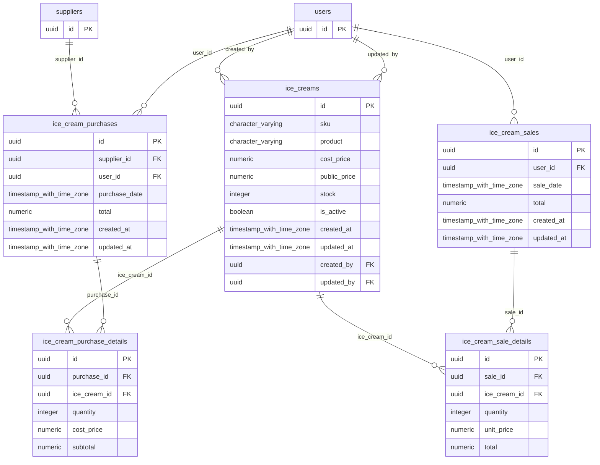

# Base de datos — dominio `ice-creams`

Volver a [05_DATABASE_REFERENCE.md](../05_DATABASE_REFERENCE.md). Diagrama ER: llaves primarias (PK) y foráneas (FK) reales; las tablas de otros dominios referenciadas aparecen solo con su `id`. Se muestran hasta 14 columnas por tabla en el diagrama; la lista completa está en cada ficha.

## `ice_cream_purchase_details`

- **Entidad TypeORM:** [IceCreamPurchaseDetailOrmEntity](../reference/backend/ice-creams.md#f-comercial-jhoel-api-src-modules-ice-creams-infrastructure-persistence-ice-cream-purchase-detail-orm-entity-ts)
- **Creada en:** migración no identificada por el análisis (creada con TypeORM `Table` o `createTable`)
- **Archivos TypeScript que la usan:** [ice-cream-purchase-detail.orm-entity.ts](../reference/backend/ice-creams.md#f-comercial-jhoel-api-src-modules-ice-creams-infrastructure-persistence-ice-cream-purchase-detail-orm-entity-ts)
- **Funciones SQL que la escriben:** `confirm_ice_cream_purchase`

| Columna | Tipo | Nulo | Default |
|---|---|---|---|
| `id` | uuid | NOT NULL | gen_random_uuid() |
| `purchase_id` | uuid | NOT NULL |  |
| `ice_cream_id` | uuid | NOT NULL |  |
| `quantity` | integer | NOT NULL |  |
| `cost_price` | numeric(12,2) | NOT NULL |  |
| `subtotal` | numeric(12,2) | NOT NULL |  |

| Restricción | Tipo | Definición |
|---|---|---|
| `FK_ice_cream_purchase_details_ice_cream` | FK | FOREIGN KEY (ice_cream_id) REFERENCES ice_creams(id) ON DELETE RESTRICT |
| `FK_ice_cream_purchase_details_purchase` | FK | FOREIGN KEY (purchase_id) REFERENCES ice_cream_purchases(id) ON DELETE CASCADE |
| `PK_3af92add5f79d1cda1e1bdb4f40` | PK | PRIMARY KEY (id) |

**Índices:**

- `IDX_ice_cream_purchase_details_ice_cream_id`: CREATE INDEX "IDX_ice_cream_purchase_details_ice_cream_id" ON public.ice_cream_purchase_details USING btree (ice_cream_id)
- `IDX_ice_cream_purchase_details_purchase_id`: CREATE INDEX "IDX_ice_cream_purchase_details_purchase_id" ON public.ice_cream_purchase_details USING btree (purchase_id)
- `PK_3af92add5f79d1cda1e1bdb4f40`: CREATE UNIQUE INDEX "PK_3af92add5f79d1cda1e1bdb4f40" ON public.ice_cream_purchase_details USING btree (id)

## `ice_cream_purchases`

- **Entidad TypeORM:** [IceCreamPurchaseOrmEntity](../reference/backend/ice-creams.md#f-comercial-jhoel-api-src-modules-ice-creams-infrastructure-persistence-ice-cream-purchase-orm-entity-ts)
- **Creada en:** migración no identificada por el análisis (creada con TypeORM `Table` o `createTable`)
- **Archivos TypeScript que la usan:** [ice-cream-purchase.orm-entity.ts](../reference/backend/ice-creams.md#f-comercial-jhoel-api-src-modules-ice-creams-infrastructure-persistence-ice-cream-purchase-orm-entity-ts)
- **Funciones SQL que la escriben:** `confirm_ice_cream_purchase`

| Columna | Tipo | Nulo | Default |
|---|---|---|---|
| `id` | uuid | NOT NULL | gen_random_uuid() |
| `supplier_id` | uuid | NOT NULL |  |
| `user_id` | uuid | NOT NULL |  |
| `purchase_date` | timestamp with time zone | NOT NULL |  |
| `total` | numeric(12,2) | NOT NULL | 0 |
| `created_at` | timestamp with time zone | NOT NULL | now() |
| `updated_at` | timestamp with time zone | NOT NULL | now() |

| Restricción | Tipo | Definición |
|---|---|---|
| `FK_ice_cream_purchases_supplier` | FK | FOREIGN KEY (supplier_id) REFERENCES suppliers(id) ON DELETE RESTRICT |
| `FK_ice_cream_purchases_user` | FK | FOREIGN KEY (user_id) REFERENCES users(id) ON DELETE RESTRICT |
| `PK_3b97d85444bb46d85bdc52d2c8d` | PK | PRIMARY KEY (id) |

**Índices:**

- `IDX_ice_cream_purchases_purchase_date`: CREATE INDEX "IDX_ice_cream_purchases_purchase_date" ON public.ice_cream_purchases USING btree (purchase_date)
- `IDX_ice_cream_purchases_supplier_id`: CREATE INDEX "IDX_ice_cream_purchases_supplier_id" ON public.ice_cream_purchases USING btree (supplier_id)
- `IDX_ice_cream_purchases_user_id`: CREATE INDEX "IDX_ice_cream_purchases_user_id" ON public.ice_cream_purchases USING btree (user_id)
- `PK_3b97d85444bb46d85bdc52d2c8d`: CREATE UNIQUE INDEX "PK_3b97d85444bb46d85bdc52d2c8d" ON public.ice_cream_purchases USING btree (id)

## `ice_cream_sale_details`

- **Entidad TypeORM:** [IceCreamSaleDetailOrmEntity](../reference/backend/ice-creams.md#f-comercial-jhoel-api-src-modules-ice-creams-infrastructure-persistence-ice-cream-sale-detail-orm-entity-ts)
- **Creada en:** migración no identificada por el análisis (creada con TypeORM `Table` o `createTable`)
- **Archivos TypeScript que la usan:** [ice-cream-sale-detail.orm-entity.ts](../reference/backend/ice-creams.md#f-comercial-jhoel-api-src-modules-ice-creams-infrastructure-persistence-ice-cream-sale-detail-orm-entity-ts)
- **Funciones SQL que la escriben:** `confirm_ice_cream_sale`

| Columna | Tipo | Nulo | Default |
|---|---|---|---|
| `id` | uuid | NOT NULL | gen_random_uuid() |
| `sale_id` | uuid | NOT NULL |  |
| `ice_cream_id` | uuid | NOT NULL |  |
| `quantity` | integer | NOT NULL |  |
| `unit_price` | numeric(12,2) | NOT NULL |  |
| `total` | numeric(12,2) | NOT NULL |  |

| Restricción | Tipo | Definición |
|---|---|---|
| `FK_ice_cream_sale_details_ice_cream` | FK | FOREIGN KEY (ice_cream_id) REFERENCES ice_creams(id) ON DELETE RESTRICT |
| `FK_ice_cream_sale_details_sale` | FK | FOREIGN KEY (sale_id) REFERENCES ice_cream_sales(id) ON DELETE CASCADE |
| `PK_5be0e696a45ff3596000e56e705` | PK | PRIMARY KEY (id) |

**Índices:**

- `IDX_ice_cream_sale_details_ice_cream_id`: CREATE INDEX "IDX_ice_cream_sale_details_ice_cream_id" ON public.ice_cream_sale_details USING btree (ice_cream_id)
- `IDX_ice_cream_sale_details_sale_id`: CREATE INDEX "IDX_ice_cream_sale_details_sale_id" ON public.ice_cream_sale_details USING btree (sale_id)
- `PK_5be0e696a45ff3596000e56e705`: CREATE UNIQUE INDEX "PK_5be0e696a45ff3596000e56e705" ON public.ice_cream_sale_details USING btree (id)

## `ice_cream_sales`

- **Entidad TypeORM:** [IceCreamSaleOrmEntity](../reference/backend/ice-creams.md#f-comercial-jhoel-api-src-modules-ice-creams-infrastructure-persistence-ice-cream-sale-orm-entity-ts)
- **Creada en:** migración no identificada por el análisis (creada con TypeORM `Table` o `createTable`)
- **Archivos TypeScript que la usan:** [ice-cream-sale.orm-entity.ts](../reference/backend/ice-creams.md#f-comercial-jhoel-api-src-modules-ice-creams-infrastructure-persistence-ice-cream-sale-orm-entity-ts)
- **Funciones SQL que la escriben:** `confirm_ice_cream_sale`

| Columna | Tipo | Nulo | Default |
|---|---|---|---|
| `id` | uuid | NOT NULL | gen_random_uuid() |
| `user_id` | uuid | NOT NULL |  |
| `sale_date` | timestamp with time zone | NOT NULL | now() |
| `total` | numeric(12,2) | NOT NULL | 0 |
| `created_at` | timestamp with time zone | NOT NULL | now() |
| `updated_at` | timestamp with time zone | NOT NULL | now() |

| Restricción | Tipo | Definición |
|---|---|---|
| `FK_ice_cream_sales_user` | FK | FOREIGN KEY (user_id) REFERENCES users(id) ON DELETE RESTRICT |
| `PK_1a2f5b25854b9edaa9ce8896c01` | PK | PRIMARY KEY (id) |

**Índices:**

- `IDX_ice_cream_sales_sale_date`: CREATE INDEX "IDX_ice_cream_sales_sale_date" ON public.ice_cream_sales USING btree (sale_date)
- `IDX_ice_cream_sales_user_id`: CREATE INDEX "IDX_ice_cream_sales_user_id" ON public.ice_cream_sales USING btree (user_id)
- `PK_1a2f5b25854b9edaa9ce8896c01`: CREATE UNIQUE INDEX "PK_1a2f5b25854b9edaa9ce8896c01" ON public.ice_cream_sales USING btree (id)

## `ice_creams`

- **Entidad TypeORM:** [IceCreamOrmEntity](../reference/backend/ice-creams.md#f-comercial-jhoel-api-src-modules-ice-creams-infrastructure-persistence-ice-cream-orm-entity-ts)
- **Creada en:** migración no identificada por el análisis (creada con TypeORM `Table` o `createTable`)
- **Archivos TypeScript que la usan:** [ice-cream.orm-entity.ts](../reference/backend/ice-creams.md#f-comercial-jhoel-api-src-modules-ice-creams-infrastructure-persistence-ice-cream-orm-entity-ts)
- **Funciones SQL que la escriben:** `confirm_ice_cream_purchase`, `confirm_ice_cream_sale`

| Columna | Tipo | Nulo | Default |
|---|---|---|---|
| `id` | uuid | NOT NULL | gen_random_uuid() |
| `sku` | character varying(64) | NOT NULL |  |
| `product` | character varying(150) | NOT NULL |  |
| `cost_price` | numeric(12,2) | NOT NULL |  |
| `public_price` | numeric(12,2) | NOT NULL |  |
| `stock` | integer | NOT NULL | 0 |
| `is_active` | boolean | NOT NULL | true |
| `created_at` | timestamp with time zone | NOT NULL | now() |
| `updated_at` | timestamp with time zone | NOT NULL | now() |
| `created_by` | uuid | NOT NULL |  |
| `updated_by` | uuid | sí |  |

| Restricción | Tipo | Definición |
|---|---|---|
| `chk_ice_creams_cost_price_non_negative` | CHECK | CHECK ((cost_price &gt;= (0)::numeric)) |
| `chk_ice_creams_public_price_non_negative` | CHECK | CHECK ((public_price &gt;= (0)::numeric)) |
| `chk_ice_creams_stock_non_negative` | CHECK | CHECK ((stock &gt;= 0)) |
| `FK_ice_creams_created_by` | FK | FOREIGN KEY (created_by) REFERENCES users(id) ON DELETE RESTRICT |
| `FK_ice_creams_updated_by` | FK | FOREIGN KEY (updated_by) REFERENCES users(id) ON DELETE RESTRICT |
| `PK_4bdf0fcde4bc2c6ad6b24774a3e` | PK | PRIMARY KEY (id) |

**Índices:**

- `PK_4bdf0fcde4bc2c6ad6b24774a3e`: CREATE UNIQUE INDEX "PK_4bdf0fcde4bc2c6ad6b24774a3e" ON public.ice_creams USING btree (id)
- `UQ_ice_creams_product_active`: CREATE UNIQUE INDEX "UQ_ice_creams_product_active" ON public.ice_creams USING btree (product) WHERE (is_active = true)
- `UQ_ice_creams_sku_active`: CREATE UNIQUE INDEX "UQ_ice_creams_sku_active" ON public.ice_creams USING btree (sku) WHERE (is_active = true)

