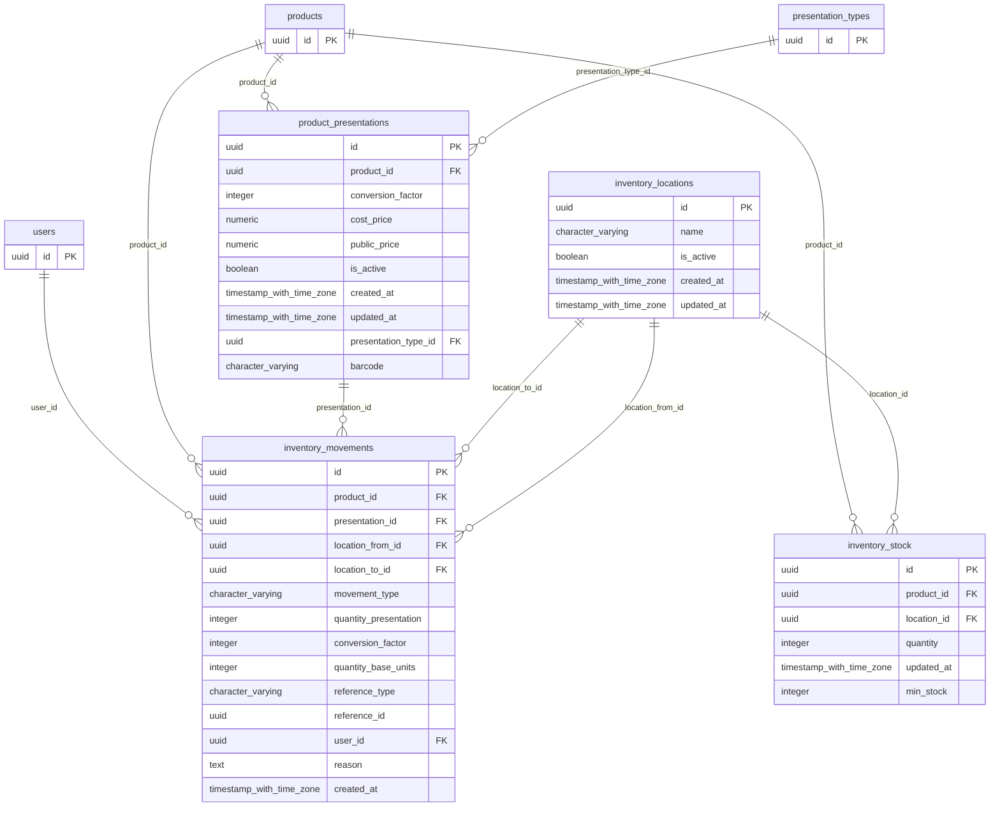

# Base de datos — dominio `inventory`

Volver a [05_DATABASE_REFERENCE.md](../05_DATABASE_REFERENCE.md). Diagrama ER: llaves primarias (PK) y foráneas (FK) reales; las tablas de otros dominios referenciadas aparecen solo con su `id`. Se muestran hasta 14 columnas por tabla en el diagrama; la lista completa está en cada ficha.

## `inventory_locations`

- **Entidad TypeORM:** [InventoryLocationOrmEntity](../reference/backend/inventory.md#f-comercial-jhoel-api-src-modules-inventory-infrastructure-persistence-inventory-location-orm-entity-ts)
- **Creada en:** migración no identificada por el análisis (creada con TypeORM `Table` o `createTable`)
- **Archivos TypeScript que la usan:** [inventory-location.orm-entity.ts](../reference/backend/inventory.md#f-comercial-jhoel-api-src-modules-inventory-infrastructure-persistence-inventory-location-orm-entity-ts)

| Columna | Tipo | Nulo | Default |
|---|---|---|---|
| `id` | uuid | NOT NULL | gen_random_uuid() |
| `name` | character varying(50) | NOT NULL |  |
| `is_active` | boolean | NOT NULL | true |
| `created_at` | timestamp with time zone | NOT NULL | now() |
| `updated_at` | timestamp with time zone | NOT NULL | now() |

| Restricción | Tipo | Definición |
|---|---|---|
| `PK_b9591ced2c9d787495d19639575` | PK | PRIMARY KEY (id) |

**Índices:**

- `PK_b9591ced2c9d787495d19639575`: CREATE UNIQUE INDEX "PK_b9591ced2c9d787495d19639575" ON public.inventory_locations USING btree (id)
- `UQ_inventory_locations_name`: CREATE UNIQUE INDEX "UQ_inventory_locations_name" ON public.inventory_locations USING btree (name)

## `inventory_movements`

- **Entidad TypeORM:** [InventoryMovementOrmEntity](../reference/backend/inventory.md#f-comercial-jhoel-api-src-modules-inventory-infrastructure-persistence-inventory-movement-orm-entity-ts)
- **Creada en:** migración no identificada por el análisis (creada con TypeORM `Table` o `createTable`)
- **Archivos TypeScript que la usan:** [inventory-movement.orm-entity.ts](../reference/backend/inventory.md#f-comercial-jhoel-api-src-modules-inventory-infrastructure-persistence-inventory-movement-orm-entity-ts)
- **Funciones SQL que la escriben:** `confirm_open_sale`, `confirm_purchase`, `confirm_sale`, `confirm_sale`, `register_inventory_transfer`, `void_purchase`, `void_sale`

| Columna | Tipo | Nulo | Default |
|---|---|---|---|
| `id` | uuid | NOT NULL | gen_random_uuid() |
| `product_id` | uuid | NOT NULL |  |
| `presentation_id` | uuid | NOT NULL |  |
| `location_from_id` | uuid | sí |  |
| `location_to_id` | uuid | sí |  |
| `movement_type` | character varying(30) | NOT NULL |  |
| `quantity_presentation` | integer | NOT NULL |  |
| `conversion_factor` | integer | NOT NULL |  |
| `quantity_base_units` | integer | NOT NULL |  |
| `reference_type` | character varying(20) | sí |  |
| `reference_id` | uuid | sí |  |
| `user_id` | uuid | NOT NULL |  |
| `reason` | text | sí |  |
| `created_at` | timestamp with time zone | NOT NULL | now() |

| Restricción | Tipo | Definición |
|---|---|---|
| `FK_inventory_movements_location_from` | FK | FOREIGN KEY (location_from_id) REFERENCES inventory_locations(id) ON DELETE RESTRICT |
| `FK_inventory_movements_location_to` | FK | FOREIGN KEY (location_to_id) REFERENCES inventory_locations(id) ON DELETE RESTRICT |
| `FK_inventory_movements_presentation` | FK | FOREIGN KEY (presentation_id) REFERENCES product_presentations(id) ON DELETE RESTRICT |
| `FK_inventory_movements_product` | FK | FOREIGN KEY (product_id) REFERENCES products(id) ON DELETE RESTRICT |
| `FK_inventory_movements_user` | FK | FOREIGN KEY (user_id) REFERENCES users(id) ON DELETE RESTRICT |
| `PK_d7597827c1dcffae889db3ab873` | PK | PRIMARY KEY (id) |

**Índices:**

- `IDX_inventory_movements_created_at`: CREATE INDEX "IDX_inventory_movements_created_at" ON public.inventory_movements USING btree (created_at)
- `IDX_inventory_movements_product_id`: CREATE INDEX "IDX_inventory_movements_product_id" ON public.inventory_movements USING btree (product_id)
- `IDX_inventory_movements_reference_id`: CREATE INDEX "IDX_inventory_movements_reference_id" ON public.inventory_movements USING btree (reference_id)
- `PK_d7597827c1dcffae889db3ab873`: CREATE UNIQUE INDEX "PK_d7597827c1dcffae889db3ab873" ON public.inventory_movements USING btree (id)

## `inventory_stock`

- **Entidad TypeORM:** [InventoryStockOrmEntity](../reference/backend/inventory.md#f-comercial-jhoel-api-src-modules-inventory-infrastructure-persistence-inventory-stock-orm-entity-ts)
- **Creada en:** migración no identificada por el análisis (creada con TypeORM `Table` o `createTable`)
- **Archivos TypeScript que la usan:** [inventory-stock.orm-entity.ts](../reference/backend/inventory.md#f-comercial-jhoel-api-src-modules-inventory-infrastructure-persistence-inventory-stock-orm-entity-ts)
- **Funciones SQL que la escriben:** `adjust_sale_item`, `cancel_open_sale`, `confirm_purchase`, `confirm_sale`, `confirm_sale`, `ensure_inventory_stock_row`, `register_inventory_transfer`, `void_purchase`, `void_sale`

| Columna | Tipo | Nulo | Default |
|---|---|---|---|
| `id` | uuid | NOT NULL | gen_random_uuid() |
| `product_id` | uuid | NOT NULL |  |
| `location_id` | uuid | NOT NULL |  |
| `quantity` | integer | NOT NULL | 0 |
| `updated_at` | timestamp with time zone | NOT NULL | now() |
| `min_stock` | integer | NOT NULL | 0 |

| Restricción | Tipo | Definición |
|---|---|---|
| `CHK_inventory_stock_min_stock_non_negative` | CHECK | CHECK ((min_stock &gt;= 0)) |
| `CHK_inventory_stock_quantity_non_negative` | CHECK | CHECK ((quantity &gt;= 0)) |
| `FK_inventory_stock_location` | FK | FOREIGN KEY (location_id) REFERENCES inventory_locations(id) ON DELETE RESTRICT |
| `FK_inventory_stock_product` | FK | FOREIGN KEY (product_id) REFERENCES products(id) ON DELETE RESTRICT |
| `PK_a13d56d2087e6d9eb3d480395bf` | PK | PRIMARY KEY (id) |

**Índices:**

- `PK_a13d56d2087e6d9eb3d480395bf`: CREATE UNIQUE INDEX "PK_a13d56d2087e6d9eb3d480395bf" ON public.inventory_stock USING btree (id)
- `UQ_inventory_stock_product_location`: CREATE UNIQUE INDEX "UQ_inventory_stock_product_location" ON public.inventory_stock USING btree (product_id, location_id)

## `product_presentations`

- **Entidad TypeORM:** [ProductPresentationOrmEntity](../reference/backend/inventory.md#f-comercial-jhoel-api-src-modules-inventory-infrastructure-persistence-product-presentation-orm-entity-ts)
- **Creada en:** migración no identificada por el análisis (creada con TypeORM `Table` o `createTable`)
- **Archivos TypeScript que la usan:** [product-presentation.orm-entity.ts](../reference/backend/inventory.md#f-comercial-jhoel-api-src-modules-inventory-infrastructure-persistence-product-presentation-orm-entity-ts), [typeorm-presentation-type.repository.ts](../reference/backend/presentation-types.md#f-comercial-jhoel-api-src-modules-presentation-types-infrastructure-persistence-typeorm-presentation-type-repository-ts), [typeorm-product.repository.ts](../reference/backend/products.md#f-comercial-jhoel-api-src-modules-products-infrastructure-persistence-typeorm-product-repository-ts)
- **Funciones SQL que la escriben:** `confirm_purchase`

| Columna | Tipo | Nulo | Default |
|---|---|---|---|
| `id` | uuid | NOT NULL | gen_random_uuid() |
| `product_id` | uuid | NOT NULL |  |
| `conversion_factor` | integer | NOT NULL |  |
| `cost_price` | numeric(12,2) | NOT NULL |  |
| `public_price` | numeric(12,2) | NOT NULL |  |
| `is_active` | boolean | NOT NULL | true |
| `created_at` | timestamp with time zone | NOT NULL | now() |
| `updated_at` | timestamp with time zone | NOT NULL | now() |
| `presentation_type_id` | uuid | NOT NULL |  |
| `barcode` | character varying(64) | sí |  |

| Restricción | Tipo | Definición |
|---|---|---|
| `CHK_product_presentations_factor_positive` | CHECK | CHECK ((conversion_factor &gt; 0)) |
| `FK_product_presentations_presentation_type` | FK | FOREIGN KEY (presentation_type_id) REFERENCES presentation_types(id) ON DELETE RESTRICT |
| `FK_product_presentations_product` | FK | FOREIGN KEY (product_id) REFERENCES products(id) ON DELETE RESTRICT |
| `PK_4e91859a1485cf8c34aab3dcbf1` | PK | PRIMARY KEY (id) |

**Índices:**

- `IDX_product_presentations_product_id`: CREATE INDEX "IDX_product_presentations_product_id" ON public.product_presentations USING btree (product_id)
- `PK_4e91859a1485cf8c34aab3dcbf1`: CREATE UNIQUE INDEX "PK_4e91859a1485cf8c34aab3dcbf1" ON public.product_presentations USING btree (id)
- `UQ_product_presentations_barcode_active`: CREATE UNIQUE INDEX "UQ_product_presentations_barcode_active" ON public.product_presentations USING btree (barcode) WHERE (is_active = true)
- `UQ_product_presentations_product_type_active`: CREATE UNIQUE INDEX "UQ_product_presentations_product_type_active" ON public.product_presentations USING btree (product_id, presentation_type_id) WHERE (is_active = true)

