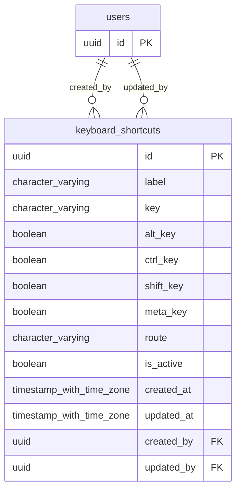

# Base de datos — dominio `keyboard-shortcuts`

Volver a [05_DATABASE_REFERENCE.md](../05_DATABASE_REFERENCE.md). Diagrama ER: llaves primarias (PK) y foráneas (FK) reales; las tablas de otros dominios referenciadas aparecen solo con su `id`. Se muestran hasta 14 columnas por tabla en el diagrama; la lista completa está en cada ficha.

## `keyboard_shortcuts`

- **Entidad TypeORM:** [KeyboardShortcutOrmEntity](../reference/backend/keyboard-shortcuts.md#f-comercial-jhoel-api-src-modules-keyboard-shortcuts-infrastructure-persistence-keyboard-shortcut-orm-entity-ts)
- **Creada en:** migración no identificada por el análisis (creada con TypeORM `Table` o `createTable`)
- **Archivos TypeScript que la usan:** [keyboard-shortcut.orm-entity.ts](../reference/backend/keyboard-shortcuts.md#f-comercial-jhoel-api-src-modules-keyboard-shortcuts-infrastructure-persistence-keyboard-shortcut-orm-entity-ts)

| Columna | Tipo | Nulo | Default |
|---|---|---|---|
| `id` | uuid | NOT NULL | gen_random_uuid() |
| `label` | character varying(150) | NOT NULL |  |
| `key` | character varying(20) | NOT NULL |  |
| `alt_key` | boolean | NOT NULL | false |
| `ctrl_key` | boolean | NOT NULL | false |
| `shift_key` | boolean | NOT NULL | false |
| `meta_key` | boolean | NOT NULL | false |
| `route` | character varying(200) | NOT NULL |  |
| `is_active` | boolean | NOT NULL | true |
| `created_at` | timestamp with time zone | NOT NULL | now() |
| `updated_at` | timestamp with time zone | NOT NULL | now() |
| `created_by` | uuid | NOT NULL |  |
| `updated_by` | uuid | sí |  |

| Restricción | Tipo | Definición |
|---|---|---|
| `CHK_keyboard_shortcuts_requires_modifier` | CHECK | CHECK ((alt_key OR ctrl_key OR meta_key)) |
| `CHK_keyboard_shortcuts_route_is_dashboard` | CHECK | CHECK (((route)::text ~~ '/dashboard/%'::text)) |
| `FK_keyboard_shortcuts_created_by` | FK | FOREIGN KEY (created_by) REFERENCES users(id) ON DELETE RESTRICT |
| `FK_keyboard_shortcuts_updated_by` | FK | FOREIGN KEY (updated_by) REFERENCES users(id) ON DELETE RESTRICT |
| `PK_72f8e3763c6384989fcedd599a5` | PK | PRIMARY KEY (id) |

**Índices:**

- `PK_72f8e3763c6384989fcedd599a5`: CREATE UNIQUE INDEX "PK_72f8e3763c6384989fcedd599a5" ON public.keyboard_shortcuts USING btree (id)
- `UQ_keyboard_shortcuts_combo_active`: CREATE UNIQUE INDEX "UQ_keyboard_shortcuts_combo_active" ON public.keyboard_shortcuts USING btree (lower((key)::text), alt_key, ctrl_key, shift_key, meta_key) WHERE (is_active = true)

