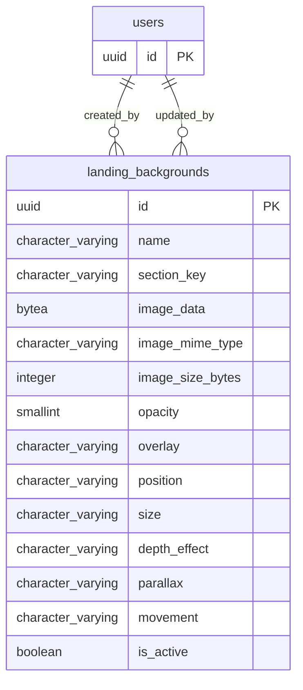

# Base de datos — dominio `landing-backgrounds`

Volver a [05_DATABASE_REFERENCE.md](../05_DATABASE_REFERENCE.md). Diagrama ER: llaves primarias (PK) y foráneas (FK) reales; las tablas de otros dominios referenciadas aparecen solo con su `id`. Se muestran hasta 14 columnas por tabla en el diagrama; la lista completa está en cada ficha.

## `landing_backgrounds`

- **Entidad TypeORM:** [LandingBackgroundOrmEntity](../reference/backend/landing-backgrounds.md#f-comercial-jhoel-api-src-modules-landing-backgrounds-infrastructure-persistence-landing-background-orm-entity-ts)
- **Creada en:** `1760005000000-CreateLandingBackgrounds.ts`
- **Archivos TypeScript que la usan:** [landing-background.orm-entity.ts](../reference/backend/landing-backgrounds.md#f-comercial-jhoel-api-src-modules-landing-backgrounds-infrastructure-persistence-landing-background-orm-entity-ts)

| Columna | Tipo | Nulo | Default |
|---|---|---|---|
| `id` | uuid | NOT NULL | gen_random_uuid() |
| `name` | character varying(150) | NOT NULL |  |
| `section_key` | character varying(40) | NOT NULL |  |
| `image_data` | bytea | sí |  |
| `image_mime_type` | character varying(50) | sí |  |
| `image_size_bytes` | integer | sí |  |
| `opacity` | smallint | NOT NULL | 25 |
| `overlay` | character varying(10) | NOT NULL | 'medium'::character varying |
| `position` | character varying(20) | NOT NULL | 'center'::character varying |
| `size` | character varying(10) | NOT NULL | 'large'::character varying |
| `depth_effect` | character varying(10) | NOT NULL | 'subtle'::character varying |
| `parallax` | character varying(10) | NOT NULL | 'subtle'::character varying |
| `movement` | character varying(12) | NOT NULL | 'scroll_mouse'::character varying |
| `is_active` | boolean | NOT NULL | true |
| `created_by` | uuid | NOT NULL |  |
| `updated_by` | uuid | sí |  |
| `created_at` | timestamp with time zone | NOT NULL | now() |
| `updated_at` | timestamp with time zone | NOT NULL | now() |

| Restricción | Tipo | Definición |
|---|---|---|
| `landing_backgrounds_depth_effect_check` | CHECK | CHECK (((depth_effect)::text = ANY ((ARRAY['none'::character varying, 'subtle'::character varying, 'medium'::character varying, 'deep'::character varying])::text[]))) |
| `landing_backgrounds_movement_check` | CHECK | CHECK (((movement)::text = ANY ((ARRAY['static'::character varying, 'floating'::character varying, 'scroll'::character varying, 'mouse'::character varying, 'scroll_mouse'::character varying])::text[]))) |
| `landing_backgrounds_opacity_check` | CHECK | CHECK (((opacity &gt;= 0) AND (opacity &lt;= 100))) |
| `landing_backgrounds_overlay_check` | CHECK | CHECK ((("overlay")::text = ANY ((ARRAY['none'::character varying, 'subtle'::character varying, 'medium'::character varying, 'strong'::character varying])::text[]))) |
| `landing_backgrounds_parallax_check` | CHECK | CHECK (((parallax)::text = ANY ((ARRAY['off'::character varying, 'subtle'::character varying, 'medium'::character varying])::text[]))) |
| `landing_backgrounds_position_check` | CHECK | CHECK ((("position")::text = ANY ((ARRAY['center'::character varying, 'center-left'::character varying, 'center-right'::character varying, 'top'::character varying, 'bottom'::character varying])::text[]))) |
| `landing_backgrounds_size_check` | CHECK | CHECK (((size)::text = ANY ((ARRAY['small'::character varying, 'medium'::character varying, 'large'::character varying, 'cover'::character varying])::text[]))) |
| `landing_backgrounds_created_by_fkey` | FK | FOREIGN KEY (created_by) REFERENCES users(id) ON DELETE RESTRICT |
| `landing_backgrounds_updated_by_fkey` | FK | FOREIGN KEY (updated_by) REFERENCES users(id) ON DELETE RESTRICT |
| `landing_backgrounds_pkey` | PK | PRIMARY KEY (id) |

**Índices:**

- `IDX_landing_backgrounds_section`: CREATE INDEX "IDX_landing_backgrounds_section" ON public.landing_backgrounds USING btree (section_key, is_active)
- `UQ_landing_backgrounds_section_active`: CREATE UNIQUE INDEX "UQ_landing_backgrounds_section_active" ON public.landing_backgrounds USING btree (section_key) WHERE (is_active = true)
- `landing_backgrounds_pkey`: CREATE UNIQUE INDEX landing_backgrounds_pkey ON public.landing_backgrounds USING btree (id)

