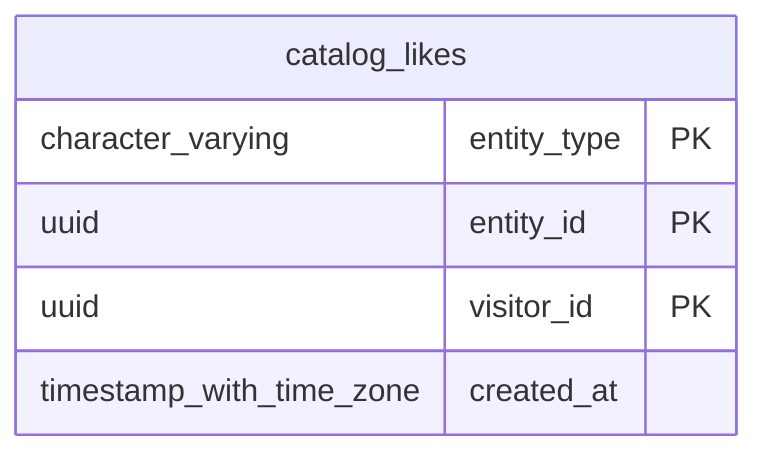

# Base de datos — dominio `likes`

Volver a [05_DATABASE_REFERENCE.md](../05_DATABASE_REFERENCE.md). Diagrama ER: llaves primarias (PK) y foráneas (FK) reales; las tablas de otros dominios referenciadas aparecen solo con su `id`. Se muestran hasta 14 columnas por tabla en el diagrama; la lista completa está en cada ficha.

## `catalog_likes`

- **Entidad TypeORM:** [CatalogLikeOrmEntity](../reference/backend/likes.md#f-comercial-jhoel-api-src-modules-likes-infrastructure-persistence-catalog-like-orm-entity-ts)
- **Creada en:** `1760003600000-CreateCatalogLikes.ts`
- **Archivos TypeScript que la usan:** [catalog-like.orm-entity.ts](../reference/backend/likes.md#f-comercial-jhoel-api-src-modules-likes-infrastructure-persistence-catalog-like-orm-entity-ts), [typeorm-catalog-like.repository.ts](../reference/backend/likes.md#f-comercial-jhoel-api-src-modules-likes-infrastructure-persistence-typeorm-catalog-like-repository-ts)

| Columna | Tipo | Nulo | Default |
|---|---|---|---|
| `entity_type` | character varying(20) | NOT NULL |  |
| `entity_id` | uuid | NOT NULL |  |
| `visitor_id` | uuid | NOT NULL |  |
| `created_at` | timestamp with time zone | NOT NULL | now() |

| Restricción | Tipo | Definición |
|---|---|---|
| `catalog_likes_entity_type_check` | CHECK | CHECK (((entity_type)::text = ANY ((ARRAY['PHONE'::character varying, 'PRODUCT'::character varying, 'NEWS'::character varying])::text[]))) |
| `PK_catalog_likes` | PK | PRIMARY KEY (entity_type, entity_id, visitor_id) |

**Índices:**

- `PK_catalog_likes`: CREATE UNIQUE INDEX "PK_catalog_likes" ON public.catalog_likes USING btree (entity_type, entity_id, visitor_id)

