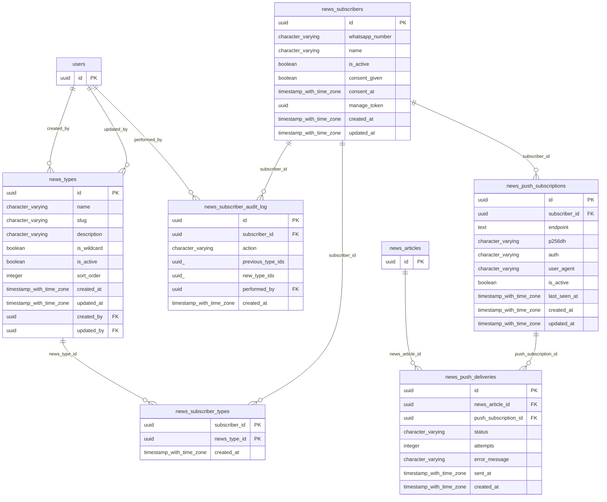

# Base de datos — dominio `news-subscriptions`

Volver a [05_DATABASE_REFERENCE.md](../05_DATABASE_REFERENCE.md). Diagrama ER: llaves primarias (PK) y foráneas (FK) reales; las tablas de otros dominios referenciadas aparecen solo con su `id`. Se muestran hasta 14 columnas por tabla en el diagrama; la lista completa está en cada ficha.

## `news_push_deliveries`

- **Entidad TypeORM:** ninguna (se accede con SQL crudo o solo desde funciones PL/pgSQL)
- **Creada en:** `1760004100000-CreateNewsPushSubscriptions.ts`
- **Archivos TypeScript que la usan:** [typeorm-news-push-subscription.repository.ts](../reference/backend/news-subscriptions.md#f-comercial-jhoel-api-src-modules-news-subscriptions-infrastructure-persistence-typeorm-news-push-subscription-repository-ts)

| Columna | Tipo | Nulo | Default |
|---|---|---|---|
| `id` | uuid | NOT NULL | gen_random_uuid() |
| `news_article_id` | uuid | NOT NULL |  |
| `push_subscription_id` | uuid | NOT NULL |  |
| `status` | character varying(20) | NOT NULL | 'PENDING'::character varying |
| `attempts` | integer | NOT NULL | 0 |
| `error_message` | character varying(500) | sí |  |
| `sent_at` | timestamp with time zone | sí |  |
| `created_at` | timestamp with time zone | NOT NULL | now() |

| Restricción | Tipo | Definición |
|---|---|---|
| `CHK_news_push_deliveries_status` | CHECK | CHECK (((status)::text = ANY ((ARRAY['PENDING'::character varying, 'SENT'::character varying, 'FAILED'::character varying, 'EXPIRED'::character varying])::text[]))) |
| `news_push_deliveries_news_article_id_fkey` | FK | FOREIGN KEY (news_article_id) REFERENCES news_articles(id) ON DELETE RESTRICT |
| `news_push_deliveries_push_subscription_id_fkey` | FK | FOREIGN KEY (push_subscription_id) REFERENCES news_push_subscriptions(id) ON DELETE RESTRICT |
| `news_push_deliveries_pkey` | PK | PRIMARY KEY (id) |
| `UQ_news_push_deliveries_article_subscription` | UNIQUE | UNIQUE (news_article_id, push_subscription_id) |

**Índices:**

- `IDX_news_push_deliveries_status`: CREATE INDEX "IDX_news_push_deliveries_status" ON public.news_push_deliveries USING btree (status)
- `UQ_news_push_deliveries_article_subscription`: CREATE UNIQUE INDEX "UQ_news_push_deliveries_article_subscription" ON public.news_push_deliveries USING btree (news_article_id, push_subscription_id)
- `news_push_deliveries_pkey`: CREATE UNIQUE INDEX news_push_deliveries_pkey ON public.news_push_deliveries USING btree (id)

## `news_push_subscriptions`

- **Entidad TypeORM:** [NewsPushSubscriptionOrmEntity](../reference/backend/news-subscriptions.md#f-comercial-jhoel-api-src-modules-news-subscriptions-infrastructure-persistence-news-push-subscription-orm-entity-ts)
- **Creada en:** `1760004100000-CreateNewsPushSubscriptions.ts`
- **Archivos TypeScript que la usan:** [news-push-subscription.orm-entity.ts](../reference/backend/news-subscriptions.md#f-comercial-jhoel-api-src-modules-news-subscriptions-infrastructure-persistence-news-push-subscription-orm-entity-ts), [typeorm-news-push-subscription.repository.ts](../reference/backend/news-subscriptions.md#f-comercial-jhoel-api-src-modules-news-subscriptions-infrastructure-persistence-typeorm-news-push-subscription-repository-ts)

| Columna | Tipo | Nulo | Default |
|---|---|---|---|
| `id` | uuid | NOT NULL | gen_random_uuid() |
| `subscriber_id` | uuid | NOT NULL |  |
| `endpoint` | text | NOT NULL |  |
| `p256dh` | character varying(255) | NOT NULL |  |
| `auth` | character varying(255) | NOT NULL |  |
| `user_agent` | character varying(255) | sí |  |
| `is_active` | boolean | NOT NULL | true |
| `last_seen_at` | timestamp with time zone | sí |  |
| `created_at` | timestamp with time zone | NOT NULL | now() |
| `updated_at` | timestamp with time zone | NOT NULL | now() |

| Restricción | Tipo | Definición |
|---|---|---|
| `news_push_subscriptions_subscriber_id_fkey` | FK | FOREIGN KEY (subscriber_id) REFERENCES news_subscribers(id) ON DELETE CASCADE |
| `news_push_subscriptions_pkey` | PK | PRIMARY KEY (id) |

**Índices:**

- `IDX_news_push_subscriptions_subscriber`: CREATE INDEX "IDX_news_push_subscriptions_subscriber" ON public.news_push_subscriptions USING btree (subscriber_id, is_active)
- `UQ_news_push_subscriptions_endpoint`: CREATE UNIQUE INDEX "UQ_news_push_subscriptions_endpoint" ON public.news_push_subscriptions USING btree (endpoint)
- `news_push_subscriptions_pkey`: CREATE UNIQUE INDEX news_push_subscriptions_pkey ON public.news_push_subscriptions USING btree (id)

## `news_subscriber_audit_log`

- **Entidad TypeORM:** [NewsSubscriberAuditLogOrmEntity](../reference/backend/news-subscriptions.md#f-comercial-jhoel-api-src-modules-news-subscriptions-infrastructure-persistence-news-subscriber-audit-log-orm-entity-ts)
- **Creada en:** `1760003900000-CreateNewsSubscriptions.ts`
- **Archivos TypeScript que la usan:** [news-subscriber-audit-log.orm-entity.ts](../reference/backend/news-subscriptions.md#f-comercial-jhoel-api-src-modules-news-subscriptions-infrastructure-persistence-news-subscriber-audit-log-orm-entity-ts)

| Columna | Tipo | Nulo | Default |
|---|---|---|---|
| `id` | uuid | NOT NULL | gen_random_uuid() |
| `subscriber_id` | uuid | NOT NULL |  |
| `action` | character varying(30) | NOT NULL |  |
| `previous_type_ids` | uuid[] | sí |  |
| `new_type_ids` | uuid[] | sí |  |
| `performed_by` | uuid | sí |  |
| `created_at` | timestamp with time zone | NOT NULL | now() |

| Restricción | Tipo | Definición |
|---|---|---|
| `news_subscriber_audit_log_performed_by_fkey` | FK | FOREIGN KEY (performed_by) REFERENCES users(id) ON DELETE RESTRICT |
| `news_subscriber_audit_log_subscriber_id_fkey` | FK | FOREIGN KEY (subscriber_id) REFERENCES news_subscribers(id) ON DELETE CASCADE |
| `news_subscriber_audit_log_pkey` | PK | PRIMARY KEY (id) |

**Índices:**

- `IDX_news_subscriber_audit_log_subscriber`: CREATE INDEX "IDX_news_subscriber_audit_log_subscriber" ON public.news_subscriber_audit_log USING btree (subscriber_id, created_at DESC)
- `news_subscriber_audit_log_pkey`: CREATE UNIQUE INDEX news_subscriber_audit_log_pkey ON public.news_subscriber_audit_log USING btree (id)

## `news_subscriber_types`

- **Entidad TypeORM:** [NewsSubscriberTypeOrmEntity](../reference/backend/news-subscriptions.md#f-comercial-jhoel-api-src-modules-news-subscriptions-infrastructure-persistence-news-subscriber-type-orm-entity-ts)
- **Creada en:** `1760003900000-CreateNewsSubscriptions.ts`
- **Archivos TypeScript que la usan:** [news-subscriber-type.orm-entity.ts](../reference/backend/news-subscriptions.md#f-comercial-jhoel-api-src-modules-news-subscriptions-infrastructure-persistence-news-subscriber-type-orm-entity-ts), [typeorm-news-push-subscription.repository.ts](../reference/backend/news-subscriptions.md#f-comercial-jhoel-api-src-modules-news-subscriptions-infrastructure-persistence-typeorm-news-push-subscription-repository-ts), [typeorm-news-subscriber.repository.ts](../reference/backend/news-subscriptions.md#f-comercial-jhoel-api-src-modules-news-subscriptions-infrastructure-persistence-typeorm-news-subscriber-repository-ts)

| Columna | Tipo | Nulo | Default |
|---|---|---|---|
| `subscriber_id` | uuid | NOT NULL |  |
| `news_type_id` | uuid | NOT NULL |  |
| `created_at` | timestamp with time zone | NOT NULL | now() |

| Restricción | Tipo | Definición |
|---|---|---|
| `news_subscriber_types_news_type_id_fkey` | FK | FOREIGN KEY (news_type_id) REFERENCES news_types(id) ON DELETE RESTRICT |
| `news_subscriber_types_subscriber_id_fkey` | FK | FOREIGN KEY (subscriber_id) REFERENCES news_subscribers(id) ON DELETE CASCADE |
| `PK_news_subscriber_types` | PK | PRIMARY KEY (subscriber_id, news_type_id) |

**Índices:**

- `PK_news_subscriber_types`: CREATE UNIQUE INDEX "PK_news_subscriber_types" ON public.news_subscriber_types USING btree (subscriber_id, news_type_id)

## `news_subscribers`

- **Entidad TypeORM:** [NewsSubscriberOrmEntity](../reference/backend/news-subscriptions.md#f-comercial-jhoel-api-src-modules-news-subscriptions-infrastructure-persistence-news-subscriber-orm-entity-ts)
- **Creada en:** `1760003900000-CreateNewsSubscriptions.ts`
- **Archivos TypeScript que la usan:** [news-subscriber.orm-entity.ts](../reference/backend/news-subscriptions.md#f-comercial-jhoel-api-src-modules-news-subscriptions-infrastructure-persistence-news-subscriber-orm-entity-ts), [typeorm-news-push-subscription.repository.ts](../reference/backend/news-subscriptions.md#f-comercial-jhoel-api-src-modules-news-subscriptions-infrastructure-persistence-typeorm-news-push-subscription-repository-ts)

| Columna | Tipo | Nulo | Default |
|---|---|---|---|
| `id` | uuid | NOT NULL | gen_random_uuid() |
| `whatsapp_number` | character varying(20) | sí |  |
| `name` | character varying(150) | sí |  |
| `is_active` | boolean | NOT NULL | true |
| `consent_given` | boolean | NOT NULL | false |
| `consent_at` | timestamp with time zone | sí |  |
| `manage_token` | uuid | NOT NULL | gen_random_uuid() |
| `created_at` | timestamp with time zone | NOT NULL | now() |
| `updated_at` | timestamp with time zone | NOT NULL | now() |

| Restricción | Tipo | Definición |
|---|---|---|
| `news_subscribers_pkey` | PK | PRIMARY KEY (id) |

**Índices:**

- `UQ_news_subscribers_manage_token`: CREATE UNIQUE INDEX "UQ_news_subscribers_manage_token" ON public.news_subscribers USING btree (manage_token)
- `UQ_news_subscribers_whatsapp_active`: CREATE UNIQUE INDEX "UQ_news_subscribers_whatsapp_active" ON public.news_subscribers USING btree (whatsapp_number) WHERE (is_active = true)
- `news_subscribers_pkey`: CREATE UNIQUE INDEX news_subscribers_pkey ON public.news_subscribers USING btree (id)

## `news_types`

- **Entidad TypeORM:** [NewsTypeOrmEntity](../reference/backend/news-types.md#f-comercial-jhoel-api-src-modules-news-types-infrastructure-persistence-news-type-orm-entity-ts)
- **Creada en:** `1760003700000-CreateNewsTypes.ts`
- **Archivos TypeScript que la usan:** [typeorm-news-push-subscription.repository.ts](../reference/backend/news-subscriptions.md#f-comercial-jhoel-api-src-modules-news-subscriptions-infrastructure-persistence-typeorm-news-push-subscription-repository-ts), [typeorm-news-subscriber.repository.ts](../reference/backend/news-subscriptions.md#f-comercial-jhoel-api-src-modules-news-subscriptions-infrastructure-persistence-typeorm-news-subscriber-repository-ts), [news-type.orm-entity.ts](../reference/backend/news-types.md#f-comercial-jhoel-api-src-modules-news-types-infrastructure-persistence-news-type-orm-entity-ts)

| Columna | Tipo | Nulo | Default |
|---|---|---|---|
| `id` | uuid | NOT NULL | gen_random_uuid() |
| `name` | character varying(50) | NOT NULL |  |
| `slug` | character varying(50) | NOT NULL |  |
| `description` | character varying(255) | sí |  |
| `is_wildcard` | boolean | NOT NULL | false |
| `is_active` | boolean | NOT NULL | true |
| `sort_order` | integer | NOT NULL | 0 |
| `created_at` | timestamp with time zone | NOT NULL | now() |
| `updated_at` | timestamp with time zone | NOT NULL | now() |
| `created_by` | uuid | NOT NULL |  |
| `updated_by` | uuid | sí |  |

| Restricción | Tipo | Definición |
|---|---|---|
| `news_types_created_by_fkey` | FK | FOREIGN KEY (created_by) REFERENCES users(id) ON DELETE RESTRICT |
| `news_types_updated_by_fkey` | FK | FOREIGN KEY (updated_by) REFERENCES users(id) ON DELETE RESTRICT |
| `news_types_pkey` | PK | PRIMARY KEY (id) |

**Índices:**

- `UQ_news_types_name_active`: CREATE UNIQUE INDEX "UQ_news_types_name_active" ON public.news_types USING btree (lower((name)::text)) WHERE (is_active = true)
- `UQ_news_types_slug_active`: CREATE UNIQUE INDEX "UQ_news_types_slug_active" ON public.news_types USING btree (lower((slug)::text)) WHERE (is_active = true)
- `UQ_news_types_wildcard_active`: CREATE UNIQUE INDEX "UQ_news_types_wildcard_active" ON public.news_types USING btree (is_wildcard) WHERE ((is_wildcard = true) AND (is_active = true))
- `news_types_pkey`: CREATE UNIQUE INDEX news_types_pkey ON public.news_types USING btree (id)

