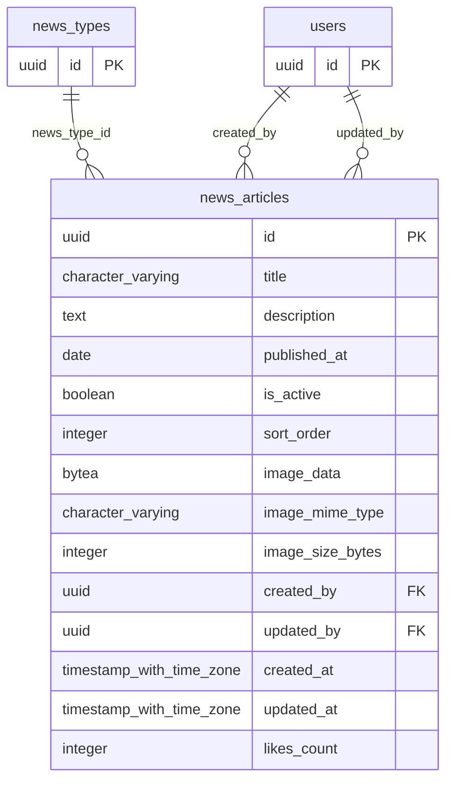

# Base de datos — dominio `news`

Volver a [05_DATABASE_REFERENCE.md](../05_DATABASE_REFERENCE.md). Diagrama ER: llaves primarias (PK) y foráneas (FK) reales; las tablas de otros dominios referenciadas aparecen solo con su `id`. Se muestran hasta 14 columnas por tabla en el diagrama; la lista completa está en cada ficha.

## `news_articles`

- **Entidad TypeORM:** [NewsArticleOrmEntity](../reference/backend/news.md#f-comercial-jhoel-api-src-modules-news-infrastructure-persistence-news-article-orm-entity-ts)
- **Creada en:** `1760003400000-CreateNewsModule.ts`
- **Archivos TypeScript que la usan:** [news-article.orm-entity.ts](../reference/backend/news.md#f-comercial-jhoel-api-src-modules-news-infrastructure-persistence-news-article-orm-entity-ts), [typeorm-news-article.repository.ts](../reference/backend/news.md#f-comercial-jhoel-api-src-modules-news-infrastructure-persistence-typeorm-news-article-repository-ts), [typeorm-news-type.repository.ts](../reference/backend/news-types.md#f-comercial-jhoel-api-src-modules-news-types-infrastructure-persistence-typeorm-news-type-repository-ts)

| Columna | Tipo | Nulo | Default |
|---|---|---|---|
| `id` | uuid | NOT NULL | gen_random_uuid() |
| `title` | character varying(200) | NOT NULL |  |
| `description` | text | NOT NULL |  |
| `published_at` | date | NOT NULL | CURRENT_DATE |
| `is_active` | boolean | NOT NULL | true |
| `sort_order` | integer | NOT NULL | 0 |
| `image_data` | bytea | sí |  |
| `image_mime_type` | character varying(50) | sí |  |
| `image_size_bytes` | integer | sí |  |
| `created_by` | uuid | NOT NULL |  |
| `updated_by` | uuid | sí |  |
| `created_at` | timestamp with time zone | NOT NULL | now() |
| `updated_at` | timestamp with time zone | NOT NULL | now() |
| `likes_count` | integer | NOT NULL | 0 |
| `news_type_id` | uuid | NOT NULL |  |
| `slug` | character varying(220) | NOT NULL |  |

| Restricción | Tipo | Definición |
|---|---|---|
| `FK_news_articles_news_type` | FK | FOREIGN KEY (news_type_id) REFERENCES news_types(id) ON DELETE RESTRICT |
| `news_articles_created_by_fkey` | FK | FOREIGN KEY (created_by) REFERENCES users(id) ON DELETE RESTRICT |
| `news_articles_updated_by_fkey` | FK | FOREIGN KEY (updated_by) REFERENCES users(id) ON DELETE RESTRICT |
| `news_articles_pkey` | PK | PRIMARY KEY (id) |

**Índices:**

- `IDX_news_articles_published`: CREATE INDEX "IDX_news_articles_published" ON public.news_articles USING btree (is_active, sort_order, published_at DESC)
- `UQ_news_articles_slug`: CREATE UNIQUE INDEX "UQ_news_articles_slug" ON public.news_articles USING btree (slug)
- `news_articles_pkey`: CREATE UNIQUE INDEX news_articles_pkey ON public.news_articles USING btree (id)

