# Base de datos — dominio `otros`

Volver a [05_DATABASE_REFERENCE.md](../05_DATABASE_REFERENCE.md). Diagrama ER: llaves primarias (PK) y foráneas (FK) reales; las tablas de otros dominios referenciadas aparecen solo con su `id`. Se muestran hasta 14 columnas por tabla en el diagrama; la lista completa está en cada ficha.

```mermaid
erDiagram
  agent_reconciliation_cash_breakdowns {
    uuid reconciliation_id PK
    character_varying source
    uuid source_cash_count_id FK
    bigint source_count_number
    timestamp_with_time_zone source_counted_at
    date source_business_date
    uuid source_counted_by FK
    numeric source_total_counted
    boolean modified_after_load
    numeric total_cash
    uuid created_by FK
    timestamp_with_time_zone created_at
    uuid source_cut_count_id FK
    uuid source_cut_period_id FK
  }
  agent_reconciliation_cash_details {
    uuid id PK
    uuid reconciliation_id FK
    numeric denomination
    integer quantity
    numeric subtotal
  }
  cash_bank_day_openings {
    uuid id PK
    uuid day_opening_id FK
    date business_date
    bigint opening_sequence
    numeric opening_cash_balance
    timestamp_with_time_zone opened_at
    uuid opened_by FK
    character_varying source
    timestamp_with_time_zone created_at
  }
  financial_day_snapshot_versions {
    uuid id PK
    uuid correction_id FK
    uuid session_id FK
    date review_date
    character_varying target_table
    uuid target_id
    character_varying field
    integer version_number
    numeric previous_value
    numeric value
    uuid created_by FK
    timestamp_with_time_zone created_at
  }
  migrations {
    integer id PK
    bigint timestamp
    character_varying name
  }
  news_notifications {
    uuid id PK
    uuid news_article_id FK
    uuid subscriber_id FK
    uuid news_type_id FK
    text message_preview
    character_varying status
    integer attempts
    character_varying external_id
    character_varying error_message
    timestamp_with_time_zone sent_at
    timestamp_with_time_zone created_at
  }
  users {
    uuid id PK
  }
  agent_reconciliations {
    uuid id PK
  }
  cash_counts {
    uuid id PK
  }
  cash_cut_counts {
    uuid id PK
  }
  cash_cut_periods {
    uuid id PK
  }
  day_openings {
    uuid id PK
  }
  financial_day_corrections {
    uuid id PK
  }
  financial_day_review_sessions {
    uuid id PK
  }
  news_articles {
    uuid id PK
  }
  news_types {
    uuid id PK
  }
  news_subscribers {
    uuid id PK
  }
  users ||--o{ agent_reconciliation_cash_breakdowns : "created_by"
  agent_reconciliations ||--o{ agent_reconciliation_cash_breakdowns : "reconciliation_id"
  cash_counts ||--o{ agent_reconciliation_cash_breakdowns : "source_cash_count_id"
  users ||--o{ agent_reconciliation_cash_breakdowns : "source_counted_by"
  cash_cut_counts ||--o{ agent_reconciliation_cash_breakdowns : "source_cut_count_id"
  cash_cut_periods ||--o{ agent_reconciliation_cash_breakdowns : "source_cut_period_id"
  agent_reconciliation_cash_breakdowns ||--o{ agent_reconciliation_cash_details : "reconciliation_id"
  day_openings ||--o{ cash_bank_day_openings : "day_opening_id"
  users ||--o{ cash_bank_day_openings : "opened_by"
  financial_day_corrections ||--o{ financial_day_snapshot_versions : "correction_id"
  users ||--o{ financial_day_snapshot_versions : "created_by"
  financial_day_review_sessions ||--o{ financial_day_snapshot_versions : "session_id"
  news_articles ||--o{ news_notifications : "news_article_id"
  news_types ||--o{ news_notifications : "news_type_id"
  news_subscribers ||--o{ news_notifications : "subscriber_id"
```

## `agent_reconciliation_cash_breakdowns`

- **Entidad TypeORM:** ninguna (se accede con SQL crudo o solo desde funciones PL/pgSQL)
- **Creada en:** `1760007600000-CuadreCashBreakdownAndCentDenomination.ts`
- **Archivos TypeScript que la usan:** [cuadre-cash-breakdown.e2e-spec.ts](../reference/backend/e2e.md#f-comercial-jhoel-api-test-cuadre-cash-breakdown-e2e-spec-ts)
- **Funciones SQL que la escriben:** `close_agent_day_with_cash_breakdown`

| Columna | Tipo | Nulo | Default |
|---|---|---|---|
| `reconciliation_id` | uuid | NOT NULL |  |
| `source` | character varying(12) | NOT NULL |  |
| `source_cash_count_id` | uuid | sí |  |
| `source_count_number` | bigint | sí |  |
| `source_counted_at` | timestamp with time zone | sí |  |
| `source_business_date` | date | sí |  |
| `source_counted_by` | uuid | sí |  |
| `source_total_counted` | numeric(14,2) | sí |  |
| `modified_after_load` | boolean | NOT NULL | false |
| `total_cash` | numeric(14,2) | NOT NULL |  |
| `created_by` | uuid | NOT NULL |  |
| `created_at` | timestamp with time zone | NOT NULL | now() |
| `source_cut_count_id` | uuid | sí |  |
| `source_cut_period_id` | uuid | sí |  |
| `source_cut_number` | smallint | sí |  |

| Restricción | Tipo | Definición |
|---|---|---|
| `CHK_agent_rec_cash_breakdowns_source` | CHECK | CHECK (((((source)::text = 'MANUAL'::text) AND (source_cash_count_id IS NULL) AND (source_cut_count_id IS NULL) AND (source_cut_period_id IS NULL) AND (source_cut_number IS NULL) AND (source_count_number IS NULL) AND (source_counted_at IS NULL) AND (source_business_date IS NULL) AND (source_counted_by IS NULL) AND (source_total_counted IS NULL) AND (modified_after_load = false)) OR (((source)::text = 'ARQUEO_CAJA'::text) AND (source_cash_count_id IS NOT NULL) AND (source_count_number IS NOT NULL) AND (source_cut_count_id IS NULL) AND (source_cut_period_id IS NULL) AND (source_cut_number IS NULL) AND (source_counted_at IS NOT NULL) AND (source_business_date IS NOT NULL) AND (source_counted_by IS NOT NULL) AND (source_total_counted IS NOT NULL)) OR (((source)::text = 'CORTE_CAJA'::text) AND (source_cut_count_id IS NOT NULL) AND (source_cut_period_id IS NOT NULL) AND (source_cut_number = ANY (ARRAY[1, 2])) AND (source_cash_count_id IS NULL) AND (source_count_number IS NULL) AND (source_counted_at IS NOT NULL) AND (source_business_date IS NOT NULL) AND (source_counted_by IS NOT NULL) AND (source_total_counted IS NOT NULL)))) |
| `CHK_agent_rec_cash_breakdowns_total` | CHECK | CHECK ((total_cash &gt;= (0)::numeric)) |
| `agent_reconciliation_cash_breakdowns_created_by_fkey` | FK | FOREIGN KEY (created_by) REFERENCES users(id) ON DELETE RESTRICT |
| `agent_reconciliation_cash_breakdowns_reconciliation_id_fkey` | FK | FOREIGN KEY (reconciliation_id) REFERENCES agent_reconciliations(id) ON DELETE RESTRICT |
| `agent_reconciliation_cash_breakdowns_source_cash_count_id_fkey` | FK | FOREIGN KEY (source_cash_count_id) REFERENCES cash_counts(id) ON DELETE RESTRICT |
| `agent_reconciliation_cash_breakdowns_source_counted_by_fkey` | FK | FOREIGN KEY (source_counted_by) REFERENCES users(id) ON DELETE RESTRICT |
| `agent_reconciliation_cash_breakdowns_source_cut_count_id_fkey` | FK | FOREIGN KEY (source_cut_count_id) REFERENCES cash_cut_counts(id) ON DELETE RESTRICT |
| `agent_reconciliation_cash_breakdowns_source_cut_period_id_fkey` | FK | FOREIGN KEY (source_cut_period_id) REFERENCES cash_cut_periods(id) ON DELETE RESTRICT |
| `agent_reconciliation_cash_breakdowns_pkey` | PK | PRIMARY KEY (reconciliation_id) |

**Índices:**

- `IDX_agent_rec_cash_breakdowns_cut`: CREATE INDEX "IDX_agent_rec_cash_breakdowns_cut" ON public.agent_reconciliation_cash_breakdowns USING btree (source_cut_count_id) WHERE (source_cut_count_id IS NOT NULL)
- `IDX_agent_rec_cash_breakdowns_source`: CREATE INDEX "IDX_agent_rec_cash_breakdowns_source" ON public.agent_reconciliation_cash_breakdowns USING btree (source_cash_count_id) WHERE (source_cash_count_id IS NOT NULL)
- `agent_reconciliation_cash_breakdowns_pkey`: CREATE UNIQUE INDEX agent_reconciliation_cash_breakdowns_pkey ON public.agent_reconciliation_cash_breakdowns USING btree (reconciliation_id)

**Triggers:**

- `trg_agent_reconciliation_cash_breakdowns_guard`: CREATE TRIGGER trg_agent_reconciliation_cash_breakdowns_guard BEFORE DELETE OR UPDATE ON public.agent_reconciliation_cash_breakdowns FOR EACH ROW EXECUTE FUNCTION cash_custody_status_only_guard()

## `agent_reconciliation_cash_details`

- **Entidad TypeORM:** ninguna (se accede con SQL crudo o solo desde funciones PL/pgSQL)
- **Creada en:** `1760007600000-CuadreCashBreakdownAndCentDenomination.ts`
- **Archivos TypeScript que la usan:** [cuadre-cash-breakdown.e2e-spec.ts](../reference/backend/e2e.md#f-comercial-jhoel-api-test-cuadre-cash-breakdown-e2e-spec-ts)
- **Funciones SQL que la escriben:** `close_agent_day_with_cash_breakdown`

| Columna | Tipo | Nulo | Default |
|---|---|---|---|
| `id` | uuid | NOT NULL | gen_random_uuid() |
| `reconciliation_id` | uuid | NOT NULL |  |
| `denomination` | numeric(10,2) | NOT NULL |  |
| `quantity` | integer | NOT NULL |  |
| `subtotal` | numeric(14,2) | NOT NULL |  |

| Restricción | Tipo | Definición |
|---|---|---|
| `CHK_agent_rec_cash_details_quantity` | CHECK | CHECK ((quantity &gt;= 0)) |
| `CHK_agent_rec_cash_details_subtotal` | CHECK | CHECK ((subtotal = (denomination * (quantity)::numeric))) |
| `agent_reconciliation_cash_details_reconciliation_id_fkey` | FK | FOREIGN KEY (reconciliation_id) REFERENCES agent_reconciliation_cash_breakdowns(reconciliation_id) ON DELETE RESTRICT |
| `agent_reconciliation_cash_details_pkey` | PK | PRIMARY KEY (id) |
| `UQ_agent_rec_cash_details` | UNIQUE | UNIQUE (reconciliation_id, denomination) |

**Índices:**

- `UQ_agent_rec_cash_details`: CREATE UNIQUE INDEX "UQ_agent_rec_cash_details" ON public.agent_reconciliation_cash_details USING btree (reconciliation_id, denomination)
- `agent_reconciliation_cash_details_pkey`: CREATE UNIQUE INDEX agent_reconciliation_cash_details_pkey ON public.agent_reconciliation_cash_details USING btree (id)

**Triggers:**

- `trg_agent_reconciliation_cash_details_guard`: CREATE TRIGGER trg_agent_reconciliation_cash_details_guard BEFORE DELETE OR UPDATE ON public.agent_reconciliation_cash_details FOR EACH ROW EXECUTE FUNCTION cash_custody_status_only_guard()

## `cash_bank_day_openings`

- **Entidad TypeORM:** ninguna (se accede con SQL crudo o solo desde funciones PL/pgSQL)
- **Creada en:** `1760007300000-CashDailyIndicatorsFromBankDayOpening.ts`
- **Archivos TypeScript que la usan:** [cash-daily-indicators.e2e-spec.ts](../reference/backend/e2e.md#f-comercial-jhoel-api-test-cash-daily-indicators-e2e-spec-ts)
- **Funciones SQL que la escriben:** `cash_bank_day_on_opening`

| Columna | Tipo | Nulo | Default |
|---|---|---|---|
| `id` | uuid | NOT NULL | gen_random_uuid() |
| `day_opening_id` | uuid | NOT NULL |  |
| `business_date` | date | NOT NULL |  |
| `opening_sequence` | bigint | NOT NULL |  |
| `opening_cash_balance` | numeric(14,2) | NOT NULL |  |
| `opened_at` | timestamp with time zone | NOT NULL |  |
| `opened_by` | uuid | NOT NULL |  |
| `source` | character varying(15) | NOT NULL | 'APERTURA'::character varying |
| `created_at` | timestamp with time zone | NOT NULL | now() |

| Restricción | Tipo | Definición |
|---|---|---|
| `CHK_cash_bank_day_openings_sequence` | CHECK | CHECK ((opening_sequence &gt;= 0)) |
| `CHK_cash_bank_day_openings_source` | CHECK | CHECK (((source)::text = ANY ((ARRAY['APERTURA'::character varying, 'BACKFILL'::character varying])::text[]))) |
| `cash_bank_day_openings_day_opening_id_fkey` | FK | FOREIGN KEY (day_opening_id) REFERENCES day_openings(id) ON DELETE RESTRICT |
| `cash_bank_day_openings_opened_by_fkey` | FK | FOREIGN KEY (opened_by) REFERENCES users(id) ON DELETE RESTRICT |
| `cash_bank_day_openings_pkey` | PK | PRIMARY KEY (id) |
| `UQ_cash_bank_day_openings_date` | UNIQUE | UNIQUE (business_date) |
| `UQ_cash_bank_day_openings_day` | UNIQUE | UNIQUE (day_opening_id) |

**Índices:**

- `IDX_cash_bank_day_openings_order`: CREATE INDEX "IDX_cash_bank_day_openings_order" ON public.cash_bank_day_openings USING btree (opening_sequence, opened_at)
- `UQ_cash_bank_day_openings_date`: CREATE UNIQUE INDEX "UQ_cash_bank_day_openings_date" ON public.cash_bank_day_openings USING btree (business_date)
- `UQ_cash_bank_day_openings_day`: CREATE UNIQUE INDEX "UQ_cash_bank_day_openings_day" ON public.cash_bank_day_openings USING btree (day_opening_id)
- `cash_bank_day_openings_pkey`: CREATE UNIQUE INDEX cash_bank_day_openings_pkey ON public.cash_bank_day_openings USING btree (id)

**Triggers:**

- `trg_cash_bank_day_openings_immutable`: CREATE TRIGGER trg_cash_bank_day_openings_immutable BEFORE DELETE OR UPDATE ON public.cash_bank_day_openings FOR EACH ROW EXECUTE FUNCTION cash_bank_day_openings_immutable()

## `financial_day_snapshot_versions`

- **Entidad TypeORM:** ninguna (se accede con SQL crudo o solo desde funciones PL/pgSQL)
- **Creada en:** `1760007100000-FinancialDayReview.ts`
- **Archivos TypeScript que la usan:** solo funciones SQL
- **Funciones SQL que la escriben:** `financial_review_record_version`

| Columna | Tipo | Nulo | Default |
|---|---|---|---|
| `id` | uuid | NOT NULL | gen_random_uuid() |
| `correction_id` | uuid | NOT NULL |  |
| `session_id` | uuid | NOT NULL |  |
| `review_date` | date | NOT NULL |  |
| `target_table` | character varying(60) | NOT NULL |  |
| `target_id` | uuid | NOT NULL |  |
| `field` | character varying(60) | NOT NULL |  |
| `version_number` | integer | NOT NULL |  |
| `previous_value` | numeric(14,2) | sí |  |
| `value` | numeric(14,2) | sí |  |
| `created_by` | uuid | NOT NULL |  |
| `created_at` | timestamp with time zone | NOT NULL | now() |

| Restricción | Tipo | Definición |
|---|---|---|
| `financial_day_snapshot_versions_correction_id_fkey` | FK | FOREIGN KEY (correction_id) REFERENCES financial_day_corrections(id) ON DELETE RESTRICT |
| `financial_day_snapshot_versions_created_by_fkey` | FK | FOREIGN KEY (created_by) REFERENCES users(id) ON DELETE RESTRICT |
| `financial_day_snapshot_versions_session_id_fkey` | FK | FOREIGN KEY (session_id) REFERENCES financial_day_review_sessions(id) ON DELETE RESTRICT |
| `financial_day_snapshot_versions_pkey` | PK | PRIMARY KEY (id) |
| `UQ_fdr_versions` | UNIQUE | UNIQUE (target_table, target_id, field, version_number) |

**Índices:**

- `UQ_fdr_versions`: CREATE UNIQUE INDEX "UQ_fdr_versions" ON public.financial_day_snapshot_versions USING btree (target_table, target_id, field, version_number)
- `financial_day_snapshot_versions_pkey`: CREATE UNIQUE INDEX financial_day_snapshot_versions_pkey ON public.financial_day_snapshot_versions USING btree (id)

**Triggers:**

- `trg_financial_day_snapshot_versions_immutable`: CREATE TRIGGER trg_financial_day_snapshot_versions_immutable BEFORE DELETE OR UPDATE ON public.financial_day_snapshot_versions FOR EACH ROW EXECUTE FUNCTION financial_review_audit_immutable()
- `trg_financial_day_snapshot_versions_no_truncate`: CREATE TRIGGER trg_financial_day_snapshot_versions_no_truncate BEFORE TRUNCATE ON public.financial_day_snapshot_versions FOR EACH STATEMENT EXECUTE FUNCTION financial_review_audit_immutable()

## `migrations`

- **Entidad TypeORM:** ninguna (se accede con SQL crudo o solo desde funciones PL/pgSQL)
- **Creada en:** migración no identificada por el análisis (creada con TypeORM `Table` o `createTable`)
- **Archivos TypeScript que la usan:** solo funciones SQL

| Columna | Tipo | Nulo | Default |
|---|---|---|---|
| `id` | integer | NOT NULL | nextval('migrations_id_seq'::regclass) |
| `timestamp` | bigint | NOT NULL |  |
| `name` | character varying | NOT NULL |  |

| Restricción | Tipo | Definición |
|---|---|---|
| `PK_8c82d7f526340ab734260ea46be` | PK | PRIMARY KEY (id) |

**Índices:**

- `PK_8c82d7f526340ab734260ea46be`: CREATE UNIQUE INDEX "PK_8c82d7f526340ab734260ea46be" ON public.migrations USING btree (id)

## `news_notifications`

- **Entidad TypeORM:** ninguna (se accede con SQL crudo o solo desde funciones PL/pgSQL)
- **Creada en:** `1760003900000-CreateNewsSubscriptions.ts`
- **Archivos TypeScript que la usan:** solo funciones SQL

| Columna | Tipo | Nulo | Default |
|---|---|---|---|
| `id` | uuid | NOT NULL | gen_random_uuid() |
| `news_article_id` | uuid | NOT NULL |  |
| `subscriber_id` | uuid | NOT NULL |  |
| `news_type_id` | uuid | NOT NULL |  |
| `message_preview` | text | NOT NULL |  |
| `status` | character varying(20) | NOT NULL | 'PENDING'::character varying |
| `attempts` | integer | NOT NULL | 0 |
| `external_id` | character varying(100) | sí |  |
| `error_message` | character varying(500) | sí |  |
| `sent_at` | timestamp with time zone | sí |  |
| `created_at` | timestamp with time zone | NOT NULL | now() |

| Restricción | Tipo | Definición |
|---|---|---|
| `CHK_news_notifications_status` | CHECK | CHECK (((status)::text = ANY ((ARRAY['PENDING'::character varying, 'SENT'::character varying, 'FAILED'::character varying])::text[]))) |
| `news_notifications_news_article_id_fkey` | FK | FOREIGN KEY (news_article_id) REFERENCES news_articles(id) ON DELETE RESTRICT |
| `news_notifications_news_type_id_fkey` | FK | FOREIGN KEY (news_type_id) REFERENCES news_types(id) ON DELETE RESTRICT |
| `news_notifications_subscriber_id_fkey` | FK | FOREIGN KEY (subscriber_id) REFERENCES news_subscribers(id) ON DELETE RESTRICT |
| `news_notifications_pkey` | PK | PRIMARY KEY (id) |
| `UQ_news_notifications_article_subscriber` | UNIQUE | UNIQUE (news_article_id, subscriber_id) |

**Índices:**

- `IDX_news_notifications_status`: CREATE INDEX "IDX_news_notifications_status" ON public.news_notifications USING btree (status)
- `UQ_news_notifications_article_subscriber`: CREATE UNIQUE INDEX "UQ_news_notifications_article_subscriber" ON public.news_notifications USING btree (news_article_id, subscriber_id)
- `news_notifications_pkey`: CREATE UNIQUE INDEX news_notifications_pkey ON public.news_notifications USING btree (id)

