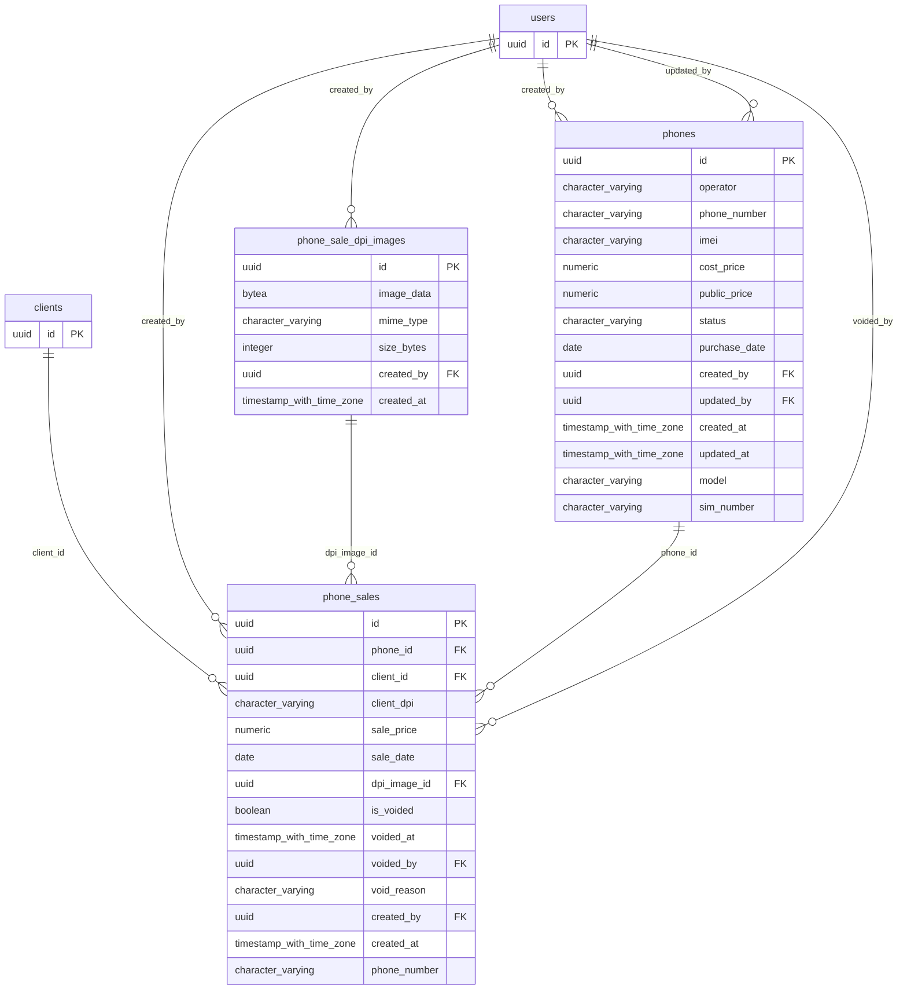

# Base de datos — dominio `phones`

Volver a [05_DATABASE_REFERENCE.md](../05_DATABASE_REFERENCE.md). Diagrama ER: llaves primarias (PK) y foráneas (FK) reales; las tablas de otros dominios referenciadas aparecen solo con su `id`. Se muestran hasta 14 columnas por tabla en el diagrama; la lista completa está en cada ficha.

## `phone_sale_dpi_images`

- **Entidad TypeORM:** ninguna (se accede con SQL crudo o solo desde funciones PL/pgSQL)
- **Creada en:** `1760002800000-CreatePhones.ts`
- **Archivos TypeScript que la usan:** [typeorm-phone-sale.repository.ts](../reference/backend/phones.md#f-comercial-jhoel-api-src-modules-phones-infrastructure-persistence-typeorm-phone-sale-repository-ts)
- **Funciones SQL que la escriben:** `register_phone_sale`

| Columna | Tipo | Nulo | Default |
|---|---|---|---|
| `id` | uuid | NOT NULL | gen_random_uuid() |
| `image_data` | bytea | NOT NULL |  |
| `mime_type` | character varying(50) | NOT NULL |  |
| `size_bytes` | integer | NOT NULL |  |
| `created_by` | uuid | NOT NULL |  |
| `created_at` | timestamp with time zone | NOT NULL | now() |

| Restricción | Tipo | Definición |
|---|---|---|
| `phone_sale_dpi_images_created_by_fkey` | FK | FOREIGN KEY (created_by) REFERENCES users(id) ON DELETE RESTRICT |
| `phone_sale_dpi_images_pkey` | PK | PRIMARY KEY (id) |

**Índices:**

- `phone_sale_dpi_images_pkey`: CREATE UNIQUE INDEX phone_sale_dpi_images_pkey ON public.phone_sale_dpi_images USING btree (id)

## `phone_sales`

- **Entidad TypeORM:** ninguna (se accede con SQL crudo o solo desde funciones PL/pgSQL)
- **Creada en:** `1760002800000-CreatePhones.ts`
- **Archivos TypeScript que la usan:** [typeorm-phone-sale.repository.ts](../reference/backend/phones.md#f-comercial-jhoel-api-src-modules-phones-infrastructure-persistence-typeorm-phone-sale-repository-ts)
- **Funciones SQL que la escriben:** `register_phone_sale`, `void_phone_sale`

| Columna | Tipo | Nulo | Default |
|---|---|---|---|
| `id` | uuid | NOT NULL | gen_random_uuid() |
| `phone_id` | uuid | NOT NULL |  |
| `client_id` | uuid | sí |  |
| `client_dpi` | character varying(20) | NOT NULL |  |
| `sale_price` | numeric(12,2) | NOT NULL |  |
| `sale_date` | date | NOT NULL |  |
| `dpi_image_id` | uuid | sí |  |
| `is_voided` | boolean | NOT NULL | false |
| `voided_at` | timestamp with time zone | sí |  |
| `voided_by` | uuid | sí |  |
| `void_reason` | character varying(255) | sí |  |
| `created_by` | uuid | NOT NULL |  |
| `created_at` | timestamp with time zone | NOT NULL | now() |
| `phone_number` | character varying(20) | NOT NULL |  |

| Restricción | Tipo | Definición |
|---|---|---|
| `CHK_phone_sales_void_consistency` | CHECK | CHECK ((((is_voided = false) AND (voided_at IS NULL) AND (voided_by IS NULL) AND (void_reason IS NULL)) OR ((is_voided = true) AND (voided_at IS NOT NULL) AND (voided_by IS NOT NULL) AND (void_reason IS NOT NULL)))) |
| `phone_sales_sale_price_check` | CHECK | CHECK ((sale_price &gt;= (0)::numeric)) |
| `phone_sales_client_id_fkey` | FK | FOREIGN KEY (client_id) REFERENCES clients(id) ON DELETE RESTRICT |
| `phone_sales_created_by_fkey` | FK | FOREIGN KEY (created_by) REFERENCES users(id) ON DELETE RESTRICT |
| `phone_sales_dpi_image_id_fkey` | FK | FOREIGN KEY (dpi_image_id) REFERENCES phone_sale_dpi_images(id) ON DELETE RESTRICT |
| `phone_sales_phone_id_fkey` | FK | FOREIGN KEY (phone_id) REFERENCES phones(id) ON DELETE RESTRICT |
| `phone_sales_voided_by_fkey` | FK | FOREIGN KEY (voided_by) REFERENCES users(id) ON DELETE RESTRICT |
| `phone_sales_pkey` | PK | PRIMARY KEY (id) |

**Índices:**

- `IDX_phone_sales_client_id`: CREATE INDEX "IDX_phone_sales_client_id" ON public.phone_sales USING btree (client_id)
- `IDX_phone_sales_sale_date`: CREATE INDEX "IDX_phone_sales_sale_date" ON public.phone_sales USING btree (sale_date)
- `UQ_phone_sales_phone_id_active`: CREATE UNIQUE INDEX "UQ_phone_sales_phone_id_active" ON public.phone_sales USING btree (phone_id) WHERE (NOT is_voided)
- `phone_sales_pkey`: CREATE UNIQUE INDEX phone_sales_pkey ON public.phone_sales USING btree (id)

## `phones`

- **Entidad TypeORM:** [PhoneOrmEntity](../reference/backend/phones.md#f-comercial-jhoel-api-src-modules-phones-infrastructure-persistence-phone-orm-entity-ts)
- **Creada en:** `1760002800000-CreatePhones.ts`
- **Archivos TypeScript que la usan:** [phone.orm-entity.ts](../reference/backend/phones.md#f-comercial-jhoel-api-src-modules-phones-infrastructure-persistence-phone-orm-entity-ts), [typeorm-phone-sale.repository.ts](../reference/backend/phones.md#f-comercial-jhoel-api-src-modules-phones-infrastructure-persistence-typeorm-phone-sale-repository-ts)
- **Funciones SQL que la escriben:** `register_phone_sale`, `void_phone_sale`

| Columna | Tipo | Nulo | Default |
|---|---|---|---|
| `id` | uuid | NOT NULL | gen_random_uuid() |
| `operator` | character varying(10) | NOT NULL |  |
| `phone_number` | character varying(20) | sí |  |
| `imei` | character varying(20) | NOT NULL |  |
| `cost_price` | numeric(12,2) | NOT NULL |  |
| `public_price` | numeric(12,2) | NOT NULL |  |
| `status` | character varying(20) | NOT NULL | 'DISPONIBLE'::character varying |
| `purchase_date` | date | NOT NULL |  |
| `created_by` | uuid | NOT NULL |  |
| `updated_by` | uuid | sí |  |
| `created_at` | timestamp with time zone | NOT NULL | now() |
| `updated_at` | timestamp with time zone | NOT NULL | now() |
| `model` | character varying(150) | NOT NULL |  |
| `sim_number` | character varying(30) | NOT NULL |  |

| Restricción | Tipo | Definición |
|---|---|---|
| `phones_cost_price_check` | CHECK | CHECK ((cost_price &gt;= (0)::numeric)) |
| `phones_operator_check` | CHECK | CHECK (((operator)::text = ANY ((ARRAY['CLARO'::character varying, 'TIGO'::character varying])::text[]))) |
| `phones_public_price_check` | CHECK | CHECK ((public_price &gt;= (0)::numeric)) |
| `phones_status_check` | CHECK | CHECK (((status)::text = ANY ((ARRAY['DISPONIBLE'::character varying, 'VENDIDO'::character varying])::text[]))) |
| `phones_created_by_fkey` | FK | FOREIGN KEY (created_by) REFERENCES users(id) ON DELETE RESTRICT |
| `phones_updated_by_fkey` | FK | FOREIGN KEY (updated_by) REFERENCES users(id) ON DELETE RESTRICT |
| `phones_pkey` | PK | PRIMARY KEY (id) |

**Índices:**

- `IDX_phones_operator`: CREATE INDEX "IDX_phones_operator" ON public.phones USING btree (operator)
- `IDX_phones_status`: CREATE INDEX "IDX_phones_status" ON public.phones USING btree (status)
- `UQ_phones_imei`: CREATE UNIQUE INDEX "UQ_phones_imei" ON public.phones USING btree (imei)
- `UQ_phones_phone_number_active`: CREATE UNIQUE INDEX "UQ_phones_phone_number_active" ON public.phones USING btree (phone_number) WHERE ((status)::text = 'VENDIDO'::text)
- `UQ_phones_sim_number`: CREATE UNIQUE INDEX "UQ_phones_sim_number" ON public.phones USING btree (sim_number)
- `phones_pkey`: CREATE UNIQUE INDEX phones_pkey ON public.phones USING btree (id)

