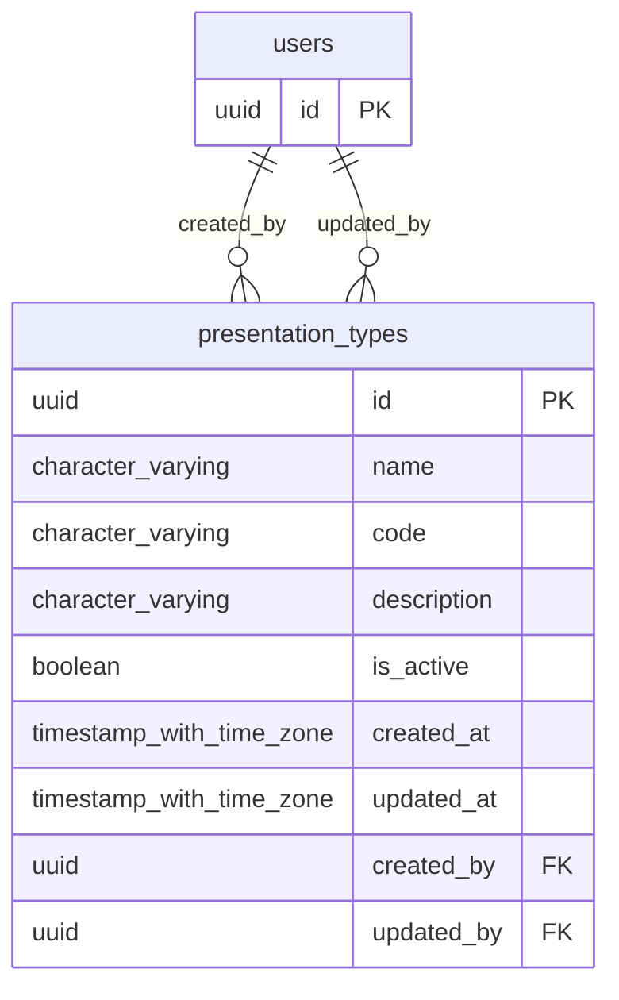

# Base de datos — dominio `presentation-types`

Volver a [05_DATABASE_REFERENCE.md](../05_DATABASE_REFERENCE.md). Diagrama ER: llaves primarias (PK) y foráneas (FK) reales; las tablas de otros dominios referenciadas aparecen solo con su `id`. Se muestran hasta 14 columnas por tabla en el diagrama; la lista completa está en cada ficha.

## `presentation_types`

- **Entidad TypeORM:** [PresentationTypeOrmEntity](../reference/backend/presentation-types.md#f-comercial-jhoel-api-src-modules-presentation-types-infrastructure-persistence-presentation-type-orm-entity-ts)
- **Creada en:** `1760000700000-CreatePresentationTypesTable.ts`
- **Archivos TypeScript que la usan:** [presentation-type.orm-entity.ts](../reference/backend/presentation-types.md#f-comercial-jhoel-api-src-modules-presentation-types-infrastructure-persistence-presentation-type-orm-entity-ts)

| Columna | Tipo | Nulo | Default |
|---|---|---|---|
| `id` | uuid | NOT NULL | gen_random_uuid() |
| `name` | character varying(50) | NOT NULL |  |
| `code` | character varying(20) | sí |  |
| `description` | character varying(255) | sí |  |
| `is_active` | boolean | NOT NULL | true |
| `created_at` | timestamp with time zone | NOT NULL | now() |
| `updated_at` | timestamp with time zone | NOT NULL | now() |
| `created_by` | uuid | NOT NULL |  |
| `updated_by` | uuid | sí |  |

| Restricción | Tipo | Definición |
|---|---|---|
| `presentation_types_created_by_fkey` | FK | FOREIGN KEY (created_by) REFERENCES users(id) ON DELETE RESTRICT |
| `presentation_types_updated_by_fkey` | FK | FOREIGN KEY (updated_by) REFERENCES users(id) ON DELETE RESTRICT |
| `presentation_types_pkey` | PK | PRIMARY KEY (id) |

**Índices:**

- `UQ_presentation_types_code_active`: CREATE UNIQUE INDEX "UQ_presentation_types_code_active" ON public.presentation_types USING btree (lower((code)::text)) WHERE ((is_active = true) AND (code IS NOT NULL))
- `UQ_presentation_types_name_active`: CREATE UNIQUE INDEX "UQ_presentation_types_name_active" ON public.presentation_types USING btree (lower((name)::text)) WHERE (is_active = true)
- `presentation_types_pkey`: CREATE UNIQUE INDEX presentation_types_pkey ON public.presentation_types USING btree (id)

