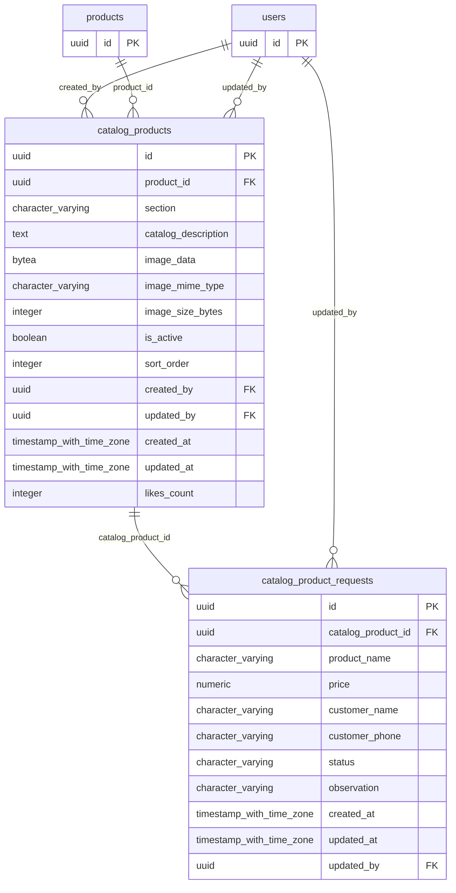

# Base de datos — dominio `product-catalog`

Volver a [05_DATABASE_REFERENCE.md](../05_DATABASE_REFERENCE.md). Diagrama ER: llaves primarias (PK) y foráneas (FK) reales; las tablas de otros dominios referenciadas aparecen solo con su `id`. Se muestran hasta 14 columnas por tabla en el diagrama; la lista completa está en cada ficha.

## `catalog_product_requests`

- **Entidad TypeORM:** [CatalogProductRequestOrmEntity](../reference/backend/product-catalog.md#f-comercial-jhoel-api-src-modules-product-catalog-infrastructure-persistence-catalog-product-request-orm-entity-ts)
- **Creada en:** `1760003300000-CreateProductCatalogModule.ts`
- **Archivos TypeScript que la usan:** [catalog-product-request.orm-entity.ts](../reference/backend/product-catalog.md#f-comercial-jhoel-api-src-modules-product-catalog-infrastructure-persistence-catalog-product-request-orm-entity-ts)

| Columna | Tipo | Nulo | Default |
|---|---|---|---|
| `id` | uuid | NOT NULL | gen_random_uuid() |
| `catalog_product_id` | uuid | NOT NULL |  |
| `product_name` | character varying(150) | NOT NULL |  |
| `price` | numeric(12,2) | NOT NULL |  |
| `customer_name` | character varying(150) | NOT NULL |  |
| `customer_phone` | character varying(20) | NOT NULL |  |
| `status` | character varying(20) | NOT NULL | 'NUEVA'::character varying |
| `observation` | character varying(500) | sí |  |
| `created_at` | timestamp with time zone | NOT NULL | now() |
| `updated_at` | timestamp with time zone | NOT NULL | now() |
| `updated_by` | uuid | sí |  |

| Restricción | Tipo | Definición |
|---|---|---|
| `catalog_product_requests_status_check` | CHECK | CHECK (((status)::text = ANY ((ARRAY['NUEVA'::character varying, 'CONTACTADA'::character varying, 'EN_PROCESO'::character varying, 'ATENDIDA'::character varying, 'CANCELADA'::character varying])::text[]))) |
| `catalog_product_requests_catalog_product_id_fkey` | FK | FOREIGN KEY (catalog_product_id) REFERENCES catalog_products(id) ON DELETE RESTRICT |
| `catalog_product_requests_updated_by_fkey` | FK | FOREIGN KEY (updated_by) REFERENCES users(id) ON DELETE RESTRICT |
| `catalog_product_requests_pkey` | PK | PRIMARY KEY (id) |

**Índices:**

- `IDX_catalog_product_requests_status`: CREATE INDEX "IDX_catalog_product_requests_status" ON public.catalog_product_requests USING btree (status)
- `catalog_product_requests_pkey`: CREATE UNIQUE INDEX catalog_product_requests_pkey ON public.catalog_product_requests USING btree (id)

## `catalog_products`

- **Entidad TypeORM:** [CatalogProductOrmEntity](../reference/backend/product-catalog.md#f-comercial-jhoel-api-src-modules-product-catalog-infrastructure-persistence-catalog-product-orm-entity-ts)
- **Creada en:** `1760003300000-CreateProductCatalogModule.ts`
- **Archivos TypeScript que la usan:** [catalog-product.orm-entity.ts](../reference/backend/product-catalog.md#f-comercial-jhoel-api-src-modules-product-catalog-infrastructure-persistence-catalog-product-orm-entity-ts), [typeorm-catalog-product.repository.ts](../reference/backend/product-catalog.md#f-comercial-jhoel-api-src-modules-product-catalog-infrastructure-persistence-typeorm-catalog-product-repository-ts)

| Columna | Tipo | Nulo | Default |
|---|---|---|---|
| `id` | uuid | NOT NULL | gen_random_uuid() |
| `product_id` | uuid | NOT NULL |  |
| `section` | character varying(30) | NOT NULL |  |
| `catalog_description` | text | sí |  |
| `image_data` | bytea | sí |  |
| `image_mime_type` | character varying(50) | sí |  |
| `image_size_bytes` | integer | sí |  |
| `is_active` | boolean | NOT NULL | true |
| `sort_order` | integer | NOT NULL | 0 |
| `created_by` | uuid | NOT NULL |  |
| `updated_by` | uuid | sí |  |
| `created_at` | timestamp with time zone | NOT NULL | now() |
| `updated_at` | timestamp with time zone | NOT NULL | now() |
| `likes_count` | integer | NOT NULL | 0 |

| Restricción | Tipo | Definición |
|---|---|---|
| `catalog_products_section_check` | CHECK | CHECK (((section)::text = ANY ((ARRAY['LIBRERIA'::character varying, 'VARIEDADES_ACCESORIOS'::character varying])::text[]))) |
| `catalog_products_created_by_fkey` | FK | FOREIGN KEY (created_by) REFERENCES users(id) ON DELETE RESTRICT |
| `catalog_products_product_id_fkey` | FK | FOREIGN KEY (product_id) REFERENCES products(id) ON DELETE RESTRICT |
| `catalog_products_updated_by_fkey` | FK | FOREIGN KEY (updated_by) REFERENCES users(id) ON DELETE RESTRICT |
| `catalog_products_pkey` | PK | PRIMARY KEY (id) |

**Índices:**

- `IDX_catalog_products_product_id`: CREATE INDEX "IDX_catalog_products_product_id" ON public.catalog_products USING btree (product_id)
- `IDX_catalog_products_section_active`: CREATE INDEX "IDX_catalog_products_section_active" ON public.catalog_products USING btree (section, is_active, sort_order)
- `catalog_products_pkey`: CREATE UNIQUE INDEX catalog_products_pkey ON public.catalog_products USING btree (id)

