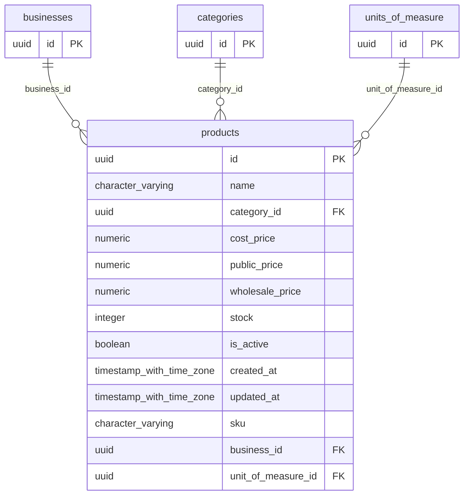

# Base de datos — dominio `products`

Volver a [05_DATABASE_REFERENCE.md](../05_DATABASE_REFERENCE.md). Diagrama ER: llaves primarias (PK) y foráneas (FK) reales; las tablas de otros dominios referenciadas aparecen solo con su `id`. Se muestran hasta 14 columnas por tabla en el diagrama; la lista completa está en cada ficha.

## `products`

- **Entidad TypeORM:** [ProductOrmEntity](../reference/backend/products.md#f-comercial-jhoel-api-src-modules-products-infrastructure-persistence-product-orm-entity-ts)
- **Creada en:** migración no identificada por el análisis (creada con TypeORM `Table` o `createTable`)
- **Archivos TypeScript que la usan:** [product.orm-entity.ts](../reference/backend/products.md#f-comercial-jhoel-api-src-modules-products-infrastructure-persistence-product-orm-entity-ts), [typeorm-product.repository.ts](../reference/backend/products.md#f-comercial-jhoel-api-src-modules-products-infrastructure-persistence-typeorm-product-repository-ts), [typeorm-unit-of-measure.repository.ts](../reference/backend/units-of-measure.md#f-comercial-jhoel-api-src-modules-units-of-measure-infrastructure-persistence-typeorm-unit-of-measure-repository-ts)
- **Funciones SQL que la escriben:** `adjust_sale_item`, `cancel_open_sale`, `confirm_purchase`, `confirm_sale`, `confirm_sale`, `void_purchase`, `void_sale`

| Columna | Tipo | Nulo | Default |
|---|---|---|---|
| `id` | uuid | NOT NULL | gen_random_uuid() |
| `name` | character varying(150) | NOT NULL |  |
| `category_id` | uuid | NOT NULL |  |
| `cost_price` | numeric(12,2) | NOT NULL |  |
| `public_price` | numeric(12,2) | NOT NULL |  |
| `wholesale_price` | numeric(12,2) | NOT NULL |  |
| `stock` | integer | NOT NULL | 0 |
| `is_active` | boolean | NOT NULL | true |
| `created_at` | timestamp with time zone | NOT NULL | now() |
| `updated_at` | timestamp with time zone | NOT NULL | now() |
| `sku` | character varying(64) | sí |  |
| `business_id` | uuid | NOT NULL |  |
| `unit_of_measure_id` | uuid | NOT NULL |  |

| Restricción | Tipo | Definición |
|---|---|---|
| `CHK_products_stock_non_negative` | CHECK | CHECK ((stock &gt;= 0)) |
| `FK_products_business` | FK | FOREIGN KEY (business_id) REFERENCES businesses(id) ON DELETE RESTRICT |
| `FK_products_category` | FK | FOREIGN KEY (category_id) REFERENCES categories(id) ON DELETE RESTRICT |
| `FK_products_unit_of_measure` | FK | FOREIGN KEY (unit_of_measure_id) REFERENCES units_of_measure(id) ON DELETE RESTRICT |
| `PK_0806c755e0aca124e67c0cf6d7d` | PK | PRIMARY KEY (id) |

**Índices:**

- `IDX_products_business_id`: CREATE INDEX "IDX_products_business_id" ON public.products USING btree (business_id)
- `IDX_products_category_id`: CREATE INDEX "IDX_products_category_id" ON public.products USING btree (category_id)
- `IDX_products_is_active`: CREATE INDEX "IDX_products_is_active" ON public.products USING btree (is_active)
- `IDX_products_search_name_trgm`: CREATE INDEX "IDX_products_search_name_trgm" ON public.products USING gin (search_normalize((name)::text) gin_trgm_ops)
- `IDX_products_search_sku_trgm`: CREATE INDEX "IDX_products_search_sku_trgm" ON public.products USING gin (search_normalize((sku)::text) gin_trgm_ops)
- `IDX_products_unit_of_measure_id`: CREATE INDEX "IDX_products_unit_of_measure_id" ON public.products USING btree (unit_of_measure_id)
- `PK_0806c755e0aca124e67c0cf6d7d`: CREATE UNIQUE INDEX "PK_0806c755e0aca124e67c0cf6d7d" ON public.products USING btree (id)
- `UQ_products_name_active`: CREATE UNIQUE INDEX "UQ_products_name_active" ON public.products USING btree (name) WHERE (is_active = true)
- `UQ_products_sku_active`: CREATE UNIQUE INDEX "UQ_products_sku_active" ON public.products USING btree (sku) WHERE (is_active = true)

