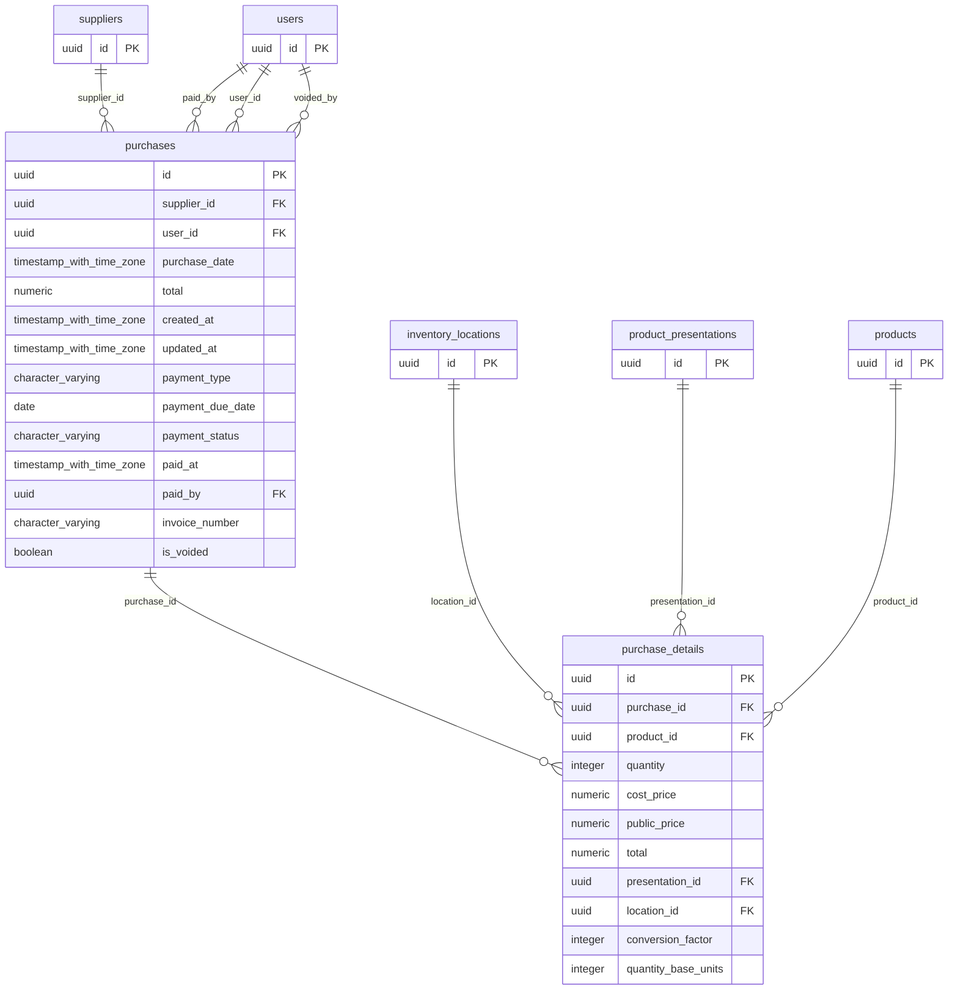

# Base de datos — dominio `purchases`

Volver a [05_DATABASE_REFERENCE.md](../05_DATABASE_REFERENCE.md). Diagrama ER: llaves primarias (PK) y foráneas (FK) reales; las tablas de otros dominios referenciadas aparecen solo con su `id`. Se muestran hasta 14 columnas por tabla en el diagrama; la lista completa está en cada ficha.

## `purchase_details`

- **Entidad TypeORM:** [PurchaseDetailOrmEntity](../reference/backend/purchases.md#f-comercial-jhoel-api-src-modules-purchases-infrastructure-persistence-purchase-detail-orm-entity-ts)
- **Creada en:** migración no identificada por el análisis (creada con TypeORM `Table` o `createTable`)
- **Archivos TypeScript que la usan:** [purchase-detail.orm-entity.ts](../reference/backend/purchases.md#f-comercial-jhoel-api-src-modules-purchases-infrastructure-persistence-purchase-detail-orm-entity-ts)
- **Funciones SQL que la escriben:** `confirm_purchase`

| Columna | Tipo | Nulo | Default |
|---|---|---|---|
| `id` | uuid | NOT NULL | gen_random_uuid() |
| `purchase_id` | uuid | NOT NULL |  |
| `product_id` | uuid | NOT NULL |  |
| `quantity` | integer | NOT NULL |  |
| `cost_price` | numeric(12,2) | NOT NULL |  |
| `public_price` | numeric(12,2) | NOT NULL |  |
| `total` | numeric(12,2) | NOT NULL |  |
| `presentation_id` | uuid | sí |  |
| `location_id` | uuid | sí |  |
| `conversion_factor` | integer | sí |  |
| `quantity_base_units` | integer | sí |  |

| Restricción | Tipo | Definición |
|---|---|---|
| `FK_purchase_details_location` | FK | FOREIGN KEY (location_id) REFERENCES inventory_locations(id) ON DELETE RESTRICT |
| `FK_purchase_details_presentation` | FK | FOREIGN KEY (presentation_id) REFERENCES product_presentations(id) ON DELETE RESTRICT |
| `FK_purchase_details_product` | FK | FOREIGN KEY (product_id) REFERENCES products(id) ON DELETE RESTRICT |
| `FK_purchase_details_purchase` | FK | FOREIGN KEY (purchase_id) REFERENCES purchases(id) ON DELETE CASCADE |
| `PK_d3ebfb1c6f9af260a2a63af7204` | PK | PRIMARY KEY (id) |

**Índices:**

- `IDX_purchase_details_product_id`: CREATE INDEX "IDX_purchase_details_product_id" ON public.purchase_details USING btree (product_id)
- `IDX_purchase_details_purchase_id`: CREATE INDEX "IDX_purchase_details_purchase_id" ON public.purchase_details USING btree (purchase_id)
- `PK_d3ebfb1c6f9af260a2a63af7204`: CREATE UNIQUE INDEX "PK_d3ebfb1c6f9af260a2a63af7204" ON public.purchase_details USING btree (id)

## `purchases`

- **Entidad TypeORM:** [PurchaseOrmEntity](../reference/backend/purchases.md#f-comercial-jhoel-api-src-modules-purchases-infrastructure-persistence-purchase-orm-entity-ts)
- **Creada en:** migración no identificada por el análisis (creada con TypeORM `Table` o `createTable`)
- **Archivos TypeScript que la usan:** [purchase.orm-entity.ts](../reference/backend/purchases.md#f-comercial-jhoel-api-src-modules-purchases-infrastructure-persistence-purchase-orm-entity-ts)
- **Funciones SQL que la escriben:** `confirm_purchase`, `void_purchase`

| Columna | Tipo | Nulo | Default |
|---|---|---|---|
| `id` | uuid | NOT NULL | gen_random_uuid() |
| `supplier_id` | uuid | NOT NULL |  |
| `user_id` | uuid | NOT NULL |  |
| `purchase_date` | timestamp with time zone | NOT NULL |  |
| `total` | numeric(12,2) | NOT NULL | 0 |
| `created_at` | timestamp with time zone | NOT NULL | now() |
| `updated_at` | timestamp with time zone | NOT NULL | now() |
| `payment_type` | character varying(20) | NOT NULL | 'CONTADO'::character varying |
| `payment_due_date` | date | sí |  |
| `payment_status` | character varying(20) | NOT NULL | 'PAID'::character varying |
| `paid_at` | timestamp with time zone | sí |  |
| `paid_by` | uuid | sí |  |
| `invoice_number` | character varying(50) | sí |  |
| `is_voided` | boolean | NOT NULL | false |
| `voided_at` | timestamp with time zone | sí |  |
| `voided_by` | uuid | sí |  |
| `void_reason` | character varying(255) | sí |  |

| Restricción | Tipo | Definición |
|---|---|---|
| `CHK_purchases_credit_has_due_date` | CHECK | CHECK (((((payment_type)::text = 'CONTADO'::text) AND (payment_due_date IS NULL)) OR (((payment_type)::text = 'CREDITO'::text) AND (payment_due_date IS NOT NULL)))) |
| `CHK_purchases_paid_consistency` | CHECK | CHECK (((((payment_status)::text = 'PENDING'::text) AND (paid_at IS NULL) AND (paid_by IS NULL)) OR (((payment_status)::text = 'PAID'::text) AND (paid_at IS NOT NULL) AND (paid_by IS NOT NULL)))) |
| `CHK_purchases_payment_status` | CHECK | CHECK (((payment_status)::text = ANY ((ARRAY['PENDING'::character varying, 'PAID'::character varying])::text[]))) |
| `CHK_purchases_payment_type` | CHECK | CHECK (((payment_type)::text = ANY ((ARRAY['CONTADO'::character varying, 'CREDITO'::character varying])::text[]))) |
| `CHK_purchases_void_consistency` | CHECK | CHECK ((((is_voided = false) AND (voided_at IS NULL) AND (voided_by IS NULL) AND (void_reason IS NULL)) OR ((is_voided = true) AND (voided_at IS NOT NULL) AND (voided_by IS NOT NULL) AND (void_reason IS NOT NULL)))) |
| `FK_purchases_paid_by` | FK | FOREIGN KEY (paid_by) REFERENCES users(id) ON DELETE RESTRICT |
| `FK_purchases_supplier` | FK | FOREIGN KEY (supplier_id) REFERENCES suppliers(id) ON DELETE RESTRICT |
| `FK_purchases_user` | FK | FOREIGN KEY (user_id) REFERENCES users(id) ON DELETE RESTRICT |
| `FK_purchases_voided_by` | FK | FOREIGN KEY (voided_by) REFERENCES users(id) ON DELETE RESTRICT |
| `PK_1d55032f37a34c6eceacbbca6b8` | PK | PRIMARY KEY (id) |

**Índices:**

- `IDX_purchases_invoice_number`: CREATE INDEX "IDX_purchases_invoice_number" ON public.purchases USING btree (invoice_number)
- `IDX_purchases_pending_due_date`: CREATE INDEX "IDX_purchases_pending_due_date" ON public.purchases USING btree (payment_status, payment_due_date)
- `IDX_purchases_purchase_date`: CREATE INDEX "IDX_purchases_purchase_date" ON public.purchases USING btree (purchase_date)
- `IDX_purchases_supplier_id`: CREATE INDEX "IDX_purchases_supplier_id" ON public.purchases USING btree (supplier_id)
- `IDX_purchases_user_id`: CREATE INDEX "IDX_purchases_user_id" ON public.purchases USING btree (user_id)
- `PK_1d55032f37a34c6eceacbbca6b8`: CREATE UNIQUE INDEX "PK_1d55032f37a34c6eceacbbca6b8" ON public.purchases USING btree (id)

