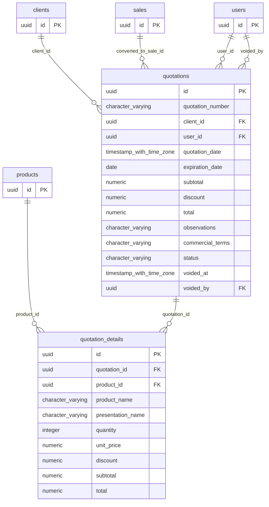

# Base de datos — dominio `quotations`

Volver a [05_DATABASE_REFERENCE.md](../05_DATABASE_REFERENCE.md). Diagrama ER: llaves primarias (PK) y foráneas (FK) reales; las tablas de otros dominios referenciadas aparecen solo con su `id`. Se muestran hasta 14 columnas por tabla en el diagrama; la lista completa está en cada ficha.

## `quotation_details`

- **Entidad TypeORM:** [QuotationDetailOrmEntity](../reference/backend/quotations.md#f-comercial-jhoel-api-src-modules-quotations-infrastructure-persistence-quotation-detail-orm-entity-ts)
- **Creada en:** migración no identificada por el análisis (creada con TypeORM `Table` o `createTable`)
- **Archivos TypeScript que la usan:** [quotation-detail.orm-entity.ts](../reference/backend/quotations.md#f-comercial-jhoel-api-src-modules-quotations-infrastructure-persistence-quotation-detail-orm-entity-ts)
- **Funciones SQL que la escriben:** `create_quotation`

| Columna | Tipo | Nulo | Default |
|---|---|---|---|
| `id` | uuid | NOT NULL | gen_random_uuid() |
| `quotation_id` | uuid | NOT NULL |  |
| `product_id` | uuid | NOT NULL |  |
| `product_name` | character varying(150) | NOT NULL |  |
| `presentation_name` | character varying(50) | sí |  |
| `quantity` | integer | NOT NULL |  |
| `unit_price` | numeric(12,2) | NOT NULL |  |
| `discount` | numeric(12,2) | NOT NULL | 0 |
| `subtotal` | numeric(12,2) | NOT NULL |  |
| `total` | numeric(12,2) | NOT NULL |  |

| Restricción | Tipo | Definición |
|---|---|---|
| `FK_quotation_details_product` | FK | FOREIGN KEY (product_id) REFERENCES products(id) ON DELETE RESTRICT |
| `FK_quotation_details_quotation` | FK | FOREIGN KEY (quotation_id) REFERENCES quotations(id) ON DELETE CASCADE |
| `PK_f5faae63247660701bce1dd4106` | PK | PRIMARY KEY (id) |

**Índices:**

- `IDX_quotation_details_quotation_id`: CREATE INDEX "IDX_quotation_details_quotation_id" ON public.quotation_details USING btree (quotation_id)
- `PK_f5faae63247660701bce1dd4106`: CREATE UNIQUE INDEX "PK_f5faae63247660701bce1dd4106" ON public.quotation_details USING btree (id)

## `quotations`

- **Entidad TypeORM:** [QuotationOrmEntity](../reference/backend/quotations.md#f-comercial-jhoel-api-src-modules-quotations-infrastructure-persistence-quotation-orm-entity-ts)
- **Creada en:** migración no identificada por el análisis (creada con TypeORM `Table` o `createTable`)
- **Archivos TypeScript que la usan:** [quotation.orm-entity.ts](../reference/backend/quotations.md#f-comercial-jhoel-api-src-modules-quotations-infrastructure-persistence-quotation-orm-entity-ts)
- **Funciones SQL que la escriben:** `create_quotation`

| Columna | Tipo | Nulo | Default |
|---|---|---|---|
| `id` | uuid | NOT NULL | gen_random_uuid() |
| `quotation_number` | character varying(20) | NOT NULL |  |
| `client_id` | uuid | NOT NULL |  |
| `user_id` | uuid | NOT NULL |  |
| `quotation_date` | timestamp with time zone | NOT NULL | now() |
| `expiration_date` | date | NOT NULL |  |
| `subtotal` | numeric(12,2) | NOT NULL |  |
| `discount` | numeric(12,2) | NOT NULL | 0 |
| `total` | numeric(12,2) | NOT NULL |  |
| `observations` | character varying(500) | sí |  |
| `commercial_terms` | character varying(500) | sí |  |
| `status` | character varying(20) | NOT NULL | 'PENDIENTE'::character varying |
| `voided_at` | timestamp with time zone | sí |  |
| `voided_by` | uuid | sí |  |
| `void_reason` | character varying(255) | sí |  |
| `converted_to_sale_id` | uuid | sí |  |
| `created_at` | timestamp with time zone | NOT NULL | now() |
| `updated_at` | timestamp with time zone | NOT NULL | now() |

| Restricción | Tipo | Definición |
|---|---|---|
| `CHK_quotations_status` | CHECK | CHECK (((status)::text = ANY ((ARRAY['PENDIENTE'::character varying, 'ACEPTADA'::character varying, 'ANULADA'::character varying])::text[]))) |
| `FK_quotations_client` | FK | FOREIGN KEY (client_id) REFERENCES clients(id) ON DELETE RESTRICT |
| `FK_quotations_converted_to_sale` | FK | FOREIGN KEY (converted_to_sale_id) REFERENCES sales(id) ON DELETE RESTRICT |
| `FK_quotations_user` | FK | FOREIGN KEY (user_id) REFERENCES users(id) ON DELETE RESTRICT |
| `FK_quotations_voided_by` | FK | FOREIGN KEY (voided_by) REFERENCES users(id) ON DELETE RESTRICT |
| `PK_6c00eb8ba181f28c21ffba7ecb1` | PK | PRIMARY KEY (id) |

**Índices:**

- `IDX_quotations_client_id`: CREATE INDEX "IDX_quotations_client_id" ON public.quotations USING btree (client_id)
- `IDX_quotations_status`: CREATE INDEX "IDX_quotations_status" ON public.quotations USING btree (status)
- `IDX_quotations_user_id`: CREATE INDEX "IDX_quotations_user_id" ON public.quotations USING btree (user_id)
- `PK_6c00eb8ba181f28c21ffba7ecb1`: CREATE UNIQUE INDEX "PK_6c00eb8ba181f28c21ffba7ecb1" ON public.quotations USING btree (id)
- `UQ_quotations_quotation_number`: CREATE UNIQUE INDEX "UQ_quotations_quotation_number" ON public.quotations USING btree (quotation_number)

