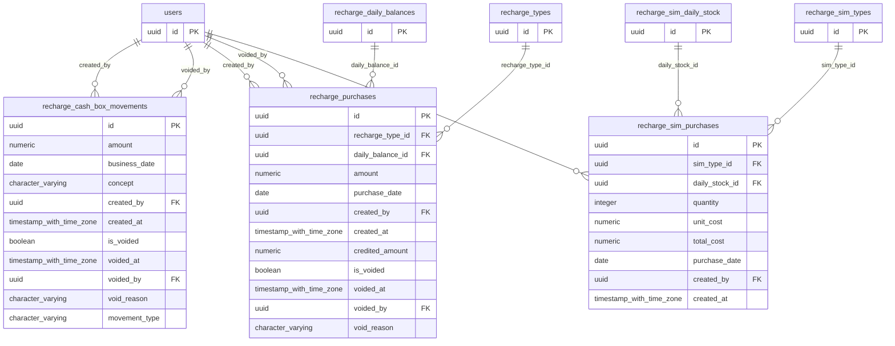

# Base de datos — dominio `recharge-cash-box`

Volver a [05_DATABASE_REFERENCE.md](../05_DATABASE_REFERENCE.md). Diagrama ER: llaves primarias (PK) y foráneas (FK) reales; las tablas de otros dominios referenciadas aparecen solo con su `id`. Se muestran hasta 14 columnas por tabla en el diagrama; la lista completa está en cada ficha.

## `recharge_cash_box_movements`

- **Entidad TypeORM:** [RechargeCashBoxMovementOrmEntity](../reference/backend/recharge-cash-box.md#f-comercial-jhoel-api-src-modules-recharge-cash-box-infrastructure-persistence-recharge-cash-box-movement-orm-entity-ts)
- **Creada en:** migración no identificada por el análisis (creada con TypeORM `Table` o `createTable`)
- **Archivos TypeScript que la usan:** [recharge-cash-box-movement.orm-entity.ts](../reference/backend/recharge-cash-box.md#f-comercial-jhoel-api-src-modules-recharge-cash-box-infrastructure-persistence-recharge-cash-box-movement-orm-entity-ts), [typeorm-recharge-cash-box.repository.ts](../reference/backend/recharge-cash-box.md#f-comercial-jhoel-api-src-modules-recharge-cash-box-infrastructure-persistence-typeorm-recharge-cash-box-repository-ts)
- **Funciones SQL que la escriben:** `register_recharge_cash_box_movement`

| Columna | Tipo | Nulo | Default |
|---|---|---|---|
| `id` | uuid | NOT NULL | gen_random_uuid() |
| `amount` | numeric(12,2) | NOT NULL |  |
| `business_date` | date | NOT NULL |  |
| `concept` | character varying(255) | NOT NULL |  |
| `created_by` | uuid | NOT NULL |  |
| `created_at` | timestamp with time zone | NOT NULL | now() |
| `is_voided` | boolean | NOT NULL | false |
| `voided_at` | timestamp with time zone | sí |  |
| `voided_by` | uuid | sí |  |
| `void_reason` | character varying(255) | sí |  |
| `movement_type` | character varying(20) | NOT NULL |  |

| Restricción | Tipo | Definición |
|---|---|---|
| `chk_recharge_cash_box_movements_type` | CHECK | CHECK (((movement_type)::text = ANY ((ARRAY['CONTRIBUTION'::character varying, 'WITHDRAWAL'::character varying])::text[]))) |
| `chk_recharge_cash_box_withdrawals_amount_positive` | CHECK | CHECK ((amount &gt; (0)::numeric)) |
| `chk_recharge_cash_box_withdrawals_void_consistency` | CHECK | CHECK ((((is_voided = false) AND (voided_at IS NULL) AND (voided_by IS NULL) AND (void_reason IS NULL)) OR ((is_voided = true) AND (voided_at IS NOT NULL) AND (voided_by IS NOT NULL) AND (void_reason IS NOT NULL)))) |
| `FK_recharge_cash_box_withdrawals_created_by` | FK | FOREIGN KEY (created_by) REFERENCES users(id) ON DELETE RESTRICT |
| `FK_recharge_cash_box_withdrawals_voided_by` | FK | FOREIGN KEY (voided_by) REFERENCES users(id) ON DELETE RESTRICT |
| `PK_fa9d268d4e950defbd8a260b461` | PK | PRIMARY KEY (id) |

**Índices:**

- `IDX_recharge_cash_box_withdrawals_business_date`: CREATE INDEX "IDX_recharge_cash_box_withdrawals_business_date" ON public.recharge_cash_box_movements USING btree (business_date)
- `IDX_recharge_cash_box_withdrawals_is_voided`: CREATE INDEX "IDX_recharge_cash_box_withdrawals_is_voided" ON public.recharge_cash_box_movements USING btree (is_voided)
- `PK_fa9d268d4e950defbd8a260b461`: CREATE UNIQUE INDEX "PK_fa9d268d4e950defbd8a260b461" ON public.recharge_cash_box_movements USING btree (id)

## `recharge_purchases`

- **Entidad TypeORM:** [RechargePurchaseFullOrmEntity](../reference/backend/recharges.md#f-comercial-jhoel-api-src-modules-recharges-infrastructure-persistence-recharge-purchase-full-orm-entity-ts)
- **Creada en:** migración no identificada por el análisis (creada con TypeORM `Table` o `createTable`)
- **Archivos TypeScript que la usan:** [recharge-purchase.orm-entity.ts](../reference/backend/recharge-cash-box.md#f-comercial-jhoel-api-src-modules-recharge-cash-box-infrastructure-persistence-recharge-purchase-orm-entity-ts), [typeorm-recharge-cash-box.repository.ts](../reference/backend/recharge-cash-box.md#f-comercial-jhoel-api-src-modules-recharge-cash-box-infrastructure-persistence-typeorm-recharge-cash-box-repository-ts), [recharge-purchase-full.orm-entity.ts](../reference/backend/recharges.md#f-comercial-jhoel-api-src-modules-recharges-infrastructure-persistence-recharge-purchase-full-orm-entity-ts), [typeorm-recharge-daily-balance.repository.ts](../reference/backend/recharges.md#f-comercial-jhoel-api-src-modules-recharges-infrastructure-persistence-typeorm-recharge-daily-balance-repository-ts)
- **Funciones SQL que la escriben:** `register_recharge_purchase`, `void_recharge_purchase`

| Columna | Tipo | Nulo | Default |
|---|---|---|---|
| `id` | uuid | NOT NULL | gen_random_uuid() |
| `recharge_type_id` | uuid | NOT NULL |  |
| `daily_balance_id` | uuid | NOT NULL |  |
| `amount` | numeric(12,2) | NOT NULL |  |
| `purchase_date` | date | NOT NULL |  |
| `created_by` | uuid | NOT NULL |  |
| `created_at` | timestamp with time zone | NOT NULL | now() |
| `credited_amount` | numeric(12,2) | NOT NULL |  |
| `is_voided` | boolean | NOT NULL | false |
| `voided_at` | timestamp with time zone | sí |  |
| `voided_by` | uuid | sí |  |
| `void_reason` | character varying(255) | sí |  |

| Restricción | Tipo | Definición |
|---|---|---|
| `chk_recharge_purchases_void_consistency` | CHECK | CHECK ((((is_voided = false) AND (voided_at IS NULL) AND (voided_by IS NULL) AND (void_reason IS NULL)) OR ((is_voided = true) AND (voided_at IS NOT NULL) AND (voided_by IS NOT NULL) AND (void_reason IS NOT NULL)))) |
| `FK_recharge_purchases_created_by` | FK | FOREIGN KEY (created_by) REFERENCES users(id) ON DELETE RESTRICT |
| `FK_recharge_purchases_daily_balance` | FK | FOREIGN KEY (daily_balance_id) REFERENCES recharge_daily_balances(id) ON DELETE CASCADE |
| `FK_recharge_purchases_type` | FK | FOREIGN KEY (recharge_type_id) REFERENCES recharge_types(id) ON DELETE RESTRICT |
| `recharge_purchases_voided_by_fkey` | FK | FOREIGN KEY (voided_by) REFERENCES users(id) ON DELETE RESTRICT |
| `PK_b2a7fa054d65ddd79a3b20fff9e` | PK | PRIMARY KEY (id) |

**Índices:**

- `IDX_recharge_purchases_daily_balance_id`: CREATE INDEX "IDX_recharge_purchases_daily_balance_id" ON public.recharge_purchases USING btree (daily_balance_id)
- `IDX_recharge_purchases_purchase_date`: CREATE INDEX "IDX_recharge_purchases_purchase_date" ON public.recharge_purchases USING btree (purchase_date)
- `IDX_recharge_purchases_type_id`: CREATE INDEX "IDX_recharge_purchases_type_id" ON public.recharge_purchases USING btree (recharge_type_id)
- `PK_b2a7fa054d65ddd79a3b20fff9e`: CREATE UNIQUE INDEX "PK_b2a7fa054d65ddd79a3b20fff9e" ON public.recharge_purchases USING btree (id)

## `recharge_sim_purchases`

- **Entidad TypeORM:** [RechargeSimPurchaseOrmEntity](../reference/backend/recharge-cash-box.md#f-comercial-jhoel-api-src-modules-recharge-cash-box-infrastructure-persistence-recharge-sim-purchase-orm-entity-ts)
- **Creada en:** migración no identificada por el análisis (creada con TypeORM `Table` o `createTable`)
- **Archivos TypeScript que la usan:** [recharge-sim-purchase.orm-entity.ts](../reference/backend/recharge-cash-box.md#f-comercial-jhoel-api-src-modules-recharge-cash-box-infrastructure-persistence-recharge-sim-purchase-orm-entity-ts), [typeorm-recharge-cash-box.repository.ts](../reference/backend/recharge-cash-box.md#f-comercial-jhoel-api-src-modules-recharge-cash-box-infrastructure-persistence-typeorm-recharge-cash-box-repository-ts), [typeorm-recharge-sim-daily-stock.repository.ts](../reference/backend/recharges.md#f-comercial-jhoel-api-src-modules-recharges-infrastructure-persistence-typeorm-recharge-sim-daily-stock-repository-ts)
- **Funciones SQL que la escriben:** `register_recharge_sim_purchase`

| Columna | Tipo | Nulo | Default |
|---|---|---|---|
| `id` | uuid | NOT NULL | gen_random_uuid() |
| `sim_type_id` | uuid | NOT NULL |  |
| `daily_stock_id` | uuid | NOT NULL |  |
| `quantity` | integer | NOT NULL |  |
| `unit_cost` | numeric(12,2) | NOT NULL |  |
| `total_cost` | numeric(12,2) | NOT NULL |  |
| `purchase_date` | date | NOT NULL |  |
| `created_by` | uuid | NOT NULL |  |
| `created_at` | timestamp with time zone | NOT NULL | now() |

| Restricción | Tipo | Definición |
|---|---|---|
| `FK_recharge_sim_purchases_created_by` | FK | FOREIGN KEY (created_by) REFERENCES users(id) ON DELETE RESTRICT |
| `FK_recharge_sim_purchases_daily_stock` | FK | FOREIGN KEY (daily_stock_id) REFERENCES recharge_sim_daily_stock(id) ON DELETE CASCADE |
| `FK_recharge_sim_purchases_type` | FK | FOREIGN KEY (sim_type_id) REFERENCES recharge_sim_types(id) ON DELETE RESTRICT |
| `PK_fb6d500e22e9f945fa521661094` | PK | PRIMARY KEY (id) |

**Índices:**

- `IDX_recharge_sim_purchases_daily_stock_id`: CREATE INDEX "IDX_recharge_sim_purchases_daily_stock_id" ON public.recharge_sim_purchases USING btree (daily_stock_id)
- `PK_fb6d500e22e9f945fa521661094`: CREATE UNIQUE INDEX "PK_fb6d500e22e9f945fa521661094" ON public.recharge_sim_purchases USING btree (id)

