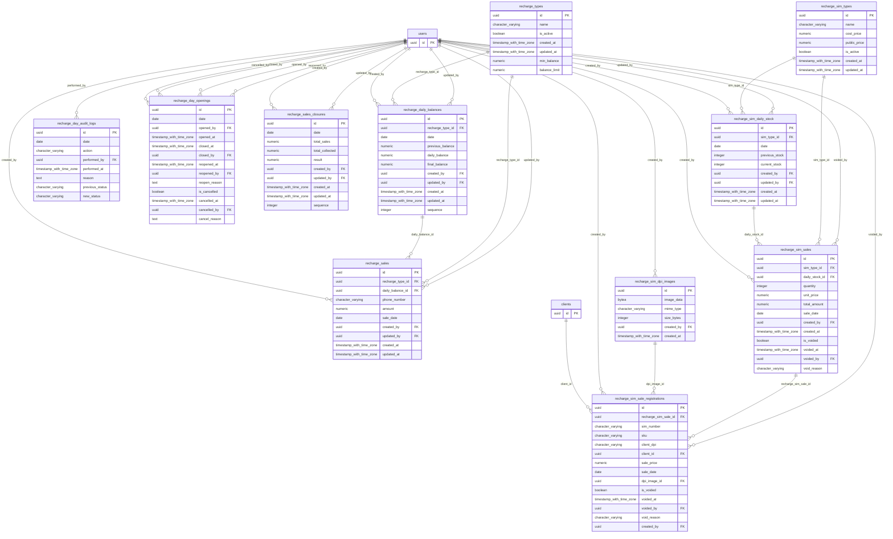

# Base de datos — dominio `recharges`

Volver a [05_DATABASE_REFERENCE.md](../05_DATABASE_REFERENCE.md). Diagrama ER: llaves primarias (PK) y foráneas (FK) reales; las tablas de otros dominios referenciadas aparecen solo con su `id`. Se muestran hasta 14 columnas por tabla en el diagrama; la lista completa está en cada ficha.

## `recharge_daily_balances`

- **Entidad TypeORM:** [RechargeDailyBalanceOrmEntity](../reference/backend/recharges.md#f-comercial-jhoel-api-src-modules-recharges-infrastructure-persistence-recharge-daily-balance-orm-entity-ts)
- **Creada en:** migración no identificada por el análisis (creada con TypeORM `Table` o `createTable`)
- **Archivos TypeScript que la usan:** [recharge-daily-balance.orm-entity.ts](../reference/backend/recharges.md#f-comercial-jhoel-api-src-modules-recharges-infrastructure-persistence-recharge-daily-balance-orm-entity-ts), [typeorm-recharge-daily-balance.repository.ts](../reference/backend/recharges.md#f-comercial-jhoel-api-src-modules-recharges-infrastructure-persistence-typeorm-recharge-daily-balance-repository-ts), [typeorm-recharge-purchase.repository.ts](../reference/backend/recharges.md#f-comercial-jhoel-api-src-modules-recharges-infrastructure-persistence-typeorm-recharge-purchase-repository-ts), [typeorm-recharge-sale.repository.ts](../reference/backend/recharges.md#f-comercial-jhoel-api-src-modules-recharges-infrastructure-persistence-typeorm-recharge-sale-repository-ts)
- **Funciones SQL que la escriben:** `ensure_recharge_daily_balance`, `register_recharge_final_balance`, `register_recharge_purchase`, `register_recharge_sales_closure`, `void_recharge_purchase`

| Columna | Tipo | Nulo | Default |
|---|---|---|---|
| `id` | uuid | NOT NULL | gen_random_uuid() |
| `recharge_type_id` | uuid | NOT NULL |  |
| `date` | date | NOT NULL |  |
| `previous_balance` | numeric(12,2) | NOT NULL |  |
| `daily_balance` | numeric(12,2) | NOT NULL |  |
| `final_balance` | numeric(12,2) | sí |  |
| `created_by` | uuid | NOT NULL |  |
| `updated_by` | uuid | sí |  |
| `created_at` | timestamp with time zone | NOT NULL | now() |
| `updated_at` | timestamp with time zone | NOT NULL | now() |
| `sequence` | integer | NOT NULL | 1 |

| Restricción | Tipo | Definición |
|---|---|---|
| `FK_recharge_daily_balances_created_by` | FK | FOREIGN KEY (created_by) REFERENCES users(id) ON DELETE RESTRICT |
| `FK_recharge_daily_balances_type` | FK | FOREIGN KEY (recharge_type_id) REFERENCES recharge_types(id) ON DELETE RESTRICT |
| `FK_recharge_daily_balances_updated_by` | FK | FOREIGN KEY (updated_by) REFERENCES users(id) ON DELETE RESTRICT |
| `PK_a002f5d87bba67dc8498727fa0f` | PK | PRIMARY KEY (id) |

**Índices:**

- `IDX_recharge_daily_balances_date`: CREATE INDEX "IDX_recharge_daily_balances_date" ON public.recharge_daily_balances USING btree (date)
- `PK_a002f5d87bba67dc8498727fa0f`: CREATE UNIQUE INDEX "PK_a002f5d87bba67dc8498727fa0f" ON public.recharge_daily_balances USING btree (id)
- `UQ_recharge_daily_balances_type_date_sequence`: CREATE UNIQUE INDEX "UQ_recharge_daily_balances_type_date_sequence" ON public.recharge_daily_balances USING btree (recharge_type_id, date, sequence)

## `recharge_day_audit_logs`

- **Entidad TypeORM:** [RechargeDayAuditLogOrmEntity](../reference/backend/recharges.md#f-comercial-jhoel-api-src-modules-recharges-infrastructure-persistence-recharge-day-audit-log-orm-entity-ts)
- **Creada en:** migración no identificada por el análisis (creada con TypeORM `Table` o `createTable`)
- **Archivos TypeScript que la usan:** [recharge-day-audit-log.orm-entity.ts](../reference/backend/recharges.md#f-comercial-jhoel-api-src-modules-recharges-infrastructure-persistence-recharge-day-audit-log-orm-entity-ts)
- **Funciones SQL que la escriben:** `cancel_recharge_day`, `close_recharge_day`, `reopen_recharge_day`

| Columna | Tipo | Nulo | Default |
|---|---|---|---|
| `id` | uuid | NOT NULL | gen_random_uuid() |
| `date` | date | NOT NULL |  |
| `action` | character varying(30) | NOT NULL |  |
| `performed_by` | uuid | NOT NULL |  |
| `performed_at` | timestamp with time zone | NOT NULL | now() |
| `reason` | text | sí |  |
| `previous_status` | character varying(30) | sí |  |
| `new_status` | character varying(30) | sí |  |

| Restricción | Tipo | Definición |
|---|---|---|
| `FK_recharge_day_audit_logs_performed_by` | FK | FOREIGN KEY (performed_by) REFERENCES users(id) ON DELETE RESTRICT |
| `PK_8411b1fff544babe0ad86a27941` | PK | PRIMARY KEY (id) |

**Índices:**

- `IDX_recharge_day_audit_logs_date`: CREATE INDEX "IDX_recharge_day_audit_logs_date" ON public.recharge_day_audit_logs USING btree (date)
- `PK_8411b1fff544babe0ad86a27941`: CREATE UNIQUE INDEX "PK_8411b1fff544babe0ad86a27941" ON public.recharge_day_audit_logs USING btree (id)

## `recharge_day_openings`

- **Entidad TypeORM:** [RechargeDayOpeningOrmEntity](../reference/backend/recharges.md#f-comercial-jhoel-api-src-modules-recharges-infrastructure-persistence-recharge-day-opening-orm-entity-ts)
- **Creada en:** migración no identificada por el análisis (creada con TypeORM `Table` o `createTable`)
- **Archivos TypeScript que la usan:** [recharge-day-opening.orm-entity.ts](../reference/backend/recharges.md#f-comercial-jhoel-api-src-modules-recharges-infrastructure-persistence-recharge-day-opening-orm-entity-ts), [typeorm-recharge-daily-balance.repository.ts](../reference/backend/recharges.md#f-comercial-jhoel-api-src-modules-recharges-infrastructure-persistence-typeorm-recharge-daily-balance-repository-ts)
- **Funciones SQL que la escriben:** `cancel_recharge_day`, `close_recharge_day`, `reopen_recharge_day`

| Columna | Tipo | Nulo | Default |
|---|---|---|---|
| `id` | uuid | NOT NULL | gen_random_uuid() |
| `date` | date | NOT NULL |  |
| `opened_by` | uuid | NOT NULL |  |
| `opened_at` | timestamp with time zone | NOT NULL | now() |
| `closed_at` | timestamp with time zone | sí |  |
| `closed_by` | uuid | sí |  |
| `reopened_at` | timestamp with time zone | sí |  |
| `reopened_by` | uuid | sí |  |
| `reopen_reason` | text | sí |  |
| `is_cancelled` | boolean | NOT NULL | false |
| `cancelled_at` | timestamp with time zone | sí |  |
| `cancelled_by` | uuid | sí |  |
| `cancel_reason` | text | sí |  |

| Restricción | Tipo | Definición |
|---|---|---|
| `FK_recharge_day_openings_cancelled_by` | FK | FOREIGN KEY (cancelled_by) REFERENCES users(id) ON DELETE RESTRICT |
| `FK_recharge_day_openings_closed_by` | FK | FOREIGN KEY (closed_by) REFERENCES users(id) ON DELETE RESTRICT |
| `FK_recharge_day_openings_opened_by` | FK | FOREIGN KEY (opened_by) REFERENCES users(id) ON DELETE RESTRICT |
| `FK_recharge_day_openings_reopened_by` | FK | FOREIGN KEY (reopened_by) REFERENCES users(id) ON DELETE RESTRICT |
| `PK_eda6e80e2d09ac941e1bf621358` | PK | PRIMARY KEY (id) |
| `UQ_fec50677c267133b9c10ac11141` | UNIQUE | UNIQUE (date) |

**Índices:**

- `PK_eda6e80e2d09ac941e1bf621358`: CREATE UNIQUE INDEX "PK_eda6e80e2d09ac941e1bf621358" ON public.recharge_day_openings USING btree (id)
- `UQ_fec50677c267133b9c10ac11141`: CREATE UNIQUE INDEX "UQ_fec50677c267133b9c10ac11141" ON public.recharge_day_openings USING btree (date)

## `recharge_sales`

- **Entidad TypeORM:** [RechargeSaleOrmEntity](../reference/backend/recharges.md#f-comercial-jhoel-api-src-modules-recharges-infrastructure-persistence-recharge-sale-orm-entity-ts)
- **Creada en:** migración no identificada por el análisis (creada con TypeORM `Table` o `createTable`)
- **Archivos TypeScript que la usan:** [typeorm-recharge-cash-box.repository.ts](../reference/backend/recharge-cash-box.md#f-comercial-jhoel-api-src-modules-recharge-cash-box-infrastructure-persistence-typeorm-recharge-cash-box-repository-ts), [recharge-sale.orm-entity.ts](../reference/backend/recharges.md#f-comercial-jhoel-api-src-modules-recharges-infrastructure-persistence-recharge-sale-orm-entity-ts), [typeorm-recharge-sale.repository.ts](../reference/backend/recharges.md#f-comercial-jhoel-api-src-modules-recharges-infrastructure-persistence-typeorm-recharge-sale-repository-ts)
- **Funciones SQL que la escriben:** `delete_recharge_sale`, `register_recharge_sale`, `update_recharge_sale`

| Columna | Tipo | Nulo | Default |
|---|---|---|---|
| `id` | uuid | NOT NULL | gen_random_uuid() |
| `recharge_type_id` | uuid | NOT NULL |  |
| `daily_balance_id` | uuid | NOT NULL |  |
| `phone_number` | character varying(15) | NOT NULL |  |
| `amount` | numeric(12,2) | NOT NULL |  |
| `sale_date` | date | NOT NULL |  |
| `created_by` | uuid | NOT NULL |  |
| `updated_by` | uuid | sí |  |
| `created_at` | timestamp with time zone | NOT NULL | now() |
| `updated_at` | timestamp with time zone | NOT NULL | now() |

| Restricción | Tipo | Definición |
|---|---|---|
| `FK_recharge_sales_created_by` | FK | FOREIGN KEY (created_by) REFERENCES users(id) ON DELETE RESTRICT |
| `FK_recharge_sales_daily_balance` | FK | FOREIGN KEY (daily_balance_id) REFERENCES recharge_daily_balances(id) ON DELETE CASCADE |
| `FK_recharge_sales_type` | FK | FOREIGN KEY (recharge_type_id) REFERENCES recharge_types(id) ON DELETE RESTRICT |
| `FK_recharge_sales_updated_by` | FK | FOREIGN KEY (updated_by) REFERENCES users(id) ON DELETE RESTRICT |
| `PK_38822fe7c6d9a44da860351a9b8` | PK | PRIMARY KEY (id) |

**Índices:**

- `IDX_recharge_sales_daily_balance_id`: CREATE INDEX "IDX_recharge_sales_daily_balance_id" ON public.recharge_sales USING btree (daily_balance_id)
- `IDX_recharge_sales_sale_date`: CREATE INDEX "IDX_recharge_sales_sale_date" ON public.recharge_sales USING btree (sale_date)
- `IDX_recharge_sales_type_id`: CREATE INDEX "IDX_recharge_sales_type_id" ON public.recharge_sales USING btree (recharge_type_id)
- `PK_38822fe7c6d9a44da860351a9b8`: CREATE UNIQUE INDEX "PK_38822fe7c6d9a44da860351a9b8" ON public.recharge_sales USING btree (id)

## `recharge_sales_closures`

- **Entidad TypeORM:** [RechargeSalesClosureOrmEntity](../reference/backend/recharges.md#f-comercial-jhoel-api-src-modules-recharges-infrastructure-persistence-recharge-sales-closure-orm-entity-ts)
- **Creada en:** migración no identificada por el análisis (creada con TypeORM `Table` o `createTable`)
- **Archivos TypeScript que la usan:** [recharge-sales-closure.orm-entity.ts](../reference/backend/recharges.md#f-comercial-jhoel-api-src-modules-recharges-infrastructure-persistence-recharge-sales-closure-orm-entity-ts), [typeorm-recharge-day-opening.repository.ts](../reference/backend/recharges.md#f-comercial-jhoel-api-src-modules-recharges-infrastructure-persistence-typeorm-recharge-day-opening-repository-ts)
- **Funciones SQL que la escriben:** `register_recharge_sales_closure`

| Columna | Tipo | Nulo | Default |
|---|---|---|---|
| `id` | uuid | NOT NULL | gen_random_uuid() |
| `date` | date | NOT NULL |  |
| `total_sales` | numeric(12,2) | NOT NULL |  |
| `total_collected` | numeric(12,2) | NOT NULL |  |
| `result` | numeric(12,2) | NOT NULL |  |
| `created_by` | uuid | NOT NULL |  |
| `updated_by` | uuid | sí |  |
| `created_at` | timestamp with time zone | NOT NULL | now() |
| `updated_at` | timestamp with time zone | NOT NULL | now() |
| `sequence` | integer | NOT NULL | 1 |

| Restricción | Tipo | Definición |
|---|---|---|
| `FK_recharge_sales_closures_created_by` | FK | FOREIGN KEY (created_by) REFERENCES users(id) ON DELETE RESTRICT |
| `FK_recharge_sales_closures_updated_by` | FK | FOREIGN KEY (updated_by) REFERENCES users(id) ON DELETE RESTRICT |
| `PK_a44635606cf4d529de6d4d79abc` | PK | PRIMARY KEY (id) |

**Índices:**

- `PK_a44635606cf4d529de6d4d79abc`: CREATE UNIQUE INDEX "PK_a44635606cf4d529de6d4d79abc" ON public.recharge_sales_closures USING btree (id)
- `UQ_recharge_sales_closures_date_sequence`: CREATE UNIQUE INDEX "UQ_recharge_sales_closures_date_sequence" ON public.recharge_sales_closures USING btree (date, sequence)

## `recharge_sim_daily_stock`

- **Entidad TypeORM:** [RechargeSimDailyStockOrmEntity](../reference/backend/recharges.md#f-comercial-jhoel-api-src-modules-recharges-infrastructure-persistence-recharge-sim-daily-stock-orm-entity-ts)
- **Creada en:** migración no identificada por el análisis (creada con TypeORM `Table` o `createTable`)
- **Archivos TypeScript que la usan:** [recharge-sim-daily-stock.orm-entity.ts](../reference/backend/recharges.md#f-comercial-jhoel-api-src-modules-recharges-infrastructure-persistence-recharge-sim-daily-stock-orm-entity-ts)
- **Funciones SQL que la escriben:** `ensure_recharge_sim_daily_stock`, `register_recharge_sim_purchase`, `register_recharge_sim_sale`, `register_recharge_sim_sale_unit`, `void_recharge_sim_sale`, `void_recharge_sim_sale_registration`

| Columna | Tipo | Nulo | Default |
|---|---|---|---|
| `id` | uuid | NOT NULL | gen_random_uuid() |
| `sim_type_id` | uuid | NOT NULL |  |
| `date` | date | NOT NULL |  |
| `previous_stock` | integer | NOT NULL |  |
| `current_stock` | integer | NOT NULL |  |
| `created_by` | uuid | NOT NULL |  |
| `updated_by` | uuid | sí |  |
| `created_at` | timestamp with time zone | NOT NULL | now() |
| `updated_at` | timestamp with time zone | NOT NULL | now() |

| Restricción | Tipo | Definición |
|---|---|---|
| `FK_recharge_sim_daily_stock_created_by` | FK | FOREIGN KEY (created_by) REFERENCES users(id) ON DELETE RESTRICT |
| `FK_recharge_sim_daily_stock_type` | FK | FOREIGN KEY (sim_type_id) REFERENCES recharge_sim_types(id) ON DELETE RESTRICT |
| `FK_recharge_sim_daily_stock_updated_by` | FK | FOREIGN KEY (updated_by) REFERENCES users(id) ON DELETE RESTRICT |
| `PK_d74836b2d18d436462eb20be94f` | PK | PRIMARY KEY (id) |

**Índices:**

- `IDX_recharge_sim_daily_stock_date`: CREATE INDEX "IDX_recharge_sim_daily_stock_date" ON public.recharge_sim_daily_stock USING btree (date)
- `PK_d74836b2d18d436462eb20be94f`: CREATE UNIQUE INDEX "PK_d74836b2d18d436462eb20be94f" ON public.recharge_sim_daily_stock USING btree (id)
- `UQ_recharge_sim_daily_stock_type_date`: CREATE UNIQUE INDEX "UQ_recharge_sim_daily_stock_type_date" ON public.recharge_sim_daily_stock USING btree (sim_type_id, date)

## `recharge_sim_dpi_images`

- **Entidad TypeORM:** ninguna (se accede con SQL crudo o solo desde funciones PL/pgSQL)
- **Creada en:** `1760002200000-AddRechargeSimSaleRegistrations.ts`
- **Archivos TypeScript que la usan:** [typeorm-recharge-sim-sale-registration.repository.ts](../reference/backend/recharges.md#f-comercial-jhoel-api-src-modules-recharges-infrastructure-persistence-typeorm-recharge-sim-sale-registration-repository-ts)

| Columna | Tipo | Nulo | Default |
|---|---|---|---|
| `id` | uuid | NOT NULL | gen_random_uuid() |
| `image_data` | bytea | NOT NULL |  |
| `mime_type` | character varying(50) | NOT NULL |  |
| `size_bytes` | integer | NOT NULL |  |
| `created_by` | uuid | NOT NULL |  |
| `created_at` | timestamp with time zone | NOT NULL | now() |

| Restricción | Tipo | Definición |
|---|---|---|
| `recharge_sim_dpi_images_created_by_fkey` | FK | FOREIGN KEY (created_by) REFERENCES users(id) ON DELETE RESTRICT |
| `recharge_sim_dpi_images_pkey` | PK | PRIMARY KEY (id) |

**Índices:**

- `recharge_sim_dpi_images_pkey`: CREATE UNIQUE INDEX recharge_sim_dpi_images_pkey ON public.recharge_sim_dpi_images USING btree (id)

## `recharge_sim_sale_registrations`

- **Entidad TypeORM:** ninguna (se accede con SQL crudo o solo desde funciones PL/pgSQL)
- **Creada en:** `1760002200000-AddRechargeSimSaleRegistrations.ts`
- **Archivos TypeScript que la usan:** [typeorm-recharge-sim-sale-registration.repository.ts](../reference/backend/recharges.md#f-comercial-jhoel-api-src-modules-recharges-infrastructure-persistence-typeorm-recharge-sim-sale-registration-repository-ts), [typeorm-recharge-sim-sale.repository.ts](../reference/backend/recharges.md#f-comercial-jhoel-api-src-modules-recharges-infrastructure-persistence-typeorm-recharge-sim-sale-repository-ts)
- **Funciones SQL que la escriben:** `register_recharge_sim_sale_registration`, `void_recharge_sim_sale_registration`

| Columna | Tipo | Nulo | Default |
|---|---|---|---|
| `id` | uuid | NOT NULL | gen_random_uuid() |
| `recharge_sim_sale_id` | uuid | NOT NULL |  |
| `sim_number` | character varying(50) | NOT NULL |  |
| `sku` | character varying(64) | NOT NULL |  |
| `client_dpi` | character varying(20) | NOT NULL |  |
| `client_id` | uuid | sí |  |
| `sale_price` | numeric(12,2) | NOT NULL |  |
| `sale_date` | date | NOT NULL |  |
| `dpi_image_id` | uuid | sí |  |
| `is_voided` | boolean | NOT NULL | false |
| `voided_at` | timestamp with time zone | sí |  |
| `voided_by` | uuid | sí |  |
| `void_reason` | character varying(255) | sí |  |
| `created_by` | uuid | NOT NULL |  |
| `created_at` | timestamp with time zone | NOT NULL | now() |

| Restricción | Tipo | Definición |
|---|---|---|
| `chk_recharge_sim_sale_registrations_void_consistency` | CHECK | CHECK ((((is_voided = false) AND (voided_at IS NULL) AND (voided_by IS NULL) AND (void_reason IS NULL)) OR ((is_voided = true) AND (voided_at IS NOT NULL) AND (voided_by IS NOT NULL) AND (void_reason IS NOT NULL)))) |
| `recharge_sim_sale_registrations_client_id_fkey` | FK | FOREIGN KEY (client_id) REFERENCES clients(id) ON DELETE RESTRICT |
| `recharge_sim_sale_registrations_created_by_fkey` | FK | FOREIGN KEY (created_by) REFERENCES users(id) ON DELETE RESTRICT |
| `recharge_sim_sale_registrations_dpi_image_id_fkey` | FK | FOREIGN KEY (dpi_image_id) REFERENCES recharge_sim_dpi_images(id) ON DELETE RESTRICT |
| `recharge_sim_sale_registrations_recharge_sim_sale_id_fkey` | FK | FOREIGN KEY (recharge_sim_sale_id) REFERENCES recharge_sim_sales(id) ON DELETE RESTRICT |
| `recharge_sim_sale_registrations_voided_by_fkey` | FK | FOREIGN KEY (voided_by) REFERENCES users(id) ON DELETE RESTRICT |
| `recharge_sim_sale_registrations_pkey` | PK | PRIMARY KEY (id) |

**Índices:**

- `idx_recharge_sim_sale_registrations_recharge_sim_sale_id`: CREATE INDEX idx_recharge_sim_sale_registrations_recharge_sim_sale_id ON public.recharge_sim_sale_registrations USING btree (recharge_sim_sale_id)
- `idx_recharge_sim_sale_registrations_sale_date`: CREATE INDEX idx_recharge_sim_sale_registrations_sale_date ON public.recharge_sim_sale_registrations USING btree (sale_date)
- `recharge_sim_sale_registrations_pkey`: CREATE UNIQUE INDEX recharge_sim_sale_registrations_pkey ON public.recharge_sim_sale_registrations USING btree (id)

## `recharge_sim_sales`

- **Entidad TypeORM:** [RechargeSimSaleOrmEntity](../reference/backend/recharge-cash-box.md#f-comercial-jhoel-api-src-modules-recharge-cash-box-infrastructure-persistence-recharge-sim-sale-orm-entity-ts)
- **Creada en:** migración no identificada por el análisis (creada con TypeORM `Table` o `createTable`)
- **Archivos TypeScript que la usan:** [recharge-sim-sale.orm-entity.ts](../reference/backend/recharge-cash-box.md#f-comercial-jhoel-api-src-modules-recharge-cash-box-infrastructure-persistence-recharge-sim-sale-orm-entity-ts), [typeorm-recharge-cash-box.repository.ts](../reference/backend/recharge-cash-box.md#f-comercial-jhoel-api-src-modules-recharge-cash-box-infrastructure-persistence-typeorm-recharge-cash-box-repository-ts), [typeorm-recharge-sim-daily-stock.repository.ts](../reference/backend/recharges.md#f-comercial-jhoel-api-src-modules-recharges-infrastructure-persistence-typeorm-recharge-sim-daily-stock-repository-ts), [typeorm-recharge-sim-sale-registration.repository.ts](../reference/backend/recharges.md#f-comercial-jhoel-api-src-modules-recharges-infrastructure-persistence-typeorm-recharge-sim-sale-registration-repository-ts), [typeorm-recharge-sim-sale.repository.ts](../reference/backend/recharges.md#f-comercial-jhoel-api-src-modules-recharges-infrastructure-persistence-typeorm-recharge-sim-sale-repository-ts)
- **Funciones SQL que la escriben:** `register_recharge_sim_sale`, `register_recharge_sim_sale_unit`, `void_recharge_sim_sale`

| Columna | Tipo | Nulo | Default |
|---|---|---|---|
| `id` | uuid | NOT NULL | gen_random_uuid() |
| `sim_type_id` | uuid | NOT NULL |  |
| `daily_stock_id` | uuid | NOT NULL |  |
| `quantity` | integer | NOT NULL |  |
| `unit_price` | numeric(12,2) | NOT NULL |  |
| `total_amount` | numeric(12,2) | NOT NULL |  |
| `sale_date` | date | NOT NULL |  |
| `created_by` | uuid | NOT NULL |  |
| `created_at` | timestamp with time zone | NOT NULL | now() |
| `is_voided` | boolean | NOT NULL | false |
| `voided_at` | timestamp with time zone | sí |  |
| `voided_by` | uuid | sí |  |
| `void_reason` | character varying(255) | sí |  |

| Restricción | Tipo | Definición |
|---|---|---|
| `chk_recharge_sim_sales_void_consistency` | CHECK | CHECK ((((is_voided = false) AND (voided_at IS NULL) AND (voided_by IS NULL) AND (void_reason IS NULL)) OR ((is_voided = true) AND (voided_at IS NOT NULL) AND (voided_by IS NOT NULL) AND (void_reason IS NOT NULL)))) |
| `FK_recharge_sim_sales_created_by` | FK | FOREIGN KEY (created_by) REFERENCES users(id) ON DELETE RESTRICT |
| `FK_recharge_sim_sales_daily_stock` | FK | FOREIGN KEY (daily_stock_id) REFERENCES recharge_sim_daily_stock(id) ON DELETE CASCADE |
| `FK_recharge_sim_sales_type` | FK | FOREIGN KEY (sim_type_id) REFERENCES recharge_sim_types(id) ON DELETE RESTRICT |
| `recharge_sim_sales_voided_by_fkey` | FK | FOREIGN KEY (voided_by) REFERENCES users(id) ON DELETE RESTRICT |
| `PK_c5f438ec85268fa9ede29cbfd07` | PK | PRIMARY KEY (id) |

**Índices:**

- `IDX_recharge_sim_sales_daily_stock_id`: CREATE INDEX "IDX_recharge_sim_sales_daily_stock_id" ON public.recharge_sim_sales USING btree (daily_stock_id)
- `PK_c5f438ec85268fa9ede29cbfd07`: CREATE UNIQUE INDEX "PK_c5f438ec85268fa9ede29cbfd07" ON public.recharge_sim_sales USING btree (id)

## `recharge_sim_types`

- **Entidad TypeORM:** [RechargeSimTypeOrmEntity](../reference/backend/recharges.md#f-comercial-jhoel-api-src-modules-recharges-infrastructure-persistence-recharge-sim-type-orm-entity-ts)
- **Creada en:** migración no identificada por el análisis (creada con TypeORM `Table` o `createTable`)
- **Archivos TypeScript que la usan:** [recharge-sim-type.orm-entity.ts](../reference/backend/recharges.md#f-comercial-jhoel-api-src-modules-recharges-infrastructure-persistence-recharge-sim-type-orm-entity-ts), [typeorm-recharge-sim-sale-registration.repository.ts](../reference/backend/recharges.md#f-comercial-jhoel-api-src-modules-recharges-infrastructure-persistence-typeorm-recharge-sim-sale-registration-repository-ts), [typeorm-recharge-sim-sale.repository.ts](../reference/backend/recharges.md#f-comercial-jhoel-api-src-modules-recharges-infrastructure-persistence-typeorm-recharge-sim-sale-repository-ts)

| Columna | Tipo | Nulo | Default |
|---|---|---|---|
| `id` | uuid | NOT NULL | gen_random_uuid() |
| `name` | character varying(50) | NOT NULL |  |
| `cost_price` | numeric(12,2) | NOT NULL |  |
| `public_price` | numeric(12,2) | NOT NULL |  |
| `is_active` | boolean | NOT NULL | true |
| `created_at` | timestamp with time zone | NOT NULL | now() |
| `updated_at` | timestamp with time zone | NOT NULL | now() |

| Restricción | Tipo | Definición |
|---|---|---|
| `PK_4d29bcd717a30a1c435e4fff666` | PK | PRIMARY KEY (id) |

**Índices:**

- `PK_4d29bcd717a30a1c435e4fff666`: CREATE UNIQUE INDEX "PK_4d29bcd717a30a1c435e4fff666" ON public.recharge_sim_types USING btree (id)
- `UQ_recharge_sim_types_name`: CREATE UNIQUE INDEX "UQ_recharge_sim_types_name" ON public.recharge_sim_types USING btree (name)

## `recharge_types`

- **Entidad TypeORM:** [RechargeTypeOrmEntity](../reference/backend/recharges.md#f-comercial-jhoel-api-src-modules-recharges-infrastructure-persistence-recharge-type-orm-entity-ts)
- **Creada en:** migración no identificada por el análisis (creada con TypeORM `Table` o `createTable`)
- **Archivos TypeScript que la usan:** [recharge-type.orm-entity.ts](../reference/backend/recharges.md#f-comercial-jhoel-api-src-modules-recharges-infrastructure-persistence-recharge-type-orm-entity-ts), [typeorm-recharge-sale.repository.ts](../reference/backend/recharges.md#f-comercial-jhoel-api-src-modules-recharges-infrastructure-persistence-typeorm-recharge-sale-repository-ts)

| Columna | Tipo | Nulo | Default |
|---|---|---|---|
| `id` | uuid | NOT NULL | gen_random_uuid() |
| `name` | character varying(50) | NOT NULL |  |
| `is_active` | boolean | NOT NULL | true |
| `created_at` | timestamp with time zone | NOT NULL | now() |
| `updated_at` | timestamp with time zone | NOT NULL | now() |
| `min_balance` | numeric(12,2) | NOT NULL | 0 |
| `balance_limit` | numeric(12,2) | NOT NULL | 0 |

| Restricción | Tipo | Definición |
|---|---|---|
| `CHK_recharge_types_balance_limit_non_negative` | CHECK | CHECK ((balance_limit &gt;= (0)::numeric)) |
| `CHK_recharge_types_min_balance_non_negative` | CHECK | CHECK ((min_balance &gt;= (0)::numeric)) |
| `PK_fdca8b94c383419ff9b6a21a390` | PK | PRIMARY KEY (id) |

**Índices:**

- `PK_fdca8b94c383419ff9b6a21a390`: CREATE UNIQUE INDEX "PK_fdca8b94c383419ff9b6a21a390" ON public.recharge_types USING btree (id)
- `UQ_recharge_types_name`: CREATE UNIQUE INDEX "UQ_recharge_types_name" ON public.recharge_types USING btree (name)

