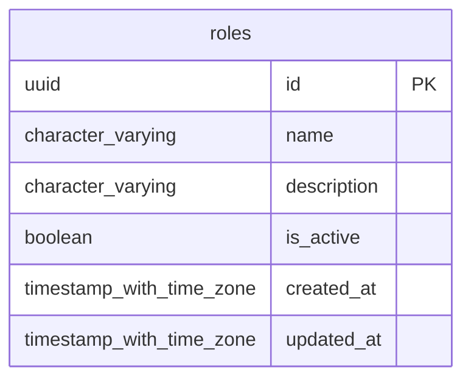

# Base de datos — dominio `roles`

Volver a [05_DATABASE_REFERENCE.md](../05_DATABASE_REFERENCE.md). Diagrama ER: llaves primarias (PK) y foráneas (FK) reales; las tablas de otros dominios referenciadas aparecen solo con su `id`. Se muestran hasta 14 columnas por tabla en el diagrama; la lista completa está en cada ficha.

## `roles`

- **Entidad TypeORM:** [RoleOrmEntity](../reference/backend/roles.md#f-comercial-jhoel-api-src-modules-roles-infrastructure-persistence-role-orm-entity-ts)
- **Creada en:** migración no identificada por el análisis (creada con TypeORM `Table` o `createTable`)
- **Archivos TypeScript que la usan:** [role.orm-entity.ts](../reference/backend/roles.md#f-comercial-jhoel-api-src-modules-roles-infrastructure-persistence-role-orm-entity-ts), [ar-settlements.e2e-spec.ts](../reference/backend/e2e.md#f-comercial-jhoel-api-test-ar-settlements-e2e-spec-ts), [bank-deposit-description.e2e-spec.ts](../reference/backend/e2e.md#f-comercial-jhoel-api-test-bank-deposit-description-e2e-spec-ts), [cash-control.e2e-spec.ts](../reference/backend/e2e.md#f-comercial-jhoel-api-test-cash-control-e2e-spec-ts), [cash-custody.e2e-spec.ts](../reference/backend/e2e.md#f-comercial-jhoel-api-test-cash-custody-e2e-spec-ts), [cash-daily-indicators.e2e-spec.ts](../reference/backend/e2e.md#f-comercial-jhoel-api-test-cash-daily-indicators-e2e-spec-ts), [cuadre-cash-breakdown.e2e-spec.ts](../reference/backend/e2e.md#f-comercial-jhoel-api-test-cuadre-cash-breakdown-e2e-spec-ts), [financial-day-review.e2e-spec.ts](../reference/backend/e2e.md#f-comercial-jhoel-api-test-financial-day-review-e2e-spec-ts)

| Columna | Tipo | Nulo | Default |
|---|---|---|---|
| `id` | uuid | NOT NULL | gen_random_uuid() |
| `name` | character varying(30) | NOT NULL |  |
| `description` | character varying(255) | sí |  |
| `is_active` | boolean | NOT NULL | true |
| `created_at` | timestamp with time zone | NOT NULL | now() |
| `updated_at` | timestamp with time zone | NOT NULL | now() |

| Restricción | Tipo | Definición |
|---|---|---|
| `PK_c1433d71a4838793a49dcad46ab` | PK | PRIMARY KEY (id) |
| `UQ_roles_name` | UNIQUE | UNIQUE (name) |

**Índices:**

- `PK_c1433d71a4838793a49dcad46ab`: CREATE UNIQUE INDEX "PK_c1433d71a4838793a49dcad46ab" ON public.roles USING btree (id)
- `UQ_roles_name`: CREATE UNIQUE INDEX "UQ_roles_name" ON public.roles USING btree (name)

