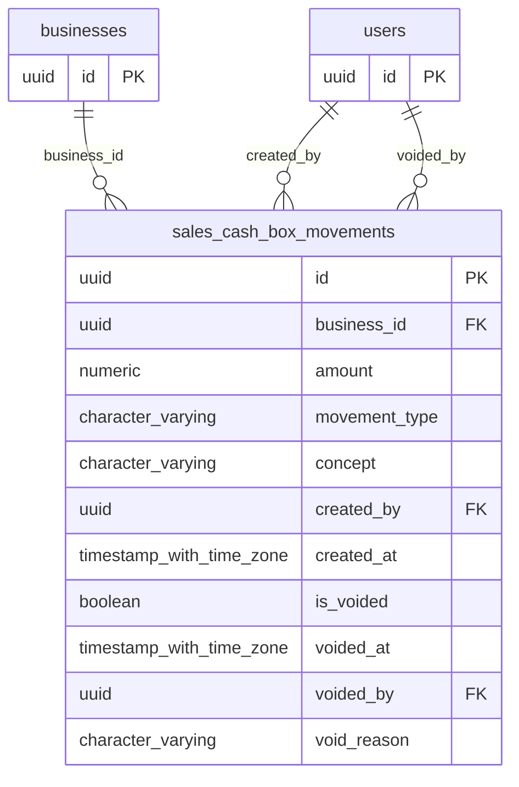

# Base de datos — dominio `sales-cash-box`

Volver a [05_DATABASE_REFERENCE.md](../05_DATABASE_REFERENCE.md). Diagrama ER: llaves primarias (PK) y foráneas (FK) reales; las tablas de otros dominios referenciadas aparecen solo con su `id`. Se muestran hasta 14 columnas por tabla en el diagrama; la lista completa está en cada ficha.

## `sales_cash_box_movements`

- **Entidad TypeORM:** [SalesCashBoxMovementOrmEntity](../reference/backend/sales-cash-box.md#f-comercial-jhoel-api-src-modules-sales-cash-box-infrastructure-persistence-sales-cash-box-movement-orm-entity-ts)
- **Creada en:** migración no identificada por el análisis (creada con TypeORM `Table` o `createTable`)
- **Archivos TypeScript que la usan:** [sales-cash-box-movement.orm-entity.ts](../reference/backend/sales-cash-box.md#f-comercial-jhoel-api-src-modules-sales-cash-box-infrastructure-persistence-sales-cash-box-movement-orm-entity-ts), [typeorm-sales-cash-box.repository.ts](../reference/backend/sales-cash-box.md#f-comercial-jhoel-api-src-modules-sales-cash-box-infrastructure-persistence-typeorm-sales-cash-box-repository-ts)
- **Funciones SQL que la escriben:** `register_sales_cash_box_movement`

| Columna | Tipo | Nulo | Default |
|---|---|---|---|
| `id` | uuid | NOT NULL | gen_random_uuid() |
| `business_id` | uuid | NOT NULL |  |
| `amount` | numeric(12,2) | NOT NULL |  |
| `movement_type` | character varying(20) | NOT NULL |  |
| `concept` | character varying(255) | NOT NULL |  |
| `created_by` | uuid | NOT NULL |  |
| `created_at` | timestamp with time zone | NOT NULL | now() |
| `is_voided` | boolean | NOT NULL | false |
| `voided_at` | timestamp with time zone | sí |  |
| `voided_by` | uuid | sí |  |
| `void_reason` | character varying(255) | sí |  |

| Restricción | Tipo | Definición |
|---|---|---|
| `chk_sales_cash_box_movements_amount_positive` | CHECK | CHECK ((amount &gt; (0)::numeric)) |
| `chk_sales_cash_box_movements_type` | CHECK | CHECK (((movement_type)::text = ANY ((ARRAY['CONTRIBUTION'::character varying, 'WITHDRAWAL'::character varying])::text[]))) |
| `chk_sales_cash_box_movements_void_consistency` | CHECK | CHECK ((((is_voided = false) AND (voided_at IS NULL) AND (voided_by IS NULL) AND (void_reason IS NULL)) OR ((is_voided = true) AND (voided_at IS NOT NULL) AND (voided_by IS NOT NULL) AND (void_reason IS NOT NULL)))) |
| `FK_sales_cash_box_movements_business` | FK | FOREIGN KEY (business_id) REFERENCES businesses(id) ON DELETE RESTRICT |
| `FK_sales_cash_box_movements_created_by` | FK | FOREIGN KEY (created_by) REFERENCES users(id) ON DELETE RESTRICT |
| `FK_sales_cash_box_movements_voided_by` | FK | FOREIGN KEY (voided_by) REFERENCES users(id) ON DELETE RESTRICT |
| `PK_30bd4e1c1555113096498d7fa8e` | PK | PRIMARY KEY (id) |

**Índices:**

- `IDX_sales_cash_box_movements_business_id`: CREATE INDEX "IDX_sales_cash_box_movements_business_id" ON public.sales_cash_box_movements USING btree (business_id)
- `IDX_sales_cash_box_movements_is_voided`: CREATE INDEX "IDX_sales_cash_box_movements_is_voided" ON public.sales_cash_box_movements USING btree (is_voided)
- `PK_30bd4e1c1555113096498d7fa8e`: CREATE UNIQUE INDEX "PK_30bd4e1c1555113096498d7fa8e" ON public.sales_cash_box_movements USING btree (id)

