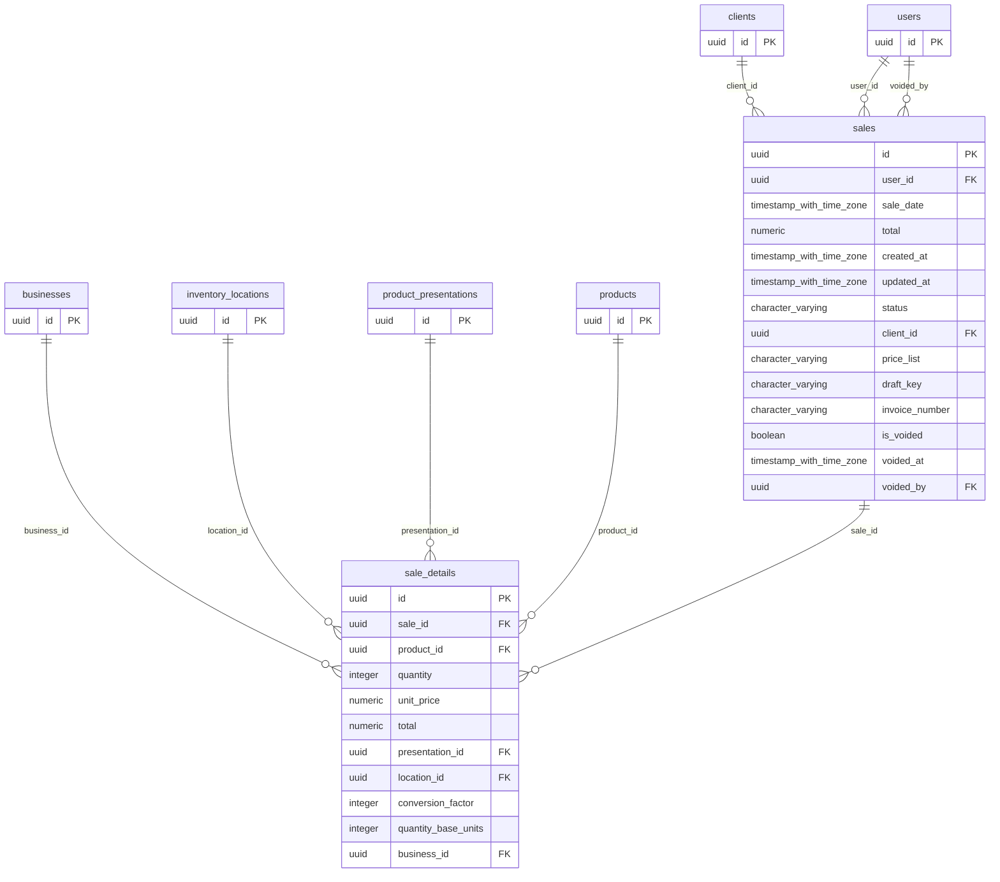

# Base de datos — dominio `sales`

Volver a [05_DATABASE_REFERENCE.md](../05_DATABASE_REFERENCE.md). Diagrama ER: llaves primarias (PK) y foráneas (FK) reales; las tablas de otros dominios referenciadas aparecen solo con su `id`. Se muestran hasta 14 columnas por tabla en el diagrama; la lista completa está en cada ficha.

## `sale_details`

- **Entidad TypeORM:** [SaleDetailOrmEntity](../reference/backend/sales.md#f-comercial-jhoel-api-src-modules-sales-infrastructure-persistence-sale-detail-orm-entity-ts)
- **Creada en:** migración no identificada por el análisis (creada con TypeORM `Table` o `createTable`)
- **Archivos TypeScript que la usan:** [sale-detail.orm-entity.ts](../reference/backend/sales.md#f-comercial-jhoel-api-src-modules-sales-infrastructure-persistence-sale-detail-orm-entity-ts), [typeorm-sales-cash-box.repository.ts](../reference/backend/sales-cash-box.md#f-comercial-jhoel-api-src-modules-sales-cash-box-infrastructure-persistence-typeorm-sales-cash-box-repository-ts)
- **Funciones SQL que la escriben:** `adjust_sale_item`, `cancel_open_sale`, `confirm_sale`, `confirm_sale`

| Columna | Tipo | Nulo | Default |
|---|---|---|---|
| `id` | uuid | NOT NULL | gen_random_uuid() |
| `sale_id` | uuid | NOT NULL |  |
| `product_id` | uuid | NOT NULL |  |
| `quantity` | integer | NOT NULL |  |
| `unit_price` | numeric(12,2) | NOT NULL |  |
| `total` | numeric(12,2) | NOT NULL |  |
| `presentation_id` | uuid | sí |  |
| `location_id` | uuid | sí |  |
| `conversion_factor` | integer | sí |  |
| `quantity_base_units` | integer | sí |  |
| `business_id` | uuid | NOT NULL |  |

| Restricción | Tipo | Definición |
|---|---|---|
| `FK_sale_details_business` | FK | FOREIGN KEY (business_id) REFERENCES businesses(id) ON DELETE RESTRICT |
| `FK_sale_details_location` | FK | FOREIGN KEY (location_id) REFERENCES inventory_locations(id) ON DELETE RESTRICT |
| `FK_sale_details_presentation` | FK | FOREIGN KEY (presentation_id) REFERENCES product_presentations(id) ON DELETE RESTRICT |
| `FK_sale_details_product` | FK | FOREIGN KEY (product_id) REFERENCES products(id) ON DELETE RESTRICT |
| `FK_sale_details_sale` | FK | FOREIGN KEY (sale_id) REFERENCES sales(id) ON DELETE CASCADE |
| `PK_a8e8b6d243f38e3587378d401f5` | PK | PRIMARY KEY (id) |

**Índices:**

- `IDX_sale_details_business_id`: CREATE INDEX "IDX_sale_details_business_id" ON public.sale_details USING btree (business_id)
- `IDX_sale_details_product_id`: CREATE INDEX "IDX_sale_details_product_id" ON public.sale_details USING btree (product_id)
- `IDX_sale_details_sale_id`: CREATE INDEX "IDX_sale_details_sale_id" ON public.sale_details USING btree (sale_id)
- `PK_a8e8b6d243f38e3587378d401f5`: CREATE UNIQUE INDEX "PK_a8e8b6d243f38e3587378d401f5" ON public.sale_details USING btree (id)

## `sales`

- **Entidad TypeORM:** [SaleOrmEntity](../reference/backend/sales.md#f-comercial-jhoel-api-src-modules-sales-infrastructure-persistence-sale-orm-entity-ts)
- **Creada en:** migración no identificada por el análisis (creada con TypeORM `Table` o `createTable`)
- **Archivos TypeScript que la usan:** [sale.orm-entity.ts](../reference/backend/sales.md#f-comercial-jhoel-api-src-modules-sales-infrastructure-persistence-sale-orm-entity-ts), [typeorm-sales-cash-box.repository.ts](../reference/backend/sales-cash-box.md#f-comercial-jhoel-api-src-modules-sales-cash-box-infrastructure-persistence-typeorm-sales-cash-box-repository-ts)
- **Funciones SQL que la escriben:** `adjust_sale_item`, `cancel_open_sale`, `configure_open_sale`, `confirm_open_sale`, `confirm_sale`, `confirm_sale`, `void_sale`

| Columna | Tipo | Nulo | Default |
|---|---|---|---|
| `id` | uuid | NOT NULL | gen_random_uuid() |
| `user_id` | uuid | NOT NULL |  |
| `sale_date` | timestamp with time zone | NOT NULL | now() |
| `total` | numeric(12,2) | NOT NULL | 0 |
| `created_at` | timestamp with time zone | NOT NULL | now() |
| `updated_at` | timestamp with time zone | NOT NULL | now() |
| `status` | character varying(20) | NOT NULL | 'CONFIRMED'::character varying |
| `client_id` | uuid | sí |  |
| `price_list` | character varying(20) | NOT NULL | 'PUBLIC'::character varying |
| `draft_key` | character varying(64) | sí |  |
| `invoice_number` | character varying(50) | sí |  |
| `is_voided` | boolean | NOT NULL | false |
| `voided_at` | timestamp with time zone | sí |  |
| `voided_by` | uuid | sí |  |
| `void_reason` | character varying(255) | sí |  |

| Restricción | Tipo | Definición |
|---|---|---|
| `CHK_sales_price_list` | CHECK | CHECK (((price_list)::text = ANY ((ARRAY['PUBLIC'::character varying, 'WHOLESALE'::character varying])::text[]))) |
| `CHK_sales_void_consistency` | CHECK | CHECK ((((is_voided = false) AND (voided_at IS NULL) AND (voided_by IS NULL) AND (void_reason IS NULL)) OR ((is_voided = true) AND (voided_at IS NOT NULL) AND (voided_by IS NOT NULL) AND (void_reason IS NOT NULL)))) |
| `FK_sales_client` | FK | FOREIGN KEY (client_id) REFERENCES clients(id) ON DELETE RESTRICT |
| `FK_sales_user` | FK | FOREIGN KEY (user_id) REFERENCES users(id) ON DELETE RESTRICT |
| `FK_sales_voided_by` | FK | FOREIGN KEY (voided_by) REFERENCES users(id) ON DELETE RESTRICT |
| `PK_4f0bc990ae81dba46da680895ea` | PK | PRIMARY KEY (id) |

**Índices:**

- `IDX_sales_invoice_number`: CREATE INDEX "IDX_sales_invoice_number" ON public.sales USING btree (invoice_number)
- `IDX_sales_sale_date`: CREATE INDEX "IDX_sales_sale_date" ON public.sales USING btree (sale_date)
- `IDX_sales_user_id`: CREATE INDEX "IDX_sales_user_id" ON public.sales USING btree (user_id)
- `PK_4f0bc990ae81dba46da680895ea`: CREATE UNIQUE INDEX "PK_4f0bc990ae81dba46da680895ea" ON public.sales USING btree (id)
- `UQ_sales_open_per_draft`: CREATE UNIQUE INDEX "UQ_sales_open_per_draft" ON public.sales USING btree (user_id, draft_key) WHERE ((status)::text = 'OPEN'::text)

