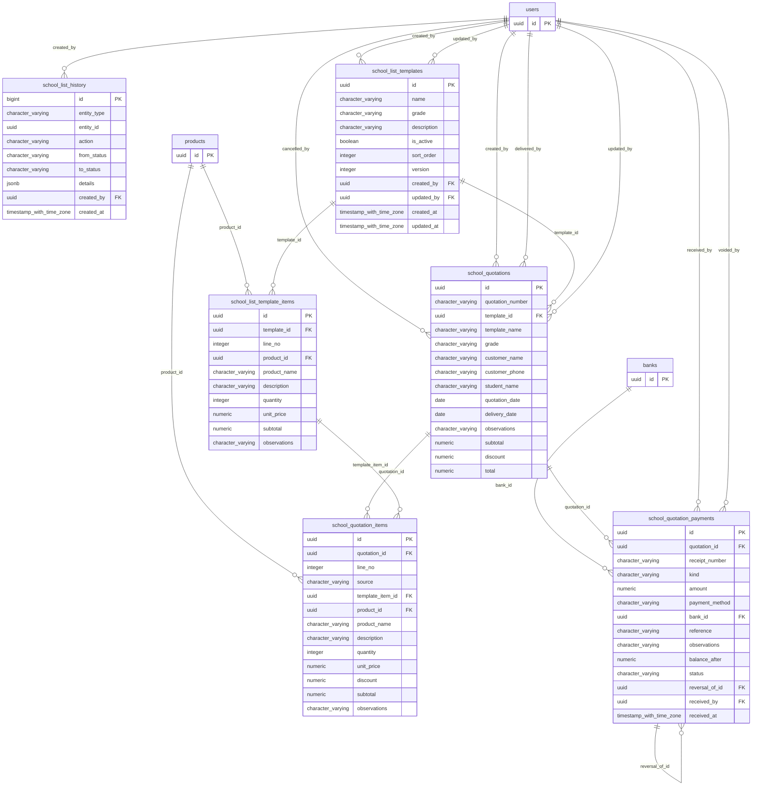

# Base de datos — dominio `school-lists`

Volver a [05_DATABASE_REFERENCE.md](../05_DATABASE_REFERENCE.md). Diagrama ER: llaves primarias (PK) y foráneas (FK) reales; las tablas de otros dominios referenciadas aparecen solo con su `id`. Se muestran hasta 14 columnas por tabla en el diagrama; la lista completa está en cada ficha.

## `school_list_history`

- **Entidad TypeORM:** ninguna (se accede con SQL crudo o solo desde funciones PL/pgSQL)
- **Creada en:** `1760007900000-SchoolLists.ts`
- **Archivos TypeScript que la usan:** [typeorm-school-list.repository.ts](../reference/backend/school-lists.md#f-comercial-jhoel-api-src-modules-school-lists-infrastructure-persistence-typeorm-school-list-repository-ts)
- **Funciones SQL que la escriben:** `cancel_school_quotation`, `change_school_quotation_status`, `create_school_quotation`, `duplicate_school_list_template`, `save_school_list_template`, `school_quotation_insert_payment`, `set_school_list_template_active`, `set_school_quotation_observations`, `update_school_quotation`, `void_school_quotation_payment`

| Columna | Tipo | Nulo | Default |
|---|---|---|---|
| `id` | bigint | NOT NULL | nextval('school_list_history_id_seq'::regclass) |
| `entity_type` | character varying(10) | NOT NULL |  |
| `entity_id` | uuid | NOT NULL |  |
| `action` | character varying(20) | NOT NULL |  |
| `from_status` | character varying(20) | sí |  |
| `to_status` | character varying(20) | sí |  |
| `details` | jsonb | NOT NULL | '{}'::jsonb |
| `created_by` | uuid | NOT NULL |  |
| `created_at` | timestamp with time zone | NOT NULL | now() |

| Restricción | Tipo | Definición |
|---|---|---|
| `school_list_history_entity_type_check` | CHECK | CHECK (((entity_type)::text = ANY ((ARRAY['TEMPLATE'::character varying, 'QUOTATION'::character varying])::text[]))) |
| `school_list_history_created_by_fkey` | FK | FOREIGN KEY (created_by) REFERENCES users(id) ON DELETE RESTRICT |
| `school_list_history_pkey` | PK | PRIMARY KEY (id) |

**Índices:**

- `IDX_school_list_history_entity`: CREATE INDEX "IDX_school_list_history_entity" ON public.school_list_history USING btree (entity_type, entity_id, id)
- `school_list_history_pkey`: CREATE UNIQUE INDEX school_list_history_pkey ON public.school_list_history USING btree (id)

**Triggers:**

- `trg_school_history_guard`: CREATE TRIGGER trg_school_history_guard BEFORE DELETE OR UPDATE ON public.school_list_history FOR EACH ROW EXECUTE FUNCTION school_list_append_only_guard()

## `school_list_template_items`

- **Entidad TypeORM:** ninguna (se accede con SQL crudo o solo desde funciones PL/pgSQL)
- **Creada en:** `1760007900000-SchoolLists.ts`
- **Archivos TypeScript que la usan:** [typeorm-school-list.repository.ts](../reference/backend/school-lists.md#f-comercial-jhoel-api-src-modules-school-lists-infrastructure-persistence-typeorm-school-list-repository-ts)
- **Funciones SQL que la escriben:** `duplicate_school_list_template`, `save_school_list_template`, `school_list_template_insert_items`

| Columna | Tipo | Nulo | Default |
|---|---|---|---|
| `id` | uuid | NOT NULL | gen_random_uuid() |
| `template_id` | uuid | NOT NULL |  |
| `line_no` | integer | NOT NULL |  |
| `product_id` | uuid | sí |  |
| `product_name` | character varying(150) | NOT NULL |  |
| `description` | character varying(255) | sí |  |
| `quantity` | integer | NOT NULL |  |
| `unit_price` | numeric(12,2) | NOT NULL |  |
| `subtotal` | numeric(12,2) | sí | ((quantity)::numeric * unit_price) |
| `observations` | character varying(255) | sí |  |

| Restricción | Tipo | Definición |
|---|---|---|
| `school_list_template_items_quantity_check` | CHECK | CHECK (((quantity &gt;= 1) AND (quantity &lt;= 9999))) |
| `school_list_template_items_unit_price_check` | CHECK | CHECK ((unit_price &gt;= (0)::numeric)) |
| `school_list_template_items_product_id_fkey` | FK | FOREIGN KEY (product_id) REFERENCES products(id) ON DELETE RESTRICT |
| `school_list_template_items_template_id_fkey` | FK | FOREIGN KEY (template_id) REFERENCES school_list_templates(id) ON DELETE RESTRICT |
| `school_list_template_items_pkey` | PK | PRIMARY KEY (id) |

**Índices:**

- `IDX_school_list_template_items_template`: CREATE INDEX "IDX_school_list_template_items_template" ON public.school_list_template_items USING btree (template_id, line_no)
- `school_list_template_items_pkey`: CREATE UNIQUE INDEX school_list_template_items_pkey ON public.school_list_template_items USING btree (id)

## `school_list_templates`

- **Entidad TypeORM:** ninguna (se accede con SQL crudo o solo desde funciones PL/pgSQL)
- **Creada en:** `1760007900000-SchoolLists.ts`
- **Archivos TypeScript que la usan:** [typeorm-school-list.repository.ts](../reference/backend/school-lists.md#f-comercial-jhoel-api-src-modules-school-lists-infrastructure-persistence-typeorm-school-list-repository-ts)
- **Funciones SQL que la escriben:** `duplicate_school_list_template`, `save_school_list_template`, `set_school_list_template_active`

| Columna | Tipo | Nulo | Default |
|---|---|---|---|
| `id` | uuid | NOT NULL | gen_random_uuid() |
| `name` | character varying(120) | NOT NULL |  |
| `grade` | character varying(60) | NOT NULL |  |
| `description` | character varying(500) | sí |  |
| `is_active` | boolean | NOT NULL | true |
| `sort_order` | integer | NOT NULL | 100 |
| `version` | integer | NOT NULL | 1 |
| `created_by` | uuid | sí |  |
| `updated_by` | uuid | sí |  |
| `created_at` | timestamp with time zone | NOT NULL | now() |
| `updated_at` | timestamp with time zone | NOT NULL | now() |

| Restricción | Tipo | Definición |
|---|---|---|
| `school_list_templates_created_by_fkey` | FK | FOREIGN KEY (created_by) REFERENCES users(id) ON DELETE RESTRICT |
| `school_list_templates_updated_by_fkey` | FK | FOREIGN KEY (updated_by) REFERENCES users(id) ON DELETE RESTRICT |
| `school_list_templates_pkey` | PK | PRIMARY KEY (id) |
| `UQ_school_list_templates_name` | UNIQUE | UNIQUE (name) |

**Índices:**

- `UQ_school_list_templates_name`: CREATE UNIQUE INDEX "UQ_school_list_templates_name" ON public.school_list_templates USING btree (name)
- `school_list_templates_pkey`: CREATE UNIQUE INDEX school_list_templates_pkey ON public.school_list_templates USING btree (id)

**Triggers:**

- `trg_school_templates_no_delete`: CREATE TRIGGER trg_school_templates_no_delete BEFORE DELETE ON public.school_list_templates FOR EACH ROW EXECUTE FUNCTION school_list_append_only_guard()

## `school_quotation_items`

- **Entidad TypeORM:** ninguna (se accede con SQL crudo o solo desde funciones PL/pgSQL)
- **Creada en:** `1760007900000-SchoolLists.ts`
- **Archivos TypeScript que la usan:** [typeorm-school-list.repository.ts](../reference/backend/school-lists.md#f-comercial-jhoel-api-src-modules-school-lists-infrastructure-persistence-typeorm-school-list-repository-ts)
- **Funciones SQL que la escriben:** `school_quotation_insert_items`, `update_school_quotation`

| Columna | Tipo | Nulo | Default |
|---|---|---|---|
| `id` | uuid | NOT NULL | gen_random_uuid() |
| `quotation_id` | uuid | NOT NULL |  |
| `line_no` | integer | NOT NULL |  |
| `source` | character varying(12) | NOT NULL |  |
| `template_item_id` | uuid | sí |  |
| `product_id` | uuid | sí |  |
| `product_name` | character varying(150) | NOT NULL |  |
| `description` | character varying(255) | sí |  |
| `quantity` | integer | NOT NULL |  |
| `unit_price` | numeric(12,2) | NOT NULL |  |
| `discount` | numeric(12,2) | NOT NULL | 0 |
| `subtotal` | numeric(12,2) | sí | (((quantity)::numeric * unit_price) - discount) |
| `observations` | character varying(255) | sí |  |

| Restricción | Tipo | Definición |
|---|---|---|
| `CHK_school_quotation_items_discount` | CHECK | CHECK ((discount &lt;= ((quantity)::numeric * unit_price))) |
| `school_quotation_items_discount_check` | CHECK | CHECK ((discount &gt;= (0)::numeric)) |
| `school_quotation_items_quantity_check` | CHECK | CHECK (((quantity &gt;= 1) AND (quantity &lt;= 9999))) |
| `school_quotation_items_source_check` | CHECK | CHECK (((source)::text = ANY ((ARRAY['PLANTILLA'::character varying, 'INVENTARIO'::character varying, 'MANUAL'::character varying])::text[]))) |
| `school_quotation_items_unit_price_check` | CHECK | CHECK ((unit_price &gt;= (0)::numeric)) |
| `school_quotation_items_product_id_fkey` | FK | FOREIGN KEY (product_id) REFERENCES products(id) ON DELETE RESTRICT |
| `school_quotation_items_quotation_id_fkey` | FK | FOREIGN KEY (quotation_id) REFERENCES school_quotations(id) ON DELETE RESTRICT |
| `school_quotation_items_template_item_id_fkey` | FK | FOREIGN KEY (template_item_id) REFERENCES school_list_template_items(id) ON DELETE SET NULL |
| `school_quotation_items_pkey` | PK | PRIMARY KEY (id) |

**Índices:**

- `IDX_school_quotation_items_quotation`: CREATE INDEX "IDX_school_quotation_items_quotation" ON public.school_quotation_items USING btree (quotation_id, line_no)
- `school_quotation_items_pkey`: CREATE UNIQUE INDEX school_quotation_items_pkey ON public.school_quotation_items USING btree (id)

## `school_quotation_payments`

- **Entidad TypeORM:** ninguna (se accede con SQL crudo o solo desde funciones PL/pgSQL)
- **Creada en:** `1760007900000-SchoolLists.ts`
- **Archivos TypeScript que la usan:** [typeorm-school-list.repository.ts](../reference/backend/school-lists.md#f-comercial-jhoel-api-src-modules-school-lists-infrastructure-persistence-typeorm-school-list-repository-ts)
- **Funciones SQL que la escriben:** `cancel_school_quotation`, `school_quotation_insert_payment`, `void_school_quotation_payment`

| Columna | Tipo | Nulo | Default |
|---|---|---|---|
| `id` | uuid | NOT NULL | gen_random_uuid() |
| `quotation_id` | uuid | NOT NULL |  |
| `receipt_number` | character varying(20) | NOT NULL |  |
| `kind` | character varying(12) | NOT NULL |  |
| `amount` | numeric(12,2) | NOT NULL |  |
| `payment_method` | character varying(20) | NOT NULL |  |
| `bank_id` | uuid | sí |  |
| `reference` | character varying(60) | sí |  |
| `observations` | character varying(500) | sí |  |
| `balance_after` | numeric(12,2) | NOT NULL |  |
| `status` | character varying(10) | NOT NULL | 'APLICADO'::character varying |
| `reversal_of_id` | uuid | sí |  |
| `received_by` | uuid | NOT NULL |  |
| `received_at` | timestamp with time zone | NOT NULL | now() |
| `voided_at` | timestamp with time zone | sí |  |
| `voided_by` | uuid | sí |  |
| `void_reason` | character varying(500) | sí |  |
| `idempotency_key` | character varying(100) | NOT NULL |  |

| Restricción | Tipo | Definición |
|---|---|---|
| `CHK_school_payments_reversal` | CHECK | CHECK ((((kind)::text = 'ANULACION'::text) = (reversal_of_id IS NOT NULL))) |
| `school_quotation_payments_amount_check` | CHECK | CHECK ((amount &gt; (0)::numeric)) |
| `school_quotation_payments_kind_check` | CHECK | CHECK (((kind)::text = ANY ((ARRAY['ANTICIPO'::character varying, 'ABONO'::character varying, 'DEVOLUCION'::character varying, 'ANULACION'::character varying])::text[]))) |
| `school_quotation_payments_payment_method_check` | CHECK | CHECK (((payment_method)::text = ANY ((ARRAY['EFECTIVO'::character varying, 'TRANSFERENCIA'::character varying, 'DEPOSITO'::character varying, 'TARJETA'::character varying, 'OTRO'::character varying])::text[]))) |
| `school_quotation_payments_status_check` | CHECK | CHECK (((status)::text = ANY ((ARRAY['APLICADO'::character varying, 'ANULADO'::character varying])::text[]))) |
| `school_quotation_payments_bank_id_fkey` | FK | FOREIGN KEY (bank_id) REFERENCES banks(id) ON DELETE RESTRICT |
| `school_quotation_payments_quotation_id_fkey` | FK | FOREIGN KEY (quotation_id) REFERENCES school_quotations(id) ON DELETE RESTRICT |
| `school_quotation_payments_received_by_fkey` | FK | FOREIGN KEY (received_by) REFERENCES users(id) ON DELETE RESTRICT |
| `school_quotation_payments_reversal_of_id_fkey` | FK | FOREIGN KEY (reversal_of_id) REFERENCES school_quotation_payments(id) ON DELETE RESTRICT |
| `school_quotation_payments_voided_by_fkey` | FK | FOREIGN KEY (voided_by) REFERENCES users(id) ON DELETE RESTRICT |
| `school_quotation_payments_pkey` | PK | PRIMARY KEY (id) |
| `school_quotation_payments_idempotency_key_key` | UNIQUE | UNIQUE (idempotency_key) |
| `school_quotation_payments_receipt_number_key` | UNIQUE | UNIQUE (receipt_number) |

**Índices:**

- `IDX_school_quotation_payments_quotation`: CREATE INDEX "IDX_school_quotation_payments_quotation" ON public.school_quotation_payments USING btree (quotation_id, received_at)
- `UQ_school_quotation_payments_reversal`: CREATE UNIQUE INDEX "UQ_school_quotation_payments_reversal" ON public.school_quotation_payments USING btree (reversal_of_id) WHERE (reversal_of_id IS NOT NULL)
- `school_quotation_payments_idempotency_key_key`: CREATE UNIQUE INDEX school_quotation_payments_idempotency_key_key ON public.school_quotation_payments USING btree (idempotency_key)
- `school_quotation_payments_pkey`: CREATE UNIQUE INDEX school_quotation_payments_pkey ON public.school_quotation_payments USING btree (id)
- `school_quotation_payments_receipt_number_key`: CREATE UNIQUE INDEX school_quotation_payments_receipt_number_key ON public.school_quotation_payments USING btree (receipt_number)

**Triggers:**

- `trg_school_payments_guard`: CREATE TRIGGER trg_school_payments_guard BEFORE DELETE OR UPDATE ON public.school_quotation_payments FOR EACH ROW EXECUTE FUNCTION school_payment_guard()

## `school_quotations`

- **Entidad TypeORM:** ninguna (se accede con SQL crudo o solo desde funciones PL/pgSQL)
- **Creada en:** `1760007900000-SchoolLists.ts`
- **Archivos TypeScript que la usan:** [typeorm-school-list.repository.ts](../reference/backend/school-lists.md#f-comercial-jhoel-api-src-modules-school-lists-infrastructure-persistence-typeorm-school-list-repository-ts)
- **Funciones SQL que la escriben:** `cancel_school_quotation`, `change_school_quotation_status`, `create_school_quotation`, `school_quotation_refresh_status`, `set_school_quotation_observations`, `update_school_quotation`, `void_school_quotation_payment`

| Columna | Tipo | Nulo | Default |
|---|---|---|---|
| `id` | uuid | NOT NULL | gen_random_uuid() |
| `quotation_number` | character varying(20) | NOT NULL |  |
| `template_id` | uuid | sí |  |
| `template_name` | character varying(120) | sí |  |
| `grade` | character varying(60) | NOT NULL |  |
| `customer_name` | character varying(150) | NOT NULL |  |
| `customer_phone` | character varying(20) | NOT NULL |  |
| `student_name` | character varying(150) | sí |  |
| `quotation_date` | date | NOT NULL |  |
| `delivery_date` | date | sí |  |
| `observations` | character varying(1000) | sí |  |
| `subtotal` | numeric(12,2) | NOT NULL |  |
| `discount` | numeric(12,2) | NOT NULL | 0 |
| `total` | numeric(12,2) | NOT NULL |  |
| `status` | character varying(20) | NOT NULL |  |
| `version` | integer | NOT NULL | 1 |
| `idempotency_key` | character varying(100) | NOT NULL |  |
| `created_by` | uuid | NOT NULL |  |
| `updated_by` | uuid | sí |  |
| `created_at` | timestamp with time zone | NOT NULL | now() |
| `updated_at` | timestamp with time zone | NOT NULL | now() |
| `delivered_at` | timestamp with time zone | sí |  |
| `delivered_by` | uuid | sí |  |
| `cancelled_at` | timestamp with time zone | sí |  |
| `cancelled_by` | uuid | sí |  |
| `cancel_reason` | character varying(500) | sí |  |
| `cancel_idempotency_key` | character varying(100) | sí |  |

| Restricción | Tipo | Definición |
|---|---|---|
| `CHK_school_quotations_delivery` | CHECK | CHECK (((delivery_date IS NULL) OR (delivery_date &gt;= quotation_date))) |
| `CHK_school_quotations_total` | CHECK | CHECK ((total = (subtotal - discount))) |
| `school_quotations_discount_check` | CHECK | CHECK ((discount &gt;= (0)::numeric)) |
| `school_quotations_status_check` | CHECK | CHECK (((status)::text = ANY ((ARRAY['BORRADOR'::character varying, 'COTIZADA'::character varying, 'ANTICIPO_RECIBIDO'::character varying, 'PAGO_PARCIAL'::character varying, 'PAGADA'::character varying, 'EN_PREPARACION'::character varying, 'ENTREGADA'::character varying, 'CANCELADA'::character varying])::text[]))) |
| `school_quotations_subtotal_check` | CHECK | CHECK ((subtotal &gt;= (0)::numeric)) |
| `school_quotations_total_check` | CHECK | CHECK ((total &gt; (0)::numeric)) |
| `school_quotations_cancelled_by_fkey` | FK | FOREIGN KEY (cancelled_by) REFERENCES users(id) ON DELETE RESTRICT |
| `school_quotations_created_by_fkey` | FK | FOREIGN KEY (created_by) REFERENCES users(id) ON DELETE RESTRICT |
| `school_quotations_delivered_by_fkey` | FK | FOREIGN KEY (delivered_by) REFERENCES users(id) ON DELETE RESTRICT |
| `school_quotations_template_id_fkey` | FK | FOREIGN KEY (template_id) REFERENCES school_list_templates(id) ON DELETE RESTRICT |
| `school_quotations_updated_by_fkey` | FK | FOREIGN KEY (updated_by) REFERENCES users(id) ON DELETE RESTRICT |
| `school_quotations_pkey` | PK | PRIMARY KEY (id) |
| `school_quotations_cancel_idempotency_key_key` | UNIQUE | UNIQUE (cancel_idempotency_key) |
| `school_quotations_idempotency_key_key` | UNIQUE | UNIQUE (idempotency_key) |
| `school_quotations_quotation_number_key` | UNIQUE | UNIQUE (quotation_number) |

**Índices:**

- `IDX_school_quotations_date`: CREATE INDEX "IDX_school_quotations_date" ON public.school_quotations USING btree (quotation_date DESC, created_at DESC)
- `IDX_school_quotations_grade`: CREATE INDEX "IDX_school_quotations_grade" ON public.school_quotations USING btree (grade)
- `IDX_school_quotations_status`: CREATE INDEX "IDX_school_quotations_status" ON public.school_quotations USING btree (status)
- `school_quotations_cancel_idempotency_key_key`: CREATE UNIQUE INDEX school_quotations_cancel_idempotency_key_key ON public.school_quotations USING btree (cancel_idempotency_key)
- `school_quotations_idempotency_key_key`: CREATE UNIQUE INDEX school_quotations_idempotency_key_key ON public.school_quotations USING btree (idempotency_key)
- `school_quotations_pkey`: CREATE UNIQUE INDEX school_quotations_pkey ON public.school_quotations USING btree (id)
- `school_quotations_quotation_number_key`: CREATE UNIQUE INDEX school_quotations_quotation_number_key ON public.school_quotations USING btree (quotation_number)

**Triggers:**

- `trg_school_quotations_no_delete`: CREATE TRIGGER trg_school_quotations_no_delete BEFORE DELETE ON public.school_quotations FOR EACH ROW EXECUTE FUNCTION school_list_append_only_guard()

