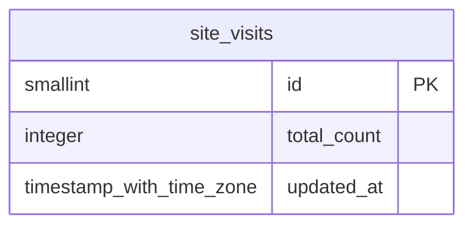

# Base de datos — dominio `site-visits`

Volver a [05_DATABASE_REFERENCE.md](../05_DATABASE_REFERENCE.md). Diagrama ER: llaves primarias (PK) y foráneas (FK) reales; las tablas de otros dominios referenciadas aparecen solo con su `id`. Se muestran hasta 14 columnas por tabla en el diagrama; la lista completa está en cada ficha.

## `site_visits`

- **Entidad TypeORM:** [SiteVisitsOrmEntity](../reference/backend/site-visits.md#f-comercial-jhoel-api-src-modules-site-visits-infrastructure-persistence-site-visits-orm-entity-ts)
- **Creada en:** `1760004200000-CreateSiteVisits.ts`
- **Archivos TypeScript que la usan:** [site-visits.orm-entity.ts](../reference/backend/site-visits.md#f-comercial-jhoel-api-src-modules-site-visits-infrastructure-persistence-site-visits-orm-entity-ts), [typeorm-site-visits.repository.ts](../reference/backend/site-visits.md#f-comercial-jhoel-api-src-modules-site-visits-infrastructure-persistence-typeorm-site-visits-repository-ts)

| Columna | Tipo | Nulo | Default |
|---|---|---|---|
| `id` | smallint | NOT NULL | 1 |
| `total_count` | integer | NOT NULL | 0 |
| `updated_at` | timestamp with time zone | NOT NULL | now() |

| Restricción | Tipo | Definición |
|---|---|---|
| `CHK_site_visits_singleton` | CHECK | CHECK ((id = 1)) |
| `CHK_site_visits_total_count_non_negative` | CHECK | CHECK ((total_count &gt;= 0)) |
| `site_visits_pkey` | PK | PRIMARY KEY (id) |

**Índices:**

- `site_visits_pkey`: CREATE UNIQUE INDEX site_visits_pkey ON public.site_visits USING btree (id)

