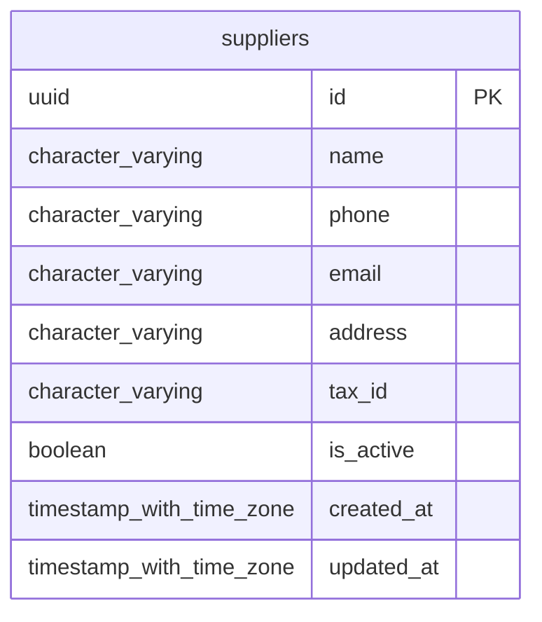

# Base de datos — dominio `suppliers`

Volver a [05_DATABASE_REFERENCE.md](../05_DATABASE_REFERENCE.md). Diagrama ER: llaves primarias (PK) y foráneas (FK) reales; las tablas de otros dominios referenciadas aparecen solo con su `id`. Se muestran hasta 14 columnas por tabla en el diagrama; la lista completa está en cada ficha.

## `suppliers`

- **Entidad TypeORM:** [SupplierOrmEntity](../reference/backend/suppliers.md#f-comercial-jhoel-api-src-modules-suppliers-infrastructure-persistence-supplier-orm-entity-ts)
- **Creada en:** migración no identificada por el análisis (creada con TypeORM `Table` o `createTable`)
- **Archivos TypeScript que la usan:** [supplier.orm-entity.ts](../reference/backend/suppliers.md#f-comercial-jhoel-api-src-modules-suppliers-infrastructure-persistence-supplier-orm-entity-ts)

| Columna | Tipo | Nulo | Default |
|---|---|---|---|
| `id` | uuid | NOT NULL | gen_random_uuid() |
| `name` | character varying(150) | NOT NULL |  |
| `phone` | character varying(20) | sí |  |
| `email` | character varying(150) | sí |  |
| `address` | character varying(255) | sí |  |
| `tax_id` | character varying(50) | sí |  |
| `is_active` | boolean | NOT NULL | true |
| `created_at` | timestamp with time zone | NOT NULL | now() |
| `updated_at` | timestamp with time zone | NOT NULL | now() |

| Restricción | Tipo | Definición |
|---|---|---|
| `PK_b70ac51766a9e3144f778cfe81e` | PK | PRIMARY KEY (id) |

**Índices:**

- `PK_b70ac51766a9e3144f778cfe81e`: CREATE UNIQUE INDEX "PK_b70ac51766a9e3144f778cfe81e" ON public.suppliers USING btree (id)
- `UQ_suppliers_tax_id_active`: CREATE UNIQUE INDEX "UQ_suppliers_tax_id_active" ON public.suppliers USING btree (tax_id) WHERE (is_active = true)

