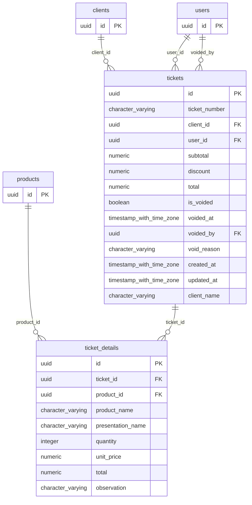

# Base de datos — dominio `tickets`

Volver a [05_DATABASE_REFERENCE.md](../05_DATABASE_REFERENCE.md). Diagrama ER: llaves primarias (PK) y foráneas (FK) reales; las tablas de otros dominios referenciadas aparecen solo con su `id`. Se muestran hasta 14 columnas por tabla en el diagrama; la lista completa está en cada ficha.

## `ticket_details`

- **Entidad TypeORM:** [TicketDetailOrmEntity](../reference/backend/tickets.md#f-comercial-jhoel-api-src-modules-tickets-infrastructure-persistence-ticket-detail-orm-entity-ts)
- **Creada en:** migración no identificada por el análisis (creada con TypeORM `Table` o `createTable`)
- **Archivos TypeScript que la usan:** [ticket-detail.orm-entity.ts](../reference/backend/tickets.md#f-comercial-jhoel-api-src-modules-tickets-infrastructure-persistence-ticket-detail-orm-entity-ts)
- **Funciones SQL que la escriben:** `create_ticket`

| Columna | Tipo | Nulo | Default |
|---|---|---|---|
| `id` | uuid | NOT NULL | gen_random_uuid() |
| `ticket_id` | uuid | NOT NULL |  |
| `product_id` | uuid | NOT NULL |  |
| `product_name` | character varying(150) | NOT NULL |  |
| `presentation_name` | character varying(50) | sí |  |
| `quantity` | integer | NOT NULL |  |
| `unit_price` | numeric(12,2) | NOT NULL |  |
| `total` | numeric(12,2) | NOT NULL |  |
| `observation` | character varying(255) | sí |  |

| Restricción | Tipo | Definición |
|---|---|---|
| `FK_ticket_details_product` | FK | FOREIGN KEY (product_id) REFERENCES products(id) ON DELETE RESTRICT |
| `FK_ticket_details_ticket` | FK | FOREIGN KEY (ticket_id) REFERENCES tickets(id) ON DELETE CASCADE |
| `PK_883aec56d7ab545277e892bd6c5` | PK | PRIMARY KEY (id) |

**Índices:**

- `IDX_ticket_details_ticket_id`: CREATE INDEX "IDX_ticket_details_ticket_id" ON public.ticket_details USING btree (ticket_id)
- `PK_883aec56d7ab545277e892bd6c5`: CREATE UNIQUE INDEX "PK_883aec56d7ab545277e892bd6c5" ON public.ticket_details USING btree (id)

## `tickets`

- **Entidad TypeORM:** [TicketOrmEntity](../reference/backend/tickets.md#f-comercial-jhoel-api-src-modules-tickets-infrastructure-persistence-ticket-orm-entity-ts)
- **Creada en:** migración no identificada por el análisis (creada con TypeORM `Table` o `createTable`)
- **Archivos TypeScript que la usan:** [ticket.orm-entity.ts](../reference/backend/tickets.md#f-comercial-jhoel-api-src-modules-tickets-infrastructure-persistence-ticket-orm-entity-ts)
- **Funciones SQL que la escriben:** `create_ticket`

| Columna | Tipo | Nulo | Default |
|---|---|---|---|
| `id` | uuid | NOT NULL | gen_random_uuid() |
| `ticket_number` | character varying(20) | NOT NULL |  |
| `client_id` | uuid | sí |  |
| `user_id` | uuid | NOT NULL |  |
| `subtotal` | numeric(12,2) | NOT NULL |  |
| `discount` | numeric(12,2) | NOT NULL | 0 |
| `total` | numeric(12,2) | NOT NULL |  |
| `is_voided` | boolean | NOT NULL | false |
| `voided_at` | timestamp with time zone | sí |  |
| `voided_by` | uuid | sí |  |
| `void_reason` | character varying(255) | sí |  |
| `created_at` | timestamp with time zone | NOT NULL | now() |
| `updated_at` | timestamp with time zone | NOT NULL | now() |
| `client_name` | character varying(150) | sí |  |

| Restricción | Tipo | Definición |
|---|---|---|
| `CHK_tickets_void_consistency` | CHECK | CHECK ((((is_voided = false) AND (voided_at IS NULL) AND (voided_by IS NULL) AND (void_reason IS NULL)) OR ((is_voided = true) AND (voided_at IS NOT NULL) AND (voided_by IS NOT NULL) AND (void_reason IS NOT NULL)))) |
| `FK_tickets_client` | FK | FOREIGN KEY (client_id) REFERENCES clients(id) ON DELETE RESTRICT |
| `FK_tickets_user` | FK | FOREIGN KEY (user_id) REFERENCES users(id) ON DELETE RESTRICT |
| `FK_tickets_voided_by` | FK | FOREIGN KEY (voided_by) REFERENCES users(id) ON DELETE RESTRICT |
| `PK_343bc942ae261cf7a1377f48fd0` | PK | PRIMARY KEY (id) |

**Índices:**

- `IDX_tickets_is_voided`: CREATE INDEX "IDX_tickets_is_voided" ON public.tickets USING btree (is_voided)
- `IDX_tickets_user_id`: CREATE INDEX "IDX_tickets_user_id" ON public.tickets USING btree (user_id)
- `PK_343bc942ae261cf7a1377f48fd0`: CREATE UNIQUE INDEX "PK_343bc942ae261cf7a1377f48fd0" ON public.tickets USING btree (id)
- `UQ_tickets_ticket_number`: CREATE UNIQUE INDEX "UQ_tickets_ticket_number" ON public.tickets USING btree (ticket_number)

