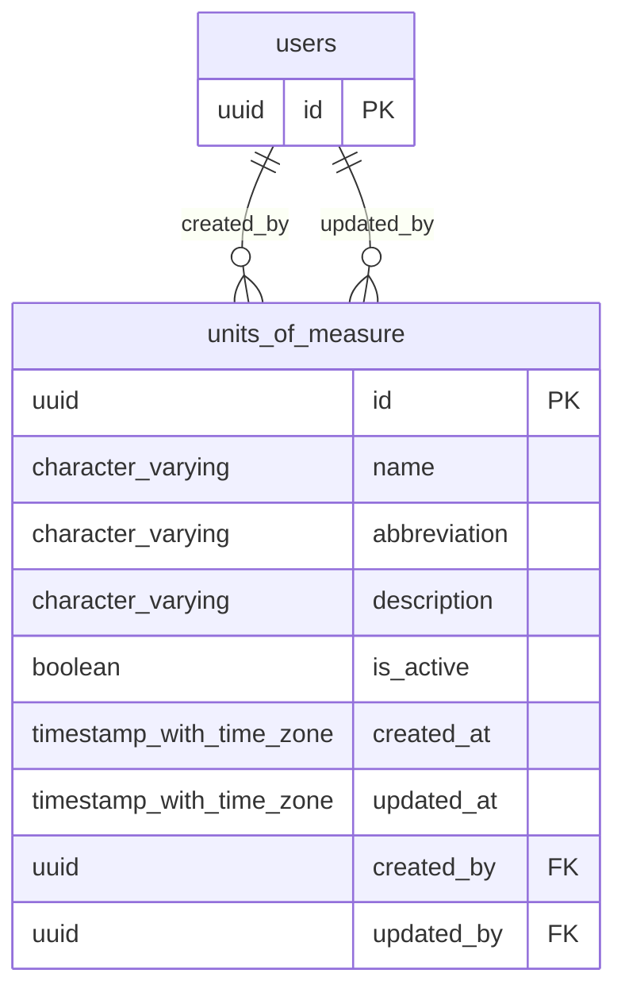

# Base de datos — dominio `units-of-measure`

Volver a [05_DATABASE_REFERENCE.md](../05_DATABASE_REFERENCE.md). Diagrama ER: llaves primarias (PK) y foráneas (FK) reales; las tablas de otros dominios referenciadas aparecen solo con su `id`. Se muestran hasta 14 columnas por tabla en el diagrama; la lista completa está en cada ficha.

## `units_of_measure`

- **Entidad TypeORM:** [UnitOfMeasureOrmEntity](../reference/backend/units-of-measure.md#f-comercial-jhoel-api-src-modules-units-of-measure-infrastructure-persistence-unit-of-measure-orm-entity-ts)
- **Creada en:** `1760000800000-CreateUnitsOfMeasureTable.ts`
- **Archivos TypeScript que la usan:** [unit-of-measure.orm-entity.ts](../reference/backend/units-of-measure.md#f-comercial-jhoel-api-src-modules-units-of-measure-infrastructure-persistence-unit-of-measure-orm-entity-ts)

| Columna | Tipo | Nulo | Default |
|---|---|---|---|
| `id` | uuid | NOT NULL | gen_random_uuid() |
| `name` | character varying(50) | NOT NULL |  |
| `abbreviation` | character varying(10) | NOT NULL |  |
| `description` | character varying(255) | sí |  |
| `is_active` | boolean | NOT NULL | true |
| `created_at` | timestamp with time zone | NOT NULL | now() |
| `updated_at` | timestamp with time zone | NOT NULL | now() |
| `created_by` | uuid | NOT NULL |  |
| `updated_by` | uuid | sí |  |

| Restricción | Tipo | Definición |
|---|---|---|
| `units_of_measure_created_by_fkey` | FK | FOREIGN KEY (created_by) REFERENCES users(id) ON DELETE RESTRICT |
| `units_of_measure_updated_by_fkey` | FK | FOREIGN KEY (updated_by) REFERENCES users(id) ON DELETE RESTRICT |
| `units_of_measure_pkey` | PK | PRIMARY KEY (id) |

**Índices:**

- `UQ_units_of_measure_abbreviation_active`: CREATE UNIQUE INDEX "UQ_units_of_measure_abbreviation_active" ON public.units_of_measure USING btree (lower((abbreviation)::text)) WHERE (is_active = true)
- `UQ_units_of_measure_name_active`: CREATE UNIQUE INDEX "UQ_units_of_measure_name_active" ON public.units_of_measure USING btree (lower((name)::text)) WHERE (is_active = true)
- `units_of_measure_pkey`: CREATE UNIQUE INDEX units_of_measure_pkey ON public.units_of_measure USING btree (id)

