# 01 · Vista general del sistema

Módulo: **Arquitectura general** · Fuente editable: [`01-system-overview.mmd`](01-system-overview.mmd) · [Índice de diagramas](README.md)

```mermaid
flowchart LR
  U(["Usuario"])
  subgraph FE["Frontend — Angular 19 (comercial-jhoel-app)"]
    R["app.routes.ts<br/>authGuard · adminGuard · guestGuard"]
    C["Componente standalone<br/>features/**/*.component.ts<br/>signals + OnPush"]
    S["Servicio HTTP / store<br/>core/services/*.service.ts · *.store.ts"]
    I["Interceptores<br/>authInterceptor (Bearer JWT)<br/>cashMutationInterceptor"]
  end
  subgraph API["Backend — NestJS 11 (comercial-jhoel-api)"]
    P["main.ts<br/>helmet · CORS · prefijo /api · ValidationPipe"]
    G{"¿JWT válido y rol permitido?<br/>JwtAuthGuard · RolesGuard"}
    CT["Controlador<br/>modules/*/presentation/controllers"]
    UC["Caso de uso<br/>modules/*/application/use-cases"]
    PO["Puerto de repositorio<br/>modules/*/domain/repositories"]
    RE["Repositorio TypeORM<br/>modules/*/infrastructure/persistence"]
    RI["ResponseInterceptor<br/>{ success: true, data }"]
    EF["GlobalExceptionFilter<br/>{ success: false, message }"]
  end
  subgraph DB["PostgreSQL 16"]
    FN[["Funciones PL/pgSQL<br/>register_* · apply_* · close_*"]]
    TB[("Tablas, Kardex y ledgers<br/>+ triggers")]
  end
  U -->|"acción"| C
  R -->|"loadComponent"| C
  C -->|"llama"| S
  S -->|"HttpClient"| I
  I -->|"HTTPS JSON"| P
  P --> G
  G -->|"sí"| CT
  G -->|"no: 401 / 403"| EF
  CT -->|"DTO validado"| UC
  UC -->|"@Inject(TOKEN)"| PO
  PO -.->|"implementa"| RE
  RE -->|"SELECT funcion(...) / SQL"| FN
  FN -->|"escribe"| TB
  RE -->|"consulta"| TB
  UC -->|"DomainError"| EF
  RE -->|"RAISE → DomainError"| EF
  CT --> RI
  RI -->|"respuesta"| S
  EF -->|"error"| S
  S -->|"r.data"| C
  C -->|"signals redibujan"| U
  classDef fe fill:#e3f2fd,stroke:#1565c0,color:#0d47a1
  classDef api fill:#ede7f6,stroke:#4527a0,color:#311b92
  classDef app fill:#e0f2f1,stroke:#00695c,color:#004d40
  classDef dom fill:#fff8e1,stroke:#f9a825,color:#5d4037
  classDef infra fill:#f3e5f5,stroke:#6a1b9a,color:#4a148c
  classDef db fill:#eceff1,stroke:#455a64,color:#263238
  classDef dec fill:#fffde7,stroke:#f57f17,color:#3e2723
  classDef err fill:#ffebee,stroke:#c62828,color:#b71c1c
  classDef start fill:#e8f5e9,stroke:#2e7d32,color:#1b5e20
  class U start
  class R,C,S,I fe
  class P,CT,RI api
  class UC app
  class PO dom
  class RE infra
  class FN,TB db
  class G dec
  class EF err
```

## Explicación

1. **¿Qué proceso representa?** El recorrido completo de una operación: usuario → componente Angular → servicio → HTTP con JWT → pipeline NestJS (guards, ValidationPipe) → controlador → caso de uso → puerto → repositorio TypeORM → función PL/pgSQL y tablas → respuesta → actualización de la interfaz.
2. **¿Dónde comienza?** Una acción del usuario en una pantalla (comercial-jhoel-app/src/app/features/**)
3. **¿Qué archivos intervienen?** [`comercial-jhoel-app/src/app/app.config.ts`](../../comercial-jhoel-app/src/app/app.config.ts), [`comercial-jhoel-app/src/app/app.routes.ts`](../../comercial-jhoel-app/src/app/app.routes.ts), [`comercial-jhoel-app/src/app/core/interceptors/auth.interceptor.ts`](../../comercial-jhoel-app/src/app/core/interceptors/auth.interceptor.ts), [`comercial-jhoel-app/src/app/core/interceptors/cash-mutation.interceptor.ts`](../../comercial-jhoel-app/src/app/core/interceptors/cash-mutation.interceptor.ts), [`comercial-jhoel-api/src/main.ts`](../../comercial-jhoel-api/src/main.ts), [`comercial-jhoel-api/src/app.module.ts`](../../comercial-jhoel-api/src/app.module.ts), [`comercial-jhoel-api/src/modules/auth/infrastructure/guards/jwt-auth.guard.ts`](../../comercial-jhoel-api/src/modules/auth/infrastructure/guards/jwt-auth.guard.ts), [`comercial-jhoel-api/src/modules/auth/infrastructure/guards/roles.guard.ts`](../../comercial-jhoel-api/src/modules/auth/infrastructure/guards/roles.guard.ts), [`comercial-jhoel-api/src/shared/interceptors/response.interceptor.ts`](../../comercial-jhoel-api/src/shared/interceptors/response.interceptor.ts), [`comercial-jhoel-api/src/shared/filters/global-exception.filter.ts`](../../comercial-jhoel-api/src/shared/filters/global-exception.filter.ts)
4. **¿Qué función ejecuta cada archivo?** Cada nodo muestra la clase y el método (`Clase.metodo`) y, debajo, la ruta del archivo. El color indica la capa: azul = frontend, morado = controlador, verde azulado = caso de uso, amarillo = dominio/puerto, lila = infraestructura, gris = PostgreSQL, amarillo claro = decisión, rojo = error.
5. **¿Qué decisiones toma el sistema?** ¿hay sesión? (authGuard en rutas) · ¿token válido? (JwtStrategy.validate) · ¿rol permitido? (RolesGuard) · ¿DTO válido? (ValidationPipe) · reglas del caso de uso · reglas de la función SQL
6. **¿Dónde se almacenan los datos?** PostgreSQL 16 (tablas, funciones PL/pgSQL, triggers)
7. **¿Cómo termina el proceso?** ResponseInterceptor envuelve { success: true, data }; el servicio Angular devuelve r.data y las signals redibujan la pantalla; cashMutationInterceptor avisa a otras pantallas/pestañas
8. **¿Qué sucede cuando ocurre un error?** Cualquier excepción termina en GlobalExceptionFilter → { success: false, statusCode, message }; un 401 hace que authInterceptor cierre la sesión

> Diagrama escrito a mano a partir del código; ver la sección de archivos.
