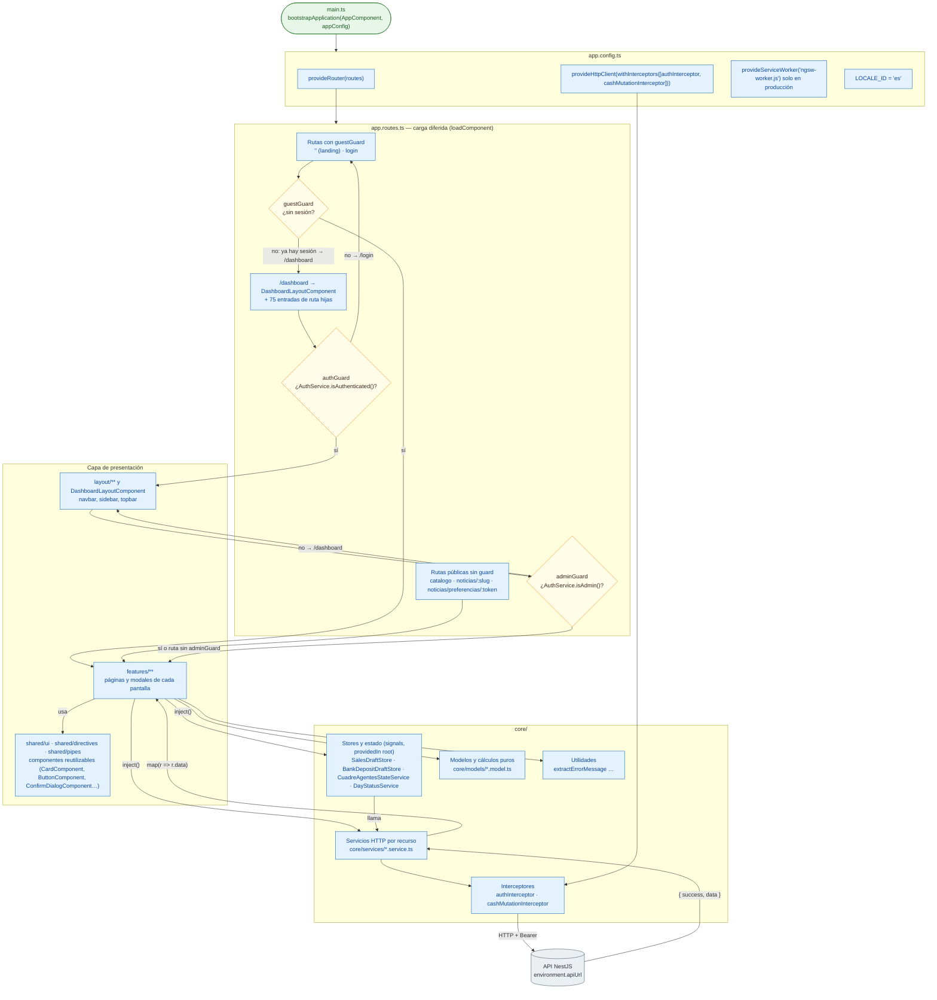

# 02 · Arquitectura del frontend (Angular 19)

Módulo: **Frontend** · Fuente editable: [`02-frontend-architecture.mmd`](02-frontend-architecture.mmd) · [Índice de diagramas](README.md)

## Explicación

1. **¿Qué proceso representa?** Cómo arranca la aplicación Angular, cómo se resuelven las rutas (con carga diferida y guards), qué capas tiene (features, shared/ui, core) y cómo fluye el estado (signals, stores singleton) hacia las llamadas HTTP.
2. **¿Dónde comienza?** comercial-jhoel-app/src/main.ts (bootstrapApplication(AppComponent, appConfig))
3. **¿Qué archivos intervienen?** [`comercial-jhoel-app/src/main.ts`](../../comercial-jhoel-app/src/main.ts), [`comercial-jhoel-app/src/app/app.config.ts`](../../comercial-jhoel-app/src/app/app.config.ts), [`comercial-jhoel-app/src/app/app.routes.ts`](../../comercial-jhoel-app/src/app/app.routes.ts), [`comercial-jhoel-app/src/app/core/guards/auth.guard.ts`](../../comercial-jhoel-app/src/app/core/guards/auth.guard.ts), [`comercial-jhoel-app/src/app/core/guards/admin.guard.ts`](../../comercial-jhoel-app/src/app/core/guards/admin.guard.ts), [`comercial-jhoel-app/src/app/core/guards/guest.guard.ts`](../../comercial-jhoel-app/src/app/core/guards/guest.guard.ts), [`comercial-jhoel-app/src/app/features/dashboard/dashboard-layout.component.ts`](../../comercial-jhoel-app/src/app/features/dashboard/dashboard-layout.component.ts), [`comercial-jhoel-app/src/app/core/services/auth.service.ts`](../../comercial-jhoel-app/src/app/core/services/auth.service.ts), [`comercial-jhoel-app/src/app/core/services/sales-draft.store.ts`](../../comercial-jhoel-app/src/app/core/services/sales-draft.store.ts), [`comercial-jhoel-app/src/app/core/services/cuadre-agentes-state.service.ts`](../../comercial-jhoel-app/src/app/core/services/cuadre-agentes-state.service.ts), [`comercial-jhoel-app/src/app/core/models/index.ts`](../../comercial-jhoel-app/src/app/core/models/index.ts), [`comercial-jhoel-app/src/app/shared/ui/index.ts`](../../comercial-jhoel-app/src/app/shared/ui/index.ts), [`comercial-jhoel-app/src/environments/environment.ts`](../../comercial-jhoel-app/src/environments/environment.ts)
4. **¿Qué función ejecuta cada archivo?** Cada nodo muestra la clase y el método (`Clase.metodo`) y, debajo, la ruta del archivo. El color indica la capa: azul = frontend, morado = controlador, verde azulado = caso de uso, amarillo = dominio/puerto, lila = infraestructura, gris = PostgreSQL, amarillo claro = decisión, rojo = error.
5. **¿Qué decisiones toma el sistema?** guestGuard en '' y login (¿sin sesión? → muestra la página; con sesión → /dashboard), authGuard (¿sesión? → /dashboard, si no /login), adminGuard (¿isAdmin()? → si no /dashboard)
6. **¿Dónde se almacenan los datos?** En el navegador: localStorage (token cj_auth_token y sesión), sessionStorage en algunos borradores, signals en stores providedIn root; los datos reales viven en el backend
7. **¿Cómo termina el proceso?** El componente pinta la plantilla con sus signals; un cambio de signal redibuja (OnPush)
8. **¿Qué sucede cuando ocurre un error?** Los guards redirigen (no lanzan); los errores HTTP llegan a cada componente, que usa extractErrorMessage y NotificationService

> Diagrama escrito a mano a partir del código; ver la sección de archivos.
