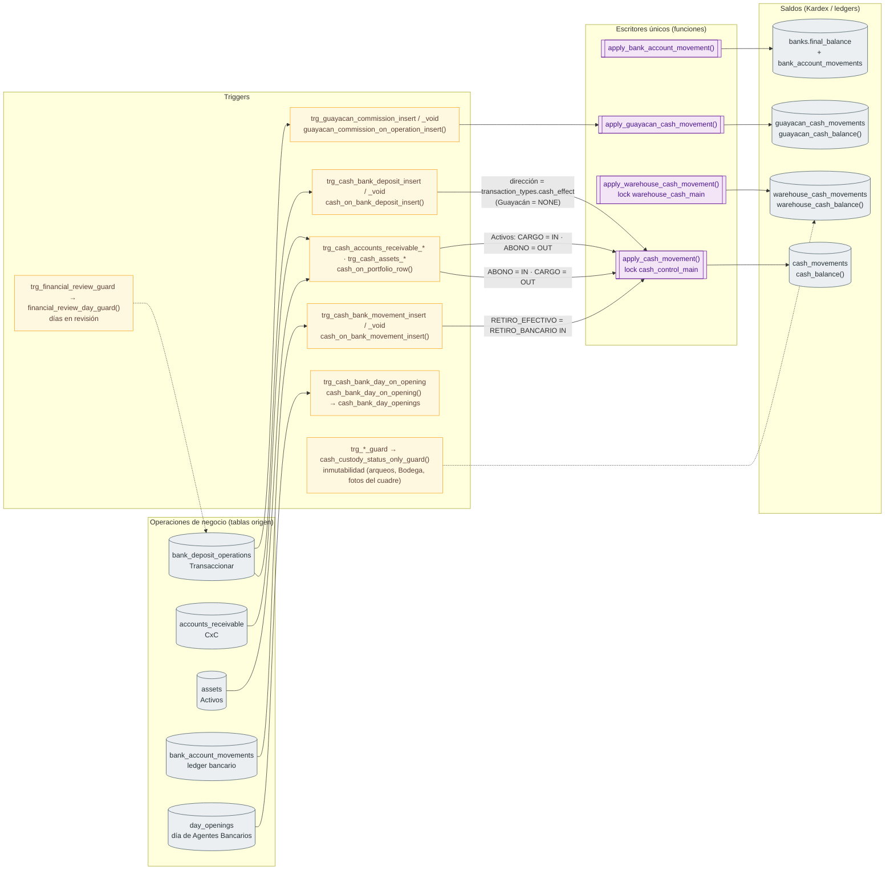

# 04 · Arquitectura de la base de datos: escritores únicos, ledgers y triggers

Módulo: **Base de datos** · Fuente editable: [`04-database-architecture.mmd`](04-database-architecture.mmd) · [Índice de diagramas](README.md)

## Explicación

1. **¿Qué proceso representa?** Qué función PL/pgSQL es la única que escribe cada saldo (banco, caja, Bodega, Guayacán), qué triggers convierten operaciones de otros módulos en movimientos de efectivo y qué guards protegen la inmutabilidad y la revisión de días.
2. **¿Dónde comienza?** Una función de registro llamada desde un repositorio (SELECT register_…(...))
3. **¿Qué archivos intervienen?** [`comercial-jhoel-api/src/database/migrations/1760005100000-CreateBankAccountMovements.ts`](../../comercial-jhoel-api/src/database/migrations/1760005100000-CreateBankAccountMovements.ts), [`comercial-jhoel-api/src/database/migrations/1760006800000-CreateCashControlKardexAndCuts.ts`](../../comercial-jhoel-api/src/database/migrations/1760006800000-CreateCashControlKardexAndCuts.ts), [`comercial-jhoel-api/src/database/migrations/1760007400000-CashCountsAndWarehouseCustody.ts`](../../comercial-jhoel-api/src/database/migrations/1760007400000-CashCountsAndWarehouseCustody.ts), [`comercial-jhoel-api/src/database/migrations/1760007500000-WarehouseWithdrawals.ts`](../../comercial-jhoel-api/src/database/migrations/1760007500000-WarehouseWithdrawals.ts), [`comercial-jhoel-api/src/database/migrations/1760006300000-CreateGuayacanCashBox.ts`](../../comercial-jhoel-api/src/database/migrations/1760006300000-CreateGuayacanCashBox.ts), [`comercial-jhoel-api/src/database/migrations/1760007100000-FinancialDayReview.ts`](../../comercial-jhoel-api/src/database/migrations/1760007100000-FinancialDayReview.ts)
4. **¿Qué función ejecuta cada archivo?** Cada nodo muestra la clase y el método (`Clase.metodo`) y, debajo, la ruta del archivo. El color indica la capa: azul = frontend, morado = controlador, verde azulado = caso de uso, amarillo = dominio/puerto, lila = infraestructura, gris = PostgreSQL, amarillo claro = decisión, rojo = error.
5. **¿Qué decisiones toma el sistema?** Cada escritor bloquea (FOR UPDATE o pg_advisory_xact_lock) y valida antes de escribir; los triggers deciden la dirección (IN/OUT/NONE) según el tipo de movimiento
6. **¿Dónde se almacenan los datos?** banks.final_balance + bank_account_movements · cash_movements · warehouse_cash_movements · guayacan_cash_movements
7. **¿Cómo termina el proceso?** COMMIT de la transacción de la función que inició la operación
8. **¿Qué sucede cuando ocurre un error?** Un RAISE EXCEPTION en cualquier escritor o trigger revierte toda la operación; trg_*_guard rechaza UPDATE/DELETE en tablas inmutables; trg_financial_review_guard bloquea días en revisión

> Diagrama escrito a mano a partir del código; ver la sección de archivos.
