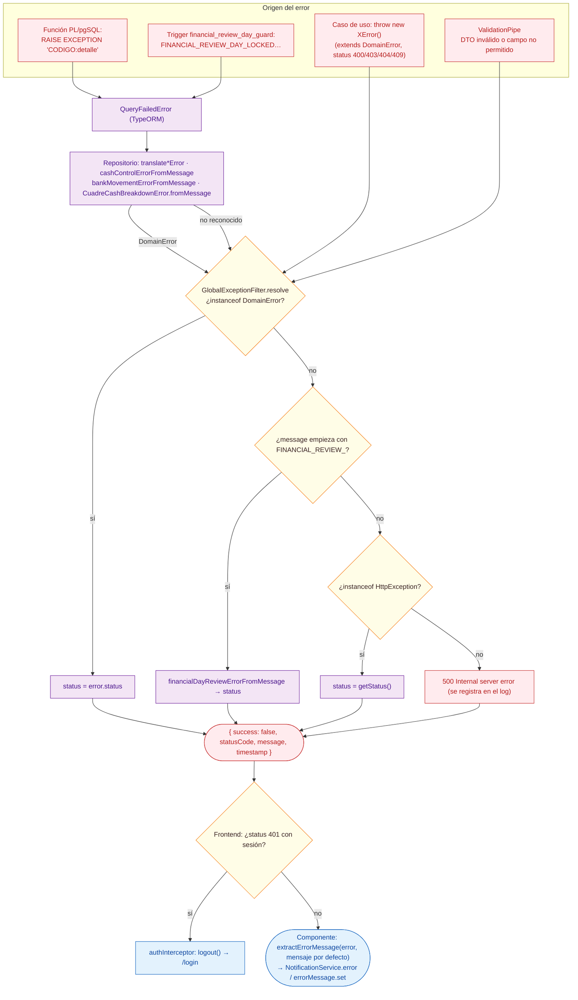

# 07 · Gestión de errores (de PostgreSQL a la pantalla)

Módulo: **Transversal** · Fuente editable: [`07-error-handling.mmd`](07-error-handling.mmd) · [Índice de diagramas](README.md)

## Explicación

1. **¿Qué proceso representa?** Cómo un error de cualquier capa (validación del DTO, regla del caso de uso, RAISE EXCEPTION de una función SQL, trigger de revisión de días) se convierte en una respuesta JSON uniforme y en un mensaje en la pantalla.
2. **¿Dónde comienza?** Una regla que no se cumple en cualquier capa
3. **¿Qué archivos intervienen?** [`comercial-jhoel-api/src/shared/domain/domain-error.ts`](../../comercial-jhoel-api/src/shared/domain/domain-error.ts), [`comercial-jhoel-api/src/shared/filters/global-exception.filter.ts`](../../comercial-jhoel-api/src/shared/filters/global-exception.filter.ts), [`comercial-jhoel-api/src/modules/cash-control/domain/errors/cash-control.errors.ts`](../../comercial-jhoel-api/src/modules/cash-control/domain/errors/cash-control.errors.ts), [`comercial-jhoel-api/src/modules/banks/domain/errors/bank-movement.errors.ts`](../../comercial-jhoel-api/src/modules/banks/domain/errors/bank-movement.errors.ts), [`comercial-jhoel-api/src/modules/banks/infrastructure/persistence/typeorm-agent-reconciliation.repository.ts`](../../comercial-jhoel-api/src/modules/banks/infrastructure/persistence/typeorm-agent-reconciliation.repository.ts), [`comercial-jhoel-app/src/app/core/interceptors/auth.interceptor.ts`](../../comercial-jhoel-app/src/app/core/interceptors/auth.interceptor.ts), [`comercial-jhoel-app/src/app/core/utils/extract-error-message.ts`](../../comercial-jhoel-app/src/app/core/utils/extract-error-message.ts)
4. **¿Qué función ejecuta cada archivo?** Cada nodo muestra la clase y el método (`Clase.metodo`) y, debajo, la ruta del archivo. El color indica la capa: azul = frontend, morado = controlador, verde azulado = caso de uso, amarillo = dominio/puerto, lila = infraestructura, gris = PostgreSQL, amarillo claro = decisión, rojo = error.
5. **¿Qué decisiones toma el sistema?** GlobalExceptionFilter.resolve: ¿DomainError? → su status · ¿mensaje FINANCIAL_REVIEW_*? → error de revisión (409) · ¿HttpException? → su status · si no → 500
6. **¿Dónde se almacenan los datos?** No escribe; un RAISE revierte la transacción completa
7. **¿Cómo termina el proceso?** JSON { success: false, statusCode, message, timestamp }; la pantalla muestra message
8. **¿Qué sucede cuando ocurre un error?** Los 5xx se registran en el log (status >= 500)

> Diagrama escrito a mano a partir del código; ver la sección de archivos.
