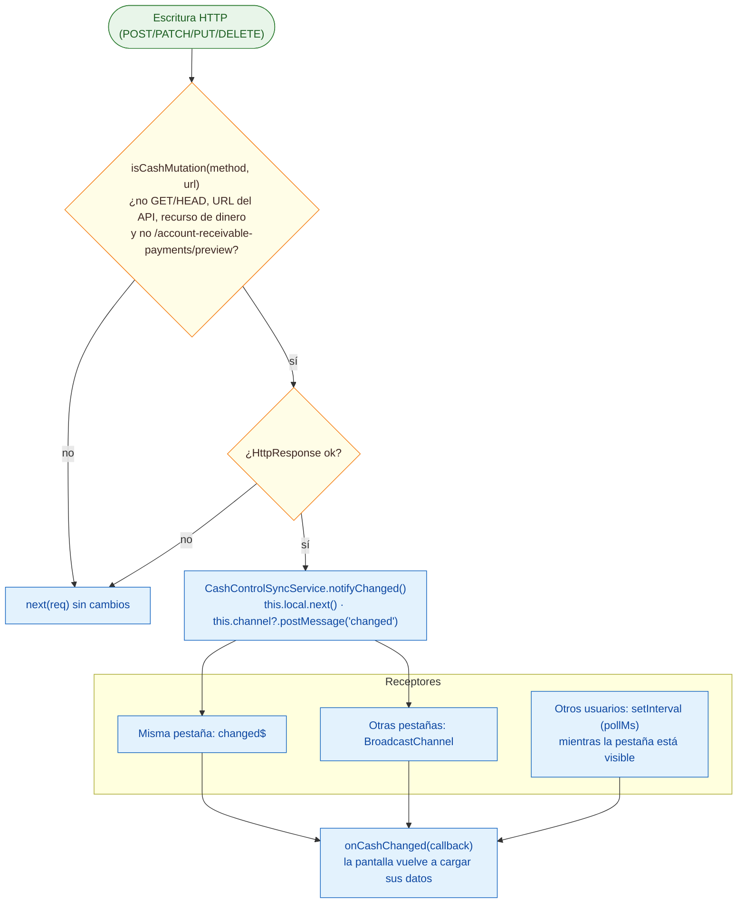

# 08 · Actualización "en tiempo real" de las pantallas de efectivo

Módulo: **Frontend — Control de Efectivo y pantallas financieras** · Fuente editable: [`08-realtime-updates.mmd`](08-realtime-updates.mmd) · [Índice de diagramas](README.md)

## Explicación

1. **¿Qué proceso representa?** No hay WebSockets en el proyecto. La actualización entre pantallas y pestañas se hace con cashMutationInterceptor + CashControlSyncService (Subject local + BroadcastChannel) y, para cambios de otros usuarios, con sondeo periódico (setInterval) mientras la pestaña está visible.
2. **¿Dónde comienza?** Una escritura exitosa (no GET) a un recurso de dinero
3. **¿Qué archivos intervienen?** [`comercial-jhoel-app/src/app/core/interceptors/cash-mutation.interceptor.ts`](../../comercial-jhoel-app/src/app/core/interceptors/cash-mutation.interceptor.ts), [`comercial-jhoel-app/src/app/core/services/cash-control-sync.service.ts`](../../comercial-jhoel-app/src/app/core/services/cash-control-sync.service.ts), [`comercial-jhoel-app/src/app/app.config.ts`](../../comercial-jhoel-app/src/app/app.config.ts)
4. **¿Qué función ejecuta cada archivo?** Cada nodo muestra la clase y el método (`Clase.metodo`) y, debajo, la ruta del archivo. El color indica la capa: azul = frontend, morado = controlador, verde azulado = caso de uso, amarillo = dominio/puerto, lila = infraestructura, gris = PostgreSQL, amarillo claro = decisión, rojo = error.
5. **¿Qué decisiones toma el sistema?** isCashMutation: ¿método distinto de GET/HEAD? ¿URL de environment.apiUrl? ¿recurso bank-deposits|accounts-receivable|account-receivable-payments|assets|bank-transfers|cash-control? ¿no es /account-receivable-payments/preview? · ¿respuesta ok?
6. **¿Dónde se almacenan los datos?** Ninguno (solo notificaciones en memoria y entre pestañas del mismo navegador)
7. **¿Cómo termina el proceso?** Las pantallas suscritas con onCashChanged(callback) vuelven a pedir sus datos
8. **¿Qué sucede cuando ocurre un error?** Si la respuesta HTTP falla no se notifica nada; si BroadcastChannel no existe en el navegador solo se notifica la pestaña actual

> Diagrama escrito a mano a partir del código; ver la sección de archivos.
