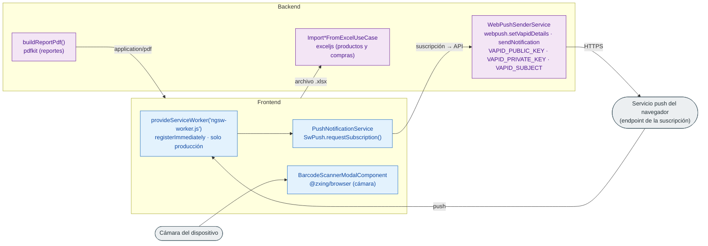

# 09 · Integraciones externas

Módulo: **Transversal** · Fuente editable: [`09-external-integrations.mmd`](09-external-integrations.mmd) · [Índice de diagramas](README.md)

## Explicación

1. **¿Qué proceso representa?** Integraciones con servicios o capacidades externas encontradas en el código: Web Push (VAPID) para noticias, PDF con pdfkit, importación de Excel con exceljs, lectura de códigos de barras con la cámara (ZXing) y el Service Worker de Angular.
2. **¿Dónde comienza?** Según la integración (ver nodos)
3. **¿Qué archivos intervienen?** [`comercial-jhoel-api/src/modules/news-subscriptions/infrastructure/services/web-push-sender.service.ts`](../../comercial-jhoel-api/src/modules/news-subscriptions/infrastructure/services/web-push-sender.service.ts), [`comercial-jhoel-app/src/app/core/services/push-notification.service.ts`](../../comercial-jhoel-app/src/app/core/services/push-notification.service.ts), [`comercial-jhoel-app/src/app/app.config.ts`](../../comercial-jhoel-app/src/app/app.config.ts), [`comercial-jhoel-api/src/modules/reports/infrastructure/pdf/report-pdf.builder.ts`](../../comercial-jhoel-api/src/modules/reports/infrastructure/pdf/report-pdf.builder.ts), [`comercial-jhoel-api/src/modules/purchases/application/use-cases/import-purchase-from-excel.use-case.ts`](../../comercial-jhoel-api/src/modules/purchases/application/use-cases/import-purchase-from-excel.use-case.ts), [`comercial-jhoel-api/src/modules/products/application/use-cases/import-products-from-excel.use-case.ts`](../../comercial-jhoel-api/src/modules/products/application/use-cases/import-products-from-excel.use-case.ts), [`comercial-jhoel-app/src/app/shared/ui/barcode-scanner-modal/barcode-scanner-modal.component.ts`](../../comercial-jhoel-app/src/app/shared/ui/barcode-scanner-modal/barcode-scanner-modal.component.ts)
4. **¿Qué función ejecuta cada archivo?** Cada nodo muestra la clase y el método (`Clase.metodo`) y, debajo, la ruta del archivo. El color indica la capa: azul = frontend, morado = controlador, verde azulado = caso de uso, amarillo = dominio/puerto, lila = infraestructura, gris = PostgreSQL, amarillo claro = decisión, rojo = error.
5. **¿Qué decisiones toma el sistema?** Service Worker solo en producción (enabled: !isDevMode())
6. **¿Dónde se almacenan los datos?** Suscripciones push en la base (módulo news-subscriptions); los PDF y Excel no se guardan, se generan o leen en memoria
7. **¿Cómo termina el proceso?** Notificación entregada al navegador / archivo PDF descargado / productos o compra importados / código leído en el formulario
8. **¿Qué sucede cuando ocurre un error?** Cada integración maneja sus errores en su propio servicio (ver el archivo)

> Diagrama escrito a mano a partir del código; ver la sección de archivos.
